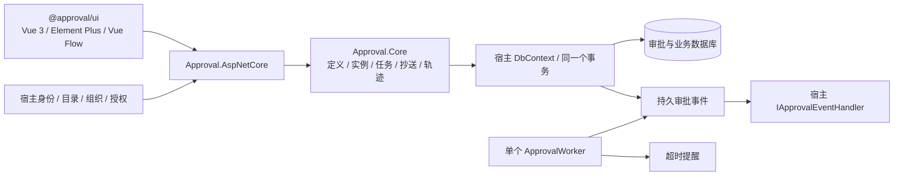

# Approval.Core — 嵌入式通用审批引擎

一个供 .NET 业务应用引用的审批类库。单实例、同进程，复用宿主 DI、DbContext 和数据库事务；用户认证、用户/部门/岗位/角色、权限、消息渠道和业务状态由宿主提供。没有多租户运行模式、Redis、消息队列、分布式锁、Leader 选举或脚本沙箱。

业务表单由宿主提供。可选的现有表单组件用于申请数据快照、变量、条件与附件，不需要建设独立表单平台。



## 能力

| 范围 | 已提供行为 |
|---|---|
| 定义生命周期 | 新建、保存/恢复设计草稿、只读草稿预览、校验、发布、停用、复制为新草稿、历史版本和基于历史版本编辑；列表按草稿/选用版本分类并由服务端筛选 |
| 版本不变量 | 发布版本不可修改；实例固定 DefinitionId/Version；发布失败不替换当前版本；停用不影响在途审批 |
| 审批 | 或签 Any、会签 All、依次 Sequential；指定用户/角色、部门负责人/上级/逐级上级和宿主自定义解析器 |
| 状态与操作 | Running、Returned、Approved、Rejected、Withdrawn、Terminated；同意、驳回结束、历史节点退回、申请人修改重提、撤回、转交、前/后/并加签、授权终止/改派 |
| 并行 | 结构化并行分叉/全部汇聚、嵌套条件和并行；保存汇聚激活标识及分支到达去重；拒绝跨分支非法退回；终止/驳回清理全部活动任务 |
| 抄送中心 | 独立抄送关系、角色接收、分页列表、未读筛选、每用户阅读状态、抄送详情及历史；受权分页查看角色当前人员（明确不是历史快照）；不进入审批待办 |
| 查询 | 待办、已办、我发起、抄送、实例、轨迹；数据库内过滤/排序/分页，标题/业务编号/实例 ID、状态/定义/业务类型/人员/UTC 时间范围 |
| 轨迹 | 只追加的 Sequence、操作人、节点、操作、意见、UTC 时间和可选任务 ID；进入节点、退回、重提、转交、加签、结束均记录 |
| 一致性 | 实例乐观并发、业务单据唯一占用、稳定命令键、事务回滚、提交结果未知核验；业务回调与审批同事务 |
| 事件 | 注册宿主统一处理器后自动记录生命周期事件；Outbox 至少一次、稳定事件 ID、退避、重试上限与手动重试 |
| 后台 | 单个 Worker 串行执行投递、超时扫描；默认超时只提醒，自动决定需宿主显式启用；可选维护默认关闭 |

并行默认等待全部分支；没有引入动态循环、任意跳转或通用自动化平台。通用动作执行器、参数模板/输出映射、Sync/Async 步骤和失败继续均已删除。Action 协议、扫描入口和兼容执行代码均已移除，未知节点类型或额外动作字段作为无效输入拒绝。宿主准备工作使用 `IApprovalLifecycleHandler`，结束业务使用 `IApprovalBusinessHandler`，外部副作用使用可靠事件。

## 最小宿主接入

```csharp
public sealed class AppDbContext(DbContextOptions<AppDbContext> options) : ApprovalDbContext(options)
{
    protected override void OnModelCreating(ModelBuilder model) => model.ConfigureApproval(this);
}

builder.Services.AddScoped<IApprovalIdentityProvider, HostIdentity>();
builder.Services.AddApprovalAspNetCore(); // 默认从可信 Claims 识别当前用户
builder.Services.AddApprovalWorkflow<AppDbContext>()
    .AddUserDirectory<HostDirectory>() // 返回用户及 IsActive，或提供 IApprovalUserStatusProvider
    .AddOrganizationProvider<HostOrganization>()
    .AddPermissionProvider<HostPermissions>()
    .AddBusinessHandler<ContractApprovalHandler>()
    .AddEventHandler<HostApprovalEventHandler>();
app.UseExceptionHandler();
app.MapApprovalEndpoints().RequireAuthorization();
```

宿主必须提供用户目录或状态接口，未知/停用用户不能发起或处理审批、接受转交/加签/改派。引擎校验服务端 Actor 与操作者参数一致；前端提交 userId/operatorId 不会改变可信身份。权限码是引擎向宿主询问的动作标识，不是独立 RBAC 系统。

宿主整段业务写入放入 `IApprovalCommandExecutor` 委托，不能把裸外部事务传给引擎。业务完成回调只修改共享 DbContext 的跟踪实体，不自行保存或提交；远程通知使用 `IApprovalEventHandler`，按 ApprovalEvent.Id 幂等。

前端保持 Vue 3 + Element Plus。用 `ApprovalUI` 或 `createApprovalClient` 接入宿主请求/令牌刷新桥接；`userKey` 随可信用户/会话变化更新。人员选择器调用宿主目录，不再提供手工创建假用户的正式路径。

## 项目结构

- `src/Approval.Core`：审批领域、EF 模型、事务、查询、可靠事件和单 Worker。
- `src/Approval.AspNetCore`：可选 HTTP 适配、可信身份、权限与 DTO。
- `web/packages/approval-ui`：可引用的 UI；`web/apps/demo` 是示例宿主。
- `samples/Approval.Certificate` / `Certificate.Api`：证书业务及宿主示例。
- `samples/Approval.ReferenceHost`：业务无关的单宿主认证/目录/授权参考，不建设组织或 RBAC 产品。
- 九套 EF 上下文各保留一条当前模型的 `InitialApproval`，直接初始化新库；没有旧库升级、租户回填或程序集转发工具。

## 文档与验收

- [宿主接入与公共接口](docs/embedded-host-integration.md)
- [状态、查询、事件与迁移](docs/embedded-approval-completion.md)
- [审查与前批记录](docs/embedded-approval-review.md)
- [事务与命令幂等](docs/transactions-and-idempotency.md)
- [数据库验证](docs/database-validation.md)

```powershell
Set-Location -LiteralPath 'D:\Study\CSharp\Workflow'
pwsh -NoProfile -File 'eng/verify.ps1' -Scope 'All'
```

入口包含构建、测试、模型漂移、真实 Kestrel 冒烟、前端 typecheck/测试/构建、契约检查及独立 NuGet/npm 消费者和浏览器验证。本地测试制品保存在 `output/`；不自动提交、推送、发布或部署。真实三库和认证/备份/网络演练有独立显式入口，结果以本次实际日志为准。
