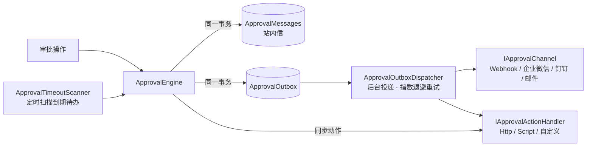

# Approval.Core — 通用审批流程框架

一个面向“业务单据 + 多角色审核”场景的轻量审批引擎。业务模块只需提供业务回调即可接入，审批的定义、流转、待办、轨迹由框架统一处理。

```
src/Approval.Core            框架本体（只依赖 EF Core Relational + DynamicExpresso）
tests/Approval.Core.Tests    单元测试（SQLite 内存库）
samples/Certificate.Api      示例：证书新增 / 变更 / 注销的多角色审核
web/approval-ui              前端：Vue 3 + Element Plus + Vue Flow（审批工作台、证书管理、流程设计器）
```

## 前端界面

| 页面 | 功能 |
|---|---|
| 审批工作台 `/workbench` | 我的待办（含角色任务）、我已处理、我发起的 |
| 审批详情 `/approvals/:id` | 同意 / 驳回 / 转交 / 撤回；业务内容（证书显示变更前后对比）；按实例版本绘制的只读流程图，高亮已完成、进行中、已驳回节点和走过的路径；审批轨迹 |
| 证书管理 `/certificates` | 申请新增 / 变更 / 注销，审核中的证书加锁提示，申请记录 |
| 流程定义 `/definitions` | 流程列表、新建、版本历史（可基于任一历史版本编辑） |
| 流程设计器 `/designer/:key` | 从左侧面板拖放节点到任意位置、拖到连线上自动插入（A→新节点→B）、撤销 / 重做（Ctrl+Z / Ctrl+Y）；属性面板配置审批人、审批方式、条件分支、动作步骤、节点通知、处理时限；流程级通知；自动排版、服务端校验、发布新版本（仅 Admin） |
| 站内信（右上角铃铛） | 未读数、消息列表、点击跳转审批详情 |
| 投递记录 `/outbox` | 外部渠道通知与异步动作的投递状态、重试次数、错误、手动重试；演示用 Webhook 接收端可模拟故障（仅 Admin） |

```
web/approval-ui/src
├─ api/                 后端接口与类型
├─ features/
│  ├─ flow/             流程模型转换（flowModel.ts，含单元测试）、画布、节点卡片、只读流程图
│  ├─ designer/         设计器状态（useFlowDesigner）与面板组件
│  ├─ approval/         审批详情：操作栏、轨迹、业务面板注册表（businessPanels.ts）
│  ├─ certificates/     证书业务组件
│  ├─ definitions/      流程定义列表
│  └─ workbench/        工作台列表
└─ views/               路由页面（只做组合）
```

**接入新业务的前端部分**：在 `features/approval/businessPanels.ts` 注册 `BusinessType → 详情组件`（组件接收 `businessKey`），审批详情页即可展示该业务的单据内容；未注册的业务显示原始表单数据。

## 核心概念

```mermaid
flowchart LR
    Biz[业务模块<br/>如 CertificateService] -- StartAsync --> Engine[ApprovalEngine]
    Engine --> Def[(ApprovalDefinitions<br/>流程定义·多版本)]
    Engine --> Inst[(ApprovalInstances<br/>流程实例)]
    Engine --> Task[(ApprovalTasks<br/>待办任务)]
    Engine --> Log[(ApprovalLogs<br/>审批轨迹)]
    Engine -- 流程结束回调 --> Handler[IApprovalBusinessHandler<br/>如 CertificateApprovalHandler]
    Engine -. 查询用户/角色 .-> Identity[IApprovalIdentityProvider]
    Engine -. 提交后通知 .-> Notifier[IApprovalNotifier]
```



| 能力 | 说明 |
|---|---|
| 节点类型 | `Start` / `Approval` / `Cc`（抄送）/ `Condition`（条件分支）/ `End` |
| 审批方式 | `Any` 或签（角色内任意一人）、`All` 会签、`Sequential` 依次审批 |
| 审批人 | 内置 `User`、`Role`、`FormField`、`Initiator`，可注册自定义解析器（如“部门负责人”） |
| 操作 | 发起、同意、驳回、撤回、转交 |
| 规则 | 禁止自审、同一单据单个进行中流程、可选“同一人不能审多个节点”、找不到审批人时报错或自动通过 |
| 版本 | 发布即生成新版本；进行中的实例继续按发起时的版本流转 |
| 一致性 | 审批状态与业务回调同一个 DbContext / 事务提交；乐观并发防止会签时并发审批丢失更新 |

## 接入一个新业务（3 步）

**1. 在宿主 DbContext 中加入审批表**

```csharp
protected override void OnModelCreating(ModelBuilder modelBuilder)
{
    modelBuilder.ConfigureApproval();   // 审批表与业务表共用 DbContext → 同一事务
    // ... 业务实体配置
}
```

**2. 注册框架、身份提供者与业务回调**

```csharp
builder.Services.AddScoped<IApprovalIdentityProvider, MyIdentityProvider>();  // 对接你的用户/角色体系
builder.Services
    .AddApprovalWorkflow<AppDbContext>(o => o.AllowInitiatorApprove = false)
    .AddBusinessHandler<ContractApprovalHandler>()        // 每个 BusinessType 一个
    .AddApproverResolver<DeptLeaderResolver>()            // 可选：自定义审批人规则
    .AddNotifier<WeComNotifier>();                        // 可选：站内信 / 企业微信 / 邮件
```

**3. 业务提交时发起审批，结束时在回调中生效**

```csharp
// 提交：业务数据与审批实例在同一次 SaveChanges 中提交
await engine.StartAsync(new StartApprovalRequest("contract.sign", "Contract", contract.Id.ToString(), userId)
{
    Title = $"合同 {contract.No}",
    FormData = new { amount = contract.Amount }       // 条件分支可用：amount > 100000
});

// 回调：在引擎 SaveChanges 之前执行，抛异常则审批操作整体回滚
public sealed class ContractApprovalHandler(AppDbContext db) : IApprovalBusinessHandler
{
    public string BusinessType => "Contract";
    public async Task OnApprovedAsync(ApprovalInstance i, CancellationToken ct) { /* 合同生效 */ }
    public async Task OnRejectedAsync(ApprovalInstance i, CancellationToken ct) { /* 退回草稿 */ }
}
```

通用审批接口（待办、同意、驳回、转交、撤回、详情）所有业务共用，参见 `samples/Certificate.Api/Endpoints/ApprovalEndpoints.cs`。

## 动作、通知与超时



| 能力 | 说明 |
|---|---|
| 动作节点 `Action` | 依次执行步骤：内置 `Http`（主机白名单防 SSRF、`Idempotency-Key`）、`Script`（Jint 沙箱，限制时间 / 内存 / 语句数 / 递归，无 .NET 访问）、宿主注册的动作（`AddActionHandler<T>()`，设计器按参数描述自动生成表单） |
| 同步 / 异步 | 同步在审批事务内执行，失败回滚（可选“失败继续”），输出写入表单变量供后续条件使用，如 `risk.body.level == "high"`；异步写入 Outbox 由后台执行并重试 |
| 参数模板 | `{标题}`、`{申请人}`、`{form.certNo}`、`{appBaseUrl}` 等；`{x\|json}` / `{x\|url}` 指定转义，HTTP 请求体默认按 JSON 转义；脚本代码不做替换（防注入） |
| 节点通知 | 事件：到达节点、同意、驳回、转交、超时提醒、流程结束；接收人：当前审批人、申请人、已审批过的人、角色、用户、表单字段；渠道：站内信（内置）+ 已注册渠道；模板同上 |
| 可靠发送 | 站内信与 Outbox 与审批数据同一事务提交；后台任务投递，失败按 `BaseRetryDelay × 2^(n-1)` 重试，超过次数标记失败可手动重试；多实例通过租约 + 并发令牌防重复 |
| 超时 | 审批节点 `timeout`：到期后提醒（可按间隔重复催办、限制次数）/ 自动同意 / 自动驳回；依次审批轮到时才开始计时，转交不重置时限 |

```csharp
builder.Services.AddApprovalWorkflow<AppDbContext>(o =>
    {
        o.Http.AllowedHosts.Add("*.mycompany.com");            // HTTP 动作白名单
        o.InstanceUrlFormat = "https://oa.mycompany.com/approvals/{0}";
    })
    .AddActionHandler<CertificateExpiryCheckAction>()          // 注册动作
    .AddContactProvider<MyContactProvider>()                    // 用户邮箱 / 企业微信 ID
    .AddWeComRobotChannel(o => o.WebhookUrl = config["WeCom:WebhookUrl"]!)
    .AddDingTalkRobotChannel(o => { o.WebhookUrl = "..."; o.Secret = "..."; })
    .AddEmailChannel(o => config.GetSection("Smtp").Bind(o))
    .AddChannel<MySmsChannel>();                                // 自定义渠道
```

示例 `certificate.create` 流程演示了全部能力：自动预检（注册动作 + 脚本）→ 临期证书走安全审核 → 部门审核 24 小时时限与催办 → 通过后异步推送档案（HTTP）→ Webhook 通知。密钥类配置（机器人地址、SMTP 密码）请使用 user-secrets 或环境变量，勿提交到仓库。

## 流程定义示例

```json
{
  "startNodeId": "start",
  "nodes": {
    "start":   { "name": "提交", "type": "Start", "next": "dept" },
    "dept":    { "name": "部门审核", "type": "Approval", "mode": "Any",
                 "approvers": [{ "type": "Role", "value": "DeptReviewer" }], "next": "cond" },
    "cond":    { "name": "类型判断", "type": "Condition", "branches": [
                   { "priority": 1, "expression": "certType == \"Special\"", "next": "safety" },
                   { "priority": 99, "expression": null, "next": "leader" } ] },
    "safety":  { "name": "安全审核", "type": "Approval", "approvers": [{ "type": "Role", "value": "SafetyOfficer" }], "next": "leader" },
    "leader":  { "name": "负责人会签", "type": "Approval", "mode": "All",
                 "approvers": [{ "type": "Role", "value": "Leader" }], "next": "end" },
    "end":     { "name": "结束", "type": "End" }
  }
}
```

发布时会做结构校验：节点引用、环路、不可达节点、缺少默认分支、未注册的审批人类型等。

## 证书示例的关键设计

审核期间**不直接修改正式证书**：每次新增 / 变更 / 注销都生成一张 `CertificateRequest`，拟变更数据存为快照，证书加编辑锁；审批通过后回调把快照写回证书，驳回或撤回则只关闭申请单、解锁证书。这样审核期间展示的始终是已生效数据，也能明确追溯“谁批准了哪个版本”。

## 运行

```powershell
cd D:\Study\CSharp\Workflow
dotnet test                                                        # 后端单元测试

# 方式一：构建前端后由后端托管（打开 http://localhost:5199）
cd web/approval-ui; pnpm install; pnpm build; cd ../..
dotnet run --project samples/Certificate.Api --urls http://localhost:5199

# 方式二：前端开发模式（热更新，打开 http://localhost:5173，/api 代理到 5199）
dotnet run --project samples/Certificate.Api --urls http://localhost:5199
cd web/approval-ui; pnpm dev

# 前端检查
cd web/approval-ui; pnpm typecheck; pnpm test
./samples/Certificate.Api/smoke-test.ps1                           # 接口层端到端演示
```

示例用请求头 `X-User-Id` 模拟登录用户，用户和角色配置在 `appsettings.json` 的 `DemoUsers` 中，前端右上角可切换演示用户（发布流程需切换到 `admin`），**仅供演示**。

## 已知限制 / 后续扩展

- 驳回目前直接结束流程（业务方修改后重新发起），尚未支持“驳回到指定节点”。
- 未支持并行分支（多个节点同时进行）与加签；时限按自然时间计算，暂不支持工作日历。
- `SingleRunningInstancePerBusiness` 是应用层检查，极端并发下如需严格保证，可在数据库层加唯一约束。
- 旧版 `IApprovalNotifier` 仍保留（提交后同步调用、失败只记日志），新代码请使用通知规则 + 渠道（Outbox 可靠投递）。
- 同步 HTTP 动作在事务提交前执行，若随后提交失败外部调用已发生，有副作用的调用请使用异步模式。
- 新增了 `ApprovalMessages`、`ApprovalOutbox` 表与 `ApprovalTasks` 的时限列：旧演示库需删除 `.db` 文件重建，正式项目请生成 EF Core 迁移。
- 示例使用 `EnsureCreated` 建库，正式项目请改用 EF Core Migrations。
