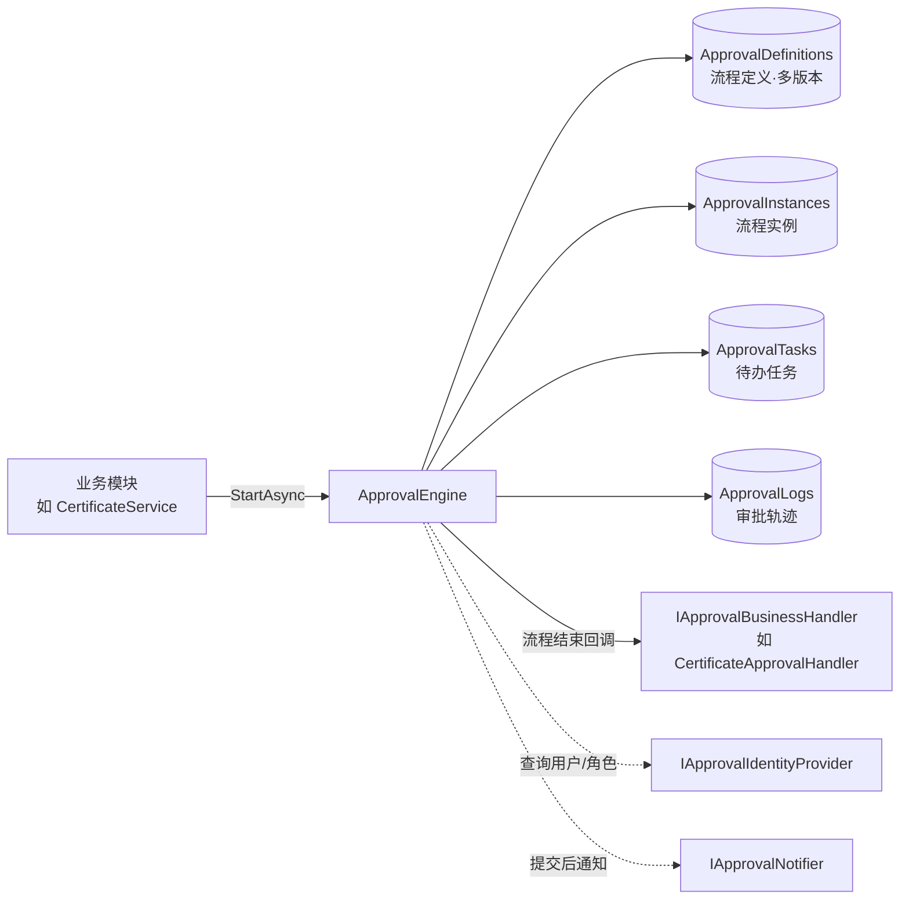

# Approval.Core — 通用审批流程框架

一个面向“业务单据 + 多角色审核”场景的轻量审批引擎。两种接入方式：

- **表单审批（零代码）**：在设计器里画流程、设计表单、打开“在发起中心显示”，用户即可在“发起申请”中填写表单发起，如请假、报销、用品申领。
- **业务审批**：业务模块（如证书管理）保存自己的单据，调用引擎发起审批，在回调中让审批结果生效。

审批的定义、流转、待办、轨迹、通知由框架统一处理。

```
src/Approval.Core                 框架本体（EF Core Relational + DynamicExpresso + Jint），不依赖 ASP.NET
src/Approval.AspNetCore           ASP.NET Core 集成：MapApprovalEndpoints() 提供全部审批接口、当前用户与用户目录抽象
tests/Approval.Core.Tests         引擎单元测试（SQLite 内存库）
tests/Approval.AspNetCore.Tests   接口集成测试（TestServer）
samples/Certificate.Api           示例宿主：证书审核（业务审批）+ 请假 / 报销（表单审批）
web/packages/approval-ui          前端组件库 @approval/ui：工作台、审批详情、流程设计器、表单设计器、发起中心
web/apps/demo                     示例前端：接入 @approval/ui + 证书管理页面 + 演示用户切换
```

## 前端界面

| 页面 | 功能 |
|---|---|
| 审批工作台 `/workbench` | 我的待办（含角色任务）、我已处理、我发起的（显示流程名称） |
| 发起申请 `/start` | 按分类列出可发起的表单流程；填写表单提交，服务端字段错误回显到表单项 |
| 审批详情 `/approvals/:id` | 同意 / 驳回或退回到指定节点 / 转交 / 加签 / 撤回 / 退回后重新提交（表单审批可修改表单）；申请内容（表单审批显示表单，证书显示变更前后对比）；按实例版本绘制的只读流程图，高亮已完成、进行中、已驳回节点和走过的路径；审批轨迹 |
| 证书管理 `/certificates` | 申请新增 / 变更 / 注销，审核中的证书加锁提示，申请记录 |
| 流程定义 `/definitions` | 流程列表、新建、版本历史（可基于任一历史版本编辑） |
| 流程设计器 `/designer/:key` | 三个页签：**流程**（画布）/ **表单**（字段拖入与排序、属性、明细表、预览）/ **发起设置**（发起中心、分类、发起角色、标题模板）。画布：从左侧面板拖放节点到任意位置、拖到连线上自动插入（A→新节点→B）、撤销 / 重做（Ctrl+Z / Ctrl+Y）；属性面板配置审批人、审批方式、条件分支、动作步骤、节点通知、处理时限；流程级通知；自动排版、服务端校验、发布新版本（仅 Admin） |
| 站内信（右上角铃铛） | 未读数、消息列表、点击跳转审批详情 |
| 投递记录 `/outbox` | 外部渠道通知与异步动作的投递状态、重试次数、错误、手动重试；演示用 Webhook 接收端可模拟故障（仅 Admin） |

```
web/packages/approval-ui/src         @approval/ui
├─ index.ts / config.ts / routes.ts  插件、配置（apiBase、headers、businessPanels…）、createApprovalRoutes()
├─ api/                              审批接口与类型
├─ components/                       MessageBell、UserPicker（基于用户目录的远程搜索）
├─ composables/                      useApprovalUser（/me）、useDirectory、useAsyncData
├─ features/
│  ├─ flow/      流程模型（flowModel.ts，含单元测试）、画布、节点卡片、只读流程图
│  ├─ designer/  设计器状态（useFlowDesigner，撤销 / 重做）与面板
│  ├─ forms/     表单模型（formModel.ts，含单元测试）、DynamicForm、FormDesigner、字段属性、发起设置
│  ├─ approval/  审批详情：操作栏、轨迹
│  └─ workbench/ definitions/
└─ views/                            路由页面（只做组合）

web/apps/demo/src                    示例宿主：main.ts（插件配置）、router.ts、布局、证书业务、演示用户切换
```

**接入新业务的前端部分**：在插件选项 `businessPanels` 中注册 `BusinessType → 详情组件`（组件接收 `businessKey`），审批详情页即可展示该业务的单据内容；表单审批自动按表单展示；其他未注册的业务显示原始表单数据。

## 核心概念



| 能力 | 说明 |
|---|---|
| 节点类型 | `Start` / `Approval` / `Cc`（抄送）/ `Condition`（条件分支）/ `Parallel`（并行分支）/ `Join`（合并）/ `Action`（自动动作）/ `End` |
| 审批方式 | `Any` 或签（角色内任意一人）、`All` 会签、`Sequential` 依次审批 |
| 审批人 | 内置 `User`、`Role`、`FormField`、`Initiator`，可注册自定义解析器（如“部门负责人”） |
| 操作 | 发起、同意、驳回（结束）、退回到指定节点、撤回、转交、加签、退回发起人后重新提交 |
| 并行 | `Parallel` 的所有出线同时进行，必须汇聚到同一个 `Join`；分支内可嵌套条件与并行，发布时校验结构（不能跳出并行块、不能在合并前结束） |
| 退回 | 可退回到发起人或本实例已审批通过的上游审批节点；在并行分支内退回只影响本分支，退回到并行块之外则取消整个块；退回发起人后，发起人可重新提交（可带新表单）或撤回。节点选项 `allowReturn` |
| 加签 | 前加签（先请他人审，再回到自己）、后加签（自己同意后他人还需同意）、并加签（同时审）；加签人必须同意节点才通过。节点选项 `allowAddSign` |
| 规则 | 禁止自审、同一单据单个进行中流程、可选“同一人不能审多个节点”、找不到审批人时报错或自动通过 |
| 版本 | 发布即生成新版本；进行中的实例继续按发起时的版本流转 |
| 一致性 | 审批状态与业务回调同一个 DbContext / 事务提交；乐观并发防止会签时并发审批丢失更新 |

## 接入一个新业务（3 步）

**1. 在宿主 DbContext 中加入审批表**

```csharp
protected override void OnModelCreating(ModelBuilder modelBuilder)
{
    modelBuilder.ConfigureApproval();   // 审批表与业务表共用 DbContext → 同一事务
    // ... 业务实体配置
}
```

**2. 注册框架、身份提供者与业务回调**

```csharp
builder.Services.AddScoped<IApprovalIdentityProvider, MyIdentityProvider>();  // 对接你的用户/角色体系
builder.Services
    .AddApprovalWorkflow<AppDbContext>(o => o.AllowInitiatorApprove = false)
    .AddBusinessHandler<ContractApprovalHandler>()        // 每个 BusinessType 一个
    .AddApproverResolver<DeptLeaderResolver>()            // 可选：自定义审批人规则
    .AddNotifier<WeComNotifier>();                        // 可选：站内信 / 企业微信 / 邮件
```

**3. 业务提交时发起审批，结束时在回调中生效**

```csharp
// 提交：业务数据与审批实例在同一次 SaveChanges 中提交
await engine.StartAsync(new StartApprovalRequest("contract.sign", "Contract", contract.Id.ToString(), userId)
{
    Title = $"合同 {contract.No}",
    FormData = new { amount = contract.Amount }       // 条件分支可用：amount > 100000
});

// 回调：在引擎 SaveChanges 之前执行，抛异常则审批操作整体回滚
public sealed class ContractApprovalHandler(AppDbContext db) : IApprovalBusinessHandler
{
    public string BusinessType => "Contract";
    public async Task OnApprovedAsync(ApprovalInstance i, CancellationToken ct) { /* 合同生效 */ }
    public async Task OnRejectedAsync(ApprovalInstance i, CancellationToken ct) { /* 退回草稿 */ }
}
```

通用审批接口（待办、同意、驳回、转交、撤回、详情等）所有业务共用，由 `Approval.AspNetCore` 提供，见下一节。

## 接入你的系统

**后端（ASP.NET Core）**

```csharp
builder.Services.AddScoped<IApprovalIdentityProvider, MyIdentityProvider>();     // 用户 → 角色（必需）
builder.Services.AddScoped<IApprovalUserDirectory, MyUserDirectory>();           // 用户搜索 / 角色列表（可选，前端用户选择器使用）
builder.Services.AddApprovalAspNetCore(o => o.AdminPolicy = "ApprovalAdmin");   // 当前用户默认取 Claims（NameIdentifier / sub）
builder.Services
    .AddApprovalWorkflow<AppDbContext>()
    .AddFormApprovals()                                  // 可选：启用表单审批（发起中心）
    .AddBusinessHandler<ContractApprovalHandler>();      // 可选：业务审批

app.UseExceptionHandler();             // 宿主自有接口抛出的 ApprovalException 也转为 ProblemDetails
app.MapApprovalEndpoints()             // 默认前缀 /api/approval，返回 RouteGroupBuilder
   .RequireAuthorization();            // 可继续追加授权、CORS 等约定
```

| 扩展点 | 说明 |
|---|---|
| `IApprovalCurrentUser` | 从请求识别当前用户；默认 `ClaimsApprovalCurrentUser`，示例用请求头实现 `DemoCurrentUser`。返回 null 时接口返回 401 |
| `IApprovalUserDirectory` | `SearchUsersAsync` / `GetUsersAsync` / `ListRolesAsync`；未注册时 `directory/*` 返回 501，前端选择器可手动输入用户 ID |
| `ApprovalAspNetCoreOptions` | `AdminPolicy`（授权策略，优先）或 `AdminRole`（默认 `Admin`）控制发布流程与投递记录；`UseStringEnums`（默认添加 `JsonStringEnumConverter`，前端依赖字符串枚举）；`EnableOutboxEndpoints` |
| 宿主自有接口 | `http.GetApprovalUserId()` 获取当前用户、`http.EnsureApprovalAdminAsync()` 校验管理员 |

接口一览：`me`、`directory/users|roles`、`todo`、`todo/count`、`done`、`started`、`cc`、`flows`、`instances/*`（含 `instances/{id}/definition`、`instances/{id}/my-task`）、`tasks/{id}/approve|reject|transfer|add-sign|resubmit|return-targets`、`definitions/*`、`meta`、`forms/*`（发起、草稿）、`files`、`messages/*`、`outbox/*`、`admin/*`。错误统一为 ProblemDetails：`title` 为中文提示，`code` 为错误码（`NotFound`、`Forbidden`、`Unauthorized`、`Conflict`、`Validation`…），表单校验失败为 400 且 `errors` 为“字段路径 → 错误”（明细单元格如 `items.0.amount`）。

**前端（Vue 3 + Element Plus + vue-router）**

```ts
import { ApprovalUI, createApprovalRoutes } from '@approval/ui'
import '@approval/ui/style.css'        // 以 dist 方式安装时引入；workspace 源码方式不需要

app.use(ElementPlus).use(ApprovalUI, {
  apiBase: '/api/approval',
  headers: () => ({ Authorization: `Bearer ${getToken()}` }),
  onUnauthorized: () => router.push('/login'),
  businessPanels: { Contract: defineAsyncComponent(() => import('./ContractPanel.vue')) },   // 审批详情中的业务单据（props：businessKey）
})

const router = createRouter({
  history: createWebHistory(),
  routes: [{ path: '/', component: MyLayout, children: [...createApprovalRoutes(), /* 你的页面 */] }],
})
```

页面路由：`workbench`、`approvals/:id`、`start`、`start/:key`、`definitions`、`designer/:key`、`outbox`、`monitor`（路由名见 `approvalRouteNames`）。组件 `MessageBell`、`UserPicker`、`DynamicForm`、`FormDesigner`、`FlowViewer`、`ApprovalTimeline` 可单独使用。宿主托管前端时，含点号的流程标识（如 `/designer/hr.leave`）需单独声明回退路由，见示例 `Program.cs`。

## 数据权限、分页与管理

**查看权限**（`IApprovalAccessPolicy`，默认 `DefaultApprovalAccessPolicy`）：发起人与管理员看全部；任务的处理人 / 候选人（含角色成员、已转交或加签的人）与抄送对象（含角色成员）作为“参与人”查看。无权查看与不存在一样返回 **404**，不暴露实例是否存在。宿主可继承默认实现追加规则：

```csharp
public sealed class AuditorPolicy(ApprovalDbContextAccessor db, IApprovalIdentityProvider identity) : DefaultApprovalAccessPolicy(db, identity)
{
    public override async Task<ApprovalAccess> GetAccessAsync(ApprovalViewer viewer, ApprovalInstance instance, CancellationToken ct) =>
        await Identity.IsInRoleAsync(viewer.UserId, "Auditor", ct) ? ApprovalAccess.Full : await base.GetAccessAsync(viewer, instance, ct);
}
builder.Services.AddApprovalWorkflow<AppDbContext>().AddAccessPolicy<AuditorPolicy>();
```

- 完整流程定义（含 HTTP 动作参数、通知配置）**仅管理员**（及 `ApprovalAspNetCoreOptions.DefinitionReaders` 中的角色）可读；查看实例的人通过 `instances/{id}/definition` 取公开视图（去掉动作参数、通知、时限与发起角色）。
- `ApprovalQueryService.GetInstanceAsync` / `GetByBusinessAsync` **不做权限判断**，供宿主后台使用；接口请用 `GetInstanceForViewerAsync` / `GetByBusinessForViewerAsync`。业务单据自身接口的权限由宿主负责。

**分页**：`todo`、`done`、`started`、`cc`、`admin/instances`、`outbox` 返回 `{ items, total, page, pageSize }`；参数 `page`（从 1 开始）、`pageSize`（默认 20，最大 100）、`keyword`（标题 / 申请人）、`status`、`definitionKey`、`from` / `to`（发起时间，ISO 8601），待办另有 `overdueOnly`。

**组织架构审批人**：实现 `IApprovalOrganizationProvider`（部门、部门负责人、上级部门、直属上级）并调用 `AddOrganizationProvider<T>()` 后，设计器出现三种审批人：`DeptLeader`（值 `1` 为本部门负责人，`2` 为上级部门负责人…）、`Manager`（第 N 级上级）、`ManagerChain`（逐级审批 1 到 N 级上级，节点须为依次审批，去重并跳过发起人）。默认以发起人为基准，`2@payee` 表示以表单人员字段 `payee` 为基准。

**管理接口**（`/api/approval/admin/*`，仅管理员）：

| 接口 | 说明 |
|---|---|
| `GET admin/instances` | 全部实例（分页筛选，可按发起人） |
| `POST admin/instances/{id}/terminate` `{ reason }` | 终止：待办取消、通知申请人，业务回调 `OnTerminatedAsync`（默认等同驳回） |
| `POST admin/tasks/{id}/reassign` `{ toUserId, reason }` | 改派待办（角色任务可改派给具体用户），时限不重置 |
| `GET admin/users/{userId}/tasks`、`POST admin/users/{userId}/reassign` | 离职交接：预览并批量改派某人的全部待办，返回改派数与跳过原因 |
| `GET admin/statistics?from&to&definitionKey` | 统计：各流程数量与状态、平均 / P90 耗时、节点处理时长、超时数、待办积压前 10（时间范围最多 366 天，内存聚合） |

前端“流程监控”页（路由 `monitor`）提供实例、统计与离职交接三个页签；审批详情中管理员可终止流程、改派待办。

## 表单审批

流程定义 JSON 中的 `form` 与 `settings` 随流程版本一起发布，进行中的实例按发起时的版本展示与校验：

```jsonc
{
  "settings": { "startable": true, "category": "人事", "initiatorRoles": [], "titleTemplate": "{申请人}的请假申请（{form.days} 天）" },
  "form": { "fields": [
    { "key": "days", "label": "天数", "type": "Number", "required": true, "min": 0.5, "max": 30, "precision": 1, "span": 12 },
    { "key": "handover", "label": "交接人", "type": "User", "span": 12 },
    { "key": "items", "label": "明细", "type": "Table", "maxRows": 50, "columns": [
      { "key": "name", "label": "项目", "type": "Text", "required": true },
      { "key": "amount", "label": "金额", "type": "Money", "required": true, "sum": true } ] }
  ] },
  "startNodeId": "start", "nodes": { "...": "..." }
}
```

| 能力 | 说明 |
|---|---|
| 字段类型 | `Text`、`TextArea`、`Number`、`Money`、`Date`、`DateRange`、`Select`、`MultiSelect`、`Radio`、`Switch`、`User`、`Users`、`Table`（明细，列支持 Text / Number / Money / Date / Select / Formula）、`Formula`（计算字段）、`File`（附件）、`Description`（说明文字） |
| 服务端校验 | 必填、类型、选项、范围、精度、长度、行数；剔除未定义字段、数字字符串转数字；人员字段校验用户存在（注册了用户目录时）。前端规则与服务端一致 |
| 条件分支 | 直接写字段标识：`days > 3`、`leaveType == "annual"`；明细合计为 `{表格}_{列}_sum`，如 `items_amount_sum > 5000` |
| 审批人 / 通知 | 审批人规则“表单字段”选择人员字段（如交接人）；消息模板与动作参数可用 `{form.days}` |
| 发起控制 | 只有 `startable` 的流程出现在发起中心（默认关闭，业务审批的流程不会混入）；`initiatorRoles` 限制发起角色（服务端校验） |
| 退回修改 | 退回发起人后，发起人可修改表单重新提交（按实例绑定版本校验，标题随之更新）；业务审批的数据由业务单据决定，不能在审批中修改 |
| 草稿 | `PUT forms/{key}/draft` 保存（不校验必填，只做结构规范化；每人最多 50 份、单份 256 KB），发起页 30 秒自动保存；打开时按最新表单调整；从草稿提交后同一事务删除草稿 |
| 计算字段 | `"formula": "items_amount_sum - ifnull(advance, 0)"`，明细列可写 `qty * price` 按行计算。语法：数字、字段、`+ - * / ()`、`round(x, n)`、`min`、`max`、`abs`、`if(条件, 是, 否)`（比较只能用在 if 中）、`ifnull(x, 默认)`；除以 0 或空值参与运算结果为空。服务端按依赖顺序重新计算（忽略提交的值），发布时检查语法、引用与循环；C# 与前端两份实现共用 `tests/shared/formula-cases.json` |
| 节点字段权限 | 审批节点 `"fieldPermissions": { "days": "Editable", "salary": "Hidden" }`，抄送节点可设 `Hidden`。可编辑：表单审批的审批人同意时一并提交（`tasks/{id}/approve` 带 `formData`，只能含可编辑字段），整表重新校验与计算、条件按新值流转，轨迹记录修改前后的值（`ApprovalLogs.Details`）。隐藏：只以设置了隐藏的节点参与的人看不到该字段，服务端从表单数据、修改记录中去掉（`hiddenFields` 告知前端），附件也不能下载；发起人、管理员可见。标题、通知模板、计算字段引用隐藏字段可能间接暴露，校验接口会给出提示（`warnings`） |
| 附件 | `"type": "File", "maxFiles": 10, "accept": ["pdf", "jpg"]`。`POST files` 上传：请求体为文件内容，文件名放在请求头 `X-File-Name`（URL 编码；自定义请求头可防跨站伪造上传）；返回 `{ id, name, size, contentType }`。提交时校验文件属于本人（或已属于该申请）并绑定；`GET files/{id}` 下载：上传者，或能查看所属审批且附件不在隐藏字段中，一律 `attachment` + `nosniff`。配置 `ApprovalOptions.Files`：`RootPath`（默认 `App_Data/approval-files`，相对内容根目录，勿放在 wwwroot）、`MaxFileSizeMb`（20）、`AllowedExtensions`（常见办公文档与图片）、`UnboundRetention`（未绑定文件 24 小时后由后台清理）；`AddFileStore<T>()` 可替换为对象存储 |

示例中的 `Flows/leave.json`（请假：直属上级可调整天数，超过 3 天走部门负责人，抄送人事与交接人且抄送人看不到请假事由）、`Flows/expense.json`（报销：发票附件、应付金额 = 合计 - 预支，财务可核对预支金额，合计超过 5000 走财务 + 负责人并行会审）和 `Flows/purchase.json`（采购：逐级审批到第 2 级上级，上级可调整明细）演示了以上能力。

## 动作、通知与超时

```mermaid
flowchart LR
    Op[审批操作] --> Engine[ApprovalEngine]
    Engine -- 同一事务 --> Msg[(ApprovalMessages<br/>站内信)]
    Engine -- 同一事务 --> Outbox[(ApprovalOutbox)]
    Engine -- 同步动作 --> Act[IApprovalActionHandler<br/>Http / Script / 自定义]
    Outbox --> Dispatcher[ApprovalOutboxDispatcher<br/>后台投递 · 指数退避重试]
    Dispatcher --> Ch[IApprovalChannel<br/>Webhook / 企业微信 / 钉钉 / 邮件]
    Dispatcher --> Act
    Scanner[ApprovalTimeoutScanner<br/>定时扫描到期待办] --> Engine
```



| 能力 | 说明 |
|---|---|
| 动作节点 `Action` | 依次执行步骤：内置 `Http`（主机白名单防 SSRF、`Idempotency-Key`）、`Script`（Jint 沙箱，限制时间 / 内存 / 语句数 / 递归，无 .NET 访问）、宿主注册的动作（`AddActionHandler<T>()`，设计器按参数描述自动生成表单） |
| 同步 / 异步 | 同步在审批事务内执行，失败回滚（可选“失败继续”），输出写入表单变量供后续条件使用，如 `risk.body.level == "high"`；异步写入 Outbox 由后台执行并重试 |
| 动作的数据修改 | 注册动作可注入宿主 DbContext 修改业务数据，**不要自行调用 SaveChanges**：同步动作的修改随审批一起提交；异步动作的修改与投递结果在同一事务提交。动作失败时，其做了一半的修改会被撤销（“失败继续”时也是），只记录失败信息；异步动作自行 SaveChanges 的部分也会随事务回滚 |
| 参数模板 | `{标题}`、`{申请人}`、`{form.certNo}`、`{appBaseUrl}` 等；`{x\|json}` / `{x\|url}` 指定转义，HTTP 请求体默认按 JSON 转义；脚本代码不做替换（防注入） |
| 节点通知 | 事件：到达节点、同意、驳回、转交、超时提醒、流程结束；接收人：当前审批人、申请人、已审批过的人、角色、用户、表单字段；渠道：站内信（内置）+ 已注册渠道；模板同上 |
| 可靠发送 | 站内信与 Outbox 与审批数据同一事务提交；后台任务投递，失败按 `BaseRetryDelay × 2^(n-1)` 重试，超过次数标记失败可手动重试；多实例通过租约 + 并发令牌防重复 |
| 超时 | 审批节点 `timeout`：到期后提醒（可按间隔重复催办、限制次数）/ 自动同意 / 自动驳回；依次审批轮到时才开始计时，转交不重置时限 |

```csharp
builder.Services.AddApprovalWorkflow<AppDbContext>(o =>
    {
        o.Http.AllowedHosts.Add("*.mycompany.com");            // HTTP 动作白名单
        o.InstanceUrlFormat = "https://oa.mycompany.com/approvals/{0}";
    })
    .AddActionHandler<CertificateExpiryCheckAction>()          // 注册动作
    .AddContactProvider<MyContactProvider>()                    // 用户邮箱 / 企业微信 ID
    .AddWeComRobotChannel(o => o.WebhookUrl = config["WeCom:WebhookUrl"]!)
    .AddDingTalkRobotChannel(o => { o.WebhookUrl = "..."; o.Secret = "..."; })
    .AddEmailChannel(o => config.GetSection("Smtp").Bind(o))
    .AddChannel<MySmsChannel>();                                // 自定义渠道
```

示例 `certificate.create` 流程演示了全部能力：自动预检（注册动作 + 脚本）→ 临期证书走安全审核 → 部门审核 24 小时时限与催办 → 通过后异步推送档案（HTTP）→ Webhook 通知。密钥类配置（机器人地址、SMTP 密码）请使用 user-secrets 或环境变量，勿提交到仓库。

## 流程定义示例

```json
{
  "startNodeId": "start",
  "nodes": {
    "start":   { "name": "提交", "type": "Start", "next": "dept" },
    "dept":    { "name": "部门审核", "type": "Approval", "mode": "Any",
                 "approvers": [{ "type": "Role", "value": "DeptReviewer" }], "next": "cond" },
    "cond":    { "name": "类型判断", "type": "Condition", "branches": [
                   { "priority": 1, "expression": "certType == \"Special\"", "next": "safety" },
                   { "priority": 99, "expression": null, "next": "leader" } ] },
    "safety":  { "name": "安全审核", "type": "Approval", "approvers": [{ "type": "Role", "value": "SafetyOfficer" }], "next": "leader" },
    "leader":  { "name": "负责人会签", "type": "Approval", "mode": "All",
                 "approvers": [{ "type": "Role", "value": "Leader" }], "next": "end" },
    "end":     { "name": "结束", "type": "End" }
  }
}
```

发布时会做结构校验：节点引用、环路、不可达节点、缺少默认分支、未注册的审批人类型等。

## 证书示例的关键设计

审核期间**不直接修改正式证书**：每次新增 / 变更 / 注销都生成一张 `CertificateRequest`，拟变更数据存为快照，证书加编辑锁；审批通过后回调把快照写回证书，驳回或撤回则只关闭申请单、解锁证书。这样审核期间展示的始终是已生效数据，也能明确追溯“谁批准了哪个版本”。

## 运行

```powershell
cd D:\Study\CSharp\Workflow
dotnet test                                                        # 后端单元测试

# 方式一：构建前端后由后端托管（打开 http://localhost:5199）
cd web; pnpm install; pnpm build; cd ..          # 示例前端构建到 samples/Certificate.Api/wwwroot
dotnet run --project samples/Certificate.Api --urls http://localhost:5199

# 方式二：前端开发模式（热更新，打开 http://localhost:5173，/api 代理到 5199）
dotnet run --project samples/Certificate.Api --urls http://localhost:5199
cd web; pnpm dev

# 前端检查（workspace 内所有包）
cd web; pnpm typecheck; pnpm test

# 打包
dotnet pack src/Approval.Core -c Release -o output/packages
dotnet pack src/Approval.AspNetCore -c Release -o output/packages
cd web; pnpm build:lib                                            # @approval/ui → web/packages/approval-ui/dist（ES 模块 + d.ts + css）
./samples/Certificate.Api/smoke-test.ps1                           # 接口层端到端演示
```

示例用请求头 `X-User-Id` 模拟登录用户（`DemoCurrentUser`），用户、姓名和角色配置在 `appsettings.json` 的 `DemoUsers` 中，前端右上角可切换演示用户（发布流程需切换到 `admin`；表单审批可用 `hana` 人事、`fiona` 财务），**仅供演示**。

## 已知限制 / 后续扩展

- 并行为“全部分支”模式，暂不支持条件并行（包含网关）与会签比例通过；时限按自然时间计算，暂不支持工作日历。
- 退回后节点会重新激活，其间的动作节点、通知也会再次执行；有副作用的动作请保证幂等。
- `SingleRunningInstancePerBusiness` 是应用层检查，极端并发下如需严格保证，可在数据库层加唯一约束。
- 旧版 `IApprovalNotifier` 仍保留（提交后同步调用、失败只记日志），新代码请使用通知规则 + 渠道（Outbox 可靠投递）。
- 同步 HTTP 动作在事务提交前执行，若随后提交失败外部调用已发生，有副作用的调用请使用异步模式。
- 动作失败时的数据回滚只针对数据库：已经发出的外部调用无法撤回（异步动作请用 `IdempotencyKey` 保证重试幂等）。数据库执行策略开启自动重试（如 SQL Server `EnableRetryOnFailure`）时异步投递不使用事务，仅撤销未保存的修改；同步动作不应自行 SaveChanges（会连同审批的中间状态一起提交）。
- 表结构有变化（`ApprovalMessages`、`ApprovalOutbox`、`ApprovalCarbonCopies`、`ApprovalDrafts`、`ApprovalFiles` 表，`ApprovalLogs.Details` 列，`ApprovalTasks` 的时限、`Kind`、`ParentTaskId`、`Round` 列，`ApprovalInstances` 的 `StateJson`、`Round` 列及新索引）：全部为新增，旧演示库需删除 `.db` 文件重建，正式项目请生成 EF Core 迁移（`dotnet ef migrations add ApprovalV2`）。
- 列表接口已改为分页结构 `{ items, total, page, pageSize }`，完整流程定义改为仅管理员可读，旧调用方需相应调整。
- 示例使用 `EnsureCreated` 建库，正式项目请改用 EF Core Migrations。
- 表单版本跟随流程版本；暂不支持跳转到任意节点、流程迁移到新版本。
- 附件不提供在线预览、病毒扫描与内容类型嗅探（只按扩展名白名单）；IIS 等反向代理的请求大小限制需另行配置。
- 统计在内存中聚合，数据量大时请改用宿主自己的报表；隐藏字段为展示层控制，不是字段级加密，审计日志暂不支持导出。
- 包未发布到 nuget.org / npm，可用 `output/packages` 下的本地包或 workspace 引用。
