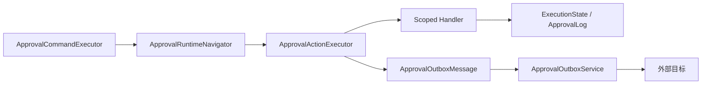

# Action 执行与恢复

流程进入 Action 节点后逐步执行，每个步骤消耗一次自动推进预算。同步 Handler 在同一工作单元运行，业务写入、审批状态、审计、输出和待投递消息一并提交。默认 `Fail` 回滚当前操作。只有声明无写入和外部副作用的 Handler 可配置 `Continue`，失败会记录安全摘要并跳过输出。

输出随 `ApprovalInstance.StateJson` 保存。并行分支只读取自己的上游输出，经过 Join 后可读取各已到达分支的输出。退回时清除重新打开路径的输出，从发起人重新提交时从 Start 重新计算。原轮次日志保留。

异步动作每实例每节点每步骤入队一次。退回与重新提交保留已入队标记。显式通知的外部渠道也遵循该规则，站内通知随重新经过节点的审批事务写入。Outbox 与审批提交原子性一致，投递发生在后续作用域。步骤顺序决定同步执行和入队顺序。不同 Outbox 项独立重试，投递完成顺序由各自的结果决定。异步动作没有可以参与当前导航的结果。

单实例 Dispatcher 按现有退避策略重试。达到上限后进入 Failed，人工重试复用原 Outbox ID、配置和执行快照。外部系统应按该 ID 去重。已成功提交的审批操作通过相同 OperationId 和请求重放，执行器直接返回原结果。

模拟复用校验和导航。JavaScript、Mapping 及明确提供预演的自定义 Handler 可生成预演输出。HTTP、SQL 和通知显示计划。在后续条件依赖无法取得的输出时停在相应动作节点。
