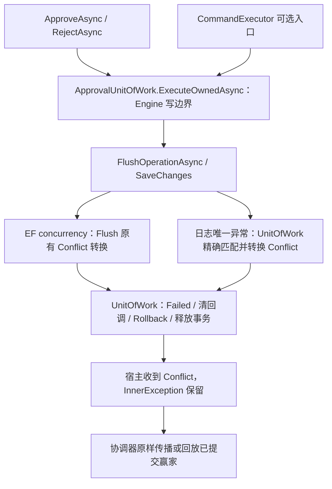

# 并发审批日志唯一约束 Conflict 修复

基线 `cc4ff472f4d823805eae7a9b49e2d453a9e96bdd`，分支 `codex/backend-progressive-refactoring`。仅修复日志序号竞争的异常语义，保留原业务行为与全部既有测试。

## A. 根因与路径审查

`ApprovalEventWriter.AddLog` 使用 `++instance.LogSequence`。两个独立上下文读取相同旧实例后，都可能生成相同 `(InstanceId, Sequence)`。实体模型 `ConfigureApproval` 保留唯一索引 `IX_ApprovalLogs_InstanceId_Sequence`；原始 CI 的 MySQL1062 / PostgreSQL23505 明确指向该索引，调用栈由 EF ReaderModificationCommandBatch / SaveChanges 到 Flush。

不能仅根据语句先后顺序推断异常优先级。本次实际三个 Provider 的命令都在同一个批次中执行 DELETE BusinessSlots → UPDATE Instances → INSERT Logs；MySQL还带SELECT ROW_COUNT，SQL Server带OUTPUT 1。即使实例UPDATE在前，MySQL/PostgreSQL仍先暴露后续日志INSERT的唯一约束异常，早于EF对受影响行数完成并发判断；SQL Server本次走EF concurrency异常。原 Flush 只 catch `DbUpdateConcurrencyException`，因此普通 `ApproveAsync` 等操作泄漏 `DbUpdateException`。协调器的通用 Unique 处理不能覆盖不经过协调器的 Engine 调用。

普通 Approve / Reject / Return / Transfer 等调用 `_unit.ExecuteCommandAsync`，经过 Engine 写所有者的 `ExecuteOwnedAsync`。带 OperationId 的 Start、HTTP/宿主显式协调命令经过 `IApprovalCommandExecutor`，它使用新的 Scope/DbContext 再调用同样的 Engine/UnitOfWork 路径。同步业务/生命周期回调**不能自行 SaveChanges**，仍由现有保存保护执行；异步事件处理器的既有保存边界不改。

旧独立令牌测试通过真实提醒清理更新令牌，验证陈旧审批；本轮完整保留。同时新增原始两个同意操作的陈旧状态场景与显式同步的两审批人竞争，不用改换竞争业务来消除日志冲突。

## B. 最小修复

| 文件 | 修改 |
| --- | --- |
| `src/Approval.Core/Persistence/ApprovalDatabaseErrors.cs` | 增加日志序号专用识别器：受影响 ApprovalLog 属于一个实例，当前模型确有 InstanceId/Sequence 唯一索引，再核对实际 Provider 错误码和完整约束/表/列名称 |
| `src/Approval.Core/Persistence/ApprovalUnitOfWork.cs` | 在 ExecuteOwnedAsync 的 Engine 写边界精确转换一次；设置 Failed，保留原 DbUpdateException 为 InnerException |
| `src/Approval.Core/Persistence/ApprovalCommandExecutor.cs` | 没有已提交赢家可回放时，原样传播已是 ApprovalException/Conflict 的异常，避免再包一层；现有业务 Unique/幂等规则保留 |
| `tests/Approval.Core.Tests/ApprovalLogConflictTests.cs` | 3项新用例：实际 SQLite 日志唯一冲突、整笔回滚/失败作用域/协调器异常身份，以及无关业务唯一约束不误报 |
| `tests/Approval.Database.Tests/ApprovalLogConflictDatabaseTests.cs` | 8项新用例：同任务两审批人同步竞争、原始陈旧审批、四种真实约束、普通 SQL、连接失败；记录真实写命令和结果 |
| `plans/2026-11-04-approval-log-conflicts.md`、本文 | 实施计划、完整验收与风险记录 |

没有修改 Engine Facade、Resolver、Governance、权限模型、生产DI、程序集、NuGet、数据库模型或 Migration。原 Touch/ConcurrencyStamp/EF concurrency catch、日志唯一索引和陈旧实体检查全部保留。

| Provider | 精确识别条件 |
| --- | --- |
| PostgreSQL | DbException.SqlState=23505，ConstraintName 与当前模型索引完全相同，TableName 与日志表完全相同 |
| MySQL | Number=1062，for key 的索引标识精确匹配；有表限定时核对日志表，无限定时受影响条目必须全部是同实例日志 |
| SQL Server | Number=2601/2627，unique index/UNIQUE KEY constraint 的名称与当前模型索引匹配，并核对 object 日志表 |
| SQLite | SqliteExtendedErrorCode=2067，UNIQUE constraint failed 的完整列集合必须恰为当前日志表的 InstanceId、Sequence |

不会把所有 Unique 或 DbUpdateException 当成日志冲突。日志主键、BusinessSlots.LookupHash、外键、连接和普通 SQL 错误有实际 Provider 负向测试。已有 `Unique` 通用函数不改，因此重复提交仍沿既有业务/协调器规则执行。



转换在既有回滚范围内；失败会清理 AfterCommit 回调，调用原 rollback / Writes.Failed，失败 scope 不能继续保存或执行新命令。不在多个层次重复包装日志异常。

## C. 确定性并发验证

同任务场景使用 Role=Reviewers 的一个 Pending 任务，由 bob/carol 两个真实角色成员分别在独立 Scope/DbContext 读取。双方完成 CanHandle 和相同旧 stamp/log sequence/pending 状态断言后，TaskCompletionSource gate 放行真实 Approve 调用。首个 EF 实际写命令取得提交资格，另一写者明确等待其提交后执行，以排除多行日志 INSERT 的随机行锁死锁；两个操作仍提交同一个任务的旧跟踪状态，不使用 Delay、概率或重试消除冲突。

SQLite 普通事务在 BEGIN 保留写锁，会自然串行化两个写事务；因此旧状态读取/共同校验放在事务前。三个服务端 Provider 不假定相同 INSERT/UPDATE 排序，每个上下文的真实 EF 命令顺序写入验收 JSON。

必须满足的数据库结果：一成功、一精确 ApprovalException/Conflict；stamp只增加1、日志计数器只增加3（Approve → NodeEntered/end → Complete），三个序号连续；一个 Approved 任务、一个业务回调记录、一个成功操作标记、一个提交回调；失败操作标记不存在；一个站内审批通知和五条唯一决策 Outbox（Approve / Complete / NodeEntered / Completed / Decision notice）；不存在重复 Sequence、重复业务决策或失败事务残留。

原始陈旧审批场景：两个上下文先加载同一个 Pending 任务；第一个真实同意提交，第二个旧实体同意必须报 Conflict，赢家日志/Outbox/状态/业务记录保持完整。原提醒清理竞争令牌测试未改未删。

## 需求与测试证据

| Requirement | Evidence |
| --- | --- |
| 普通 Approve/Reject 日志唯一冲突统一 Conflict、InnerException 保留 | `ApprovalLogConflictTests.Engine_LogSequenceCollisionReturnsConflictAndRollsBackWholeScope`（approve/reject，真实 SQLite2067） |
| 整笔回滚、失败 scope 不可复用、协调器不重复包装 | 同方法，断言任务/实例/日志/Outbox/业务表不变，后续 SaveChanges/UnitOfWork 失败，异常引用 Same |
| 无关业务 Unique 不变成日志 Conflict | `ApprovalLogConflictTests.Engine_UnrelatedBusinessUniqueViolationRemainsDatabaseException` |
| 两人同步提交同一 Pending 任务，一成功/一 Conflict；无残留/重复通知、Outbox、回调 | `DatabaseContractTests.SameTask_SynchronizedApprovalsCommitExactlyOneDecisionAndRollbackLoser` |
| 恢复原始陈旧审批竞争 | `DatabaseContractTests.OriginalStaleApproval_PreservesCommittedWinnerWithoutLeakingDatabaseException` |
| 原独立 ConcurrencyStamp 机制仍有效 | 原 `ReadOnlyConcurrencyTests.RealApproval_RejectsStaleTrackedInstanceAndPreservesWinner`、`DatabaseContractTests.RealApproval_RejectsStaleStampAndRollsBackSideEffectsOnEachProvider` |
| 精确日志 Sequence 唯一识别；不误报主键、业务唯一或外键 | `DatabaseContractTests.RealProviderConstraints_IdentifyOnlyApprovalLogSequence`（sequence / log-primary / business-slot / foreign-key） |
| 普通 SQL 错误不误报 | `DatabaseContractTests.RealProviderSqlError_IsNotApprovalLogConflict` |
| 实际连接失败不误报 | `DatabaseContractTests.RealProviderConnectionFailure_IsNotApprovalLogConflict` |

## D. 验证记录

本地实际执行：Release Solution Build 0 warnings / 0 errors；Core419、ASP.NET Core81、Certificate58，共Passed558 / Failed0 / Skipped0；Contracts匹配全部既有基线。窄回归包含3项新增和13项原并发令牌测试，Passed16 / Failed0 / Skipped0。TRX位于 `output/log-conflicts/local`。

数据库专项本地仅编译，不执行、不启动Docker。MySQL / PostgreSQL / SQL Server / SQLite 以及Model Drift的本次实际CI结果待远端验证完成后记录；不使用上一轮Run替代验收。

## E. 风险边界

只为已确认日志 InstanceId/Sequence 索引竞争增加映射。其他索引如 Definitions.Key/Version、Operations.LookupHash、BusinessSlots.InstanceId 和管理表发布竞争仍执行既有规则，本轮不为每个索引新增统一 Engine 映射；现有相关回归保留。

MySQL/SQL Server没有Npgsql式结构化约束名，此识别器结合错误码、当前模型、受影响实体与当前驱动实际错误格式；未知/不匹配格式保留原异常，避免误报。非默认服务器消息语言的格式未在本轮覆盖。多实例混合失败无法精确确定归属时也不归类为日志冲突。

## F. 提交与复验

本地检查完成后创建可由Actions拉取的修复验证提交，CI全部通过后提交最终验收记录；不改历史、不强推。

```powershell
Set-Location -LiteralPath 'D:\Study\CSharp\Workflow'
dotnet build 'Workflow.slnx' --configuration 'Release' --no-restore --verbosity 'minimal'
dotnet test 'tests/Approval.Core.Tests/Approval.Core.Tests.csproj' --configuration 'Release' --no-build --no-restore --verbosity 'minimal'
dotnet test 'tests/Approval.AspNetCore.Tests/Approval.AspNetCore.Tests.csproj' --configuration 'Release' --no-build --no-restore --verbosity 'minimal'
dotnet test 'tests/Certificate.Api.Tests/Certificate.Api.Tests.csproj' --configuration 'Release' --no-build --no-restore --verbosity 'minimal'
pnpm --dir 'web' 'contracts:check' --no-build
gh run list --repo 'ttcc666/WorkflowDemo' --branch 'codex/backend-progressive-refactoring' --limit 5
```
