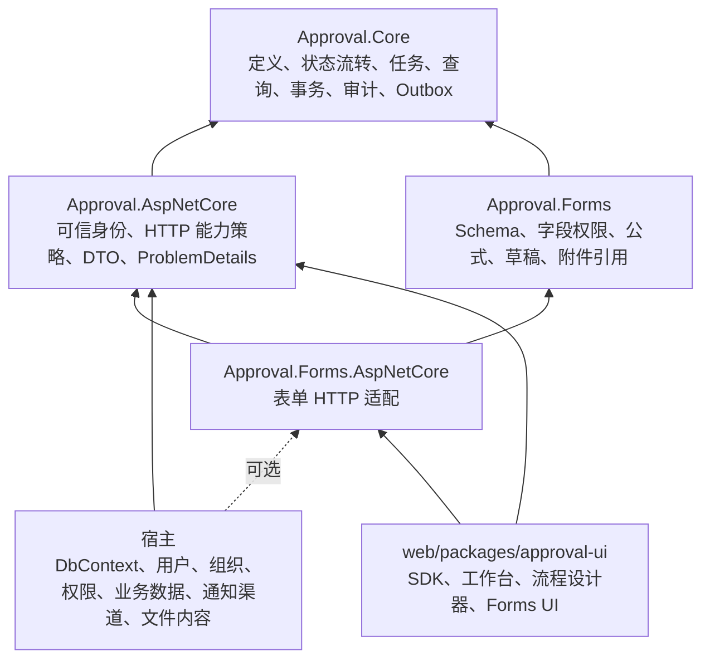
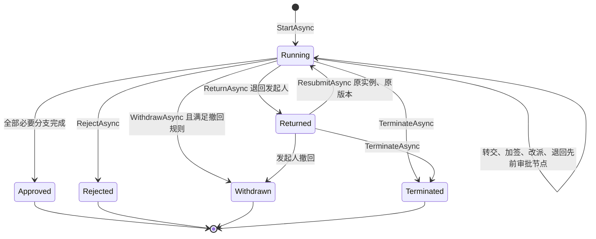
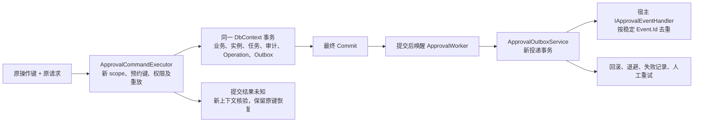

# 整体架构与产品能力盘点（2026-11-05）

审查代码基线：`main`，`965e6cd5ad4ab9e5a3cf7078e6601846e43d4435`。开始时工作区干净。本轮新增本报告，未修改生产代码、测试、公共契约或数据库模型；定点诊断程序保存在被 Git 忽略的 `output/architecture-audit/`。

结论：项目已经具备单宿主、单应用实例的嵌入式通用审批引擎所需的主要能力。核心生命周期闭环、发布版本隔离、可选 Forms、共享事务、严格幂等及 Outbox 均有实现和验证证据。当前优先事项是修复三项已复现的一致性与扩展边界问题，随后收敛接入文档和发布前公共 API；没有证据支持重新拆分核心架构或增加基础设施。

## 六个维度的结论

| 维度 | 判断 | 需要保留的限定 |
| --- | --- | --- |
| 核心审批生命周期 | 在当前产品范围内完整 | 驳回结束后重新发起新实例；退回发起人后在原实例重新提交。两者语义明确不同。 |
| 定义、发布、版本管理 | 主体完善 | 正式启动遵循活动版本，人员预检存在不一致，见 A02。预演只覆盖首次人工边界前的自动路径。 |
| Forms 与审批边界 | 后端边界清晰，前端包边界尚未独立 | Core 保存流程变量及可选 JSON 快照；Forms 解释字段。前端仍同属 `@approval/ui`。 |
| 宿主集成 API | 已能可靠集成，发布前仍需收敛 | 有四程序集 API / HTTP / JSON / TypeScript 基线和独立消费者；A01、A03 影响宿主错误语义和扩展使用。 |
| 恢复、通知、事件扩展 | 机制齐全，扩展责任明确 | 客户端跨页面完整请求恢复、真实外部通知平台及任意宿主忽略取消的扩展代码不在已验证能力内。 |
| 抽象、重复与复杂度 | 大多数承担实际边界职责，有局部收敛空间 | 优先消除版本选择语义重复、文档漂移和非扩展类型的公共暴露；保留安全保护与独立事务职责。 |

## 架构与职责归属



四个 `.csproj` 的实际依赖与这个方向一致。Core 不引用 ASP.NET Core、Forms 或 samples。宿主数据与审批数据使用同一个 DbContext；`UseApproval()` 安装保存、实体加载、SQL 与事务保护，`ConfigureApproval()` 配置模型，迁移仍由宿主拥有。

`ApprovalWorker` 是唯一后台 Worker；`ApprovalHostValidation` 只负责启动注册检查。没有新增多租户、分布式租约、消息平台或通用 Repository。这个范围与当前需求相符。

## 1. 核心生命周期



代码依据：[ApprovalEngine.cs](../src/Approval.Core/Engine/ApprovalEngine.cs)、[Collaboration](../src/Approval.Core/Engine/ApprovalEngine.Collaboration.cs)、[Admin](../src/Approval.Core/Engine/ApprovalEngine.Admin.cs)、[Timeouts](../src/Approval.Core/Engine/ApprovalEngine.Timeouts.cs) 及 [ApprovalTaskCoordinator](../src/Approval.Core/Engine/Runtime/ApprovalTaskCoordinator.cs)。

- 或签保留角色分配，会签与依次审批展开人员；依次审批和前加签有等待状态，加签必须完成才能推进。
- 并行、嵌套分支和 Join 有分支身份、到达记录及自动推进步数限制。退回分支内部保留兄弟分支进度，退出并行块取消相应分支并清除 Join 状态。
- 驳回、撤回和终止取消未完成任务、释放业务占用，并进入结束回调、审计与事件路径。退回先前审批节点仍保持 Running；仅等待发起人重提时为 Returned。
- 抄送、逐人已读、待办 / 已办 / 我发起的 / 抄送我的、轨迹、超期查询、管理改派、批量离职交接和终止均有入口。
- 超时提醒和自动决策已有实现；自动决策须宿主显式开启。批量改派按实例独立提交，可以部分完成并以原键继续恢复。

验证依据包括 `EngineRuleTests`、`ParallelReturnAddSignTests`、`ActionAndTimeoutTests`、`AdminTests`、`P4SafetyTests`、数据库并发测试及 HTTP 测试。本次已有后端用例全部执行通过。没有把“主流程通过”代替取消、重复、权限、并行和并发路径的证据。

服务任务、持久等待、工作日历、SLA 和审批代理属于明确非目标；不应因此判定当前审批生命周期不完整。

## 2. 定义、发布与版本管理

代码依据：[ApprovalDefinitionService](../src/Approval.Core/Engine/ApprovalDefinitionService.cs)、[Governance](../src/Approval.Core/Engine/ApprovalDefinitionService.Governance.cs)、[Availability](../src/Approval.Core/Engine/ApprovalDefinitionAvailability.cs) 及 [FlowDefinitionValidator](../src/Approval.Core/Definitions/FlowDefinitionValidator.cs)。

| 能力 | 当前实现 |
| --- | --- |
| 协议校验 | 外部 JSON 必须显式声明 `schemaVersion=1`；图、审批规则、条件、Join、通知和时限受校验。 |
| 草稿 | 与发布版本分离，允许保存不完整设计；Revision 拒绝陈旧编辑，记录来源版本和变更审计。 |
| 发布 | 发布新版本，发布 JSON 不可变；设计 / 发布 / 停用能力分别授权。 |
| 版本选择 | 保留历史版本，能切换活动版本、停用新启动；已运行实例继续绑定原版本。 |
| 回退与重提 | 原实例读取其 DefinitionId 对应版本，不被后来发布的 JSON 覆盖。 |
| 分类和审计 | 分类投影、版本列表、来源、操作人、变更说明和追加式审计均存在。 |
| 发布前预演 | 与正式运行共用 `ApprovalAutomaticTraversal`、条件和人员解析；限制累计解析量及协作取消时间。 |

`schemaVersion` 是 JSON 格式版本，`ApprovalDefinition.Version` 是业务发布版本，`Revision` 是治理并发令牌；三者职责不同。

预演在人工边界停止，不执行业务准备、人工决策、真实表单修改或外部副作用。该边界已明确说明，不能把 `isValid` 理解为所有未来路径均经过业务验收。现存版本选择重复导致 A02，需优先修正。

## 3. Forms 与审批边界

代码依据：[ApprovalDataExtensions](../src/Approval.Core/Abstractions/ApprovalDataExtensions.cs)、[ApprovalFormsBridge](../src/Approval.Core/Persistence/ApprovalFormsBridge.cs)、[ApprovalFormService](../src/Approval.Forms/Runtime/ApprovalFormService.cs)、[FormDataProjection](../src/Approval.Forms/Runtime/FormDataProjection.cs) 及 [ApprovalFileService](../src/Approval.Forms/Attachments/ApprovalFileService.cs)。

- Core 负责实例、任务、流程变量及 JSON 快照；条件及 Resolver 可以使用变量。Core 不解释动态表单字段的类型、必填、公式或附件内容。
- Forms 通过定义扩展、数据投影和资源解析接口处理 Schema、字段权限、隐藏投影、公式、草稿及附件引用。缺少 Forms 时包含模块快照或字段权限的定义明确拒绝。
- 审批中的字段修改先授权，再校验可编辑范围和附件；变更审计与审批流转共同提交。服务器重算公式，不信任客户端计算结果。
- `FlowNode.FieldPermissions` 等标记仍在核心流程契约中，具体字段语义归 Forms。这是当前可选模块协作方式，不代表 Core 已持有 FormSchema。
- 实际文件内容归宿主 `IApprovalFileStore`；上传有失败补偿，但不是请求幂等业务写命令，也不属于数据库能自动回滚的远程副作用。

同 SHA 的独立 NuGet 消费者使用 IdentityDbContext 和 SaveChanges override，仅安装 Core/AspNetCore，实际完成无 Forms 的加签、退回、重提、Join 和事件验证，并确认未加载 Forms 程序集。

前端 SDK、Forms UI 和设计器仍由 `@approval/ui` 一个包导出，并带 Element Plus / Vue Flow 等 peer dependencies。因此“后端可选”成立，“前端轻量独立 Forms / SDK 包”尚未成立。只有真实消费者需要更小依赖集时，才值得增加包入口或拆包。

## 4. 宿主集成 API

稳定性已经有工程支撑：四个公共程序集 API 基线、OpenAPI、两份 JSON Schema、生成 TypeScript、包哈希验证及真实独立消费者。HTTP 使用 DTO 和 ProblemDetails；身份来自可信 Actor，默认人工授权拒绝，系统能力采用显式集合。

主要接入入口是 `AddApprovalWorkflow<TContext>()`、`ConfigureApproval()`、`UseApproval()`、`IApprovalCommandExecutor`、业务 / 生命周期回调、身份 / 目录 / 状态 / 组织 Provider，以及权限、查询范围和实例访问策略。

需要注意：

1. 稳定键保护由 executor 完整委托建立；裸 UnitOfWork 不能替代。只有 Start 的便利入口和少数独立批量入口直接接收键，其余业务服务在已预约键的事务内运行。这种职责划分合理，但文档应首先展示同一个正确接入方式。
2. 能力权限、QueryScope、实例参与可见性和 Forms 字段投影分别回答“能否执行”“能看到哪些实例”“能否查看该实例”“能看哪些字段”，不能合并为一个角色判断。
3. `ApprovalDbContextAccessor`、后台 Runner / State / Signal、部分服务构造器以及返回实体的入口仍公开。它们不是全部都需要作为宿主扩展契约承诺；首次发布前宜逐个核查实际消费者并缩小维护面。
4. 有契约基线意味着漂移可检测，不等于已经向外部使用者承诺长期兼容。项目尚未发布，A01 和 A03 应先修复，再冻结接入承诺。

## 5. 异常恢复、通知和事件



- Operation 保存请求摘要和结果；同键同内容重放，同键异内容冲突，当前权限撤销后不能读取旧结果。
- Engine Flush 不是 Commit；完整委托重试使用新 scope / DbContext，并固定已选择定义。提交核验不可用返回 `CommitOutcomeUnknown`。
- 事件与审批状态在同一事务进入 Outbox；投递具有退避、失败上限、人工重试和乐观并发确认。处理器保存宿主数据与成功确认共同提交，处理器失败后由新事务保存失败信息。
- `NotificationRequested` 提供已解析接收人及 DeliveryTarget；宿主通过单一 `IApprovalEventHandler` 路由邮件、推送或企业消息。多渠道组合由宿主实现，Core 不建立自己的发送器平台。
- Worker 关闭与 Dispatcher 关闭的语义不同；没有默认吞掉事件的处理器。启用投递时启动检查要求有效处理器。
- 诊断提供模型、积压、业务占用、人员异常样本、Worker 心跳及 `IApprovalDiagnosticsContributor`；处理入口复用授权、幂等和审计，不提供直接改库修复。

产品限制：UI 在同页保留原请求内存副本，sessionStorage 仅保存键和指纹。页面卸载 / 重载后无法从指纹还原正文，恢复提示也依赖内存重试回调；这不是完整跨页面恢复中心。应先由产品需求决定是加强原结果查询、人工核对入口还是宿主保存原意图，而不默认把敏感正文放入浏览器存储。

真实外部渠道去重仍由宿主承担；本轮没有接入真实邮件或企业消息平台。单进程投递串行，忽略取消的宿主处理器可能阻塞后续工作；这是可信扩展的协作约束，不能宣称任意宿主代码受到强制超时沙箱保护。

## 6. 抽象与复杂度收敛

| 项目 | 建议 | 原因 |
| --- | --- | --- |
| 正式启动、Forms 启动与人员预检的定义选择 | 优先统一选择规则，复用现有 Availability 与版本固定机制 | 已产生 A02；不需要增加新的通用“版本服务”。 |
| 公共持久化 / 后台实现类型 | 首次发布前逐个审查，适当改为 internal | 减少宿主可见但不应长期依赖的维护面；须同步契约和仓库消费者。 |
| 活跃接入文档与历史报告 | 明确现行入口，修正 A04 | 当前 SDK 和事件说明存在互相矛盾的内容。 |
| UnitOfWork 与 CommandExecutor | 保留 | 前者拥有事务和写入边界；后者拥有稳定键、结果恢复与新 scope 重试。 |
| IApprovalHostContext 与 Accessor | 保留各自最小职责 | Forms 的 ResourceResolver 只需要 Context；直接改用包含授权服务的 Accessor 可能使授权解析依赖成环。小接口本身不是无用抽象。 |
| 自动遍历、任务协调、事件写入、人员解析 | 保留 | 有实际运行职责；预演已复用遍历和解析，未发现需要另建执行器的理由。 |
| FormsBridge 和 EF 保存 / SQL / 事务保护 | 保留 | 负责可选模块的受限写入及回调隔离，删掉会削弱安全边界。 |
| 前后端公式与流程契约校验 | 保留两端执行，维护共享 fixture | 客户端反馈与服务器权威校验都需要；不能因两种语言实现相似就删除服务器验证。 |

## 已确认问题与优先级

### A01 — P1：外层执行器把无关宿主唯一约束当成审批冲突

位置：[ApprovalCommandExecutor.cs:134](../src/Approval.Core/Persistence/ApprovalCommandExecutor.cs#L134)、[ApprovalDatabaseErrors.cs:62](../src/Approval.Core/Persistence/ApprovalDatabaseErrors.cs#L62)。治理保存也有类似宽泛分类：[Governance:105](../src/Approval.Core/Engine/ApprovalDefinitionService.Governance.cs#L105)。

`Unique` 只检查 Provider 的唯一约束错误码，执行器未确认约束属于 Operation、业务占用或其他明确的审批冲突。完整宿主委托里的业务表唯一约束失败也会被转为 `ApprovalException(Conflict)`；HTTP 最终为 409。诊断复现向 `TestRecord.Name` 写入重复值，实际捕获 Conflict，InnerException 为 DbUpdateException；回滚后业务表仍只有原始一行。

影响是错误语义与诊断失真，可能误导客户端刷新重试；本次没有发现由此造成部分写入。现有 `Engine_UnrelatedBusinessUniqueViolationRemainsDatabaseException` 证明的是直接 Engine 路径，不能证明完整 executor 路径。

建议按实际审批表 / 索引精确识别；复用日志序号冲突识别的原则，保留真实宿主错误。修复时覆盖同键赢家恢复、业务占用冲突、宿主唯一约束、外键及普通 SQL 错误，避免误伤合法恢复。

### A02 — P2：发起前人员预检与正式启动的版本和停用规则不一致

位置：[ApprovalEngine.cs:519](../src/Approval.Core/Engine/ApprovalEngine.cs#L519)，对比同文件 `StartAsyncCore` 和 `ApprovalDefinitionAvailability.ForNewStarts`。

未显式指定 DefinitionId 的预检按发布版本降序取最新，未使用活动版本 / 启用过滤。诊断发布 v1（bob）和 v2（carol），选回 v1 后预检返回 carol；实际带键发起绑定 v1，任务给 bob。停用流程后预检仍返回 carol。

建议统一预检与正式发起的定义选择语义，同时保留明确指定版本及完整命令重试时固定版本的现有行为。回归应覆盖活动历史版本、停用、显式绑定和启动准备变量。

### A03 — P2：Warnings 回调缺少只读保存边界

位置：[ApprovalDefinitionService.cs:89](../src/Approval.Core/Engine/ApprovalDefinitionService.cs#L89)；HTTP 校验入口在 [DefinitionAndMessageEndpoints.cs:80](../src/Approval.AspNetCore/Endpoints/DefinitionAndMessageEndpoints.cs#L80)。

ValidateCore 在 `_unit.Extension()` 中调用扩展，但返回后 `Warnings` 直接调用自定义扩展。沿 HTTP 入口相同的服务调用顺序（ValidateAsync → Warnings）复现，自定义 Warnings 的 `db.SaveChanges()` 成功，并在纯校验后持久保存了一条宿主业务记录。

这需要宿主注册相应自定义扩展，不是普通请求自行绕过审批实体写保护。模拟入口外层已有 Extension 边界，本次遗漏发生在公开 Warnings / 静态校验路径。

建议将 Warnings 调用放入现有 Extension 边界，并验证 SaveChanges、Commit、重入被拒绝及数据库无变化，不增加另一套只读服务。

### A04 — P2：现行接入文档与代码漂移

- [transactions-and-idempotency.md:71](transactions-and-idempotency.md#L71) 称 `client.api.reassignUser` 没有键参数；实际 [approval.ts:173](../web/packages/approval-ui/src/api/approval.ts#L173) 已要求 operationId 并发送 Idempotency-Key。
- [events.md:12](events.md#L12) 仍描述旧 Notification 行转换；当前 Outbox 只解析 ApprovalEvent，已移除旧 Kind / 载荷兼容。应改为当前协议说明或明确标记历史记录。

这会使宿主采用多余 HTTP 旁路或误解升级行为。建议修正文档并建立唯一现行接入示例。此次仅记录，没有顺手改变现行文档或契约。

## 实际验证与证据范围

| 位置 / 检查 | 实际结果 |
| --- | --- |
| 本地 `verify.ps1 -Scope Backend` | 退出 0；Release 0 警告 / 0 错误；Core 589、HTTP 117、SQLite 数据库 68、Certificate 59，合计 Passed 833 / Failed 0 / Skipped 0。 |
| 本地 Model Drift | Certificate 加 ReferenceHost / ContractContext × 四 Provider，共 9 项通过；这是模型检查，不代替服务数据库运行。 |
| 本地 ReferenceHost | 27 项通过；报告 `output/reference-host/a66dd4b090f142fc8e13490a11d1a314/smoke.json`。 |
| 本地 `verify.ps1 -Scope Contracts` | 退出 0，公共 API、OpenAPI、JSON Schema 与 TypeScript 基线一致；未运行 contracts:update。 |
| 本地定点诊断程序 | 退出 0，A01 / A02 / A03 的上述现象均复现；它验证缺陷存在，不表示这些缺陷已经修复。仅使用隔离 SQLite 内存库。 |
| 当前 SHA 的 GitHub Actions | [Run 41986698611](https://github.com/ttcc666/WorkflowDemo/actions/runs/41986698611)，headSha 与本报告代码基线完全一致，Run 和四个 Job 均 completed / success。 |
| CI 服务数据库 | SqlServer、PostgreSql、MySql 各 Passed 68 / Failed 0 / Skipped 0；已读取日志中的实际测试与脚本成功汇总。本地未启动 Docker 或运行服务数据库专项。 |
| CI Windows 全量 verify | 后端 833；前端 approval-ui 242、demo 6；契约、独立 NuGet / npm 消费者、浏览器 7 项以及完整 verify 成功。已核对同 SHA 日志，未使用旧 Run。 |

本地未重复运行 Frontend / Packages / 浏览器全量，相关证据来自上述同 SHA CI。本次新增诊断场景尚未成为仓库正式回归测试，也未在三种服务数据库上复现；已有 CI 绿色不能证明 A01～A03 不存在。

可在仓库根目录复制执行：

```powershell
Set-Location -LiteralPath 'D:\Study\CSharp\Workflow'
pwsh -NoProfile -File './eng/verify.ps1' -Scope 'Backend'
pwsh -NoProfile -File './eng/verify.ps1' -Scope 'Contracts'
dotnet run --project './output/architecture-audit/ArchitectureAudit.csproj' --configuration 'Release'
gh run view '41986698611' --json 'headSha,status,conclusion,jobs,url'
```

定点程序是本轮本地诊断产物，被 Git 忽略。本报告保留基线的输入场景、观测结果和证据边界。A01～A05 后续修复、正式回归和最终 CI 状态见[架构盘点修复实施与验收记录](architecture-audit-fixes-2026-11-05.md)。前端拆包与跨页面恢复按实际宿主需求另行决定。
