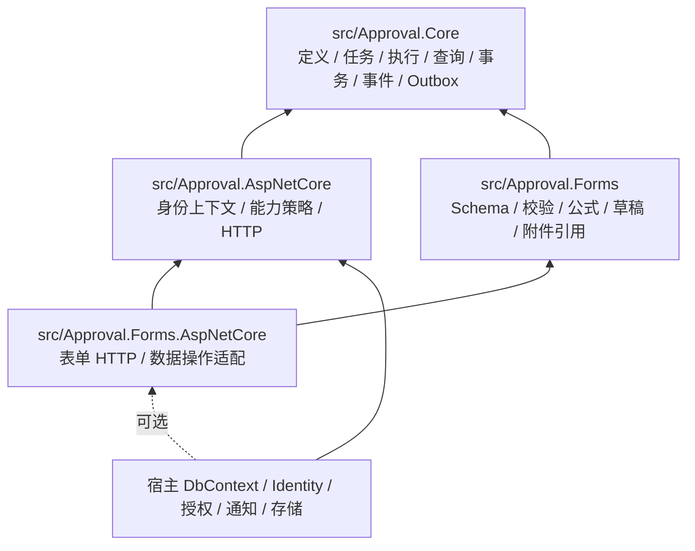

# 0.3 架构

宿主的任意 EF DbContext 通过 ConfigureApproval 加入审批模型，DI 安装 ApprovalPersistence 的 SaveChanges、查询、SQL 与事务拦截器。只有审批版本/审计/回调事务等必要边界受到保护。业务数据、审批状态、操作结果和 Outbox 使用同一工作单元提交。

Core 不引用 Forms、MVC、宿主或存储/通知提供者。Forms 通过 IApprovalDefinitionExtension、IApprovalDataProjection、IApprovalResourceResolver 扩展快照校验、数据可见性与可选资源解析。审批核心持有业务类型、业务键、流程变量和 JSON 快照。

单宿主、单实例；保留正常并发 HTTP 的数据库事务、实例并发令牌、唯一业务占用和幂等键。只有 ApprovalWorker 执行 Outbox 与超时扫描。历史记录保留策略由宿主决定。
