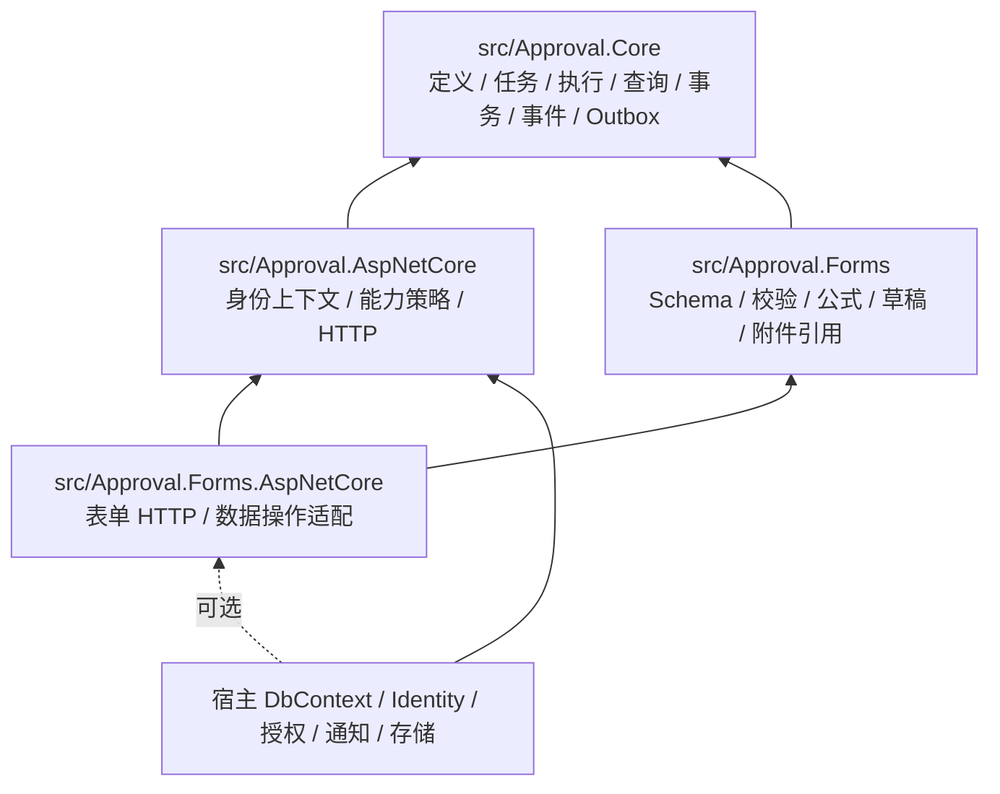

# 0.3 架构

宿主的 EF DbContext 通过 ConfigureApproval 加入审批模型，DI 安装 ApprovalPersistence 的实体加载、SaveChanges、查询、SQL 与事务拦截器。审批运行、治理、消息、幂等及可选 Forms 实体采用内部所有权授权，新增/修改/删除和批量操作都受保护；授权按 DbContext 与具体变化记录，宿主回调不继承它。业务数据、审批状态、操作结果和 Outbox 仍使用同一工作单元提交。

ApprovalHostValidation 只在启动时解析关键注册项，不是第二个 Worker。单个 ApprovalWorker 继续拥有投递和超时循环。详见[实体写入边界](persistence-write-boundaries.md)。

Core 不引用 Forms、MVC、宿主或存储/通知提供者。Forms 通过 IApprovalDefinitionExtension、IApprovalDataProjection、IApprovalResourceResolver 扩展快照校验、数据可见性与可选资源解析。审批核心持有业务类型、业务键、流程变量和 JSON 快照。

单宿主、单实例；保留正常并发 HTTP 的数据库事务、实例并发令牌、唯一业务占用和幂等键。只有 ApprovalWorker 执行 Outbox 与超时扫描。历史记录保留策略由宿主决定。

当前产品边界：单宿主、单应用实例的嵌入式通用审批引擎，Forms 可选，samples 仅为集成验证。宿主拥有用户、组织、权限和外部副作用；不包含多租户平台、服务任务、持久等待、工作日历、SLA 或审批代理。本轮计划能力及验收状态见[阶段一产品化计划](../plans/2026-11-04-approval-productization.md)，未验收项不代表已实现。
