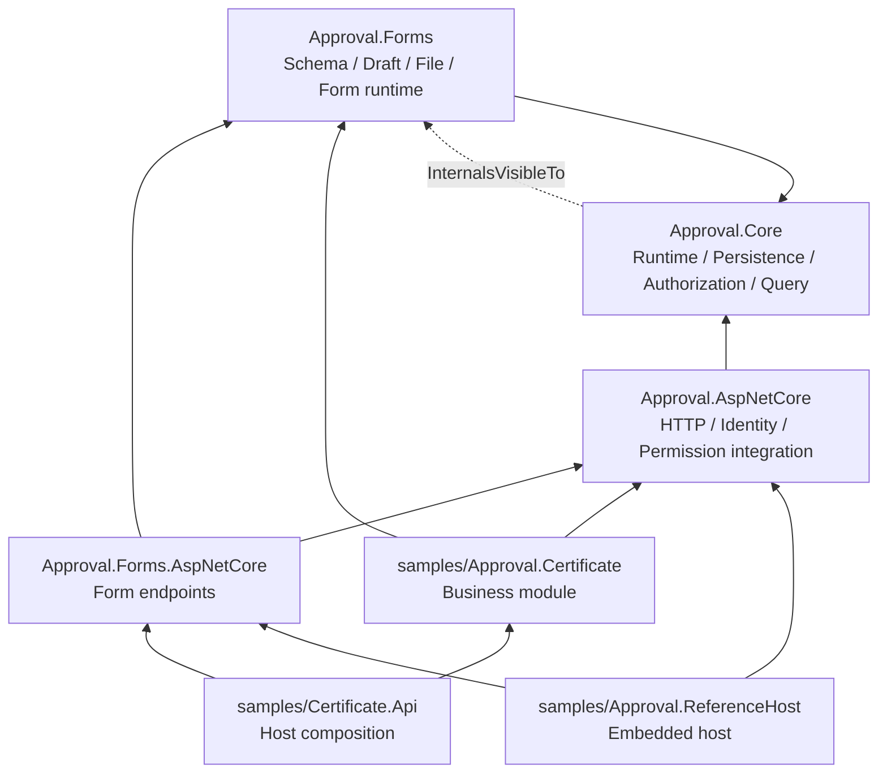
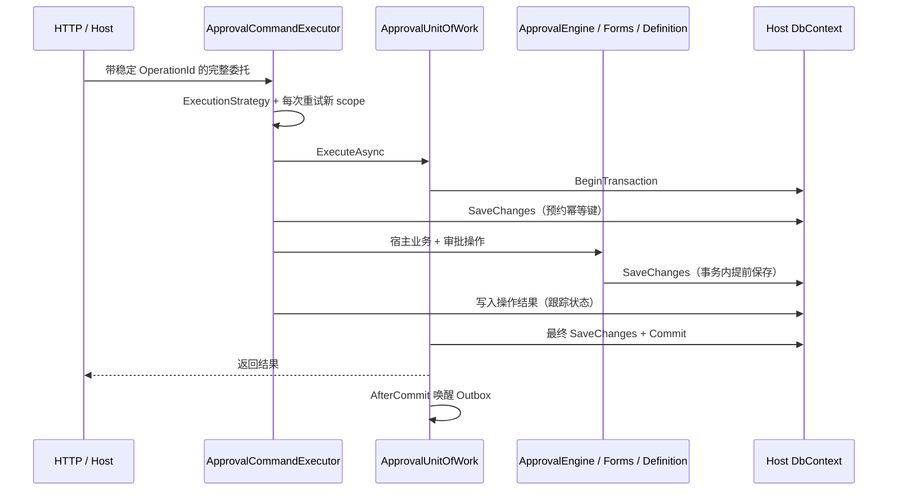

# 后端架构审计（2026-11-03）

## 审计基线与范围

- 仓库：`D:\Study\CSharp\Workflow`。
- HEAD：`ca6987815ce0b668bd1401a8b15e50da824ee81b`；开始审计时工作区干净。
- 版本：未正式发布的 `0.3.0`；SDK `10.0.401`，目标框架 `net10.0`，EF Core 包版本遵循现有中央包管理。
- 本次完成后端项目依赖盘点及 Engine、Persistence、扩展契约、Query、Forms、Authorization、DI、Definition、后台投递的关键路径审计。Schema、公式、HTTP 路由等通过结构与调用点核对；没有对每个辅助算法开展逐行形式化验证，也没有进行生产规模性能压测。
- 本文是实施前审计，配套 [五轮执行方案](../plans/2026-11-03-backend-progressive-refactoring.md)。生产代码尚未修改，五轮尚未开始。
- 分类：**确认问题**有直接代码依据；**潜在风险**需要专门复现或测量；**风格建议**不作为缺陷，也不单独驱动拆类。

## 项目依赖



依据：四个 `src/*/*.csproj` 及三个示例项目的 `ProjectReference`；图展示后端运行项目的直接依赖。Core 没有 Forms 或 ASP.NET Core 项目引用。Core 向 Forms 开放全部 internal 成员（`src/Approval.Core/Approval.Core.csproj:19`）。这一点是访问权限耦合，与程序集引用方向不同。

保留四个现有包，不新增项目，不引入 Repository、UnitOfWork 二次包装、MediatR 或通用插件框架。

## 核心职责与优先级

| 类 / 文件 | 当前职责 | 判断 | 处理轮次 |
| --- | --- | --- | --- |
| `Engine/ApprovalEngine*.cs` | 六个 partial 共 1,595 行；命令校验、任务状态、导航、Join、完成回调、审计、事件、通知、保存 | 确认职责集中；partial 没有隔离共享状态 | 第一轮 P0 |
| `Persistence/ApprovalUnitOfWork.cs` | 事务所有权、失败状态、扩展写权限、稳定 ID、AfterCommit | 大多是必要边界；不能机械精简 | 第一轮 P0 |
| `Persistence/ApprovalCommandExecutor.cs` | 新 scope 重试、幂等预约、回放授权、未知提交恢复 | 已有明确协调职责；保留整体重试语义 | 第一轮 P0 |
| `Abstractions/*.cs` | 宿主扩展契约 | 部分直接使用 Entity；Resource Resolver 已使用 DTO | 第二轮 P0 |
| `Engine/ApprovalQueryService.cs` | 344 行，工作列表、详情、业务查询、公开定义、投影、筛选 | 有可分离的详情读取职责；列表筛选已经复用 | 第三轮 P1 |
| `Forms/Runtime`、`Forms/Attachments` | 表单、草稿、附件与 Core 事务协作 | internal 知识分散，需收敛到有限入口 | 第三轮 P1 |
| `Authorization/ApprovalAuthorizationService.cs` | 154 行，Actor、规范资源、Provider、Scope、Viewer、超时 | 资源解析可独立；无需为每种资源创建类 | 第四轮 P1 |
| `ApprovalServiceCollectionExtensions.cs` | 204 行，公共注册、内部工厂、Builder 扩展 | 注册职责混排、存在属性注入；未确认 Singleton 持有 Scoped 的缺陷 | 第四轮 P1 |
| `Engine/ApprovalDefinitionService*.cs` | 382 行，元数据、验证、读、草稿、发布、治理 | 查询往返与验证路径优先于按名称拆类 | 第五轮 P2 |

以上行数包含空行和注释，作为阅读范围参考，不作为复杂度或重构验收指标。

## 确认的问题

| ID | 级别 | 证据（文件 / 方法） | 实际问题与限制 |
| --- | --- | --- | --- |
| A01 | P0 | `ApprovalEngine.cs:43–47`、`Notifications.cs:15`；`MoveToAsync`、`LoadTaskAsync`、`CommitAsync` | 六项操作状态保存在 Scoped Engine 上：步数、任务 ID、Outbox 标记、流程、结构、运行态。成功时手动清理部分状态，读取路径也能更新任务 ID，命令之间没有显式上下文边界。未据此声称存在跨请求污染。 |
| A02 | P0 | `ApprovalEngine.cs:337`、`:405`、`:511`、`:558`、`:756`、`:809` | 任务状态、流程导航、业务回调、日志事件和保存共享私有方法，职责拆分只停留在 partial 文件层面。 |
| A03 | P0 | `ApprovalEngine.cs:809`；`ApprovalUnitOfWork.cs:123–124`；`Governance.cs:79` | `CommitAsync` 实际执行状态归档、SaveChanges 和 AfterCommit 登记，真正的事务 Commit 属于 UnitOfWork；方法命名与职责容易误导。存在多次保存，但不能把所有 SaveChanges 判定为可删除冗余。 |
| A04 | P0 | `Abstractions/Abstractions.cs`：`ApproverResolveContext.Instance`、`IApprovalBusinessHandler`；`IApprovalLifecycleHandler.OnStartingAsync` | resolver、业务结束、生命周期回调直接接收 `ApprovalInstance`。Engine 将跟踪实体传入，暴露状态、并发令牌、运行态与导航属性；WriteGuard 已限制非法持久化，所以 Entity 暴露不等同于已经确认越权写入。 |
| A05 | P0 | `IApprovalAccessPolicy.GetAccessAsync`；`ApprovalDataExtensions.cs`：`IApprovalDataProjection`、`ApprovalDataView`；`ApprovalEngine.ApproveWithDataAsync` | 查看策略、投影及公开编辑委托仍依赖 Entity；投影返回 `ApprovalLog`。即使使用 AsNoTracking，也仍是长期契约耦合。 |
| A06 | P1 | `ApprovalQueryService.cs`：`InstanceDetail`、`GetInstanceAsync`、`GetByBusinessAsync`、`GetPublicDefinitionAsync` | Core 查询返回 Entity 或含 Entity 的 DTO；HTTP 层已有独立 `Approval*Response`，应保留其 JSON 契约，不能宣称 HTTP 直接返回 EF 跟踪图。 |
| A07 | P1 | `Approval.Core.csproj:19`；`ApprovalFormService`、`ApprovalFileService`、`ConfigureApprovalForms` | Forms 直接使用 `ApprovalUnitOfWork`、`ApprovalWriteOwner`、`Writes.Enter`、internal authorization、HostServices、定义固定逻辑及类型注册。协作入口分散，friend assembly 权限宽。 |
| A08 | P1 | `ApprovalQueryService.ToDetailAsync`；`DefaultApprovalAccessPolicy.GetAccessAsync`、`GetParticipatedNodesAsync` | 详情路径规范化 Viewer 后，默认 Policy 再规范化并重查实例；参与节点另查任务、抄送。实际重复调用可见，部分用于防伪与当前授权，不能无证据直接去掉。 |
| A09 | P1 | `ApprovalQueryService.GetByBusinessForViewerAsync` → `ToDetailAsync` | 业务历史逐实例执行资源授权与访问策略；默认策略内部继续访问数据库，实例数量增大时往返随数量增长。定义解析已有 `_flows` 缓存，不应重复“补缓存”。 |
| A10 | P1 | `ApprovalServiceCollectionExtensions.AddApprovalWorkflow` | 注册混合持久化、授权、运行时、查询与后台；Engine、Definition、Outbox 依赖部分由属性赋值。构造函数不能完整表达必需依赖。工厂里的 `GetRequiredService` 本身是 Composition Root 的正常用法。 |
| A11 | P2 | `ApprovalDefinitionService.Governance.cs:180`：`ListGovernanceAsync` → `GetGovernanceAsync` → `DescribeAsync` | 先查所有 Key，再每个 Key 重查 Management，并计算三个 capability。存在确定的 N+1 Management 查询和重复资源解析；摘要查询还经过含 DraftJson 的详情读取路径。 |
| A12 | P2 | `ApprovalDefinitionService.cs:69`：`Validate` | 同步方法用 `GetAwaiter().GetResult()` 等待异步权限 Provider；已有 `ValidateAsync`。同步 API 的替换涉及兼容性，不能删掉权限校验获得“异步优化”。 |
| A13 | P2 | `ApprovalDefinitionService.ListLatestAsync`、`ListFlowsAsync`；`ApprovalStatisticsService.LatestNamesAsync` | 重复使用“每 Key 最大已发布 Version”条件。新发起使用 ActiveDefinitionId 是另一种规则，不能把两者统一成同一查询。 |
| A14 | P2 | `Extensions/ApprovalExtensionCatalog.cs:41`：`LastByKey` | resolver、business handler、channel 同名 Key 使用不区分大小写的最后一个实现，无冲突提示。resolver 的覆盖已有文档，channel/lifecycle 的最后注册行为有测试保障；直接改为全部抛错属于行为变更。 |
| A15 | P2 | `ApprovalStatisticsService.cs:141`：`BacklogAsync` | 查询所有匹配待办后才在内存 GroupBy / Take(10)，数据库读取量和内存占用随全量积压增长。适合验证四个 Provider 后将可翻译的聚合移入 SQL。 |
| A16 | P2 | `ApprovalFormService.NormalizeAsync` | 人员字段逐字段调用用户目录，目录 I/O 随人员字段数量增长。批量化必须保留每字段错误归属与用户存在性校验。附件 `ApprovalFileService.ResolveAsync` 已去重 ID 并一次 ToDictionaryAsync 批量加载，不列为 N+1 问题。 |

表中简写的 Engine 文件均位于 `src/Approval.Core/Engine`；Forms 文件位于 `src/Approval.Forms`。后续改动以方法绑定为准，行号仅对应本次 HEAD。

## 潜在风险与风格建议

| 类别 | 证据 | 结论 / 下一步 |
| --- | --- | --- |
| 潜在风险 | `ApprovalEngine.CanHandleAsync` → `LoadTaskAsync(write: true)` | 读取能力检查递增并发令牌并设置操作任务 ID。需同一 scope 的读取后保存复现；改为只读会改变可观察副作用，单列缺陷修复，不能夹带在行为保持重构中。 |
| 潜在风险 | `HandleTimeoutAsyncCore` 早返回；`CommitAsync` 手动清理 | 未到期任务加载后早返回不走 Engine 清理；UnitOfWork 仍会保存跟踪变化。上下文重构需覆盖该路径，但保持原有业务结果，令牌调整另行判断。 |
| 潜在风险 | `AddApprovalWorkflow`、`AddApprovalForms` | 重复调用会追加部分核心服务、Options、内置 resolver / Forms handler。先检查真实宿主调用和重复注册语义，不预设现有生产宿主已经重复注册。 |
| 潜在风险 | `ApprovalDiagnosticsService.CheckAsync` | 有限样本内加载实例与定义后，`GetEligibleApproversAsync` 再加载实例 / 定义。已有 1–100 条预算；测量后决定批量预取收益，不增加全局缓存。 |
| 潜在风险 | `MoveToAsync`、`RaiseAsync` | 同次操作重复业务数据 JSON 解析；数据和标题可能被生命周期、审批编辑改变。任何缓存都必须按数据版本或 JSON 值失效，不能只按实例 ID 缓存。`FormSnapshots.GetForm` 已在 FlowDefinition.Form 上缓存类型化 schema，不重复添加同类缓存。 |
| 风格建议 | Query 344 行、Authorization 154 行 | 文件长度不足以证明必须拆成三个以上服务；优先提取真实职责，不按每个入口拆 Handler。 |
| 风格建议 | `ApprovalHostServices`、旧 public 构造函数 | HostServices 实现写权限隔离和结果复制，有实质安全用途；旧构造函数是公开兼容边界，不能因参数没被使用就删除。 |

未确认权限绕过、跨租户漏洞、Join 错误或事务非原子缺陷。当前模型是单宿主模式，没有 TenantId；数据隔离依赖可信 Actor、Host QueryScope、AccessPolicy 与业务资源规范化，不重新引入已移除的多租户架构。

## 事务和持久化边界



UnitOfWork 嵌套调用加入现有事务；普通公开 UnitOfWork 不授予审批实体写权限。失败后当前 DbContext / scope 不允许复用，不能用 Clear 抹掉宿主跟踪图。数据库自动重试需要命令执行器重跑完整业务委托；不能只重试某次 SaveChanges。

| 保存位置 | 当前用途 | 首轮决定 |
| --- | --- | --- |
| `ApprovalCommandExecutor.ExecuteAsync` 的预约保存 | 在执行宿主代码前占用唯一幂等 Key，防止两个请求都执行提交委托 | 保留；不能移至最后保存 |
| `ApprovalEngine.CommitAsync` | StateJson / CurrentNodeId 归档、并发检查、使同事务后续数据库查询看到任务 / 实例、登记提交后唤醒 | 明确为 Flush；首轮保留保存和错误映射 |
| `ApprovalUnitOfWork.ExecuteAsync` | 保存宿主剩余修改和命令结果；唯一最终 Commit / Rollback 所有者 | 保留；不因前面保存过而删除 |
| `ApprovalDefinitionService.SaveGovernanceAsync` | Revision / 唯一键冲突及时映射，后续授权与读取可见新版本 | 保留；发布前后资源解析要专测 |
| Forms 草稿保存 / 删除 | 同事务持久化草稿及附件关系 | 先保留；优化需验证跨命令读取与回放 |
| `ApprovalFileService.UploadAsync` | 宿主文件存储 + 独立元数据保存；保存失败删除存储对象 | 不并入 Engine 事务，不移动补偿时机 |
| Outbox 成功 / 失败 / Retry 保存 | 投递结果、失败单独事务、并发错误和日志时点 | 首轮不改；投递回调的 allowSave 特例保留 |
| Message / CarbonCopy 已读保存 | 独立写所有者与并发 / 幂等处理 | 首轮不改，后续仅有证据再优化 |

AfterCommit 是进程内 best effort，可靠投递来自与审批同事务保存的 Outbox。迁移操作上下文不能让数据库提交前发信号，也不能把可靠业务事件改成 AfterCommit 委托。

## 公共扩展契约及影响范围

| 契约 | 当前暴露 | 可收敛方向 |
| --- | --- | --- |
| `IApprovalBusinessHandler` | 跟踪 ApprovalInstance | CompletionContext：业务键、实例与定义标识、最终状态、必要快照 |
| `IApproverResolver` | Instance、可变 FlowNode、FormData | ResolveContext 内只读 Instance / Node snapshot，必要参数明确传递 |
| `IApprovalLifecycleHandler` | 开始前跟踪实例，可修改 Title / FormDataJson | 输入快照 + PreparationResult；区分未修改与显式赋空，Core 应用允许字段 |
| `IApprovalAccessPolicy` | ApprovalInstance | 实例读取上下文；保护默认策略及其 public 派生扩展点 |
| `IApprovalDataProjection` | Instance、返回 ApprovalLog Entity | 输入数据 / 审计快照、输出过滤后视图 |
| `IApprovalResourceResolver` | ApprovalResource record | 已是窄 DTO，保持契约，不创建重复包装 |
| `IApprovalQueryScope` | IQueryable<ApprovalInstance> | 有意用于宿主 SQL 范围组合；单独评估，不能无替代删除 |

`IReadOnlyList` / `IReadOnlyDictionary` 只限制接口操作，不保证底层对象不可变。映射必须复制可变集合，避免 Snapshot 的导航对象仍指向跟踪图。

已识别的受影响位置：

- Core：Engine、AssigneeService、BuiltIn / Organization resolver、DefaultApprovalAccessPolicy、Query、CommandExecutor 回放。
- Forms：`FormDataProjection`、`FormApprovalHandler`、表单编辑委托和 `FieldVisibility.FilterLogs`。
- HTTP：`ApprovalResponses.cs` 的映射及可选表单编辑适配器；保持已提交的 JSON / OpenAPI 字段与日期表示。
- 示例：`samples/Approval.Certificate/Certificates/CertificateApprovalHandler.cs`、`CertificateAccessPolicy.cs`、`CertificateQueryService.cs`，Certificate.Api 的注册。
- 测试：`TestInfrastructure`、`ActionAndTimeoutTests`、`ActionRollbackTests`、`ActionOverrideTests`、`OrganizationApproverTests`、`ApprovalWriteProtectionTests`、`ApiHost`、`AtomicDatabaseContractTests`、`FinalAcceptanceDatabaseTests`、`CertificateConcurrencyTests` 中的实现与装饰器。
- 消费者与文档：`eng/consumers/EmbeddedHost`、独立包消费者、宿主接入与迁移文档。

接口参数替换是 C# source / binary contract 变化；HTTP JSON 保持不变不能证明 C# 兼容。当前有 OpenAPI / JSON 契约检查，没有搜索到 PublicAPI.Shipped 或 ApiCompat 门禁。第二轮必须先记录 API 选择，不能静默更新接口及所有测试后宣称兼容。

## 冗余清单与保留理由

| 项目 | 权威实现 / 可复用边界 | 行动 |
| --- | --- | --- |
| 未完成任务判定 | Engine 的 `IsOpen` / `CurrentTasksOf` | 任务协作者承接；LINQ-to-Entities 不能直接调用普通 C# helper |
| 撤回能力判断 | `ApprovalEngine.CanWithdraw` 已供详情复用 | 保留共用规则，不另造 UI 版本 |
| 转交 / 改派任务复制 | `ApprovalEngine.Admin.HandOver` 已复用 | 保留字段与加签关系完整复制 |
| 撤回 / 终止 / 驳回重复取消 | 已有 `FinishAsync` 再取消，调用点也取消 | 核对事件发生时任务状态后再去重，不单凭文本重复删除 |
| 最新已发布版本 | Definition 的两个列表、Statistics 的名称查询 | 提取内部 Query 条件；与 Active version 严格区分 |
| Entity → HTTP response | `ApprovalResponses.cs` 已集中 | 重用一次 Core snapshot 映射，HTTP 保持独立 transport contract |
| 权限调用与资源重查 | Authorization 与默认 Policy / Query | 保留当前授权，不全局缓存 Allow；优化数据库加载先于改变授权次数 |
| 用户与附件查找 | Forms Normalize / Resolve | 人员目录可改输入级批量读取；附件数据库批量加载已有，保留每字段错误归属与安全规则 |
| `Trim`、截断、异常小方法 | 各职责内部 | 无明显跨职责收益时不建 Utils |
| HostServices 包装 | 扩展撤销写权、保护可变返回值 | 有实际安全边界，保留 |

## 本次验证结果

在仓库根执行：

```powershell
Set-Location -LiteralPath 'D:\Study\CSharp\Workflow'
pwsh -NoProfile -File './eng/verify.ps1' -Scope 'Backend'
```

命令完成，退出码 0，输出 `Verification succeeded: Backend`。

| 检查 | 实际结果 |
| --- | --- |
| SDK / 工具 / Restore | SDK 10.0.401；dotnet-ef 10.0.14 工具还原成功；solution restore 成功 |
| Release solution build | 0 warnings，0 errors |
| Approval.Core.Tests | Passed: 378, Failed: 0, Skipped: 0 |
| Approval.AspNetCore.Tests | Passed: 81, Failed: 0, Skipped: 0 |
| Approval.Database.Tests | Passed: 31, Failed: 0, Skipped: 0；默认 SQLite |
| Certificate.Api.Tests | Passed: 58, Failed: 0, Skipped: 0 |
| 合计 | Passed: 548, Failed: 0, Skipped: 0 |
| EF Migration 模型漂移 | Certificate 1 个、ReferenceHost 4 个、Database Contract 4 个上下文均无 pending model changes |
| ReferenceHost SQLite 冒烟 | Passed: 27 checks；`output/reference-host/805a53469aa7455e9f11afa8450a2a05/smoke.json` 的 `passed` 为 true |
| SQL Server / PostgreSQL / MySQL 真实集成 | 本次未运行；`docker info` 无法连接 dockerDesktopLinuxEngine named pipe，daemon 未运行 |

九个 Provider 模型检查通过只是模型证据，不能当作三个服务数据库事务测试通过。历史 RC / CI 报告仅作背景，本次不引用其结果作为当前证明。

## 当前交付状态

本次新增审计报告及可执行计划，无生产代码、HTTP 契约、数据库模型或包依赖改动。实施后的类数量、冗余减少量、性能收益和兼容性结果须在每轮实际 Diff 与测试结果中填写，不能提前声明已实现。
