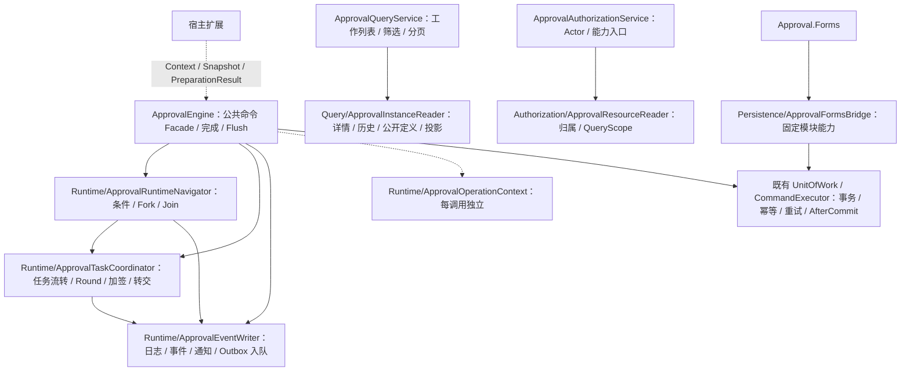

# 后端渐进式重构交付报告

代码起点：`ca6987815ce0b668bd1401a8b15e50da824ee81b`。按既定 P0 → P0 → P1 → P1 → P2 五轮顺序执行，每个主题均有独立编译、测试和 Diff 审查；数据库专项按用户追加要求转 GitHub CLI / Actions。最终代码的 CI 验收编号和结果在末尾补录。

## 架构变化

原 Engine 六个 partial 共1,595行且共享操作字段。现在五个公共命令 partial 共1,119行，导航、任务、事件具有实际独立实现；减少476行指的是 Facade 范围，不是全仓净减少，也不以行数作为优化质量证明。

Core / Forms / AspNetCore / Forms.AspNetCore 四个包保留，没有新程序集、NuGet、Repository、UnitOfWork 包装、MediatR 或逐方法 Handler。

## 修改文件清单

| 文件 | 实际改动 |
| --- | --- |
| `src/Approval.Core/Engine/ApprovalEngine.cs` | 显式操作上下文、协作者调用、统一完成与 Flush；扩展 snapshot / preparation；internal ctor 注入 |
| `Engine/ApprovalEngine.Admin.cs` | 改派 / 转交调用任务协作者，实例内各任务日志 ID 明确，保留逐实例事务 |
| `Engine/ApprovalEngine.Collaboration.cs` | 退回 / 加签 / 重新提交传上下文，任务与事件调用隔离 |
| `Engine/ApprovalEngine.Timeouts.cs` | 同上下文驱动超时、任务决定和事件，保留早返回 / 并发行为 |
| `Engine/Runtime/ApprovalOperationContext.cs` | 六项操作状态与结构 / Join 查找缓存，调用结束自然释放 |
| `Engine/Runtime/ApprovalRuntimeNavigator.cs` | 自动节点、条件、并行 scope、汇聚停止 / 结束返回 |
| `Engine/Runtime/ApprovalTaskCoordinator.cs` | 最近有效 Round、状态、Sequential / 前加签恢复、任务复制与关系迁移 |
| `Engine/Runtime/ApprovalEventWriter.cs` | 替代 Notifications partial，追加日志 / 事件 / Cc / 消息 / 通知 Outbox |
| `Engine/OutboxJson.cs` | 原 JSON 编码器迁移，原 namespace / 设置不变 |
| `Engine/Runtime/ApprovalAssigneeService.cs` | Resolver 输入只读实例 / 节点快照，移除整节点 JSON 复制 |
| `Abstractions/ApprovalSnapshots.cs` | 共用 Instance / Node / Task / Log / Definition DTO、StartPreparation / ProjectionContext 与内部映射 |
| `Abstractions/Abstractions.cs` | Business / Resolver 契约改为 Context |
| `Abstractions/IApprovalLifecycleHandler.cs` | 快照输入，明确标题 / JSON 准备结果 |
| `Abstractions/IApprovalAccessPolicy.cs` | 实例 Context 输入 |
| `Abstractions/ApprovalDataExtensions.cs` | 投影与审计快照返回 |
| `Engine/DefaultApprovalAccessPolicy.cs` | 接收快照但继续读真实实例并规范 Viewer |
| `Engine/ApprovalQueryService.cs` | 公共入口委派真实 Reader，工作列表共用查询保留，结果 DTO化 |
| `Engine/Query/ApprovalInstanceReader.cs` | 访问 / 投影 / 详情，批量预取定义 JSON，授权后解析 |
| `Authorization/ApprovalAuthorizationService.cs` | Actor / Provider 判断保留，资源与 Scope 调用分离 |
| `Authorization/ApprovalResourceReader.cs` | 保留原规范资源、Scope、超时、取消和 Extension 隔离 |
| `Persistence/ApprovalFormsBridge.cs` | Forms 固定写所有者、Title、ID、固定定义与宿主隔离入口 |
| `Persistence/ApprovalUnitOfWork.cs` | 移除已无调用的 prepared / prepareData 扩展参数，原事务 / 保存 / allowSave 特例保持 |
| `Persistence/ApprovalCommandExecutor.cs` | Replay access policy 使用快照，原键、结果版本、未知提交恢复保持 |
| `ApprovalServiceCollectionExtensions.cs` | 五组 private registrations，可选依赖构造注入，public Builder / 生命周期保持 |
| `Engine/ApprovalOutboxService.cs` | EventHandler internal ctor 注入，投递算法不变 |
| `Engine/ApprovalDefinitionService.cs` | 构造注入、复用版本查询、Metadata一次排序、去多余复制和死字段 |
| `Engine/ApprovalDefinitionService.Governance.cs` | 治理摘要一次投影，保留原资源权限及 capability 调用 |
| `Engine/ApprovalDefinitionAvailability.cs` | 最新已发布版本权威条件，与 active version 分开 |
| `Engine/ApprovalStatisticsService.cs` | Ordinal 分组流式汇总，保留排序 / 时限 / 统计公式 |
| `src/Approval.Forms/Runtime/ApprovalFormService.cs` | Context 编辑结果、固定桥接、目录批量校验 |
| `Runtime/ApprovalFormService.Drafts.cs` | 固定桥接事务和稳定 ID |
| `Attachments/ApprovalFileService.cs` | 固定元数据写桥接和 Viewer，原文件失败补偿 / 批量读保留 |
| `ApprovalFormsModelBuilderExtensions.cs` | 固定桥接注册保护类型，模型不变 |
| `Runtime/FormDataProjection.cs` | 只读数据 / 日志输入 |
| `Schema/FieldVisibility.cs` | 审计 record with 过滤，保留其余值避免重复复制 |
| `src/Approval.AspNetCore/Contracts/ApprovalResponses.cs` | Context snapshot 映射，原 HTTP JSON保持 |
| `src/Approval.AspNetCore/IApprovalEndpointModule.cs` | Task data adapter 去 Entity |
| `src/Approval.Forms.AspNetCore/ApprovalFormsAspNetCoreExtensions.cs` | 可选 adapter 签名同步 |
| `samples/Approval.Certificate/Certificates/CertificateApprovalHandler.cs` | 只读 Context，本地业务同事务逻辑保持 |
| `contracts/Approval.Core.api.txt`、`Approval.AspNetCore.api.txt`、`Approval.Forms.api.txt`、`samples/Approval.Certificate/contracts/Approval.Certificate.api.txt` | 明确授权且审查后的 C# API 基线变化 |

Core 文件简写以 `src/Approval.Core/` 为前缀，Forms 文件简写以 `src/Approval.Forms/` 为前缀。

测试新增：OperationTests 中四个命令 / 事务风险方法；ExtensionContextTests、QueryBoundaryTests、FormsBoundaryTests、CompositionRootTests、DefinitionQueryOptimizationTests、RuntimeQueryOptimizationTests。新增测试主要验证外部结果和边界，没有为每个协作者机械镜像测试。

第五轮新增数据库 Provider 回归：`tests/Approval.Database.Tests/QueryOptimizationDatabaseTests.cs`，针对治理摘要 nullable 版本投影 / 资源过滤与流式待办大小写 / 状态过滤，本地只编译，由 GitHub 执行。

测试同步修改：Core 的 AccessControl、ActionAndTimeout、ActionOverride、ActionRollback、ApprovalWriteProtection、EngineRule、Notification、OrganizationApprover、TestInfrastructure；HTTP ApiHost / HttpResponseContract；Database Atomic / FinalAcceptance fixtures；CertificateConcurrency。保持原业务断言，写保护攻击改从注入 DbContext 实际更改实体而非修改已经移除的 Entity 参数。

文档更新：事务、宿主接入、写保护、数据库 GitHub CLI 验证；新增架构审计、计划、API 迁移及五轮报告。

## 冗余与耦合

操作字段、手动复位和跨 partial 隐式状态实际移除。日志 / 事件 / 任务筛选、复制、有效 Round 有统一实现。治理摘要去掉逐 Key 重读与完整 DraftJson，公开投影不再复制每个日志字段。没有创建杂项 Utils 或 Generic Repository。

宿主扩展不再依赖跟踪图、StateJson、ConcurrencyStamp；Forms 的实际 internal 引用限定固定 Bridge，保留 friend但加入签名 / IL 边界测试，不假称编译器访问权限已缩小。Public Query 结果为 snapshot / DTO；必要 ORM模型和数据库范围组合继续存在。

## 性能及其限度

已量化：三份治理摘要 Management 查询从逐 Key 重读变为1；两个版本业务历史的定义内容读取为1；多个 User字段的目录校验为1。实际权限 / capability 调用数量保持，并有断言。

Backlog 保留内存从任务行集合变为不同审批人的计数字典，不承诺降低数据库传输行数。没有生产规模压力测试，不宣称吞吐或延迟提升百分比。不建立全局 Flow / JSON / ACL cache。

## 兼容性

用户已明确授权 C# breaking change，所有变化和迁移方法见 [API 迁移](backend-context-api-migration.md)。HTTP OpenAPI、JSON schema、TypeScript HTTP contract、数据库模型和 Migration保持，OperationId / Outbox版本未变。

Engine 公共命令方式、状态机、Parallel / Join、Any / All / Sequential、加签、转交、退回、撤回、超时、业务原子提交和写保护保持。明确保留原 SaveChanges 次数 / 时点及失败 scope 不能复用规则。

## 回归证据

本地最终：Release build 0 warnings / 0 errors；业务测试 Passed535 / Failed0 / Skipped0（Core396、HTTP81、Certificate58），Contracts 成功。用户追加约定后未在本地运行数据库专项或启动 Docker。

| Requirement | Evidence |
| --- | --- |
| Engine 操作 / 事务 / 幂等边界 | `OperationTests.NextStart_DoesNotReuseTaskIdFromReadOrNoopTimeout`、`HostUnitOfWork_StartThenApproveUsesFlushedTasksAndCommitsTogether`、`AutoStepBudget_IsPerCommandAndOverflowRollsBack` |
| EF 扩展快照 / 准备结果 | `ExtensionContextTests.ResolverAndEditSnapshots_RemainStableWhenTheInstanceCompletes`、`LifecyclePreparation_CanClearTitleAndReplaceDataWithoutReceivingAnEntity` |
| Query 与 Forms 边界 | `QueryBoundaryTests.BusinessHistory_BatchesDefinitionReadsAcrossVersionsAndReusesTheRequestCache`、`DeniedHistory_DoesNotParseAnUnreadableCorruptDefinition`、`FormsBoundaryTests.Forms_ReferencesCoreInternalsOnlyThroughTheFixedBridge` |
| 授权和 DI | `PermissionTests.ProviderReceivesCanonicalResource_RevocationHasNoCachedAllow`、`CompositionRootTests.CompositionRoot_ValidatesScopesAndSharesOnlyTheHostContextWithinEachScope` |
| Definition / 性能 / 字段错误 | `DefinitionQueryOptimizationTests.GovernanceSummary_LoadsOneProjectionAndPreservesPerResourcePermissionChecks`、`RuntimeQueryOptimizationTests.UserFields_ShareOneDirectoryReadAndKeepErrorsOnTheOriginalField`、`Backlog_StreamsOrdinalAssigneesAndPreservesCountsDeadlinesAndOldestArrival` |
| HTTP v1 / 回滚 / 并发 / 发布 / Forms 全流程 | 原 Core / HTTP / Database / Certificate 全量及 Golden fixtures，CI 精确 head结果如下 |

## 保留项

原公开同步 Validate 保留源兼容，仓库内调用已异步；不通过移除权限获得“无同步等待”。重复扩展的 last-wins 属于已有约定，未改成全部启动失败，后续需要明确替换 / 禁止重复的配置契约。

不直接用 SQL GROUP BY 改审批人汇总，因为宿主排序规则可能合并大小写不同 ID；当前流式方式保留 Ordinal 分组。Definition / 发布命令中的必要模型 API仍存在，没有为抽象完整性强制推翻成熟治理实现。

## 最终评价

可维护性：操作、导航、任务、事件、读取与资源归属有实际独立权威实现。可扩展性：宿主 Context / Preparation 边界明确，原扩展与后台投递能力保持。低冗余：重复状态、查询、转换有实质减少。低耦合：EF跟踪图与模块 internal 知识收敛，未用新程序集或接口堆叠换取形式上的分层。

## 最终 GitHub CI 验收

最新代码提交、run URL、各 Provider 的 TRX / manifest、Windows全量 / package消费者结果待完成后补录；不以旧head的绿色结果代替。
