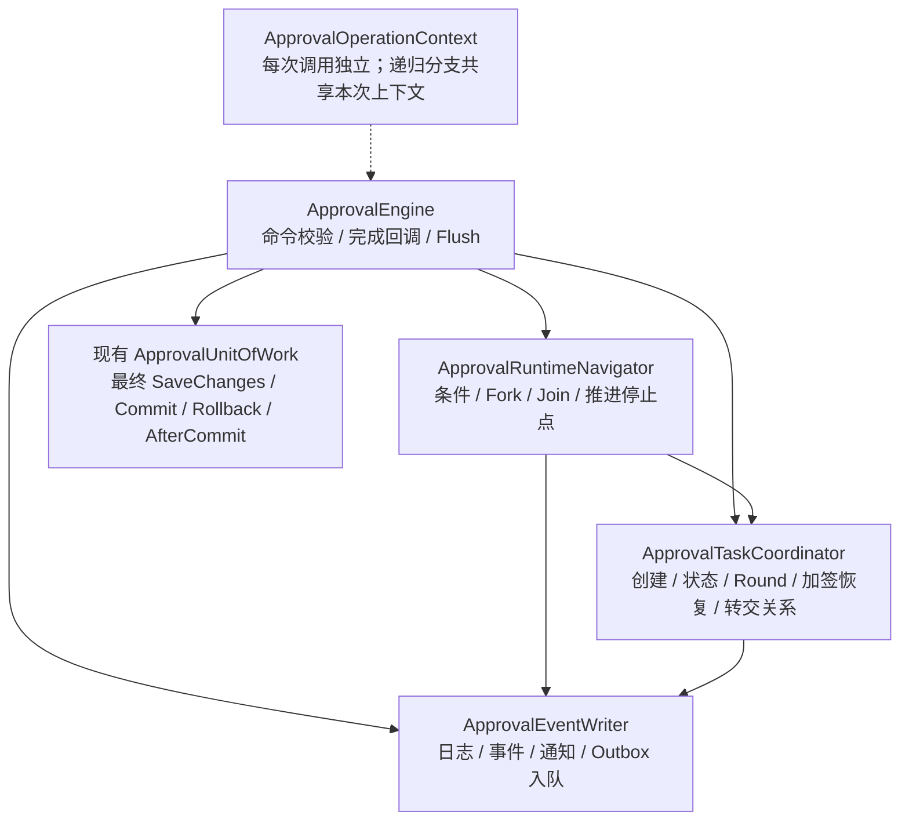

# 后端重构第一轮：Engine、操作上下文与事务边界

完成日期：2026-11-03；代码起点 `ca6987815ce0b668bd1401a8b15e50da824ee81b`。本报告只对应第一轮，不代表五轮全部完成。

## 实际变化



- 新增 `src/Approval.Core/Engine/Runtime/ApprovalOperationContext.cs`，六项操作状态从 Scoped Engine 字段移入每次调用创建的上下文；私有调用链显式传参。
- 新增上述三个具体协作者，无新内部接口、程序集或 NuGet 依赖。任务协作者不反向调用导航器，完成逻辑继续集中在 Engine。
- 私有 `CommitAsync` 更名为 `FlushOperationAsync`；所有原 SaveChanges、并发错误映射、幂等预约和提交后唤醒时点保留。事务级固定定义、稳定 ID 与失败状态仍由原工作单元拥有。
- 删除 `ApprovalEngine.Notifications.cs` partial；共享 Outbox JSON 编码器移到 `Engine/OutboxJson.cs`，保持原 namespace 与序列化设置。
- Engine 主文件、Collaboration、Admin、Timeouts 迁移调用点。公共 Engine 方法及构造函数签名、HTTP、模型和 Migration 保持不变。
- 更新事务和写保护文档；`OperationTests.cs` 增加操作隔离、同事务继续审批、步数边界和多任务改派验证。

## 行为证据

新增隔离用例在原实现上均复现错误：查询退回目标或未到期超时早返回后，再启动另一自动通过实例，AutoApprove 日志会引用前一个实例的任务。本轮独立上下文消除此错误关联。未改变 CanHandle 或未到期超时路径原有的并发令牌副作用。

| Requirement | Evidence |
| --- | --- |
| 读取 / 无操作超时不向下一命令传递 TaskId | `OperationTests.NextStart_DoesNotReuseTaskIdFromReadOrNoopTimeout`，两个参数用例原实现失败、修改后成功 |
| 先启动再审批共享事务，任务已提前保存 | `OperationTests.HostUnitOfWork_StartThenApproveUsesFlushedTasksAndCommitsTogether`；明确断言数据库任务、状态与日志 TaskId |
| 保留三个 SaveChanges 时点 | 同一用例的 SaveChangesInterceptor 断言依次为 1、2、3；两个 Engine Flush 后仍有事务，最外层再最终保存 |
| 每条命令 200 步边界，201 步拒绝并完整回滚 | `OperationTests.AutoStepBudget_IsPerCommandAndOverflowRollsBack`；199 条件 + End 连续两次成功，200 条件 + End 的实例 / 日志 / Outbox 均回滚 |
| 同实例多个改派任务日志归属及 Join 状态 | `OperationTests.BulkReassign_LogsEachOriginalTaskAndPreservesParallelState`；两个原 TaskId 对应各自日志，旧任务 Transferred，新任务 Pending，StateJson 不变 |

## 验证结果

每个主题先执行独立 Release solution build，再运行相关测试并审查 Diff。所有构建 0 warnings / 0 errors。

| 门禁 | Passed | Failed | Skipped |
| --- | ---: | ---: | ---: |
| 1A OperationTests | 14 | 0 | 0 |
| 1A Core 全量 | 384 | 0 | 0 |
| 1A SQLite Database 全量 | 31 | 0 | 0 |
| 1B Operation / HostDbContextIntegration | 20 | 0 | 0 |
| EventWriter 相关测试 | 73 | 0 | 0 |
| TaskCoordinator 相关测试 | 57 | 0 | 0 |
| 第一轮完整后端门禁 | 554 | 0 | 0 |

完整门禁明细：Core 384、AspNetCore 81、Database 31、Certificate.Api 58；九个 Migration 模型检查无漂移；ReferenceHost SQLite smoke 27 checks。命令退出码 0，`Verification succeeded: Backend`。

```powershell
Set-Location -LiteralPath 'D:\Study\CSharp\Workflow'
pwsh -NoProfile -File './eng/verify.ps1' -Scope 'Backend' -SkipRestore
git diff --check
```

相关 TRX 位于 `output/backend-refactoring/round1-{context,flush,events,tasks}/`；最后冒烟报告为 `output/reference-host/8c300780f36145179d95cf37c0812a24/smoke.json`。

三个服务 Provider 本次尚未运行，Docker daemon 不可连接；模型检查不能替代真实 SQL Server / PostgreSQL / MySQL 事务验证。没有性能压测，不宣称速度提高；收益是操作状态隔离、职责归属和提交边界更清晰。
