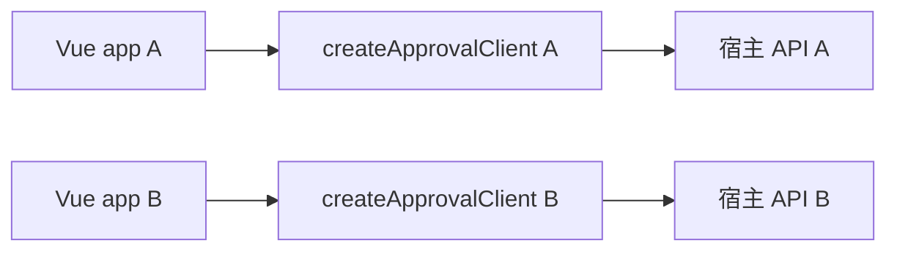

# 前端客户端与宿主接入

新接入推荐创建独立客户端。组件、composables、当前用户和人员目录缓存从 Vue 注入中取得同一实例，事件处理与异步回调保留该实例。

```ts
import { createApprovalClient, createApprovalRoutes } from '@approval/ui'
import type { FlowDefinition, FormSchema } from '@approval/ui/contracts'

const approval = createApprovalClient({
  apiBase: '/api/approval',
  headers: () => ({ Authorization: `Bearer ${session.token}` }),
  userKey: () => `${session.tenantId}:${session.userId}`,
  fetcher: hostFetch,
  businessPanels: { Certificate: CertificatePanel },
})

app.use(approval)
// 将 createApprovalRoutes() 挂到本应用的 router 布局中。
// 非组件代码显式使用同一个客户端。
await approval.api.todo()
await approval.http.post('/api/certificates', payload, { 'Idempotency-Key': submissionId })
```

`hostFetch` 保留原始 Response、HTTP 状态和 AbortSignal，可继续使用 Admin 的认证与令牌刷新桥接。类型入口 `@approval/ui/contracts` 仅导出协议类型，不依赖 Vue Flow 或 feature 实现。

## 多实例与生命周期



- 每套页面使用自己的 router，路由名称维持现有 `approval-*` 契约；query 更新按 router 隔离。
- 客户端的配置、业务面板映射、用户信息、目录可用性、名称与角色缓存分别独立。headers 每次请求时读取。
- `userKey` 应包含会影响权限或目录范围的身份信息；变化时取消旧缓存请求，清除旧缓存并重新加载用户和已请求过的角色列表。即使宿主忽略取消，旧目录响应也不能写回新身份缓存。
- 客户端安装的最后一个应用卸载时会释放共享监听与缓存请求；非 Vue 使用者可调用 `approval.dispose()`。普通 HTTP 请求的取消由调用者传入的 AbortSignal 管理。
- 包内组件在 setup 中调用 `useApprovalClient()`，异步事件闭包继续使用捕获的客户端；CI 的依赖边界检查会拒绝 UI 代码直接导入全局 `approvalApi`、`http`、`approvalConfig` 或 `approvalUserKey`。

## 原接入方式兼容

`app.use(ApprovalUI, options)`、`configureApprovalUI()`、全局 `approvalApi` 与 `http` 继续共用兼容单实例。`configureApprovalUI` 的更新会作用于这一实例，保持现有 demo 与 Admin 的接入语义。

`createApprovalClient()` 创建的实例不受全局配置更新影响。组件外也应使用对应的 `client.api` / `client.http`，避免在多个宿主之间混用全局兼容入口。demo 与独立包消费者使用新客户端；Admin 保留原入口，继续验证兼容性。
