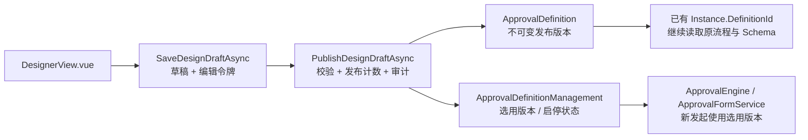

# 流程设计、发布与启停

设计草稿、不可变发布版本和允许新发起的状态分别保存。业务表单草稿仍使用原 `ApprovalDraft`，与这里的流程设计草稿无关。

## HTTP 与 Core 接入

下面的路径均相对于 `MapApprovalEndpoints` 的路由前缀。写操作使用 `Idempotency-Key`；需要严格拒绝缺键时开启 `RequireOperationId`。Core 复合调用通过 `IApprovalCommandExecutor` 包裹完整委托。

| 接口 | 操作 / 权限 |
|---|---|
| GET `/definitions/governance` | 包含仅有草稿的流程清单及逐资源 capabilities；`definition.read-sensitive` |
| GET `/definitions/{key}/governance` | 设计草稿、状态、编辑令牌；`definition.read-sensitive` |
| PUT `/definitions/{key}/draft` | `{ name, definitionJson, expectedRevision, sourceDefinitionId }`；`definition.design` |
| POST `/definitions/{key}/publish-draft` | `{ expectedRevision, changeNote }`；`definition.publish` |
| POST `/definitions/{key}/enabled` | `{ enabled, expectedRevision, changeNote }`；`definition.disable` |
| POST `/definitions/{key}/select-version` | `{ definitionId, expectedRevision, changeNote }`；`definition.publish` |
| GET `/definitions/{key}/audit?page=1&pageSize=20` | 同事务治理审计；`definition.read-sensitive` |
| GET `/definitions/synchronous-actions?page=1&pageSize=20` | 旧动作只读扫描；同时要求 `diagnostics.read` 与 `definition.read-sensitive` |

表中的权限省略共同前缀 `approval.`。启停和选用版本的写响应不返回保存的草稿 JSON；拥有操作权限不自动获得敏感定义读取权限。

新流程首次保存使用 `expectedRevision=0`。从读取结果获取后续令牌，每次治理写入递增令牌；其他人已保存、发布或启停时返回 409，重新读取后检查差异再提交。草稿只解析 JSON，允许保存尚未通过结构校验的设计；发布始终执行完整校验。

发布号由独立管理记录中的持久计数及并发令牌控制，唯一约束提供最终防线。并发初始化或发布的失败方整体回滚并返回冲突；不会留下失败审计、命令结果或覆盖获胜版本。首次治理写入旧流程时从现有最大版本初始化计数，不虚构旧发布人或旧审计。

原 `PublishAsync` 和 POST `/definitions/{key}` 继续可用，并接入相同计数和审计。旧宿主先校验后显式传递 `StartApprovalRequest.DefinitionId` 的绑定语义保留；未显式绑定的新发起使用当前选用版本。两条路径都受停用状态限制。

## 草稿、历史与恢复

保存草稿不会改变新申请使用的发布版本。发布会生成新版本并选用它，保留当前启停状态；发布停用流程不会自动启用。选用历史版本和重新启用均为显式权限操作并留下审计。历史 JSON、在途实例的 DefinitionId 和原表单 Schema 不变。

`Revision` 是所有治理操作的并发令牌，`DraftRevision` 与 `PublishedDraftRevision` 用于判断草稿是否有未发布内容；启停操作本身不会制造草稿修改。发布版本禁止通过 SaveChanges 或 EF 批量更新改写，治理审计禁止改写或删除。

审计保存可信操作人、UTC 时间、动作、版本/来源 ID、变更说明及定义摘要，不保存动作参数或凭据。读取完整草稿及版本仍要求敏感定义权限。外部日志或通知由宿主登记 `AfterCommit` 或使用 Outbox；外部调用不属于本地审计事务。

设计器支持保存后刷新恢复草稿、发布变更说明，以及在“版本与治理”中启停、选择历史版本和查看审计。按钮采用资源 capabilities，实际提交仍由 Core 复核。网络错误或待确认结果保留原键与原内容；同页重试不重复保存或递增发布版本。刷新后若当前令牌已经变化，先核对审计/版本中的原结果，再显式开始新操作，不能盲目生成新键重做。

## 旧同步动作扫描

扫描按发布版本分页，包含在途实例数量，仅返回定义 ID、流程键、版本、节点、动作类型与原因，不输出参数。`ExternalSideEffect` 表示声明了外部写副作用的同步动作；`SelfCommit` 表示扩展声明 `CommitsWorkUnit=true`；`UnregisteredSyncAction` 与 `InvalidDefinition` 需要人工复核。

新发布拒绝自行提交工作单元的扩展。外部同步动作默认拒绝发布，遗留宿主可显式开启 `AllowSynchronousExternalActions` 并承担远程幂等与补偿边界。扫描不执行动作，不更改旧定义、不自动改为 Async，也不重新绑定在途实例。未声明的任意自定义代码无法仅凭 JSON 判断是否自行提交；宿主须核对其实现，运行时工作单元保护继续有效。

## 数据库升级

本阶段为四个测试 Provider 和证照示例各追加 `DefinitionGovernance` 迁移，创建 `ApprovalDefinitionManagement`、`ApprovalDefinitionAudits` 及租户关联、唯一约束和并发列。原迁移 ID 保留。宿主应基于自己的 Provider 和模型生成迁移，并在备份、停止旧 writer/worker 后演练应用。

旧流程在尚无管理记录时保持可发起，默认使用最新发布版本；首次治理写入创建管理记录。没有自动归属推断或审计补造。开放新写入后优先前向修复；删除治理表会丢失状态与审计，不能作为普通回退办法。MySQL DDL 的隐式提交限制仍适用。

完整本机验收与限制见[阶段实施记录](../plans/2026-11-02-multitenant-production-hardening-progress.md)。诊断与生命周期清理属于下一阶段。
