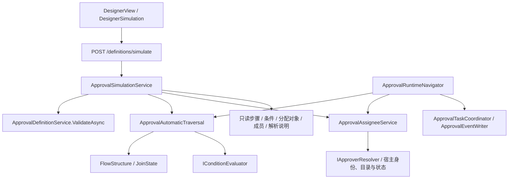

# 发布前预演、审批人预览与异常处理

本能力适用于单宿主、单应用实例的嵌入式通用审批引擎。它不执行人工决策、业务准备回调或外部副作用，不提供数据库修复。

## 预演边界与复用关系



正式执行和预演共用自动节点遍历：条件按优先级求值、默认分支最后，求值失败不进入默认分支；并行和嵌套 Join 使用相同的分支身份和到达规则；共用 200 步自动推进限制。只有正式适配器能创建任务、抄送、审计和 Outbox。

人工节点显示候选分配后停止该分支。并行的其他分支继续预演，未到齐的 Join 明确显示等待。空处理人沿用节点的 Error / AutoApprove 策略。`isComplete` 仅表示自动路径到达结束节点；`isValid` 不代表已验证人工决策后的全部流程，也不代表宿主外部数据永远不变。

输入是草稿快照与调用者提供的模拟变量，不读取他人的业务表单。可信申请人始终来自当前 Actor；请求不提供切换申请人的入口。草稿没有真实实例或业务标识，也不执行启动准备回调：依赖这些标识或回调输出的 Resolver，必须由宿主另外验证，并提供实际准备后的流程变量。

## HTTP 与宿主扩展

```http
POST /api/approval/definitions/simulate
Content-Type: application/json

{"definitionJson":"...","formData":{"amount":8000}}
```

请求可指定 `nodeId`，独立预览审批或抄送节点；再指定从零开始的 `ruleIndex` 可只解析其中一条规则。仍校验完整草稿，不另建第二套规则预览 API。此 POST 只读，不需要 `Idempotency-Key`，OpenAPI 也不把它标为业务写命令。

服务端要求 `approval.definition.simulate`、`approval.directory.read` 和现有的 `approval.definition.validate`。宿主必须明确授予这些能力；新增能力不会从角色名称推断授权。模拟权限允许设计人员查看规则涉及的当前人员及组织解析结果，应按敏感设计能力授予。未授权请求在解析人员前拒绝。

Forms 可选。注册 Forms 时，通过 `IApprovalDefinitionExtension.NormalizeSimulationData` 使用正式 `FormDataValidator` 做类型规范化、必填 / 范围校验与公式重算；不信任输入的计算字段。不绑定附件，不调用表单提交服务。自定义定义扩展需实现新增的只读规范化方法；不拥有表单快照的扩展可原样返回 JSON。

Resolver 继续通过现有注册机制执行，接收快照和 `CancellationToken`。可通过 `ApproverResolveContext.Trace` 报告说明，正式执行不收集这些说明；内置组织 Resolver 在实际解析时报告部门或上级链，不为展示再调用一遍组织算法。预演限制处理人、单角色成员和解析说明各不超过 200 项，并提供 30 秒协作取消预算。宿主扩展必须响应取消；不能安全强制中止忽略令牌的任意宿主代码。

单次模拟另有共享累计预算：解析对象 2,000 项、角色成员展开 5,000 项、Resolver 调用 500 次、解析说明 2,000 条。全流程、并行分支、单节点和单规则预览均使用一次请求内的预算；重复项在去重前计数，角色在解析、资格过滤、成员展示中的每次展开均计入，展开生成的用户也计入解析对象。正式审批不使用这些模拟专属限制，也不改变定义发布校验。

引擎在调用 Resolver 前检查调用额度，在其返回后、格式化输出说明及追加对象前检查结果数量；角色列表返回后、复制 / 去重 / 查询目录及状态前检查成员额度。说明在追加前检查节点与累计上限。超限返回现有模拟结果 `isValid=false`、`isComplete=false`、失败步骤与明确的中文预算错误；恰好达到上限且没有后续消耗时仍允许完成。

现有宿主接口一次返回完整列表，预算不能阻止宿主在返回前分配超大列表、构造单条超大说明或忽略取消；它限制引擎可观察的累计处理量与后续调用，不是任意宿主代码的内存 / CPU 沙箱。宿主仍须遵守可信、只读及协作取消契约。

所有预演扩展在现有只读回调边界内执行，禁止 `SaveChanges`、Commit 和重入命令。宿主 Resolver 自身也必须遵守只读契约，不能在外部系统发送消息或执行其他副作用。

## 分配对象与有效成员

或签保留角色任务，会签与依次审批展开为人员。返回的 `resolvedAssignees` 是实际任务分配候选，`assignments.members` 展示角色的当前成员、名称、有效性及排除原因，两者不能混为一谈。自审限制、用户目录与状态 Provider 必须由同一人员同时满足；不能由不同角色成员分别满足不同条件。目录和状态适配器都未注册时，成员有效性显示为未知，不伪造验证成功；只有状态适配器时不能补全姓名或组织资料。

预演在首次人工边界停止，因此没有人工审批历史可用于后续节点的“同一人已审批”判断。抄送保留正式执行的接收人语义，不借预演更改抄送规则。角色成员是当前查询结果，不是未来审批发生时的保证。

## 异常中心

`DiagnosticsView` 组合现有健康报告、异常样本、后台心跳，以及失败 Outbox、超期实例和实例详情入口。异常包含关联实例 / 任务及绑定定义标识；可按本次样本的问题类型、流程筛选和分页。处理人样本截断时明确提示，不能当成全量异常清单；Outbox 与实例列表继续使用各自数据库分页和状态筛选。

超期实例通过现有实例查询增加 `overdueOnly`，在 QueryScope 后、分页和 count 前，以数据库 `Any` 筛选运行 / 退回实例的超期 Pending 任务。无时限、未到期、已结束实例和非 Pending 任务不计入。

诊断读取不授予实例读取、改派、批量改派、终止或 Outbox 重试权限。处理入口复用现有页面与命令，重新执行服务端授权、状态和并发检查，并沿用操作原因、稳定键与审计。业务占用、模型及后台问题仅展示诊断与人工定位建议，不提供直接改状态、改 BusinessSlot、补日志、改 Operation 或 SQL 修复功能。

## SDK 与结果未知恢复

全部受管理写方法要求显式非空 `operationId`，缺键在发送前拒绝，SDK 不生成临时键。原来可省略的表单参数在键之前以 `undefined` 明确占位；例如 `approve(taskId, comment, undefined, operationId)`。批量改派也必须传键。

UI 继续使用 `useCommandIntent`：网络失败、5xx、`CommitOutcomeUnknown` 保留键和内容指纹；同键换内容被拒绝。批量改派可能部分提交，即使后续返回 4xx 也保留原键，原处理人的待办归零仍可恢复原计划和汇总，不改变逐实例事务。

`CommandRecovery` 在同页保存原请求的内存快照和发送回调。刷新业务状态导致原任务或重试按钮消失时，仍可用原内容恢复；它不从新的任务 ID、表单或版本令牌重新拼请求。键按身份、API 和业务范围隔离，身份切换后不能调用其他身份的重放回调。浏览器存储只包含键和 SHA-256 内容指纹，不包含业务正文。

页面真正卸载或重新加载后，内存正文消失，需用原内容恢复，或先核对审计 / 业务结果再明确开始新意图；不会从指纹恢复正文，也不会静默换键。GET、静态校验、模拟和附件原始上传保持各自边界。Demo 的故障注入 POST 是样例测试控制接口，不是审批业务写命令；Certificate 示例的直接 HTTP 写入继续由其现有意图管理提供稳定键。
