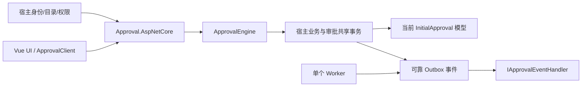

# 嵌入式审批当前交付状态

2026-11-03，当前分支 codex/engineering-extensibility。项目尚未正式使用，按新项目直接初始化；此前为旧环境设计的兼容方案已经撤销。本报告替代此前旧库迁移/回填/动作兼容说明。

## 当前结构

Core 为单实例嵌入式审批引擎，宿主提供身份、目录、组织、授权及业务 DbContext。Approval.AspNetCore 提供 HTTP/DTO 适配，Vue UI 使用每个应用独立安装的 ApprovalClient。



## 已完成的三项功能

| Requirement | Evidence |
|---|---|
| 简化动作扩展 | 不存在 Action 节点/步骤/参数/输出映射/失败继续及扫描接口。准备工作使用 IApprovalLifecycleHandler；结束业务用 IApprovalBusinessHandler；远端副作用用稳定 ID 的可靠事件。Unsupported_action_protocol_is_rejected_without_partial_writes、Unknown_node_members_are_rejected_without_partial_writes、生命周期回滚/早保存/重试测试继续验证。 |
| 分类展示和服务端筛选 | settings.category 同步到定义与治理投影，草稿优先，否则选用版本；SQL 分类/未分类筛选和受权分类选项。Categories_follow_draft_then_selected_version_and_filter_including_uncategorized 及浏览器分类场景继续验证。 |
| 抄送具体人员 | 工作台与详情共用受权分页人员弹窗，角色名单明确为当前成员。DirectoryRead + InstanceRead + 实例可见性/查询范围；只请求当前页目录，HTTP 优先公开目录，未知/停用状态明确，身份变化关闭并拒绝旧响应。Recipients_require_directory_and_instance_permission_and_query_scope、目录分页与浏览器姓名/未读数场景继续验证。 |

## 新项目初始化清理

- 证书 SQLite、参考宿主四 Provider、测试四 Provider，共九套上下文各保留一条 InitialApproval 和当前模型快照。不存在多租户扩展、租约删列、动作阻断或分类回填的历史升级链。
- 移除 eng/legacy-migrations 和 Approval.TenantTool 的源码及项目引用，删除 ApprovalBusinessSlotBackfill、CertificateDatabase.UpgradeCopyAsync、旧程序集转发、动作迁移扫描及相关契约/测试。
- 发布/保存草稿创建治理记录；不再从无治理记录的定义自动恢复启用状态、版本计数或分类。
- 前端移除 configureApprovalUI、全局 approvalApi/http/defaultApprovalClient、api/types 兼容入口。使用 createApprovalClient 或 ApprovalUI 每次安装独立实例；未安装时明确报错。
- 正常备份、就绪检查、业务一致性、事务回滚、可靠事件、幂等、并发、不可变业务历史与版本功能保留。

删除的源码可从忽略目录 output/new-project-cleanup-source 恢复；没有重置/改写暂存区，也没有删除、重建或升级用户数据库。旧的计划/审查资料仅为开发过程记录，当前接入以本文和宿主指南为准。

旧工具目录的递归缓存清理被自动审批审查拒绝，仅返回 `blocked by policy`，没有更具体原因。旧工具源码和引用已移除；遗留 bin/obj 缓存未清理，不参与当前解决方案或打包。当前 InitialApproval 用于空库，不会自动清空此前的本地开发库。

## 验证

本轮完整入口已成功退出，`output/new-project-verification.log` 末尾为 `Verification succeeded: All`。Release 构建0警告/0错误；后端 **514通过、0失败、0跳过**（Core347、HTTP75、SQLite数据库34、Certificate58），前端 **186通过**（UI180、demo6），边界 **7通过**，浏览器 **5通过**。专用于旧库升级/回填/程序集兼容的用例已经删除，当前数字不与前一轮543直接比较；业务、事务、权限、并发、分类及抄送回归继续执行。

证书和四 Provider 参考模型无漂移；另四个测试上下文模型检查通过，见 `output/new-project-contract-models.log`。统一入口已加入这四个额外检查，九套上下文全部覆盖。源码及独立包参考宿主各27项 Kestrel 检查通过，前端类型/库与示例构建、契约基线也通过。

独立消费者为 `output/engineering/consumer-67c8a31ce5914026ba33e36f84aa5e0b/`，`verification.json` 记录打包时的源码、包和契约摘要；browser/results.json 与 passed.json 记录5个场景通过，unexpected/skipped/flaky均为0。当前源码的暂存区内容与清理前完全一致，没有提交、推送、发布或部署。

| Requirement | Evidence |
|---|---|
| 当前模型直接建库、重复初始化不改业务行、空库迁移往返 | `Initial_migration_creates_current_schema_and_repeated_initialization_preserves_rows`、`Initial_migration_can_roll_back_empty_schema_and_recreate_without_model_drift`、`Migrations_RollBackAndReapply_WithoutModelDrift`。 |
| 不再读取旧动作或接受未知节点字段 | `Unsupported_action_protocol_is_rejected_without_partial_writes`、`Unknown_node_members_are_rejected_without_partial_writes`；当前生成的C#/OpenAPI/TypeScript基线不包含旧Action DTO、扫描或升级副本API。 |
| 前端无兼容全局实例、缺少安装明确拒绝、多客户端隔离 | `requires an installed client instead of falling back to global configuration`、`keeps transport configuration dynamic headers and panels independent across clients`；实际独立npm消费者构建及5个浏览器场景通过。 |
| 保留正常备份恢复、宿主适配器失败与事务回滚 | `Online_sqlite_backup_restores_application_links_and_pending_work`、`Backup_refuses_to_overwrite_source_or_existing_destination`、`Published_definition_with_unavailable_host_channel_rolls_back_instead_of_dropping_notification`、`Governance_OuterRollbackRemovesDraftPublicationAuditAndOperation`。 |

入口（仓库根目录）：

```powershell
Set-Location -LiteralPath 'D:\Study\CSharp\Workflow'
pwsh -NoProfile -File 'eng/verify.ps1' -Scope 'All' -SkipRestore
```

真实 MySQL/SQL Server/PostgreSQL 尚未重验，SQLite 和模型无漂移不代表真实三库已验收。
