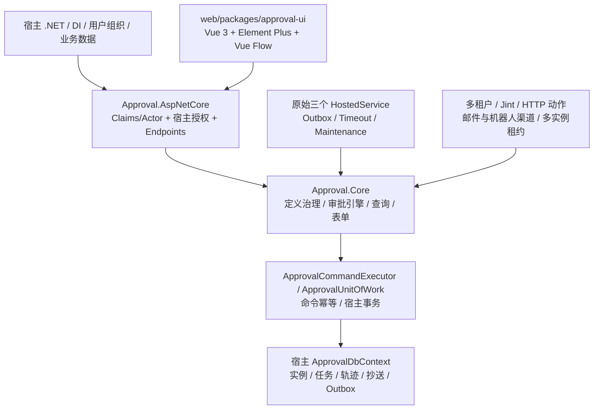

# 历史审查与第一批记录

本文件保留改造前及第一批事实。后续多租户、自动化、状态、抄送等项目已继续实施，不能把本文旧“剩余工作”当作当前进度；最新状态与验证见 [完成报告](embedded-approval-completion.md)。

# 嵌入式审批引擎审查与实施记录

日期：2026-11-03。分支与原始测试结果见 [实施台账](../plans/2026-11-03-embedded-approval-implementation.md)。本报告以实际代码和测试为证据，不以 README 的功能描述作为验收。

## 原始结构



核心已是类库，不需要重建。`Approval.Certificate` 为示例业务类库，`Certificate.Api` 和 `Approval.ReferenceHost` 为宿主；另有 ContractTool、TenantTool 和 RehearsalTool。数据库契约维护 SQLite/MySQL/SQL Server/PostgreSQL 四套迁移。

## 已实现且可复用

| 能力 | 实际证据与结论 |
|---|---|
| 流程草稿、发布、停用、版本选择 | `ApprovalDefinitionService.Governance.cs`、`DefinitionGovernanceTests.cs`：设计草稿与不可变发布版本分离，Revision 防并发；实例保存 DefinitionId/Version。 |
| 或签、会签、依次审批 | `ApprovalEngine.cs` 的 CreateTasks/IsNodeFinished/ActivateNextSequential；`EngineRuleTests.cs`。依次待办 Waiting，激活时开始计时。 |
| 退回、重提、历史节点退回 | `ApprovalEngine.Collaboration.cs`、`ParallelReturnAddSignTests.cs`：验证上游已通过节点、关闭失效任务、增加 Round；重提从开始节点继续。 |
| 结构化并行 | `FlowStructure.cs`、`ExecutionState.cs`：分支/汇聚校验，StateJson 保存每个 Join 到达计数。CurrentNodeId 只是活动节点摘要，并非唯一运行状态。不能断言只有串行能力。 |
| 前/后/并加签与转交 | Collaboration 和 Engine；ParentTaskId、Suspended 及附加任务阻塞规则已实现。 |
| 独立抄送关系 | `ApprovalCarbonCopy`、`AddCarbonCopy`、GetCarbonCopied：独立表，不混入审批任务。 |
| 事务与并发 | `ApprovalUnitOfWork`、`ApprovalCommandExecutor`、实例 ConcurrencyStamp、BusinessSlot 唯一约束；AtomicDatabaseContractTests 验证回滚与命令重试。必须保留。 |
| 宿主边界 | IApprovalIdentityProvider、UserDirectory、OrganizationProvider、PermissionProvider、QueryScope；Core 不引用具体宿主，没有自建用户表。 |
| 服务端分页及字段可见性 | `ApprovalQueryService.cs` 的 ToPagedAsync、ScopeAsync 在数据库查询内执行；FieldVisibility 对详情与修改轨迹脱敏。 |
| 设计器/工作台 | Vue Flow 图、审批规则、返回/加签操作、分页 composable、版本治理面板均存在；有 Vitest 测试。 |

## 已实现但存在问题 / 缺失

| 严重性 | 问题 | 影响与修复方向 |
|---|---|---|
| P0 | 退回申请人仍为 Running | 领域状态与运行中审批混淆；增加明确 Returned 状态，统一业务占用、撤回、重提、查询、统计和示例业务判断。不能只加枚举。 |
| P0 | 退回复用 NotifyEvent.Rejected，重提没有可靠独立事件 | 宿主难以区分结束驳回和继续修改；应建立有稳定 ID 的通用事件，随审批事务写 Outbox。 |
| P0 | 抄送无阅读状态和独立详情查询 | 不能依赖站内信已读推导；角色抄送不能使用一个全局 IsRead 表示所有人的阅读。 |
| P0 | 用户目录可选，用户存在/停用不是统一操作前置条件 | 当前严格岗位规则才查询可用人员；转交/加签也需基于宿主可信状态统一校验。 |
| P0 | 列表筛选不完整 | TodoQuery 只有关键字、DefinitionKey、超时；InstanceQuery 无业务编号/审批人/排序参数。已有分页应扩展，不能改成前端全量过滤。 |
| P1 | 并行汇聚使用 Expected/Arrived 计数 | 目前结构化无环图、待办 Pending 校验和实例并发共同保护；仍需专门验证重复到达、退回再激活和并发分支，不可仅凭计数实现就认定没有漏洞或已满足全部语义。 |
| P1 | 轨迹无独立 TaskId、节点进入事件 | 现有操作人、节点、意见、UTC、Sequence 已有；补充精确任务关联与节点激活，不覆盖旧日志。 |

## 过度设计与重构边界

- Core 的 `Actions/HttpActionHandler.cs`、`ScriptActionHandler.cs`（Jint）及自动动作编排偏离审批定位。现有定义和样例引用必须先列明；不能移除实现后让旧实例在执行中突然失败，也不能静默跳过动作。
- `Notifications/BuiltInChannels.cs` 内邮件、企业微信、钉钉、Webhook 应移交宿主。保留统一事件和可靠投递，不在 Core 维护具体渠道。
- TenantId 遍及所有实体、复合外键、全局查询过滤、命令 guard、权限上下文、迁移、示例和测试。不能仅删租户类或把所有旧归属值改成常量：不同归属中已有同业务键/定义键会冲突。需要明确保留数据的升级路径。
- Outbox 的 LeaseId/LeaseDuration/Claim/Owned/超期确认用于多实例竞争，单实例不需要。ConcurrencyStamp 还可保护投递与人工操作结果，应保留该用途。
- 原始 DI 注册三个后台循环；收敛为一个 Worker。维护归档不是本轮必要后台能力，现有显式启用的维护功能暂保留手动能力和兼容调用，后续单独清理其租约模型。
- 未发现 Redis、独立 MQ、Leader 选举为现有必需依赖；不引入这些设施。

## 实施与实际验证

原始后端：510 通过，0 失败、0 跳过；SQLite 数据库测试。原始命令使用的 `artifacts/embedded-review/` 已移至被忽略的 `output/embedded-review/`，其中 `baseline/` 保存原始 TRX，避免将验证产物混入源代码。

前端原始基线：approval-ui 176 项、demo 6 项，合计 182 项通过。

## 本轮已实施的代码（第一批）

这不是整个任务的最终完成报告。当前只完成 Outbox/Worker 瘦身及第三方通知发送的宿主边界整理；完整验收结果在下文追加。

### 删除与重构

| 范围 | 文件 | 原因及结果 |
|---|---|---|
| 删除 Core 内置渠道 | `src/Approval.Core/Notifications/BuiltInChannels.cs` | 删除邮件、企业微信、钉钉、通用 Webhook 及配套 Options；发送归宿主。没有删除相关审批、回滚、幂等测试。 |
| 删除渠道注册及联系方式协议 | `ApprovalServiceCollectionExtensions.cs`、`Notifications/ChannelAbstractions.cs` | 删除 AddWebhook/WeCom/DingTalk/Email/ContactProvider，清理渠道 HTTP 客户端注册；保留 AddChannel<T> 宿主适配。 |
| Outbox 单实例投递 | `Engine/ApprovalOutboxService.cs`、`ApprovalOptions.cs`、`Domain/MessagingEntities.cs` | 删除 LeaseId、LeaseDuration 和 Claim/Owned/过期确认；确认前消息仍为到期 Pending；失败独立事务记录，保留退避和重试上限。 |
| 投递并发和取消 | 同上、`Background/ApprovalTenantSweeper.cs` | 同一 DI 宿主只允许一批投递；后台运行时人工重试返回 Conflict。等待处理器真正退出后释放作用域，取消/崩溃后的消息可用原 ID 重新投递。ConcurrencyStamp 保留，防止结果覆盖其他写入。 |
| 旧渠道未配置的升级保护 | `Engine/ApprovalEngine.Notifications.cs` | 旧发布定义引用缺失的宿主适配器时明确返回 InvalidDefinition，并回滚该审批操作；不再警告后跳过通知。宿主配置好同名适配器后可重试。 |
| 单个 Worker | 新增 `Background/ApprovalWorker.cs`；调整 `BackgroundServices.cs`、`ApprovalMaintenanceWorker.cs`、DI | 原三个 BackgroundService 变成单次执行服务，只有 ApprovalWorker 注册为执行循环；Outbox 与超时保持各自间隔，显式启用的旧维护能力复用该循环。 |
| 诊断与维护筛选 | `Diagnostics/ApprovalDiagnosticsService.cs`、`Maintenance/ApprovalLifecycleService.cs` | 删除已经无意义的 Outbox 过期租约统计及筛选条件。旧归档/附件删除自身租约尚未移除，不能把它们视为已瘦身。 |

### 新增宿主实现与测试

- `samples/Certificate.Api/Infrastructure/DemoWebhookChannel.cs`：仅示例宿主发送 Webhook；保留消息 JSON、Idempotency-Key、HMAC-SHA256 签名和非成功响应异常，不在 Core 内建发送基础设施。
- `CertificateApplication.cs`、`DemoIdentityProvider.cs`、`appsettings.json`：同步调整所有调用和配置，移除虚构联系方式与邮件/机器人自动启用逻辑。
- `BackgroundRegistrationTests.cs`：单 Worker 注册/关闭、间隔校验、Outbox 重试与超时扫描按各自间隔执行。
- `AtomicDatabaseContractTests.cs`：保留动作保存后失败的回滚测试；原“租约替换”测试改为实际单实例策略：拒绝投递中的手动重试、重复调度不重复执行；新增处理器遵守/忽略取消两种恢复场景。
- `OutboxMigrationTests.cs`：从旧迁移升级，验证旧消息、Unicode 载荷、状态、次数、并发值保留；只有遗留租约恢复到期，正常退避时间不变，物理 LeaseId 列被移除。
- `DemoWebhookChannelTests.cs`：宿主消息正文、稳定 ID、固定已知签名以及失败传播；`NotificationTests.cs` 增加未知消息类型不可误确认成功、旧定义缺少宿主渠道时不得静默丢消息且所有审批记录回滚的测试。

### 数据库、公共 API 与前端

- 九套实际上下文均追加 `*_SimplifyOutbox.cs` 和 Designer，并更新模型快照：证书宿主 `Infrastructure/Migrations/` 一套，参考宿主与数据库契约各四 Provider。没有修改旧迁移或删除业务表。
- 新迁移只重排旧 Pending 租约消息的 NextAttemptAt 并移除 Outbox.LeaseId；保留实例并发、Outbox 并发、历史、载荷及消息 ID。
- 删除 `ApprovalOutboxOptions.LeaseDuration`、`ApprovalOutboxMessage.LeaseId`、诊断响应 `ExpiredLeases`；新增 `ApprovalWorker.RunOnceAsync`。三个原单次服务不再继承 BackgroundService，旧显式构造函数保留。
- 前端 `DiagnosticsPanel.vue` 删除过期租约项，`OutboxView.vue` 将重试成功提示改为“已安排重新投递”。重试 API 与列表路径保持原样。
- 契约通过 `pnpm contracts:update` 自动生成，包含公开 C# API、OpenAPI、TypeScript 和示例契约。接入与升级方式见 [单实例宿主接入](embedded-host-integration.md)。

## 剩余工作与下次接续点

1. 继续剩余 Core/UI 的逐项审查，完成整体功能矩阵；当前报告只声称表中已经核实的内容。
2. 先继续 B2：列清 `Actions/HttpActionHandler.cs`、`ScriptActionHandler.cs`、Jint、动作节点、配置与前端入口的引用。保留现有有价值的回滚/幂等行为测试，明确旧定义、旧待投递动作和在途实例的升级条件，再删除实现。
3. 再执行 C：多租户实体/复合键/查询防护/路由/工具/参考宿主的兼容迁移，不能直接合并旧归属中相同业务键。旧维护与附件删除的租约亦需单独处理。
4. P0 尚未补齐：明确 Returned 状态及全部活跃状态判定、可靠 Returned/Resubmitted 等生命周期事件、每位查看者独立的抄送阅读状态、完整服务端过滤排序、统一宿主用户状态、精确任务/节点进入轨迹。既有草稿/版本/退回/加签继续复用。
5. P1 尚需验收：并行分支激活/到达去重、嵌套汇聚、分支取消、并发完成/退回；自动超时处理默认降为可选扩展。不能把现有测试通过等同于上述全部验收通过。
6. 最后完成上述功能的必要前端交互、真实数据库 Provider 验证、联调和最终交付报告。真实认证服务/网络故障/备份恢复演练本轮尚未执行。

本轮未切换分支、未提交、未推送；两份原始未跟踪计划保持原样。新台账为后续从当前工作区接续的唯一进度依据。

## 本批要求与测试证据

| Requirement | Evidence |
|---|---|
| 一个后台执行器，可关闭自动执行，保留手动单次入口 | `RegistersExactlyOneHostedWorker_AndCanDisableIt` |
| 正值调度间隔、投递与超时各自按间隔运行 | `RejectsNonPositiveBackgroundIntervals`；`SingleWorker_RetriesOutboxAndScansTimeoutsAtTheirOwnIntervals` |
| 并发投递不重复，人工重试不覆盖投递结果 | `AtomicOutbox_RetryDuringDeliveryIsRejected_AndConcurrentDispatchDoesNotDuplicate` |
| 投递取消后可恢复，处理器忽略取消时也不得重叠或过早释放作用域 | `AtomicOutbox_CanceledDeliveryRemainsDue_AndCanResumeWithSameId`（false/true 两组） |
| 异步动作自行保存后失败也回滚 | `AtomicOutbox_SaveThenFail_RollsBackActionEvenWithRetryStrategy`；`Async_failure_discards_partial_changes_and_records_the_error` |
| 退避、最大次数、人工恢复、稳定消息 ID | `Failed_delivery_is_retried_with_exponential_backoff`；`Delivery_is_marked_failed_after_max_attempts_and_can_be_retried_manually`；`Last_registered_channel_overrides_earlier_channels_in_metadata_and_retries` |
| 旧数据库消息保留、仅释放遗留租约、物理删列 | `OutboxMigration_PreservesMessagesAndReleasesOnlyPendingLegacyLeases`；`Migrations_RollBackAndReapply_WithoutModelDrift` |
| 未知 Outbox 类型不得误确认成功 | `Unknown_outbox_kind_fails_instead_of_being_acknowledged` |
| 旧定义缺少宿主通知适配器时明确失败并回滚全部审批记录 | `Legacy_definition_with_missing_host_channel_rolls_back_instead_of_dropping_notification` |
| 宿主发送消息的协议、稳定 ID、固定签名和失败传播 | `HostWebhook_PreservesEventBodyStableIdAndSignature`；`HostWebhook_PropagatesFailureForOutboxRetry` |

测试质量复核：新增测试均有具体状态、内容、错误或副作用断言；取消/并发使用任务屏障而非固定睡眠；HMAC 使用独立的固定已知向量。没有通过删除原回滚或幂等测试使结果转绿。源代码与断言的静态对应检查已完成，没有执行或声称执行 mutation testing。

## 本批实际验证结果

- 初次全量门禁 `pwsh -NoProfile -File eng/verify.ps1 -Scope All -SkipRestore` 退出 0：当时后端 520、前端 182、边界测试 7、独立包浏览器 3 项通过，契约生成一致。
- 随后改进 SQLite 事务内删列，并补上旧定义缺失适配器时的失败保护；最终后端门禁 `pwsh -NoProfile -File eng/verify.ps1 -Scope Backend -SkipRestore` 已通过：Core **340**、AspNetCore **77**、Database **36**、Certificate **68**，合计 **521 通过、0 失败、0 跳过**，Release 构建 **0 警告、0 错误**。证书及四 Provider 参考模型无漂移，Kestrel 参考宿主 **38 项检查通过**，SQLite 迁移不再出现之前的表重建非事务警告。
- 前端自上述完整门禁后没有代码变更，182 项测试、typecheck、UI 库和 demo 构建证据继续有效。
- 最终源码独立 NuGet/npm 包消费者、参考宿主与浏览器复验 `pwsh -NoProfile -File eng/verify-packages.ps1 -SkipBuild -RunBrowser` 退出 0：**3 项浏览器测试通过**，包括打包设计器发布、三级审批激活证书、匿名与协议版本拒绝、就绪/默认禁用维护。最终独立消费者目录 `output/engineering/consumer-3b33672204d8449fb81fc45cf9462402/`，制品只在本地生成，没有发布。
- 详细日志：`output/embedded-review-verification.log`、`output/embedded-review-backend-verified.log`、`output/embedded-review-packages-verified.log`；原始和定向 TRX：`output/embedded-review/`。

## 可复验命令

工作目录为本仓库；不会连接用户的业务数据库。全量门禁会在 `output/` 创建独立临时宿主、包消费者与浏览器测试产物。

```powershell
Set-Location -LiteralPath 'D:\Study\CSharp\Workflow'
pwsh -NoProfile -File 'eng/verify.ps1' -Scope 'All' -SkipRestore
```

首次缺少依赖时去掉 `-SkipRestore`。真实数据库 Provider 还需 Docker 恢复后逐项执行原 `eng/verify-databases.ps1`；本轮 `docker info` 返回 `Docker Desktop is unable to start`，因此没有创建测试容器、没有声称三库本次已通过。Vite 仍提示示例部分产物超过 500 kB，该提示不影响构建成功，未为此扩展本次改造范围。
