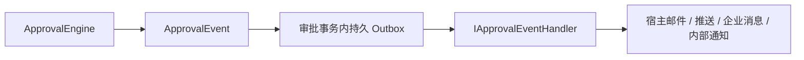

# 统一事件与 Outbox

`ApprovalOutboxMessage.PayloadJson` 保存当前 `ApprovalEvent` 的 JSON，属性使用 camelCase，枚举以字符串输出。事件包含稳定的 `Id`、实例、定义版本、业务键、操作人、状态和时间，`Id` 与 Outbox 消息 ID 一致。任务创建事件可包含接收人。流程通知规则直接生成 `EventType` 为 `NotificationRequested` 的事件，`Notification` 携带内容及已解析用户，`DeliveryTarget` 是宿主声明的路由提示。

`NotificationTargets` 向设计器提供路由提示名称。宿主实现 `IApprovalEventHandler.HandleAsync(ApprovalEvent, CancellationToken)`，负责将事件路由到自己的邮件、推送或企业消息渠道。

`ApprovalWorker` 在单进程内串行投递。投递器先验证事件正文和消息标识，再调用处理器。无效正文按投递失败处理，使用指数退避和最大尝试次数。具有 `OutboxRetry` 权限的人工重试以稳定命令键把未成功消息恢复为 `Pending`，重置尝试次数，事务提交后唤醒投递器。自动和人工重试均复用原事件 ID。旧的 `Kind` 与裸通知载荷属于历史协议。

`Outbox.EnableDispatcher=false` 明确关闭后台与手动投递，事件继续持久化为 Pending，不会发送、不标记成功。`EnableBackgroundServices=false` 仅不运行定时 Worker，允许显式手动投递，因此启用 Dispatcher 时仍要求处理器。没有默认吞掉事件的空实现。

启用投递时，启动和手动调度均要求可构造的 `IApprovalEventHandler`。处理器可以在当前投递事务保存宿主业务实体。处理异常会回滚该事务，失败记录由新事务保存。处理器须由框架提交事务，并通过宿主渠道处理外部副作用，审批实体写入和重入审批命令会被拒绝。

Outbox 提供至少一次投递，处理器可能多次收到同一事件。宿主必须按稳定的 `ApprovalEvent.Id` 去重外部副作用。审批数据库的事务覆盖本地写入和投递确认，外部渠道拥有自己的事务边界，因此没有跨系统 exactly-once 保证。

抄送及逐人已读是审批业务记录，审批中心站内提示也可随审批事务保存。
