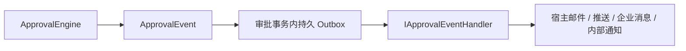

# 统一事件与 Outbox

事件在审批事务中生成，包含稳定 Id、实例、版本、业务键、操作人、状态和时间。任务创建事件可包含接收人。流程规则生成 NotificationRequested 事件，Notification 携带内容及已解析用户，DeliveryTarget 仅是宿主声明的路由提示。

NotificationTargets 提供设计器可用的提示名称，不注册发送器。宿主只需实现 IApprovalEventHandler；不再提供 IApprovalChannel、AddChannel、IApprovalNotifier 或 AddNotifier。Core 不发送 SMTP/Webhook/短信，也不知道实际消息平台。

ApprovalWorker 单进程串行投递，失败指数退避、次数上限、人工重试和乐观并发确认保留。启用 Dispatcher 时必须注册可构造的 IApprovalEventHandler，缺失注册在宿主启动阶段失败；手动调度也检查。旧 Outbox Notification 行转换为同一 ApprovalEvent，原消息 ID 和正文保留。

`Outbox.EnableDispatcher=false` 明确关闭后台与手动投递，事件继续持久化为 Pending，不会发送、不标记成功。`EnableBackgroundServices=false` 仅不运行定时 Worker，允许显式手动投递，因此启用 Dispatcher 时仍要求处理器。没有默认吞掉事件的空实现。

处理器可以在当前投递事务保存宿主业务实体；异常仍回滚业务写入及成功确认，失败记录由新事务保存。处理器不能修改审批实体或自行 Commit，也不能重入审批命令。外部副作用仍是至少一次，接收方按 Event.Id 去重。

抄送及逐人已读是审批业务记录。审批中心站内提示可随事务保存；它们与宿主外部通知渠道分开，不会引入独立消息平台。宿主通过 Event.Id 幂等处理副作用。
