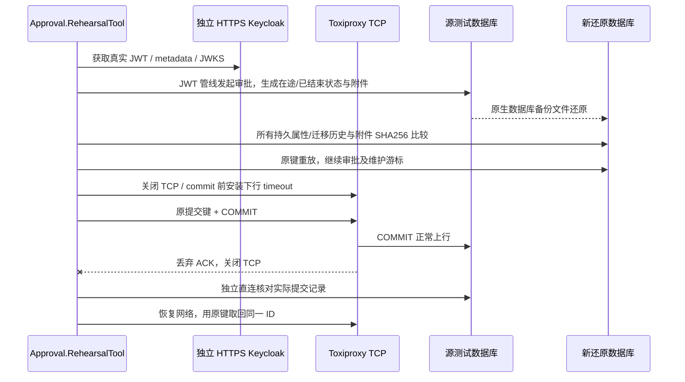

> 历史记录：此文件描述前轮开发快照，不是 0.3 的接入说明或本次验证结果。当前架构见 ../architecture.md，当前执行证据见 ../round2-report.md。

# 历史演练与当前边界

以下历史结果属于此前版本。本次单宿主改造更新了演练调用方和宿主目录，但因 Docker Desktop 无法启动，未重新执行真实三库/认证/备份/网络演练；不能将历史通过作为本次已验收。

# 真实服务演练：认证、备份恢复和 TCP 故障

用户未提供现有生产认证中心配置。本入口隔离部署真实 Keycloak HTTPS 服务，调用实际 token endpoint / discovery / JWKS；使用参考宿主的 Production JWT 管线和三个真实数据库。结果属于本机真实服务验收，不代替现有生产环境、认证集群或生产网络拓扑验收。

```powershell
Set-Location -LiteralPath 'D:\Study\CSharp\Workflow'
pwsh -NoProfile -File './eng/verify-rehearsals.ps1'
# 单库定位；仍包括认证、原生备份/还原和真实 TCP 故障。
pwsh -NoProfile -File './eng/verify-rehearsals.ps1' -Provider 'PostgreSql'
```

目前入口支持 Windows x64、PowerShell 7、.NET 10 和 Linux Docker containers。Keycloak 镜像固定 digest；Toxiproxy 2.12.0 使用经官方 SHA256 校验的 Windows 二进制，不安装为系统服务。代理镜像 registry 下载失败时采用同版本官方 release 二进制，不取消网络演练。新建的控制端口、代理和数据库端口只绑定回环。



`eng/Approval.RehearsalTool` 是不可打包的显式演练工具。快速 `dotnet test` 不会把未运行的 Docker 演练写成绿色或 Skip；重型入口输出 named checks 的 JSON，单独报告“演练检查”，不冒充 xUnit 测试数量。

认证检查覆盖正常 sub/tenant_id、无登录、错误签名/issuer/audience、真实短期令牌到期、非成员和伪造企业请求头。对短期令牌使用演练进程的明确零 ClockSkew 策略并等待 token 的实际 exp 边界。没有修改参考宿主生产默认值。临时自签证书仅在该进程中固定精确 SHA256 并保留主机名检查，不写系统信任库。密码 grant 只供隔离客户端验证，不作为业务用户登录方案；正式浏览器接入应使用 Authorization Code + PKCE。

原生备份路径：MySQL 使用完整 `mysqldump` 后选择新库导入；SQL Server 使用 BACKUP WITH CHECKSUM、VERIFYONLY、FILELISTONLY 和新文件 MOVE 后完整 RESTORE；PostgreSQL 使用 custom pg_dump 和新库 pg_restore。没有将 VERIFYONLY 或迁移往返当作恢复完成的证据。

在备份静止点暂停后台，比较两个租户每种 EF 实体的全部数据库属性和迁移历史；附件单独复制并经实际授权下载核对内容摘要。恢复后验证原键返回原 ID、到期键继续 410、原待办完成并释放占用、原维护作业从已提交批次继续，以及原 Outbox ID/payload 保留。到期 tombstone 与待投递 Outbox 为明确构造的演练夹具；外部接收方、真实投递对账、数据库账号/权限/密钥及加密备份恢复不由这套业务状态演练推定。

网络故障不是异常替身：先实际停止代理接受/转发 TCP，再核对无提交记录；commit 前 EF hook 只创建真实下行 timeout toxic，COMMIT 仍可到达数据库，确认响应被丢弃并断开。数据库异常由实际 socket/Provider 产生。核验路径不可用时应返回 CommitOutcomeUnknown，独立直连确认已提交，恢复网络后同键返回同一实例，不能换键重做。

报告在 `output/rehearsals/<runId>/`，每库保留 seed/auth/restore/network JSON、原生备份、前后状态快照、附件和制品摘要。失败报告同样保留。realm 密码及 TLS 私钥存于本次 Git scratch 目录，结束时只删除本次明确私密文件；owned 容器/代理进程核对归属后清理。报告不保存令牌、密码、私钥或连接字符串。

现有生产中心仍须提供 HTTPS Authority/Audience、隔离测试账号与租户映射；生产备份账号、证书/加密密钥、RPO/RTO、HA/集群切换和外部副作用对账须在真实环境另行执行并记录，不使用本机结果代替。

## 最终运行证据

日期：2026-11-02（Asia/Shanghai）。完整入口退出 0，runId **`ea79988feac24c25817e175aff963307`**。Keycloak 26.4.7 的日志确认 HTTPS 与 `Profile prod activated`；H2/dev-file 仅用于隔离演练，不宣称生产认证集群部署。SDK 10.0.401，Toxiproxy 2.12.0 的官方发布 SHA256 和 Keycloak/三库镜像 digest 固定。

| Provider / Server | Seed | JWT | 原生还原 | TCP 故障/恢复 |
|---|---:|---:|---:|---:|
| MySQL 8.4.10 | 26 | 11 | 25 | 12 |
| SQL Server 16.00.4255 | 26 | 11 | 25 | 27 |
| PostgreSQL 17.11 | 26 | 11 | 25 | 12 |

全部 **237** 项 named checks 通过；其中 SQL Server 多出的 15 项是连接恢复时实际基础设施错误的有界原键重试，不作为新增覆盖率或 xUnit 用例数。

| Requirement | Evidence |
|---|---|
| 真实主体/企业、无登录、签名、issuer、audience、到期、非成员及伪造请求头 | `RealOidcSubjectAndTenant`、`JwtAnonymousRejected`、`JwtSignatureRejected`、`JwtWrongIssuerRejected`、`JwtWrongAudienceRejected`、`JwtExpiredTokenRejected`、`JwtNonmemberRejected`、`JwtTenantHeaderCannotOverrideIssuerClaim` |
| 全部持久属性/迁移历史相同，附件授权下载摘要相同，其他企业附件拒绝 | `NativeBackupRestoredEveryPersistentProperty`、`RestoredAttachmentBytesAndHash`、`RestoredForeignAttachmentRejected` |
| 原 ID/原键/tombstone、原待办/占用、维护游标及 Outbox 保留 | `RestoredOriginalKeysReturnOriginalIds`、`RestoredTombstoneReturns410`、`OriginalInstanceCompleted`、`RestoredApprovalReleasesBusinessSlot`、`RestoredMaintenanceResumesFromCommittedCursor`、`RestoredOutboxKeepsOriginalIdAndPayload` |
| 实际断网无已提交操作，恢复后原键只提交一次 | `RealTcpOutageRejectsNewCommand`、`TcpOutageLeavesNoCommittedOperation`、`TcpRecoveryOriginalKeyCommitsOnce` |
| 实际丢弃 commit ACK，待确认、直连核验、原键返回同一 ID | `ActualDownstreamTcpToxicInstalledAtCommit`、`RealCommitAckLossReturnsUnknown`、`DirectConnectionVerifiesCommittedResultDespiteLostAck`、`RestoredNetworkReplaysVerifiedIdWithoutDuplicate` |

报告在 `output/rehearsals/ea79988feac24c25817e175aff963307/`：顶层 `verification.json` / `evidence.json`、各库 `manifest.json`、四个 stage JSON、数据库备份、前后快照及附件。已重新核对每个 manifest 的递归制品 SHA256、前后快照一致性、所有检查的通过状态；确认没有 owned 容器及本次 realm 口令文件/TLS 私钥残留。SDK/原工具 DLL/锁文件摘要仅补充制品关联，没有改动已验收的运行行为。

普通入口 `verify.ps1 -Scope Backend -SkipRestore` 退出 0：Core333、HTTP73、Certificate66、SQLite33，合计 **Passed: 505, Failed: 0, Skipped: 0**；日志在 `output/rehearsals-validation/backend.log`，包括 38 项 Kestrel 冒烟和模型检查。契约命令 `pnpm --dir 'web' 'contracts:check' '--no-build'` 通过，日志为 `output/rehearsals-validation/contracts.log`。

保留了早期失败报告：演练客户端移除了 Keycloak basic scope 导致缺少必要身份声明、临时 Unix socket 就绪早于最终 TCP、Toxiproxy 拒绝浏览器默认 User-Agent，以及恢复端口后首个 SQL Server 连接请求仍失败。修复仅位于演练/验证入口：保留 basic scope、用真实 TCP/TLS 探针、显式 CLI User-Agent、依据实际响应进行有界原键重试；没有改写生产授权规则或通过换键/任意等待掩盖失败。
