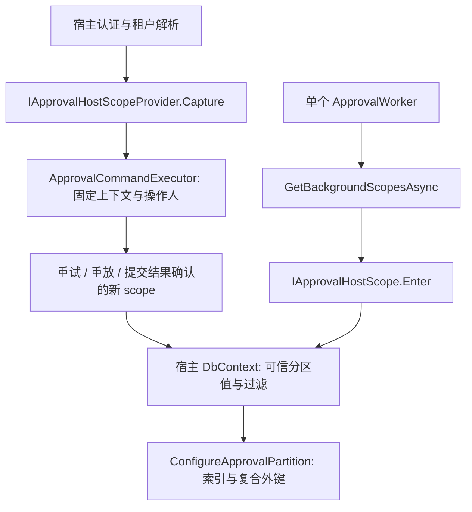

# 宿主数据分区

审批引擎支持宿主共享数据库中的独立数据范围。宿主提供租户目录、可信租户解析、当前租户有效性、EF 查询过滤与分区值；Core 不依赖 Finbuckle，不创建租户表或独立调度系统。单宿主默认配置无需额外实现。



## 作用域

可运行的仓库内实现见 [`samples/Approval.MultiTenantHost`](../samples/Approval.MultiTenantHost/README.md)：共享 SQLite、可信租户 claim、固定 Context、分区模型、报销生命周期与 Outbox 接收记录；A/B 隔离与并发集成测试纳入默认后端验证。

注册宿主的 `IApprovalHostScopeProvider`。`Capture()` 返回不可变快照；`PartitionKey` 是稳定的宿主范围标识；`Enter()` 在当前调用链同步安装上下文，返回的 IDisposable 在完成或失败时恢复原上下文。不能依赖一个异步辅助方法设置 AsyncLocal 后返回，设置应覆盖实际执行委托。

执行器捕获一次上下文，并在策略、授权、Find/Replay、业务委托、COMMIT 结果确认及每次重试中使用它。启用分区的宿主 DbContext 实现 `IApprovalPartitionContext`，暴露创建时固定的 PartitionKey；执行器在预约操作键前核对两者一致。`UseApproval()` 在每次 EF 命令和保存时验证该值非空且没有变化；使用 DI 创建 Context 时，还会核对其应用服务提供者中的 `IApprovalHostScopeProvider.Capture()`。直接构造 Context 的宿主仍负责将固定值与当前可信范围核对（示例 `TenantCommandGuard`）。分区 Context 不支持 `AddDbContextPool` / `PooledDbContextFactory`，检测到池化配置即拒绝；使用每个范围独立的普通 Context。

`GetBackgroundScopesAsync()` 由宿主返回本轮可用范围。现有单个 Worker 逐一执行；一个范围失败不会阻止其他范围，整轮心跳会记录失败。每个范围内嵌套的 Outbox、任务与目录作用域必须保持同一上下文。系统能力不免除分区边界。

匿名 `MapApprovalReadiness()` 同样使用该范围列表，在每个可信范围内创建独立的系统 scope 检查数据库。至少存在一个范围且全部通过才返回 `200 { "ready": true }`；空列表、枚举/进入失败、数据库不可用或整轮超时返回 `503 { "ready": false }`。发现失败即结束探测，所有范围共享五秒取消预算，并在退出时恢复原上下文。探针不使用请求用户或租户 Header 选择范围，也不返回租户或数据库细节。

## 持久化

先配置审批及可选 Forms 模型，再由宿主给对应实体配置非空字符串分区属性、可信值生成和查询过滤，最后调用：

```csharp
modelBuilder.ConfigureApprovalPartition("TenantId", typeof(HostDeliveryReceipt));
```

方法覆盖 Core/Forms 审批实体，以及显式传入的宿主持久化类型。它为现有索引增加分区前缀，为关联配置包含分区的 foreign key 和 principal alternate key，保留 GUID 主键。宿主负责其余业务实体的模型。

非主键的候选键（`HasAlternateKey`，包括 `HasPrincipalKey` 建立的自然键）也增加分区前缀，保留约束注解，并将全部引用外键切换到复合键后移除原全局候选键；没有引用的候选键同样分区。已有同列复合键可复用，注解冲突会在修改模型前拒绝。分区实体的任意键被未纳入分区的实体引用时，配置直接报错，包括引用主键的关联。Owned 类型当前不能作为独立分区实体参与该扩展；不能用未分区 Owned 外键连接分区 owner，应改为显式分区实体。GUID 主键仍保持全局唯一。

命名和未命名索引都按其模型标识替换，保留名称、唯一性、数据库注解与原列排序；新增分区列按升序排列，不保留原来的全局索引。若 EF 已为复合外键创建同列分区索引，则复用该索引并保留唯一约束；冲突的排序或数据库注解在修改模型前报错。已有复合外键若已在相同位置配对分区字段，则保留该关联；仅一侧包含分区字段或配对位置不一致的配置会在修改模型前报错。

分区值必须在实体跟踪时已经可用。若采用 EF ValueGenerator，值来自已固定的宿主 Context，并将 `GeneratesTemporaryValues` 设置为 false、`GeneratesStableValues` 设置为 true；FK 传播不能把可信分区值当成待数据库生成的临时值。

`ConfigureApprovalPartition()` 统一将分区字段配置为 `IsConcurrencyToken()` 和 `AfterSaveBehavior.Throw`，让分区值参与 UPDATE/DELETE 的数据库条件并禁止修改。`UseApproval()` 检查所有分区实体新增值及更新/删除的当前值和原始值必须等于固定 PartitionKey。仅校验 ChangeTracker 无法阻止 Attach 其他租户的 ID；数据库条件会使此类写入报告并发冲突，整个 SaveChanges 的事务回滚。

分区过滤器必须包含不可绕过的 `row.PartitionProperty == context.PartitionKey`（支持 CLR 属性或 `EF.Property<string>`），允许通过 `&&` 附加软删除等条件。`context` 必须是当前类型的 DbContext 常量引用，EF 会在执行时使用实际 Context 的值。只有软删除条件、`OR` 放宽范围、常量租户、隐藏在自定义方法中的条件无法证明边界，运行时拒绝。多个命名过滤器可以组合，但不能移除其中任何一个。宿主须使用能严格区分目录标识的数据库 collation，并为分区列配置长度（示例为 64）。

## 原生 SQL 与批量操作策略

分区 Context 默认拒绝 `SqlQuery` / `SqlQueryRaw`、`FromSql` / `FromSqlRaw` / `FromSqlInterpolated`、`ExecuteSql` / `ExecuteSqlRaw` / `ExecuteSqlInterpolated`，包括同步、异步、编译和组合查询。映射到 SQL / 数据库函数的查询源也拒绝。判断依据是 EF 查询根和命令来源，不能通过 SQL 文本包含 `TenantId` 获得授权，也不提供任意 SQL 的运行时豁免。EF Migration 命令保持可用，离线维护使用隔离的管理连接与权限。

宿主分区实体允许通过 `ExecuteUpdate` 更新普通字段；修改模型声明的分区属性（含 `EF.Property`、投影）的 setter 被拒绝。无法识别的 setter 结构默认拒绝。`ExecuteDelete` 保留查询过滤；针对其他租户 ID 的合法 LINQ 返回 0 行，不能区分记录不存在还是属于其他租户。审批实体本身仍只允许所属内部服务写入。未分区 Context 保留原有 SQL、批量操作与过滤器行为。

内置 `Sql` 工作流动作目前只有固定查询和独立只读连接契约，无法证明租户范围，因此分区工作流执行该动作时在打开连接前拒绝。单租户动作不受影响；若宿主需要租户 SQL 能力，应先设计数据库强制限制的连接/账号和可信参数契约，再单独审查，不能仅凭只读连接或参数名认为安全。

## 数据库级边界与部署前提

以上是 EF 访问层保护，**不是同进程不可信代码的沙箱，也不等同于数据库 RLS**。`Database.GetDbConnection().CreateCommand()`、独立 ADO.NET 连接、持有数据库凭证的代码不经过 EF 拦截器。当前回归测试明确保留这一可复现边界；任意拥有共享数据库权限的宿主代码仍可以访问所有租户。不能将这些测试通过解释为“直接数据库命令已隔离”。已返回的对象、`DbSet.Local` 或跟踪缓存也不能在租户之间共享。

| 数据库 | 数据库级选项 | 必须满足的部署条件 |
| --- | --- | --- |
| PostgreSQL | RLS policy 的 USING / WITH CHECK、必要时 FORCE ROW LEVEL SECURITY | 应用角色不能有 BYPASSRLS / superuser；owner 例外须处理；不能让攻击者任意设置用于 policy 的租户会话变量；连接池每次租借正确绑定/清理身份 |
| SQL Server | Security Policy + inline TVF，过滤谓词及写入 block predicate | 运行账号不得改 policy / 以高权限绕过；SESSION_CONTEXT 必须由可信连接入口初始化并处理连接池复用，不能把可伪造的 session key 当认证 |
| MySQL | 独立租户数据库/账号，或严格限制底表权限的视图/存储过程接口 | 无与前两者等价的通用原生 RLS；同一账号可直接读底表时视图无效；受限视图方案需要重新验证 EF 写入、迁移和事务 |
| SQLite | 独立数据库文件及文件权限 | 无原生 RLS；共享文件并持有连接不能对同进程不可信代码保证行级隔离 |

本次没有自动部署 RLS、改变凭证或创建第二套租户目录。需要抵御直接数据库连接时，必须由宿主确定数据库账号、租户身份传递与权限边界，并对目标 Provider 做部署和攻击验证；当前共享连接模式不能满足这一更强安全承诺。

必须先注册审批模型和所有额外宿主实体。参数为空、额外类型未映射/为 Owned、分区属性缺失/可空/非字符串或重复配置会被拒绝；属性和类型校验完成后才修改分区索引和外键。配置了分区模型却未提供可信 PartitionKey 时，执行器拒绝命令。

调用 `ConfigureApprovalPartition()` 的 DbContext 禁止使用任意重载的 `IgnoreQueryFilters()`，包括命名过滤器，以及从非分区实体或 SQL 查询源发起的调用。EF 会在查询拦截后展开导航、Include 和 AutoInclude，因此保护边界以整个分区 Context 为准，不提供查询形状例外。管理员选择另一个范围应建立新的、授权后的 Context；宿主的非分区管理查询使用独立的非分区 Context。普通非分区 DbContext 的过滤器 API 不受影响。宿主的分区过滤应使用匿名过滤；dotnet-starter-kit 由 Finbuckle 安装该匿名租户过滤。

幂等唯一性是 `(PartitionKey, LookupHash)`，同范围同键同内容恢复同一结果，同键异内容 Conflict。确定性资源 ID 的 seed 包含 PartitionKey，因此不同范围中的相同 actor/kind/scope/key 不会产生相同实例、任务或事件 ID。业务槽、流程 Key/Version、日志序号等维持各自语义。

冲突识别按实际分区模型的约束、列与 Provider 错误核对；不会把无关唯一约束、外键错误和连接失败改成 Conflict。严格幂等、UseApproval 写保护、发布版本不可变和审批状态机不变。

## 权限、附件与事件

宿主目录与权限查询在同范围的新 scope 中运行。人工能力必须同时满足当前操作人可信、用户在范围中可用、能力授权和资源访问条件；不能仅靠 root 角色、缓存命中或按钮可见授权。

所有可选 Forms 元数据使用相同过滤与 FK 边界。附件实际内容仍由宿主存储，唯一 StorageKey 对应私有内容；下载先经过 Forms 的元数据与字段访问校验。存储路径不能公开为静态目录或用用户输入拼接。

Outbox 仍是至少一次投递。宿主事件接收器在所属范围运行，按稳定 Event.Id 对外部副作用去重；发布宿主集成事件时明确传递可信 TenantId，不依赖后台 HTTP 上下文。

## 验收

用同一数据库的 A/B 两个范围验证相同 Key/业务键/操作键独立执行、重放、并发上下文、跨范围读写拒绝、数据库 FK 拒绝、字段与附件授权、后台失败继续和原有写保护。SQLite 本地验证；服务数据库按当前提交的 CI 分别报告实际执行结果。

`PartitionModel_MigrationRoundTripEnforcesTenantConstraints` 已纳入现有数据库矩阵的必跑门禁：使用 Provider 生成的迁移 DDL 建立隔离的 `Partition*` 表，验证宿主命名索引与自然候选键的分区唯一性、已有和新扩展的 Core/Forms 及宿主复合外键、失败事务回滚和删除重建。报告输出 `partition-migration.sql`。本地可验证四 Provider 的模型和 SQL 生成；MySQL、SQL Server、PostgreSQL 的真实数据库结果仍以对应提交的 CI 为准。

dotnet-starter-kit 的宿主适配位于其 `src/Modules/Approval/Modules.Approval`。当前范围为共享数据库，独立租户数据库明确返回不可用。宿主负责审阅并应用增量迁移；API 不自动迁移，也不重置已有数据库。
