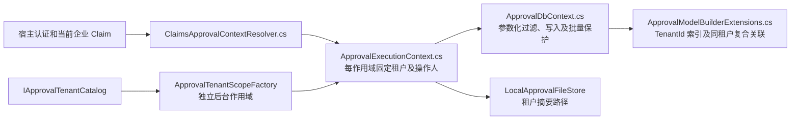

# 阶段 1：租户接入与升级

审批表采用共享库共享表。九类实体（定义、实例、任务、日志、抄送、草稿、附件、消息、Outbox）都具有 TenantId；宿主业务表仍由宿主维护。本阶段没有把证照业务变为共享表多租户业务。



## 宿主改动

宿主 DbContext 继承 `ApprovalDbContext`，构造函数注入 `IApprovalTenantContext`，模型调用 `modelBuilder.ConfigureApproval(this)`。业务配置和本地事务继续放在同一个 Context 中。`OnConfiguring` 和 SaveChanges 由基类封闭保护；需要内部选择 Provider 时覆盖 `ConfigureApprovalOptions`，需要保存扩展时使用 EF 拦截器。不要启用 DbContext pooling。

单租户宿主必须显式设置 `FixedTenantId`；共享模式设置 `MultiTenant = true`，同时禁止设置 FixedTenantId。租户标识为 1–64 位小写 ASCII 字母、数字、点、下划线、连字符，不 trim、不转大小写。用户和业务主键不受此租户标识规则限制，保持原值。

```csharp
services.AddDbContext<HostDbContext>(options => options.UseSqlServer(connection));
services.AddApprovalWorkflow<HostDbContext>(options => options.MultiTenant = true)
    .AddIdentityProvider<HostIdentityProvider>()
    .AddUserDirectory<HostDirectory>();
services.AddScoped<IApprovalTenantCatalog, HostTenantCatalog>();
services.AddApprovalAspNetCore(options => options.TenantClaimType = "tenant_id");
```

`HostDbContext`、`HostIdentityProvider`、`HostDirectory` 和 `HostTenantCatalog` 是宿主实现；仓库中的可执行接入测试见 `TenantEndpointTests.cs` 和 `TenancyTests.cs`。共享模式的身份、目录、组织和联系方式适配器须 Scoped，并注入当前租户查询宿主数据；不能沿用按 userId 单独缓存的全局 Singleton。默认实现不接入任何特定企业框架。

默认 HTTP 适配只读取已认证主体的唯一当前企业 Claim。缺少/冲突 Claim 或未认证返回 401，停用/未知企业返回 403；请求体和请求头不能覆盖 Claim。多个企业成员关系、企业选择和 Claim 签发由宿主认证系统验证。需要自有身份来源时实现 Scoped `IApprovalContextResolver`，返回可信租户及操作人；Core 不依赖 HttpContext。

`/me` 增加 tenantId。管理员角色、既有访问策略和第三方权限都不能扩大查询的租户边界。细分的动作权限以及核心操作人参数校验属于阶段 2，本阶段的 ActorContext/System 标记还不是完整授权机制。

## 持久化和附件

- EF 的命名过滤器 `ApprovalTenant` 引用 Context 实例的只读 TenantId，多个租户复用同一模型；并非把首次租户放入模型常量。宿主增加软删除等条件时，也须使用不同名称的命名过滤器；EF 拒绝混用匿名过滤器，避免覆盖租户条件。
- 新增行自动填充当前租户；跨租户 Attach 会被拒绝并解除跟踪；修改/删除检查原租户。TenantId 也参与并发条件，猜测外部 ID 的伪造实体无法更新或删除对应行。
- 实例与定义，任务/日志/抄送与实例，文件与实例/草稿，消息/Outbox 与实例具有同租户复合外键。历史 DefinitionId 保持不变。
- 普通 LINQ、Find、Include、分页/count、统计和批量更新/删除保留过滤。禁止 IgnoreQueryFilters、批量修改 TenantId 和通过 ExecuteSqlRaw 写审批表。传输层拦截器覆盖四个验证过的 Provider。
- 原始 ADO 连接、独立维护 DbContext 和数据库账号仍是宿主的特权边界；这些保护不是数据库行级安全，也不能约束恶意宿主代码。离线维护工具使用独立连接，不提供 HTTP 绕过开关。
- 默认本地附件新键为 `tenants/<TenantId 的 SHA256>/yyyy/MM/<随机 GUID>`，读取/删除拒绝其他企业前缀和路径变形；旧的年月/GUID 键保留，必须先通过已回填归属的元数据访问。自定义存储也须 Scoped，并按当前租户生成不会碰撞的存储键。

## 后台、配置及前端

后台通过目录枚举启用租户，为每个租户重新建立系统主体作用域；不读取或继承 HTTP/AsyncLocal 身份。Outbox 每租户每轮一批，扫描每租户最多 100 个任务；单个租户异常会记录后继续其余企业。停用租户停止调度，数据与失败消息保留。通过 `IApprovalTenantScopeFactory.CreateAsync` 创建后台作用域时会再次确认租户仍启用。

宿主可用 Scoped `IApprovalTenantSettingsProvider` 提供时区、审批详情链接和模板全局变量；HTTP 白名单、脚本限制等宿主安全选项不在租户配置接口中。用户联系方式与渠道扩展仍由对应的租户作用域适配器解析。

前端配置 tenantId 和 userKey 的响应式 getter：

```typescript
const client = createApprovalClient({
  tenantId: () => session.value.tenantId,
  userKey: () => session.value.userId,
  headers: () => ({ Authorization: `Bearer ${session.value.token}` }),
})
```

宿主应一次替换 session 对象，原子地切换身份、企业和认证令牌。缓存键使用 tenantId/userId 的无歧义组合。切换后取消所有旧请求，即使宿主 fetcher 忽略 abort 也不接纳迟到响应；清空用户、目录、页面缓存、发起表单及设计器未提交内容。确认弹窗或表单校验期间切换身份，不会把旧内容作为新企业的提交发出。

## 旧库升级：Expand → 显式映射 → Harden

升级前暂停全部旧写服务及 worker，备份数据库和附件，并在副本演练。禁止旧版本继续向新模型写入无租户数据。已有迁移 ID 不变，新增两步：

1. `ExpandApprovalTenants` 仅加入可空 TenantId 列，不默认归属企业。
2. 明确确认单企业归属，或提供每个表/ID 的映射；先 Preview，检查孤立/跨企业关联、未映射行、重复进行中业务和已有归属冲突。问题存在时 Apply 不写入。
3. `TenantIsolation` 拒绝未映射、格式无效、孤立和跨企业关联，然后收紧列、索引和外键。SQLite 重建表前在事务外关闭外键检查，重建后恢复；迁移前的关联检查避免借重建保留坏数据。MySQL DDL 隐式提交，失败后须检查实际 schema，不能声称整段 DDL 回滚。

各 Provider 有自己的迁移/快照；参考链位于 `tests/Approval.Database.Tests/Migrations/<Provider>`。真实宿主须为自己的 DbContext 生成迁移，并采用相同的 Expand/Mapping/Harden 顺序，不能直接搬用 SQLite SQL。`RequireApprovalTenantMapping()` 可复用迁移前置检查。源库含业务数据时，证照示例保留显式 UpgradeCopy 流程，副本上回填 `certificate` 固定归属，源文件不变。

维护 CLI 默认只预览，连接必须由操作者显式放入 `APPROVAL_MAINTENANCE_CONNECTION`，不读取 appsettings。以下命令要求目标已运行到 Expand，且停止所有写入：

```powershell
# 逐行映射预览；连接由当前维护终端预先配置。
dotnet run --project 'eng/Approval.TenantTool' -- --provider 'SqlServer' --mapping 'tenant-map.json' --output 'output/tenant-preview.json'
# 复核报告后执行；执行时在 Serializable 事务内重新预检。
dotnet run --project 'eng/Approval.TenantTool' -- --provider 'SqlServer' --mapping 'tenant-map.json' --apply --output 'output/tenant-applied.json'
# 已明确确认整个旧库属于一个企业时，可用 --fixed-tenant 替代逐行映射。
dotnet run --project 'eng/Approval.TenantTool' -- --provider 'Sqlite' --fixed-tenant 'certificate' --output 'output/tenant-preview.json'
```

映射文件使用明确的表后缀，不包含表单正文、密钥或完整用户信息：

```json
[{"table":"Definitions","id":"11111111-1111-1111-1111-111111111111","tenantId":"company-a"}]
```

Definitions、Instances、Tasks、Logs、CarbonCopies、Drafts、Files、Messages、Outbox 每条旧记录都必须有映射，包括未关联实例的草稿、消息和附件；示例只有一行，不能用于真实整库升级。重复/未知映射拒绝，已有非空归属不能重分配。工具只改 TenantId，不改 ID、定义版本、业务键或物理附件位置；重复执行同一映射变更数为 0。报告包括各表数量和具体问题，单次上限 100000 行；更大数据量须使用经审查的分批维护适配器。

报告的 PotentialKeyCollisions 单独列出大小写/空白归一化可能造成的流程键和业务键碰撞；工具保持原值，不自动合并或转换。准备更换排序规则或归一化规则时必须先处理这些警告。若宿主明确设置 SingleRunningInstancePerBusiness=false，可用 `--allow-parallel-running` 保留并行业务语义；默认配置仍将重复进行中业务视为阻断问题。

完成收紧约束后，用两个租户的相同流程键/业务键/用户执行冒烟，再恢复写入。在新版本开放写入之前可恢复备份；开放多租户写入后不要把新 schema 或程序直接降回旧版本。

验证命令和实际结果见 [实施记录](../plans/2026-11-02-multitenant-production-hardening-progress.md)。阶段 2 权限接入见[权限指南](permissions.md)；阶段 3–6 的通用幂等/工作单元、定义治理和数据生命周期尚未交付。
