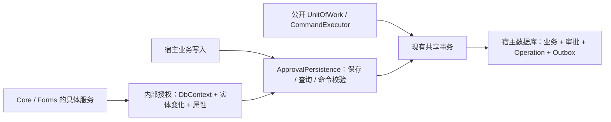

# 共享 DbContext 的审批写入边界

宿主可以读取审批实体，并照常管理业务实体；审批状态变化必须由拥有实体的服务产生。`UseApproval` 安装实体加载、SaveChanges、查询、命令和事务拦截器，不能省略或覆盖它们。

| 所有者 | 写入范围 |
| --- | --- |
| 引擎 | Instance/Task 状态及运行数据、BusinessSlot；追加 Log/CarbonCopy/Message/Outbox |
| 定义治理 | DefinitionManagement；新增发布 Definition 与审计，历史版本/审计不可改写 |
| 消息与抄送服务 | 本人可见消息 IsRead/ReadAt；逐人 CarbonCopyRead 新增 |
| Outbox 服务 | 状态、次数、下次投递、错误、完成时间和并发确认；不能改载荷 |
| 命令执行器 | Operation 预约与已提交结果，不开放给宿主委托 |
| Forms | Draft/File 元数据与绑定；当前实例标题的窄更新，审批状态仍由 Core 更新 |

内部授权不注册成通用 DI 服务，也没有宿主可以关闭保护的布尔属性。它绑定 DbContext 的租期、实体和预期变化，保存后消耗/更新，失败作用域作废。嵌套操作合并各自授权，宿主回调暂停继承权限。开始回调的合法标题/申请快照准备保留；回调改任务、历史、幂等记录或投递载荷被拒绝。

宿主先改审批对象再调用服务，或者服务返回后继续改审批对象，不能把这些变化夹带进最后一次 SaveChanges。手工 Attach/重设原始值的伪造对象也不能成为引擎权威状态。SavingChanges 后的宿主拦截器若引入审批变化，执行数据库命令前再次核验；EF 可能将此拒绝包装为 DbUpdateException。

ExecuteUpdate/Delete 绕过 ChangeTracker，因此查询拦截按真实 EF 方法及目标拒绝审批 bulk，命令执行时再检查写表。编译阶段没有短期授权例外，不会因缓存先在内部编译成功而让宿主复用。站内信全部已读改用有界跟踪批次，同一事务提交；业务 bulk 可以读取审批表作筛选。

原生 SQL 防护覆盖本上下文拦截器可见的普通 INSERT/UPDATE/DELETE/MERGE/REPLACE/TRUNCATE 写目标，以及同步/异步 non-query、reader、scalar 执行路径。表名/schema 来自当前 EF 模型，按标识符分析，忽略普通字面量与注释；合法业务 SQL 不因只读引用审批表而拒绝。

这不是完整 SQL 解释器，也不是数据库权限隔离。动态 SQL、存储过程、视图/同义词、触发器及复杂厂商语法的间接写入不提供完整保证。直接 GetDbConnection 创建命令、独立连接、移除拦截器/手工未安装上下文、迁移/数据库管理权限都属于可信宿主边界。拥有数据库写权限的宿主仍能绕过应用层保护；若要约束这种权限，使用数据库账户/权限隔离。

历史 Migration、归档数据、ArchiveId/DeletionPending、旧附件键和已擦除结果的 Tombstone 保留。运行元数据没有改变数据库模型。低层数据库约束测试可以使用离线存储夹具；实际安全验证和独立消费者使用正常保护配置。
