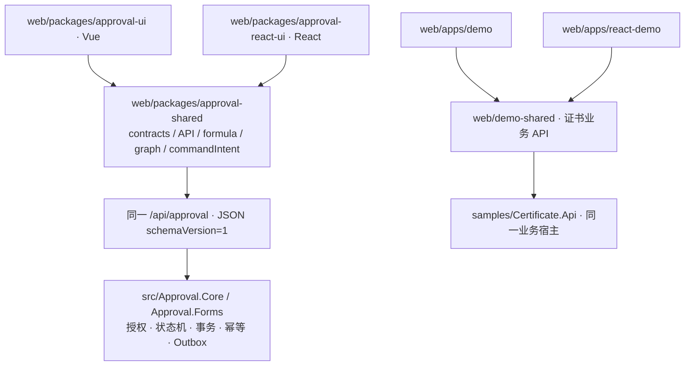

# React 宿主集成

React 是第二套正式前端，与 Vue 共享 `@approval/shared` 的 HTTP 客户端、类型、流程 / 表单序列化、公式、图算法和命令意图。后端审批规则、数据库模型与协议不变。

基础 UI 使用官方 shadcn/ui 的 Radix Nova 组件。源文件位于 `src/components/shadcn/`，`components.json` 记录来源和 Tailwind v4 `approval` 前缀；`components/ui/` 保留公开组件的薄适配接口。宿主无需安装 shadcn CLI，发布 CSS 已包含组件与动画样式。



## 安装与样式

```powershell
pnpm add '@approval/react-ui' '@approval/shared' 'react@19' 'react-dom@19' 'react-router@7'
```

包当前在本仓库开发，未发布到 npm。发布前使用 workspace 或打包 tgz；两份 tgz 的本地测试消费方式见 `eng/verify-react-package.mjs`，其中 overrides 仅将尚未发布的 shared 依赖映射到已打包文件。普通发布消费者安装同版本 registry 包即可。

```tsx
import '@approval/react-ui/style.css'
```

发布 CSS 已包含所需 utilities，不要求宿主安装 Tailwind 或扫描库源码。没有 Preflight 全局 reset；Tailwind tokens / utilities 使用 `approval` 前缀。

库构建使用 `src/library.ts` 收集 CSS，公开类型入口仍是 `src/index.ts`；发布声明不会引用未发布的源码样式文件。宿主显式导入上面的 style.css。

## Provider、认证与路由

```tsx
import { createBrowserRouter, RouterProvider } from 'react-router'
import { ApprovalProvider, createApprovalRoutes } from '@approval/react-ui'

const router = createBrowserRouter([
  { children: createApprovalRoutes() },
])

function ApprovalApp({ userId, token }: { userId: string; token: string }) {
  return (
    <ApprovalProvider options={{
      apiBase: '/api/approval',
      headers: () => ({ Authorization: `Bearer ${token}` }),
      userKey: () => userId,
      onUnauthorized: () => window.location.assign('/login'),
    }}>
      <RouterProvider router={router} />
    </ApprovalProvider>
  )
}
```

九个相对路由可挂到宿主布局 children：`workbench`、`approvals/:id`、`start`、`start/:key`、`definitions`、`designer/:key`、`monitor`、`outbox`、`diagnostics`。使用 React Router 的 data router（`createBrowserRouter/createMemoryRouter`），设计器与申请页用 blocker 提示未保存离开。页面 lazy 加载。

也可直接导入单个页面，挂到宿主自己的 Router；不必安装完整菜单、Demo 或全部九个路由。发布产物提供九个页面的 JavaScript 与声明入口：

```tsx
import WorkbenchPage from '@approval/react-ui/pages/WorkbenchPage'
import ApprovalDetailPage from '@approval/react-ui/pages/ApprovalDetailPage'

const router = createBrowserRouter([{ path: '/workflow', children: [
  { path: 'workbench', Component: WorkbenchPage },
  { path: 'approvals/:id', Component: ApprovalDetailPage },
] }])
```

页面仍使用 React Router 提供 params 和搜索参数；申请页与设计器需要 data router。页面内默认导航使用相邻 `workbench`、`approvals/:id`、`start/:key`、`definitions`、`designer/:key` 等相对路径，宿主应映射其实际启用的入口。独立 `eng/consumers/react-standalone` 夹具使用 Hash Router 和少量页面验证集成，不依赖 Demo 路由工厂。

MessageBell 默认放在该审批布局路由中，详情导航会保留宿主挂载路径；放在其他全局布局时可传 `detailPath={(id) => '/workflow/approvals/' + id}`。

`headers/fetcher` 每次请求读取最新配置，fetcher 接收原始 RequestInit 并返回 Response，保留 AbortSignal、401、ProblemDetails、204、Blob 和上传响应。不要把业务响应、Token 或表单正文写入 localStorage。

React 的 getter 没有 Vue 自动依赖追踪：切换身份时宿主必须更新 state / props 触发 Provider 重新渲染。提供稳定 userKey；不要在每次请求中生成用户 key。身份切换清理旧用户状态 / 目录缓存、取消请求并隔离迟到结果。多个 Provider 或 createApprovalClient 实例互相独立。

也可显式创建 `createApprovalClient(options)` 并传入 `<ApprovalProvider client={client}>`。外部创建的客户端由宿主负责更新选项和 dispose；Provider 不销毁借用实例。

## 权限与查询

`useApprovalUser()` 暴露 me、userId、roles、capabilities、can、isAdmin、canViewDefinitions、formsEnabled、formBusinessType、reload，以及查询 loading/error。显示菜单使用服务端能力；isAdmin/角色仅显示，不推断授权。详情动作使用 my-task 顶层能力、实例与单任务资源能力；后端最终复核所有操作。

仅基础 Core 的宿主无需安装后端 Forms 或建立 Forms 表；未启用 Forms 时隐藏发起入口。通用组件仍可按需引用 DynamicForm/FormDesigner。

## 业务、投递与人员扩展

```tsx
<ApprovalProvider options={{
  apiBase: '/api/approval',
  businessPanels: { Order: OrderApprovalPanel }, // props: businessKey
  outboxPanel: DeliveryOperationsPanel,
  userPicker: HostUserPicker,
}}>
  {children}
</ApprovalProvider>
```

自定义 UserPicker 接收 value（用户 ID 数组）、onChange、multiple、excludedUsers、disabled、label；必须遵守禁用 / 只读状态，不将显示名称当成可信身份。宿主用户目录、组织、角色和授权仍由后端 Provider 提供。

业务面板只注册 React 组件。证书业务和模拟 Webhook 位于 Demo，公共库不依赖它们。Outbox Payload 使用独立敏感 API，OutboxRead 不授予 Payload 权限。

## 写操作与恢复

异步写操作可能在页面离开后返回。`useCommandIntent().isCurrent()` 检查命令所在组件是否仍挂载、身份与客户端版本是否仍匹配；应用结果或导航前应复核它。请求已成功返回的原键仍按正常确认清理，页面离开不会触发另一笔写操作或把宿主导航回旧页面。

API 写方法要求 OperationId，经 `Idempotency-Key` 发送。一次意图生成一个键；网络 / 5xx / CommitOutcomeUnknown 保留原键、原请求和路由，禁止通过换键盲重试。`useCommandIntent` / `CommandRecovery` 提供此流程，sessionStorage 仅保存键、摘要和状态，原正文及回调只在页面内存。

页面已丢失原正文时只能核对结果并恢复原内容，不能宣称一键恢复。校验 / 并发冲突显示当前错误并按页面规则刷新。文件上传仍是既有非请求幂等例外，不自动重试外部存储写入。

共享层统一两套前端的命令命名空间，并读取旧 React 的 `user-reassign`、`cc-read`、`form-start`、`message-read`、`definition-import`、`definition-copy` 记录。读取不会删除旧记录；发现同一对象有多笔不同未确认键时阻止提交，要求人工核对全部结果。只有原操作成功确认或用户明确核对后开始新意图时才清理对应记录。交接恢复卡片会在刷新后显示原交出人员；已丢失正文的历史记录禁止自动重试。

`useCommandIntent` 支持 `permission` 或 `canExecute(scope)`，提交和原键重试都会重新检查当前权限。该 UI 检查用于避免过期交互，后端仍负责可信授权。

Action 类型 / 配置版本 / 模式从 `/meta.actions` 获取。HTTP 使用宿主登记目标，SQL 使用登记只读查询；不提供任意 URL / SQL 旁路。同步 GET 可提供 statusCode/body；HTTP 预演只展示计划。Action 预演 API 按节点顺序运行，编辑器可以定位节点中的步骤；ruleIndex 只用于审批人规则。

## 仓库命令

`usePagedList().total` 在查询尚未成功或失败时为 `undefined`，成功的空列表为 `0`。`Pagination` 接受未知总数及可选 `loading`，未知／加载时禁用页导航；异步 `DataTable` 传入 `loading` 和 `error`，避免失败被显示成空列表。

`DatePicker` 默认在输入失焦后显示自身格式错误；由外层表单校验时可设 `showInputError={false}`。原始输入仍即时通知 `onChange`；该选项只影响错误展示，不改变后端校验或审批权限。完整操作优化和验收见 [操作可靠性报告](react-usability-report-2026-11-07.md)。

通用 Select 使用 Radix Select 的值回调；原生 `onChange(event)` 已移除。仓库尚未发布，本次有意同步调整所有 React 消费者，宿主使用方式为：

```tsx
<Select aria-label="状态" value={status} onValueChange={setStatus}
  options={[{ value: 'Running', label: '审批中' }]} />
<DatePicker label="开始日期" value={date} onChange={setDate} />
```

Select 清空返回 `''`，size 使用 `default` / `sm`。日期控件使用框架日历弹层并保留文本输入，传值仍为 `YYYY-MM-DD`。HTTP／JSON／SDK 数据模型不受这个 UI props 调整影响。

在 `web/`：`pnpm dev:react`（5174，默认代理 5199）、`pnpm typecheck:react`、`pnpm test:react`、`pnpm build:react-lib`、`pnpm build:react`、`pnpm verify:react-package`、`pnpm test:e2e:react`。React Demo 输出自身 dist，Vue Demo 的原构建入口和后端 wwwroot 输出不变。

浏览器脚本仅创建本次独立端口、SQLite 与文件目录；不连接用户开发库。服务数据库测试仍在 GitHub Actions 对确切提交 SHA 执行。
