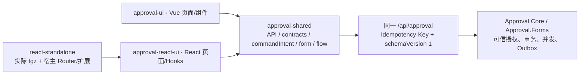

# React / Vue 全面审查与生产验收

审查日期：2026-11-09。远端 main 基线：`a2f87a0943ea986f6a4911e2bb08532403947cb9`。工作分支：`codex/react-production-audit`。实施计划：[计划](../plans/2026-11-09-react-production-audit.md)。

开始时通过 GitHub API 核对 main 和 [Actions 42591757577](https://github.com/ttcc666/WorkflowDemo/actions/runs/42591757577)：verify、MySql、SqlServer、PostgreSql 均成功。这是修改前的基线，不能作为本次提交的 CI 结果。原工作区有后端及包版本改动，本次使用隔离 worktree，未带入或覆盖它们。最终提交 SHA 与本次 CI 状态见交付回复。

## 1. 功能对照

`V/` = `web/packages/approval-ui/src/`；`R/` = `web/packages/approval-react-ui/src/`；`S/` = `web/packages/approval-shared/src/`。下表按实际业务能力分为 45 组，React 均有实现；没有发现 Vue 已有业务能力在 React 完全缺失。此处 45/45 是代码功能对照结果，不是行覆盖率、分支覆盖率，也不表示每个细节均有独立浏览器测试。更细的 178 项历史基线仍保留在 [FEATURE_PARITY.md](../web/packages/approval-react-ui/FEATURE_PARITY.md)。

| ID / 功能 | Vue 依据 | React 依据 | 差异与修复状态 |
|---|---|---|---|
| 01 我的待办、超期与数量 | V/views/WorkbenchView.vue、features/workbench/TodoTable.vue | R/pages/WorkbenchPage.tsx | 同一 todo / todoCount；React 摘要更丰富 |
| 02 我的已办、结果与处理时间 | V/features/workbench/InstanceTable.vue | R/pages/WorkbenchPage.tsx | 同一 done 查询；保留状态与日期筛选 |
| 03 我发起的、运行状态与详情入口 | V/views/WorkbenchView.vue | R/pages/WorkbenchPage.tsx | 同一 started 查询 |
| 04 抄送未读/已读、个人已读 | V/features/workbench/CarbonCopyTable.vue | R/pages/WorkbenchPage.tsx | 统一旧 cc-read 命名空间识别 |
| 05 搜索、筛选、分页、URL 恢复与空/错/加载状态 | V/composables/usePagedList.ts、features/workbench/ListFilterBar.vue | R/hooks/usePagedList.ts、features/workbench/ListFilterBar.tsx | 修复 Hooks 依赖；保留独立 URL 条件。监控页 URL 前缀不同，API 参数相同 |
| 06 任务详情、业务面板、申请人和发布版本 | V/views/ApprovalDetailView.vue | R/pages/ApprovalDetailPage.tsx | 同一 instance / myTask / instanceDefinition；React 直接解析目录显示名称 |
| 07 流程进度、当前节点、运行轨迹 | V/features/flow/FlowViewer.vue | R/features/flow/FlowViewer.tsx | 共享流程/模拟算法；修复定位 Effect 依赖 |
| 08 同意、意见、可编辑字段及变更确认 | V/features/approval/ApprovalActions.vue、views/ApprovalDetailView.vue | R/features/approval/ApprovalActions.tsx、pages/ApprovalDetailPage.tsx | pickValues / changedFields 共享；隐藏字段不提交 |
| 09 驳回、指定节点/发起人退回 | V/features/approval/ApprovalActions.vue | R/features/approval/ApprovalActions.tsx | 同一 reject API；补旧 reject/return 未确认作用域双向识别 |
| 10 Before/After/Parallel 加签、会签参与者 | V/features/approval/ApprovalActions.vue | R/features/approval/ApprovalActions.tsx | 同一 addSign API；保留真实审批顺序测试 |
| 11 人员转交、目录搜索与资格限制 | V/components/UserPicker.vue、features/approval/ApprovalActions.vue | R/components/UserPicker.tsx、features/approval/ApprovalActions.tsx | 同一目录与 transfer；修复选择器 Effect 和卸载保护 |
| 12 撤回、重新提交与原表单恢复 | V/views/ApprovalDetailView.vue | R/pages/ApprovalDetailPage.tsx | 同一 withdraw / resubmit；使用当前服务端数据 |
| 13 管理终止、单任务改派 | V/features/monitor/MonitorInstances.vue、features/approval/ReassignDialog.vue | R/features/monitor/MonitorPanels.tsx、features/approval/ApprovalActions.tsx | 补确认及原键重试前权限检查；终止原因统一 trim |
| 14 审计、字段变更、抄送历史与角色接收人分页 | V/features/approval/ | R/features/approval/ApprovalHistory.tsx | 同一历史/接收人 API；未建立第二套授权 |
| 15 全部流程实例查询 | V/features/monitor/MonitorInstances.vue | R/features/monitor/MonitorPanels.tsx | 同一 adminInstances；原分页/发起人/日期用例全部保留 |
| 16 统计、流程/节点/积压、比例和未知值 | V/features/monitor/MonitorStatistics.vue | R/features/monitor/MonitorPanels.tsx | 同一 statistics；保留上阶段日期、失败恢复和移动测试 |
| 17 离职交接、预览、逐实例结果和恢复 | V/features/monitor/HandoverPanel.vue | R/features/monitor/MonitorPanels.tsx | 两端修复结果残留、历史对象提示和权限；React 保留完整分页，Vue 预览前 100 条但命令仍处理全部 |
| 18 Outbox 列表、重试、宿主扩展 | V/views/OutboxView.vue | R/pages/OutboxPage.tsx | 同一 outbox / retryOutbox；补权限守卫。React 另有敏感 Payload API 查看 |
| 19 运行诊断与异常实例说明 | V/views/DiagnosticsView.vue、features/diagnostics/DiagnosticsPanel.vue | R/pages/DiagnosticsPage.tsx | 同一 diagnostics；能力默认拒绝 |
| 20 消息、未读数、单条/全部已读与导航 | V/components/MessageBell.vue | R/components/MessageBell.tsx | 统一 message-read 旧命名空间；定时器清理、写权限检查 |
| 21 流程定义列表、分类和关键词 | V/views/DefinitionsView.vue | R/pages/DefinitionsPage.tsx | 同一 governanceDefinitions / definitionCategories |
| 22 新建、复制、导入校验与导出 | V/features/definitions/ | R/pages/DefinitionsPage.tsx、features/definitions/ImportDefinitionDialog.tsx | 统一旧导入/复制命名空间；React 确认及重试前复核设计权限 |
| 23 保存草稿、校验、发布、启用/停用 | V/features/designer/useDefinitionGovernance.ts、features/definitions/DefinitionGovernancePanel.vue | R/pages/DesignerPage.tsx、features/definitions/DefinitionVersionsDialog.tsx | 保留 revision；启停用使用 disable 能力，选版本使用 publish 能力 |
| 24 历史版本查看、差异、选用与基于旧版编辑 | V/features/definitions/DefinitionVersionsDrawer.vue、DefinitionVersionComparison.vue | R/features/definitions/DefinitionVersionsDialog.tsx | 同一 versions / definitionAudit / selectDefinitionVersion；发布版本不修改 |
| 25 八类节点创建、编辑、删除与 Start 保护 | V/features/designer/useFlowDesigner.ts、NodeInspector.vue | R/features/designer/designerModel.ts、RuleEditors.tsx | 共用 NodeType / createNodeData；没有虚构 SubFlow |
| 26 拖拽、连线、边插入、自动布局、位置保留 | V/features/flow/FlowCanvas.vue | R/features/flow/FlowCanvas.tsx | Vue Flow / XYFlow 各自实现 UI，图算法与 JSON 共享 |
| 27 条件、默认分支、并行分支、Join 和嵌套流程 | V/features/designer/BranchInspector.vue、S/features/flow/ | R/features/flow/FlowCanvas.tsx、features/designer/designerModel.ts | 保留优先级、表达式、默认分支与 round-trip；后端分支语义不变 |
| 28 审批人规则、用户/角色、Any/All/Sequential、空审批人策略 | V/features/designer/ApproverRulesEditor.vue、NodeInspector.vue | R/features/designer/RuleEditors.tsx | 宿主 meta / 目录驱动，未新增用户或角色模型 |
| 29 超时、重复提醒、通知模板与渠道 | V/features/designer/TimeoutEditor.vue、NotificationRulesEditor.vue | R/features/designer/RuleEditors.tsx | 共享单位与配置；通知仍由宿主投递 |
| 30 Action 类型/版本、Mapping、JavaScript、步骤与模拟 | V/features/designer/Action*.vue、DesignerSimulation.vue | R/features/designer/Action*.tsx、DesignerSimulation.tsx | 共享模型；修复 CodeMirror 初始化依赖，保留格式化竞争测试 |
| 31 全部 16 种动态表单字段 | V/features/forms/FormFieldInput.vue | R/features/forms/DynamicForm.tsx | 相同 FormFieldType 与后端 Schema |
| 32 字段属性、必填、默认值、长度/范围/精度校验 | V/features/forms/FieldInspector.vue、S/features/forms/formValidation.ts | R/features/forms/FormDesigner.tsx、DynamicForm.tsx | validateValue / initialValues 共享；未建立 React 私有规则 |
| 33 表单布局、字段拖动/排序、复制、预览 | V/features/forms/FormDesigner.vue | R/features/forms/FormDesigner.tsx | 相同 span/fields/columns；保留键盘和手机用例 |
| 34 节点字段权限、Hidden 投影、只读及禁用 | V/features/designer/FieldPermissionsEditor.vue、features/forms/DynamicForm.vue | R/features/designer/RuleEditors.tsx、features/forms/DynamicForm.tsx | 共享 withoutFields / pickValues；最终字段授权仍由 Forms 复核 |
| 35 明细表六类列、公式、汇总与数据回显 | V/features/forms/FormTableField.vue、S/features/forms/ | R/features/forms/DynamicForm.tsx | 公式算法共享；修复 DynamicForm Hook 依赖 |
| 36 用户/多人字段、文件上传下载和附件授权 | V/features/forms/FileUploadInput.vue、FileList.vue | R/features/forms/FileInput.tsx、components/UserPicker.tsx | 共享 API；保留不自动重试外部上传及卸载后的结果拒绝 |
| 37 发起中心、表单申请、草稿保存/自动保存/删除与旧草稿调整 | V/views/StartCenterView.vue、StartFormView.vue | R/pages/StartCenterPage.tsx、StartFormPage.tsx | 同一 Forms API；修复 draft URL 依赖及预览/删除权限 |
| 38 页面/菜单/按钮/命令权限、身份变化和状态清理 | V/composables/useApprovalUser.ts、client.ts | R/client.tsx、hooks/useAsyncData.ts、各页面 | me / resource capabilities；补管理命令提交和恢复守卫 |
| 39 HTTP 错误、网络/取消、重复提交和结果未知 | S/api/http.ts、commands/commandIntent.ts，两个 UI 适配 | 相同共享实现 | 修复忽略 caller AbortSignal 的自定义 fetcher；旧记录保留、冲突拒绝 |
| 40 npm exports、声明、ESM、CSS 和依赖隔离 | V/package.json、vite.config.ts | R/package.json、vite.config.ts | 新增九个独立页面入口；实际 tgz 消费验证；无 Vue 依赖 |
| 41 Provider、外部 Client、人员/业务/Outbox 扩展和可选 Forms | V/client.ts、config.ts | R/client.tsx | React Provider owned/borrowed、StrictMode 与隔离保持；宿主负责目录和业务 |
| 42 宿主自己的路由与单独页面挂载 | V/routes.ts、公开视图组件 | R/routes.ts、./pages/* | 修复单页面公开入口缺失；Hash/data router 真实集成；相对导航约定见集成文档 |
| 43 注册证 Demo 申请、审批、历史、更新和注销 | web/apps/demo/src/ | web/apps/react-demo/src/ | 同一 demo-shared API；修复重新申请的迟到响应和未处理错误 |
| 44 Demo Webhook/Action 503 恢复和稳定键去重 | web/apps/demo、demo-shared | web/apps/react-demo、demo-shared | 保留真实 Outbox 重试用例 |
| 45 响应式、焦点、框架组件及加载/错误/空状态 | V/components、views | R/components/shadcn、components/ui | 保留移动/桌面、键盘、Dialog、表格、日历和样式测试 |

以仓库实际协议为准，以下均不计入“缺失功能”：没有用户/角色/组织管理 CRUD 页面（宿主职责）；没有 SubFlow 节点；没有独立于流程的表单发布/版本 API；没有正则或通用条件显隐 Schema；没有任意自定义字段类型协议。Forms 通过流程定义发布，联动由公式/明细汇总和节点字段权限实现。SSR 未声明完整交互支持，画布/编辑器按浏览器组件验收；React peer 为 19、React Router 为 7，没有声称支持 React 18 或任意 Router。

## 2. API、状态与边界

直接调用盘点（排除生成契约和官方 shadcn 源码）记录 Vue 106 个、React 51 个源文件；Vue 59 个直接 API 方法全部存在 React 调用。React 多出的直接 usersByIds 调用用于显示用户名称，Vue 也通过共享目录间接使用该 API；outboxPayload 是 React 的额外能力，仍要求 read-sensitive。原始调用索引保存在本地 `output/audit/api-inventory.json`。



| 审查点 | 结果 |
|---|---|
| 地址/方法/参数/DTO/响应 | 两端经 createApprovalApi，未修改任何后端路由、DTO 或数据转换规则 |
| 分页 | 共用 ListQuery / PagedResult / listModel；交接 Vue 100 条预览与 React 分页属于 UI 呈现差异 |
| 日期 | 共用格式化及 localDayStart，本地日期边界转换为 ISO 请求 |
| 文件 | 共用 Blob 下载、原始上传、编码文件名与鉴权头；外部存储不自动重试 |
| 400/401/403/404/409/422/429/500 | ApiError 保留 status/code/errors；401 才调用 onUnauthorized；新增逐状态测试 |
| 网络/超时/取消 | 错误透传；未知写结果保留原键。取消检查增加 caller signal，防止忽略 signal 的 fetcher 返回旧结果 |
| 重复/过期请求 | useAsyncData 的 revision/controller/generation 保持，列表 Effect 改为稳定依赖，人员选择器使用局部 active 保护 |
| 命令键 | 六组旧命名空间在共享层归一并保留读取；同一资源存在不同键/摘要时拒绝发送，不盲选记录 |
| 旧正文丢失 | 仅保存键、digest、uncertain；没有正文/回调时只显示人工核对，不自动重放 |
| API 权限 | 后端最终授权；管理 UI 增加动态能力与确认回调守卫；哈希等待后再次检查权限 |
| 写结果不确定 | 批量 retainOnError 保留；已未知之后的 4xx 不能丢键。按原内容恢复不生成新键 |
| 用户变化 | Core 取消请求/清缓存，React identity/generation 拒绝迟到响应；owned Provider 保持客户端稳定 |
| 设计器一致性 | 两端只确认实际提交快照；名称纳入 dirty；未加载成功不编辑、不保存替代默认模型 |
| 公共契约 | C#/HTTP/JSON/数据库均未改变；TypeScript 增加可选命令守卫/历史记录识别能力，npm 增加 ./pages/* |

## 3. 问题优先级与修复

| 级别 / 编号 | 根因与影响 | 处理 |
|---|---|---|
| P0 | 未发现已证实 P0 | 不据此宣称所有宿主或所有设备已经穷举 |
| P1-01 旧命令命名空间 | user-reassign/bulk-reassign 等六组不一致，切前端可能无法识别未确认记录 | 共享 resolveCommandNamespace、别名读取；成功/人工确认前不删除旧键 |
| P1-02 同资源旧作用域 | Vue 退回使用 reject:task，React 使用 return:task | 双向识别，改变请求内容时拒绝；不将旧驳回自动改为退回 |
| P1-03 交接结果残留 | 修改接收人/原因只改变输入，原结果仍显示；恢复后输入也可能与原请求不一致 | 两端清结果；内存重试成功恢复原接收人/原因，新提交和新意图清旧结果 |
| P1-04 历史恢复可理解性 | 旧正文已丢失且原对象未显示 | 自动发现历史交接，显示原人员/恢复状态；冲突要求核对全部结果 |
| P1-05 管理操作过期权限 | 按钮检查不足以保护打开的确认框及旧回调 | 确认 handler、共享 canExecute 与原键 retry 再校验；保留正确 disable/publish 能力区别 |
| P1-06 保存竞争与名称遗漏 | markSaved 使用响应时的当前模型，名称未纳入 dirty | 两端 markSaved(persistedDefinition)，名称单独基线；真实保存竞争/离开保护测试 |
| P1-07 加载默认模型误写 | 设计器加载中/失败或指定不存在的历史版本时可能回退空模型 | ready 守卫；历史读取 404 不创建替代默认流程，两端保留已有草稿 |
| P1-08 独立页面消费入口 | 只有全路由工厂，不能稳定直接 import 页面 | 九个 JS/d.ts 页面 subpath + 独立宿主真实 tgz 流程 |
| P1-09 Caller 取消 | HTTP 只检查内部 controller，fetcher 忽略外部 signal 时仍可能成功 | 发送前及解析后检查 caller signal；新增负向测试 |
| P1-10 迟到写结果导航 | 复制/表单提交结束时只校验身份，页面离开后仍可能导航回旧页面 | 命令 Hook 提供 isCurrent 生命周期检查；复制、提交、导入、设计器与通用恢复应用结果前复核 |
| P2-01 Hooks 依赖 | lint 初次发现 25 项依赖/cleanup 问题 | 修复；保持 owned client、CodeMirror 初始值、稳定 list/selectedIds 与回调语义，不关闭规则 |
| P2-02 大组件 | DesignerPage、MonitorPanels、FormDesigner、RuleEditors 仍较大 | 本次不进行整库重写；后续按独立职责渐进拆分 |
| P2-03 宿主路由约定 | 页面导航按相邻默认入口，不适配任意路由命名 | 文档明确挂载父路由及相对路径；独立宿主不要求安装完整路由工厂 |
| P2-04 Windows 独立包构建 | 深层 worktree 下部分包资源路径达到 260 字符，MSBuild Copy 误报文件不存在 | binlog 复现；缩短每次独立 NuGet 缓存路径至 output/n/GUID，不放宽隔离或哈希检查 |
| P2-05 浏览器测试分组 | 默认 Vue 包消费配置意外扫描新增 React packed 宿主用例，该消费者没有 React host.html | 明确排除 React 专属目录；该用例仍由 React packed 配置实际执行，不增加 skip |
| P3-01 包体积 | 生产构建有部分 >500 kB chunk 提示 | 保留警告；宿主按页面 lazy import，未提高 warning 阈值掩盖它 |

没有引入租户、Worker、Repository、用户/角色表、通知渠道或新后端模块。

## 4. 测试证据

| Requirement | Evidence |
|---|---|
| 旧键只读发现、无正文禁止自动恢复 | `discovers a legacy handover before selecting its sender without deleting or persisting its body`；React `discovers an old React handover on mount and identifies its original sender without an automatic retry`；Vue `Vue discovers the old React namespace before sender selection and forbids replay without the original body` |
| 原键/原内容及后来 403 恢复 | `replays an unchanged legacy payload with its original key and clears both identities only on success`；原 `retains frozen payload and original key after an unknown commit and a later forbidden replay` |
| 多记录冲突、actor/API/namespace 隔离 | `blocks two distinct legacy and canonical intents until explicit review without losing either key`；`keeps legacy discovery isolated by actor API namespace and sender including encoded IDs` |
| reject/return 历史作用域 | 参数化 `blocks reject:task from being replaced by return:task while its result is unresolved` 及反向 |
| 交接接收人/原因改动清旧结果 | 参数化 React `changing the handover receiver clears the previous result without another write` / reason；Vue `Vue clears a completed handover when its receiver changes without issuing another command` / reason |
| 原请求恢复后的结果归属 | React `failed handover recovers the original key and body through the recovery control even with an empty preview` 增加原接收人/原因断言；Vue `Vue recovery restores the original receiver and reason so the result describes the actual retried request` |
| 动态权限/无部分发送 | `denies a revoked permission on both new commands and uncertain replays without deleting the original`；`rechecks permission after asynchronous fingerprinting and never sends or allocates a key after revocation`；`revoking terminate permission in an open monitor confirmation prevents a write` |
| 无批量权限 | 原 React `users without bulk-reassign permission cannot preview or submit handover tasks`；新增 `Vue denies handover preview and submission when the host supplies no bulk permission` |
| 两端保存快照与 undo/redo | `acknowledges only the persisted designer snapshot and preserves edits made while saving`；`Vue acknowledges only the persisted designer snapshot while preserving later edits and undo redo` |
| 名称 dirty、实际保存与失败加载 | Playwright `designer name-only edits block leaving and edits made during a real save remain unsaved`；`Vue name-only edits block leaving and a real save preserves a newer name and its dirty state`；`a pending or failed designer load disables editing and saving without creating a replacement draft` |
| 历史版本失败不能覆写 | Playwright `React refuses a missing historical version and leaves the existing draft unchanged` / Vue；断言实际 404、禁止保存、无 PUT 和原 draftJson/revision/name |
| 页面离开后写结果不得导航 | `a late definition copy result cannot redirect the host after leaving the page`；`a late form submission result cannot redirect the host after leaving the page`；准确请求正文、单次原键和原宿主路由均有断言 |
| 全部错误码与取消 | 参数化 `preserves HTTP 400 ProblemDetails and field errors with an unauthorized callback only for 401`（另含 401/403/404/409/422/429/500）；`does not send a request when the caller signal is already aborted even if the custom fetcher ignores cancellation`；`rejects a caller cancellation during response parsing even when the custom fetcher completes successfully` |
| 动态表单/完整流程配置 | 保留 `renders all sixteen schema field types without changing input values`、`React and Vue preserve all field node and Action configuration on both editing directions`、全部共享公式/Schema/图测试 |
| 真正独立包与路由/扩展/样式/审批 | `a packed third-party host mounts independent pages with its own router extensions identity and scoped CSS and completes an approval`；eng/verify-react-package.mjs 验证实际 tgz、九个 JS/d.ts 入口、native ESM 和无 Vue 依赖 |
| 核心业务与旧问题回归 | 原完整 Playwright 工作台、审批、拒绝/退回/重提、三类加签、交接、Action、版本、证书、移动布局测试全部保留 |

新增断言同时检查可见状态、准确请求正文/原键、无额外请求、存储保留/清除、数据库最终 Approved 和真实治理名称。竞争使用显式 Promise latch，没有用固定等待猜时序。测试质量复核将别名忽略、错误换键、删除旧记录、取消失效、保存错误 baseline 和权限等待间隙视为可观察变异；新增断言会捕获这些行为。没有执行外部 mutation tool，不能把静态分析写成实际 mutation score。

审阅 diff 时发现新增测试误用已有 MonitorInstances.test.tsx 文件名；已恢复原七个用例并仅追加新用例。原用例、断言、超时、retries、类型规则均保留。早期失败与诊断输出保存在 output/audit 和 output/playwright，最终结果以下表为准。

## 5. 实际验收结果

| 检查 | 实际结果 |
|---|---|
| Release .NET 构建 | 通过，0 警告 / 0 错误 |
| 后端测试 | 988 通过 / 0 失败 / 0 跳过：Core 694、HTTP 148、数据库默认组 87、Certificate 59 |
| 前端 Vitest | 477 通过 / 0 失败：shared 41、React UI 163、Vue UI 262、React Demo 5、Vue Demo 6 |
| Node 边界与 UI 审计测试 | 18 通过：边界 15、UI 审计 3 |
| TypeScript / vue-tsc | 五个 workspace 项目全部通过，测试源文件也参与检查 |
| ESLint / boundaries / UI audit | 全部通过，未放宽规则 |
| Vue / React npm 库与生产构建 | 全部通过；九个 React 页面 JS/d.ts 导出完整 |
| C# API / OpenAPI / JSON Schema / HTTP TS 契约 | contracts:check 通过，无基线差异 |
| Model Drift | 九个 Context 全部无变化；此项不是服务数据库实跑 |
| ReferenceHost | 本地及包消费各 27 项 smoke 检查通过 |
| NuGet 独立消费 | 真实包哈希/依赖/构建通过；Core-only Host 19 项、TestingHost 22 项实跑检查通过 |
| Vue 实际 tgz 浏览器 | 12 通过 / 0 skipped / 0 unexpected / 0 flaky，JSON 报告已核验 |
| React 实际 tgz 独立宿主 | 类型、构建、native ESM、CSS、无 Vue 依赖通过；含实际 API 审批与宿主路由往返 |
| React packed 浏览器 | 74 通过 / 0 skipped / 0 unexpected / 0 flaky，JSON 报告已核验 |
| React 源码浏览器 | 73 通过 / 0 skipped / 0 unexpected / 0 flaky，JSON 报告已核验 |
| 本次 GitHub Actions / 三服务数据库 | 随本次提交推送执行；确切 SHA、Run URL 和逐 Job 结果随交付提供，本地结果不替代 CI |

完整 All 脚本最后一次已完成上述前序门禁，但在 React 消费者安装步骤遇到 ENOSPC，因此该次完整命令退出 1。空间恢复后使用相同 `pnpm verify:react-package --skip-build` 补跑成功，并继续完成打包 / 源码浏览器检查。没有把失败的 All 命令写成退出 0，也没有跳过其剩余验收步骤。

最后完整门禁日志：`output/audit/verify-release-final.log`；React 包补跑：`output/audit/react-package-completion.log`，消费目录 `output/engineering/react-consumer-a0d8258f-2394-47bb-afbb-da3b384a0afa/verification.json`；Vue 包浏览器：`output/engineering/consumer-8fc0f664d5f24dd08994248922a29a33/browser/results.json`；最终浏览器日志：`output/audit/react-packed-final.log`、`output/audit/react-source-final.log`，对应 JSON 目录由各日志记录。汇总保存在 `output/audit/acceptance.json`。

完整命令，在本任务 worktree 根目录运行：

```powershell
$env:APPROVAL_BROWSER_CHANNEL = 'chromium'
pwsh -NoProfile -File './eng/verify.ps1'
```

前端及独立包复核命令（web 目录）：

```powershell
pnpm lint
pnpm typecheck
pnpm test
pnpm build:react-lib
pnpm build:react
pnpm build:lib
pnpm build
pnpm verify:react-package
$env:APPROVAL_BROWSER_CHANNEL = 'chromium'
pnpm test:e2e:react
pnpm test:e2e:packed
pnpm contracts:check
```

ESLint 使用 TypeScript recommended 与 React rules-of-hooks / exhaustive-deps，max-warnings=0；审查共享层、React 库和 React Demo/业务共享源文件。官方生成 shadcn 源码与生成 HTTP 契约不纳入本次手写源码 lint；Vue SFC 使用完整 vue-tsc 和测试验证。没有降低原规则；此前仓库没有 ESLint 门禁。

浏览器本地使用匹配版本 Chromium，未声称本地 Edge 全套通过。现有 CI 默认浏览器配置保留。服务数据库仅允许通过 Actions 执行，没有在本地启动 Docker 或数据库专项。

## 6. 修改文件与影响

共 58 个文件（含本报告）：

| 文件 | 修改目的 / 影响 |
|---|---|
| [docs/react-integration.md](../docs/react-integration.md) | 集成约定、功能矩阵、问题及实际验收证据 |
| [docs/react-production-acceptance-2026-11-09.md](../docs/react-production-acceptance-2026-11-09.md) | 集成约定、功能矩阵、问题及实际验收证据 |
| [eng/consumers/react-standalone/StandaloneHost.tsx](../eng/consumers/react-standalone/StandaloneHost.tsx) | 实际 tgz 消费的最小第三方宿主、独立路由及扩展 |
| [eng/consumers/react-standalone/host.html](../eng/consumers/react-standalone/host.html) | 实际 tgz 消费的最小第三方宿主、独立路由及扩展 |
| [eng/verify-packages.ps1](../eng/verify-packages.ps1) | 缩短每次隔离 NuGet 缓存路径，保留包哈希与消费者门禁 |
| [eng/verify-react-package.mjs](../eng/verify-react-package.mjs) | 独立页面产物/打包宿主与浏览器验收；保留原门禁 |
| [eng/verify.ps1](../eng/verify.ps1) | 独立页面产物/打包宿主与浏览器验收；保留原门禁 |
| [plans/2026-11-09-react-production-audit.md](../plans/2026-11-09-react-production-audit.md) | 实施范围、不变量、验证与回滚清单 |
| [web/apps/react-demo/src/pages/CertificatesPage.tsx](../web/apps/react-demo/src/pages/CertificatesPage.tsx) | 重新申请的迟到读取与异常处理 |
| [web/eslint.config.mjs](../web/eslint.config.mjs) | ESLint/测试依赖、锁文件及 npm 页面导出配置 |
| [web/package.json](../web/package.json) | ESLint/测试依赖、锁文件及 npm 页面导出配置 |
| [web/packages/approval-react-ui/package.json](../web/packages/approval-react-ui/package.json) | ESLint/测试依赖、锁文件及 npm 页面导出配置 |
| [web/packages/approval-react-ui/src/client.tsx](../web/packages/approval-react-ui/src/client.tsx) | Hooks 依赖、稳定实例/输入及异步清理；保留原业务规则 |
| [web/packages/approval-react-ui/src/components/CommandRecovery.tsx](../web/packages/approval-react-ui/src/components/CommandRecovery.tsx) | 原对象、人工核对/恢复状态与迟到结果保护 |
| [web/packages/approval-react-ui/src/components/MessageBell.tsx](../web/packages/approval-react-ui/src/components/MessageBell.tsx) | Hooks 依赖、稳定实例/输入及异步清理；保留原业务规则 |
| [web/packages/approval-react-ui/src/components/UserPicker.tsx](../web/packages/approval-react-ui/src/components/UserPicker.tsx) | Hooks 依赖、稳定实例/输入及异步清理；保留原业务规则 |
| [web/packages/approval-react-ui/src/features/definitions/DefinitionVersionsDialog.tsx](../web/packages/approval-react-ui/src/features/definitions/DefinitionVersionsDialog.tsx) | 设计/治理权限复核及迟到写结果保护 |
| [web/packages/approval-react-ui/src/features/definitions/ImportDefinitionDialog.tsx](../web/packages/approval-react-ui/src/features/definitions/ImportDefinitionDialog.tsx) | 设计/治理权限复核及迟到写结果保护 |
| [web/packages/approval-react-ui/src/features/designer/ActionScriptEditor.tsx](../web/packages/approval-react-ui/src/features/designer/ActionScriptEditor.tsx) | Hooks 依赖、稳定实例/输入及异步清理；保留原业务规则 |
| [web/packages/approval-react-ui/src/features/designer/designerModel.ts](../web/packages/approval-react-ui/src/features/designer/designerModel.ts) | 只确认实际提交的设计快照 |
| [web/packages/approval-react-ui/src/features/flow/FlowViewer.tsx](../web/packages/approval-react-ui/src/features/flow/FlowViewer.tsx) | Hooks 依赖、稳定实例/输入及异步清理；保留原业务规则 |
| [web/packages/approval-react-ui/src/features/forms/DynamicForm.tsx](../web/packages/approval-react-ui/src/features/forms/DynamicForm.tsx) | Hooks 依赖、稳定实例/输入及异步清理；保留原业务规则 |
| [web/packages/approval-react-ui/src/features/forms/FileInput.tsx](../web/packages/approval-react-ui/src/features/forms/FileInput.tsx) | Hooks 依赖、稳定实例/输入及异步清理；保留原业务规则 |
| [web/packages/approval-react-ui/src/features/monitor/MonitorPanels.tsx](../web/packages/approval-react-ui/src/features/monitor/MonitorPanels.tsx) | 交接结果清理、恢复对象、命名空间和管理确认守卫 |
| [web/packages/approval-react-ui/src/hooks/useAsyncData.ts](../web/packages/approval-react-ui/src/hooks/useAsyncData.ts) | Hooks 依赖、稳定实例/输入及异步清理；保留原业务规则 |
| [web/packages/approval-react-ui/src/hooks/useCommandIntent.ts](../web/packages/approval-react-ui/src/hooks/useCommandIntent.ts) | 接入共享命令别名/权限与组件生命周期 |
| [web/packages/approval-react-ui/src/hooks/usePagedList.ts](../web/packages/approval-react-ui/src/hooks/usePagedList.ts) | Hooks 依赖、稳定实例/输入及异步清理；保留原业务规则 |
| [web/packages/approval-react-ui/src/pages/DefinitionsPage.tsx](../web/packages/approval-react-ui/src/pages/DefinitionsPage.tsx) | 设计/治理权限复核及迟到写结果保护 |
| [web/packages/approval-react-ui/src/pages/DesignerPage.tsx](../web/packages/approval-react-ui/src/pages/DesignerPage.tsx) | 名称 dirty、加载/历史版本失败保护和保存/发布快照 |
| [web/packages/approval-react-ui/src/pages/OutboxPage.tsx](../web/packages/approval-react-ui/src/pages/OutboxPage.tsx) | 重试权限和轮询 Effect 的稳定依赖 |
| [web/packages/approval-react-ui/src/pages/StartCenterPage.tsx](../web/packages/approval-react-ui/src/pages/StartCenterPage.tsx) | 草稿权限/路由状态和迟到提交导航保护 |
| [web/packages/approval-react-ui/src/pages/StartFormPage.tsx](../web/packages/approval-react-ui/src/pages/StartFormPage.tsx) | 草稿权限/路由状态和迟到提交导航保护 |
| [web/packages/approval-react-ui/tests/features/designer/designerModel.test.ts](../web/packages/approval-react-ui/tests/features/designer/designerModel.test.ts) | 回归测试；覆盖当前行为及负向/异步边界 |
| [web/packages/approval-react-ui/tests/pages/CommandNavigation.test.tsx](../web/packages/approval-react-ui/tests/pages/CommandNavigation.test.tsx) | 回归测试；覆盖当前行为及负向/异步边界 |
| [web/packages/approval-react-ui/tests/pages/HandoverPanel.test.tsx](../web/packages/approval-react-ui/tests/pages/HandoverPanel.test.tsx) | 回归测试；覆盖当前行为及负向/异步边界 |
| [web/packages/approval-react-ui/tests/pages/MonitorInstances.test.tsx](../web/packages/approval-react-ui/tests/pages/MonitorInstances.test.tsx) | 回归测试；覆盖当前行为及负向/异步边界 |
| [web/packages/approval-react-ui/vite.config.ts](../web/packages/approval-react-ui/vite.config.ts) | 九个公开页面的多入口 JS 构建及样式产物 |
| [web/packages/approval-shared/src/api/http.ts](../web/packages/approval-shared/src/api/http.ts) | 发送与解析后检查 caller AbortSignal |
| [web/packages/approval-shared/src/commands/commandIntent.ts](../web/packages/approval-shared/src/commands/commandIntent.ts) | 命名空间/作用域别名、原键保留、冲突和权限再校验 |
| [web/packages/approval-shared/tests/commandIntent.test.ts](../web/packages/approval-shared/tests/commandIntent.test.ts) | 回归测试；覆盖当前行为及负向/异步边界 |
| [web/packages/approval-shared/tests/http.test.ts](../web/packages/approval-shared/tests/http.test.ts) | 回归测试；覆盖当前行为及负向/异步边界 |
| [web/packages/approval-ui/package.json](../web/packages/approval-ui/package.json) | ESLint/测试依赖、锁文件及 npm 页面导出配置 |
| [web/packages/approval-ui/src/components/CommandRecovery.vue](../web/packages/approval-ui/src/components/CommandRecovery.vue) | 原对象、人工核对/恢复状态与迟到结果保护 |
| [web/packages/approval-ui/src/composables/useCommandIntent.ts](../web/packages/approval-ui/src/composables/useCommandIntent.ts) | 接入共享命令别名/权限与组件生命周期 |
| [web/packages/approval-ui/src/features/designer/DesignerToolbar.vue](../web/packages/approval-ui/src/features/designer/DesignerToolbar.vue) | 名称 dirty、加载/历史版本失败保护和保存/发布快照 |
| [web/packages/approval-ui/src/features/designer/useFlowDesigner.ts](../web/packages/approval-ui/src/features/designer/useFlowDesigner.ts) | 只确认实际提交的设计快照 |
| [web/packages/approval-ui/src/features/monitor/HandoverPanel.vue](../web/packages/approval-ui/src/features/monitor/HandoverPanel.vue) | 交接结果清理、恢复对象、命名空间和管理确认守卫 |
| [web/packages/approval-ui/src/features/monitor/MonitorInstances.vue](../web/packages/approval-ui/src/features/monitor/MonitorInstances.vue) | 终止 handler 与原键重试权限 |
| [web/packages/approval-ui/src/views/DesignerView.vue](../web/packages/approval-ui/src/views/DesignerView.vue) | 名称 dirty、加载/历史版本失败保护和保存/发布快照 |
| [web/packages/approval-ui/src/views/OutboxView.vue](../web/packages/approval-ui/src/views/OutboxView.vue) | 重试权限和轮询 Effect 的稳定依赖 |
| [web/packages/approval-ui/tests/features/designer/useFlowDesigner.test.ts](../web/packages/approval-ui/tests/features/designer/useFlowDesigner.test.ts) | 回归测试；覆盖当前行为及负向/异步边界 |
| [web/packages/approval-ui/tests/features/monitor/HandoverPanel.test.ts](../web/packages/approval-ui/tests/features/monitor/HandoverPanel.test.ts) | 回归测试；覆盖当前行为及负向/异步边界 |
| [web/playwright.config.ts](../web/playwright.config.ts) | Vue 包消费者仅扫描自己的用例，React packed 用例由独立配置实际执行 |
| [web/playwright.react.config.ts](../web/playwright.react.config.ts) | 独立页面产物/打包宿主与浏览器验收；保留原门禁 |
| [web/pnpm-lock.yaml](../web/pnpm-lock.yaml) | ESLint/测试依赖、锁文件及 npm 页面导出配置 |
| [web/scripts/react-e2e.mjs](../web/scripts/react-e2e.mjs) | 独立页面产物/打包宿主与浏览器验收；保留原门禁 |
| [web/tests/browser/react-package/standalone.spec.ts](../web/tests/browser/react-package/standalone.spec.ts) | 回归测试；覆盖当前行为及负向/异步边界 |
| [web/tests/browser/react/designer-save.spec.ts](../web/tests/browser/react/designer-save.spec.ts) | 回归测试；覆盖当前行为及负向/异步边界 |

全部修改限制在前端、工程验收、测试、计划和集成文档。核心公共 C# API、OpenAPI、JSON Schema、TypeScript HTTP 生成契约和 Migration 均不变，contracts 只执行 check。

## 7. 最终对比与结论

React 的 45 组实际 Vue 业务能力均有对应实现。两端共享 API、流程/表单数据与后端业务规则；React 增强了分页交接、工作台摘要、敏感 Outbox Payload 和独立页面入口。保留差异为 UI 框架、监控 URL 前缀、Vue 交接只显示前 100 条、Router 的相对导航约定和较大的编辑器组件/部分 chunk。

新增功能没有需要后端配合的阻断事项。若要支持 SubFlow、用户/组织 CRUD、通用显隐/正则或自定义字段协议，必须另行确定产品与后端契约需求，本次不伪造这些功能。

本地验收结论：**有条件通过**。实际 Vue 业务能力在 React 有完整对应，全部本地分项门禁已执行通过；保留的非阻断事项为大组件、部分 chunk 体积和宿主相对导航约定。本次提交的远程 Windows verify 与三服务数据库矩阵需要对应确切 SHA；最终远程证据随交付提供。未将修改前 main 的绿色 CI 作为本次结果。
