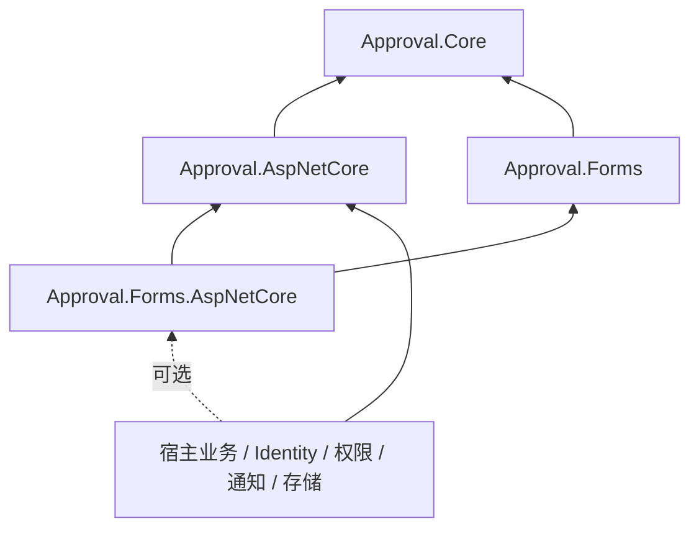

# 第二轮嵌入式审批引擎收敛报告

> 历史记录：本文保留该轮次当时的实现和验证事实。旧构造器、消息/幂等兼容、JSON 缺省版本及初始化迁移的当前状态，以[开发期兼容清理报告](unreleased-compatibility-cleanup.md)为准；本文不构成保留旧软件接口的要求。

日期：2026-11-03。版本：NuGet 四包与 `@approval/ui` 均为 0.3.0。
开发分支：`codex/engineering-extensibility`，改造起点 `76631ca`。开始时工作区干净，历史 InitialApproval 迁移未修改。

## 改造概况

原架构只有 Core/AspNetCore 两个框架项目，Core 同时持有维护/归档/保留、动态表单、附件生命周期、渠道与 best-effort 通知；宿主必须继承 ApprovalDbContext。

现在 Core 负责审批运行、版本、任务、并行/加签/退回、查询、审计、命令一致性和 Outbox。宿主保留已有 DbContext、Identity、授权、组织、业务和存储；Forms 及其 HTTP 是独立可选模块。



没有新增多租户、分布式协调、租约、消息平台、RBAC、脚本或维护扩展空壳。

## 删除与迁移清单

| 分类 | 实际变化 |
|---|---|
| 项目 | 未删除现有整项目；新增 Approval.Forms、Approval.Forms.AspNetCore |
| 维护服务 | 删除 ApprovalLifecycleService 及 Worker/Files partial、ApprovalMaintenanceGate、ApprovalMaintenanceWorker、ApprovalMaintenanceModel |
| 维护实体 | 删除 ApprovalArchiveRecord、ApprovalMaintenanceJob、ApprovalRetentionHold、ApprovalFileDeletion、ApprovalMaintenanceAudit 及相关枚举 |
| 接口 | 删除 IApprovalArchiveQueryScope、IApprovalChannel、IApprovalNotifier；删除强制继承的 ApprovalDbContext |
| DTO | 移除 MaintenancePreview、MaintenanceJobInfo、MaintenanceBatchInfo、ArchiveSummary 及维护请求契约 |
| API | 移除 /maintenance/*、/archives/*；/diagnostics 独立保留并受能力授权 |
| 配置 | 删除 Lifecycle、AdminRole、AdminPolicy、DefinitionReaders、UnboundRetention；文件选项移入 Forms |
| 权限 | 移除 archive.*、system.maintenance-run、system.file-cleanup |
| UI | 删除 MaintenanceView、MaintenancePanel、维护 API 客户端与菜单；保留独立 DiagnosticsView/DiagnosticsPanel |
| 通知 | 删除 AddChannel/AddNotifier；外部路由统一 IApprovalEventHandler，NotificationRequested 是事件载荷 |
| 表单/附件 | 将 Schema、公式、校验、字段可见性、ApprovalFormService、ApprovalDraft、ApprovalFile、文件服务/存储契约移入 Forms；FormEndpoints 移入 Forms.AspNetCore |
| 测试 | 删除维护专属 LifecycleTests、MaintenanceSafetyTests、LifecycleDatabaseContractTests 和文件定时清理病例；原混合 MaintenanceEndpointTests 的诊断/权限断言迁入 DiagnosticsEndpointTests；核心行为/表单/文件测试保留 |
| 文档 | 删除当前维护/多租户指南，更新全部有效接入文档；旧轮次结果明确存于 docs/history，不能作为本次证明 |

维护自动归档、清理操作记录、删除附件、归档快照生成及保留调度已经退出默认运行时。旧物理表和数据按升级策略保留。

## DbContext 与事务

`AddApprovalWorkflow<TContext>` 泛型约束改为 DbContext，DI 通过 EF ConfigureDbContext 安装 UseApproval。ConfigureApproval 集中配置审批实体；ConfigureApprovalForms 仅在安装 Forms 时使用。宿主可在之后继续覆盖自己的表名/模型配置。

原基类中的必要保护移入 ApprovalPersistence：发布版本不可变、审计只追加、相关 bulk/raw SQL 路径约束、扩展禁止自行提交、失败作用域不能继续保存。事务状态按 DbContext 实例保存，不封闭宿主 SaveChanges override。

命令委托从新 scope 获取同一个宿主 DbContext，业务数据、审批、操作结果与 Outbox 在同一数据库事务提交。IApprovalUnitOfWork 保留组合调用；两个不同 DbContext 不自动共享事务，裸外部事务仍明确拒绝。

## Forms、事件、权限、幂等与文件

- Core 无 Forms 项目/程序集依赖；只持有可选 JSON 快照。IApprovalDefinitionExtension、IApprovalDataProjection、IApprovalResourceResolver 提供必要的模块校验、可见性和资源解析。
- Forms 的字段、公式、明细、校验、规范化、草稿、附件引用和修改审计均保留。缺失快照模块时拒绝相关定义，不能跳过字段校验或过滤。
- 所有业务事件随审批事务进入 Outbox；稳定 Id、至少一次、退避/上限/人工重试及并发确认保留。旧 Notification 行转换到同一宿主事件接口，旧 ID 不变。
- 权限默认拒绝人工操作；不推断管理员角色。ASP.NET 单能力 policy 映射与宿主 provider 均可使用，受限系统身份仍需显式能力集合。
- OperationId、RequestHash、LookupHash、结果版本/JSON、唯一预约和未知提交核验保留，分别解决重复提交、数据库排序规则及结果恢复问题。没有新的操作过期/维护调度；IsTombstone 仅兼容旧版已擦除结果，旧键仍防重。
- 文件元数据归 Forms，实际存储归宿主；LocalApprovalFileStore 只由宿主显式选择。审批 Worker 不删除文件或执行保留策略。旧归档文件不通过在线接口绕过授权开放。

## 兼容性与迁移

九套上下文新增 EmbeddedEngineBoundary 迁移，snapshot 删除维护实体，Up/Down 不删除旧维护表、索引、外键或附件。原 InitialApproval/Designer 文件未修改。新宿主使用自己的 EF Migration，无须创建旧维护表。

这是 0.3 接入契约变更：去掉审批基类，模型调用 ConfigureApproval；手动/设计工厂构造上下文使用 UseApproval。表单改为 AddApprovalForms/AddApprovalFormsAspNetCore，文件设置与适配器归 Forms。旧渠道/Notifier 改为 IApprovalEventHandler；旧管理员角色配置改为宿主能力授权。

前端 Forms 尚未单独成为 `@approval/forms` 包，当前仍在 `@approval/ui` 内；这是明确保留的前端后续阶段。后端消费者已证明可完全不安装 Forms。

## 本次实际执行结果

| 验证 | 本次实际结果 | 证据 |
|---|---|---|
| Approval.Core.Tests | 341 通过，0 失败，0 跳过 | output/round2/validated/*.trx |
| Approval.Database.Tests / SQLite | 30 通过，0 失败，0 跳过 | 同上 |
| Approval.AspNetCore.Tests | 75 通过，0 失败，0 跳过 | 同上 |
| Certificate.Api.Tests | 58 通过，0 失败，0 跳过 | 同上 |
| 后端合计 | 504 通过 | 本次 TRX；起点 514 项，维护移除和新增/保留测试详见上文 |
| 前端单元测试 | UI 180 + demo 6，共 186 通过 | pnpm test |
| 前端边界测试 | 7 通过；95 个生产源文件边界检查通过 | pnpm test:boundaries / check:boundaries |
| 前端类型与 build | typecheck、build:lib、build 通过 | pnpm 对应命令 |
| Contracts | OpenAPI、JSON schema、四程序集 API 与 TypeScript 基线一致 | pnpm contracts:check --no-build |
| Migration model | 九套 HasPendingModelChanges 均无漂移 | EF CLI 检查 |
| ReferenceHost Kestrel | 源码与 NuGet 消费者均 27 项 smoke 通过 | output/reference-host/*/smoke.json |
| NuGet | 四包独立 pack、隔离缓存/摘要核对、两个现有宿主构建通过；Core-only Identity 消费者 10 项通过 | output/engineering/package-verification.json、consumer-*/embedded-host/verification.json |
| npm | tgz 独立安装、dist exports、types、CSS、消费者构建通过 | consumer-*/web |
| 浏览器 | 5 项消费者回归通过：发布及审批、匿名/协议拒绝、诊断/维护路由移除、退回重提/抄送已读、分类过滤 | consumer-*/browser/results.json |
| SQL Server / PostgreSQL / MySQL 本地 | 三入口实际退出 1：Docker daemon 不可用 | output/database-tests 各 provider 报告 |
| SQL Server / PostgreSQL / MySQL GitHub | 各 30 通过、0 失败、0 跳过；本次三个 Job 全绿 | run 41597075461，下载的 TRX 位于 output/round2/ci-001b63c |
| GitHub Actions | 提交 001b63c 的 Windows verify + MySQL/SQL Server/PostgreSQL 全部 success | [实际运行 41597075461](https://github.com/ttcc666/WorkflowDemo/actions/runs/41597075461) |

改造前远端 run 41585928243 的实际失败已核对：SQL Server/PostgreSQL 失败在被移除的维护双 Worker 病例；Windows verify 失败在缺失 rg。它们不是本轮运行结果。

## 关键需求与具体测试

| Requirement | Evidence |
|---|---|
| 普通/Identity/自定义基类，宿主 SaveChanges、事务、并发及 Outbox | ExistingHostContext_PreservesBusinessSaveApprovalTransactionConcurrencyAndOutbox（3 参数病例） |
| 缺失权限实现不隐式授予管理员 | MissingPermissionProvider_RejectsEvenAnAdministratorBeforeCreatingData；DefaultPermissionProvider_DeniesMembersAndAdministrators |
| 旧数据库/附件数据保留 | EmbeddedBoundaryMigration_PreservesLegacyArchiveAndAttachmentData |
| 独立诊断受授权、维护 API 确实删除 | ReadinessIsAnonymousBoolean_DiagnosticsRequireRights_AndMaintenanceRoutesAreAbsent |
| 未知提交恢复和重复请求不重复执行 | KeyedCoreStart_ReplaysOriginalVersionAndRejectsDifferentContent；CancellationBeforeCommitRollsBack_AndAfterCommitCannotUndoSuccess |
| 事件 ID、重试、退回与拒绝区别 | Host_events_are_transactional_retry_with_stable_ids_and_distinguish_return_from_rejection |
| Core 不安装 Forms 的实际消费 | EmbeddedHost 的 AddSignReturnResubmitWithoutForms、ParallelJoinWithoutForms、NoFormsAssemblyLoaded 等 10 个检查 |
| 核心表单/附件/审批功能 | 原有各直接模块回归继续执行，504 项后端及 186 项前端通过；完整测试名称见 TRX/results.json |

## 剩余问题与架构判断

- P0：无剩余阻塞。服务三库与 Windows verify 已由本次 GitHub Actions 实际通过；本地 Docker 仍不可用，不能将本地服务库入口标记为通过。
- P1：前端独立 `@approval/forms` 包属于后续阶段，当前 npm 包内仍包含表单组件。
- P2：无已知阻塞的文档/配置遗留；旧物理维护表及防重标记由明确升级策略保留，非默认运行子系统。

当前后端已经是可嵌入审批引擎，可直接集成已有 ASP.NET Core/Identity DbContext，不要求审批基类，并已通过不安装 Forms 的真实包消费。身份、组织、授权、外部通知与实际存储由宿主负责。审批核心仍保留必要的事务/审计/可靠事件复杂度；维护平台复杂度已移除。本轮后端、四库、独立发布包消费者与 CI 验收已完成；前端单独 Forms 包按允许的后续阶段保留。

## 可复现命令

在 `D:\Study\CSharp\Workflow`：

```powershell
dotnet build 'Workflow.slnx' --configuration 'Release'
dotnet test 'Workflow.slnx' --configuration 'Release' --logger 'trx' --results-directory 'output/verification'
pwsh -NoProfile -File 'eng/verify.ps1'
pwsh -NoProfile -File 'eng/verify-databases.ps1' -Provider 'SqlServer'
pwsh -NoProfile -File 'eng/verify-databases.ps1' -Provider 'PostgreSql'
pwsh -NoProfile -File 'eng/verify-databases.ps1' -Provider 'MySql'
```

`eng/verify.ps1` 包含前端、契约、独立包消费者与浏览器验证。所有命令依据实际退出码，失败不得标记为通过。

## 远端验收补充

2026-11-03 15:40（Asia/Shanghai），run 41597075461 完成，四个 Job 全部 success，head 为 001b63cf941ae5bca756055b4016960e40acdddd。本报告之后的提交仅同步交付说明，不变更已验收的生产代码。

修复过程中没有跳过核心测试。数据库脚本的旧“至少 33 项”阈值改为核验本次 TRX 的定义数/结果数/执行数/通过数一致、零失败/零跳过，以及关键迁移/事务病例实际执行；完整校验块和全部工程 PowerShell 脚本均已解析验证。
