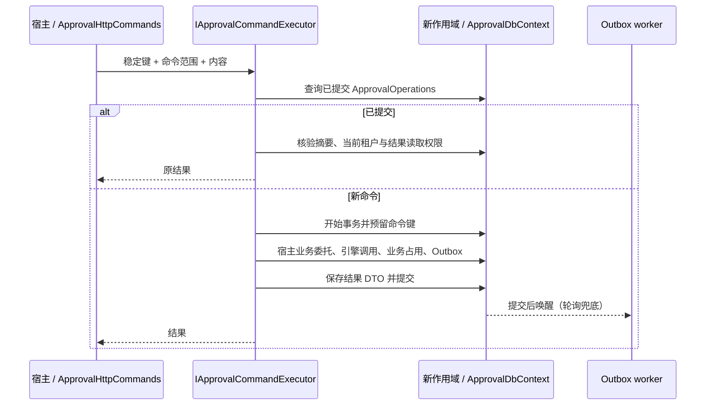

# 事务与通用幂等

阶段 3 为审批写操作提供本地工作单元和通用命令协调器。租户、操作人仍来自可信作用域；业务表与审批表必须使用同一个 `ApprovalDbContext`。数据库事务无法撤销已经发送的 HTTP、邮件或其他外部副作用。



## 宿主接入

单次 Core 写方法默认拥有本地事务。需要整段业务重试或客户端去重时，使用 `IApprovalCommandExecutor`，把业务准备、引擎调用和结果 DTO 全放进委托。每次尝试都会重新创建 DI 作用域和 DbContext；不要捕获外层 DbContext、跟踪实体或 scoped 服务。

```csharp
var instanceId = await commands.ExecuteAsync(
    new ApprovalCommand("contract.start", contractId.ToString(), operationId,
        new { contractId, amount }, ApprovalPermissions.InstanceStart,
        new() { DefinitionKey = "contract.sign" }),
    async (services, token) =>
    {
        var db = services.GetRequiredService<AppDbContext>();
        var contract = await db.Contracts.SingleAsync(c => c.Id == contractId, token);
        contract.Amount = amount;
        var engine = services.GetRequiredService<ApprovalEngine>();
        var instance = await engine.StartAsync(new("contract.sign", "Contract",
            contractId.ToString(), userId), token);
        return instance.Id;
    }, ct);
```

`Kind`、`Scope` 是宿主维护的稳定协议，不能含当前时间或随机数。`Payload` 必须包括影响业务结果的全部输入；它只保存摘要，不保存原请求正文。结果必须是可序列化且经过字段裁剪的 DTO，避免返回 EF 实体或敏感表单。

只需要共享事务时，可以用当前 scoped `IApprovalUnitOfWork.ExecuteAsync` 包住多次引擎调用。内层方法可以保存以支持 read-your-writes（同事务读取刚写入的数据），但不会提前提交；外层失败会撤销全部写入。这种显式工作单元本身不创建去重记录。启用 Provider 自动重试时，应使用协调器，以便整个业务委托和上下文一起重建。

裸 `Database.BeginTransaction`、`TransactionScope` 不作为受支持的审批接入方式，会在修改之前拒绝。失败后的作用域被标记为不可继续保存：释放它并使用新作用域，框架不会清空宿主 ChangeTracker 来伪装恢复。审批业务回调和同步动作只修改跟踪实体，禁止自行 SaveChanges、提交或重入审批写操作。

## 键和重放协议

| 项目 | 语义 |
|---|---|
| HTTP | 写命令使用 `Idempotency-Key`，长度 1–200，不能含控制字符 |
| Core 发起 | `StartApprovalRequest.OperationId`；其他复合操作通过协调器 |
| 唯一范围 | 当前租户、可信操作人、命令类型、资源范围和客户端键 |
| 同键同内容 | 返回原已提交结果，不重新准备业务、选择最新版流程或流转任务 |
| 同键不同内容 | `Conflict` / HTTP 409 |
| 不同键同一运行中业务 | 默认仅一个运行中实例，数据库业务占用约束选出获胜者 |
| 校验失败/确定回滚 | 不保留成功命令记录；可以修正输入后重新提交 |
| 提交结果未知 | 独立上下文核验；核验暂不可用时返回 `CommitOutcomeUnknown` / 503；保留原键和原内容重试 |
| 当前撤权 | 重放也核验当前结果读取权限，不因持有键恢复已失去的权限 |
| 保留期 | 当前无自动过期或清理；不能先删命令结果再声称原键仍有去重保证 |

摘要 v1 使用 UTF-8 长度分帧和 SHA-256，JSON 对象属性按 Ordinal 排序、数组顺序保留、十进制数采用稳定表示。业务标识保留原值，`Order`、`order`、`order ` 是不同业务；占用使用摘要键避免数据库 collation（排序规则）改变业务身份。其他历史自然键约束仍受 Provider 排序规则影响。

结果协议 v2 保存 DTO 及可信规范资源快照；已关联实例的结果按当前实例读取规则授权，其他结果按提交时的可信资源及当前权限服务授权，允许删除草稿后的原删除命令重放。未知摘要/结果版本拒绝重放；未来升级需要显式迁移协议。流程版本在同一执行策略的重试间固定，重放不随新发布版本变化。

竞争失败后先释放原事务，再用独立上下文读取获胜记录；不会在 PostgreSQL 已失败的事务中继续查询。仅识别明确唯一约束错误，不把任意数据库异常当作重复请求。提交前取消会回滚；提交成功后的客户端取消无法撤销已提交结果。不得把 503 或网络中断自动转换成新键。

## 兼容与严格模式

`ApprovalOptions.RequireOperationId` 默认 `false`：旧客户端仍可写入，但无键请求没有客户端重试去重保证。开启后，受管 HTTP 写操作及普通 Core 根写操作拒绝缺键，错误为 `OperationIdRequired` / 400。受信任宿主显式工作单元和最小系统作用域仍可以执行维护任务；它们不是客户端去重接口。

证照示例绑定 `Approval:RequireOperationId`、`Approval:CommitVerificationTimeout`（默认 10 秒）和 `Approval:AllowSynchronousExternalActions`；证照提交接口原有 UUID 键要求继续有效。严格模式上线前，须升级所有写客户端并验证幂等键生命周期。

以下接口保留专门语义：

- 定义校验只读，不创建命令记录。
- 批量人员改派逐实例独立事务，显式返回部分成功；拒绝加入外层工作单元，不提供整批原键重放保证。
- 二进制附件上传及物理清理不由通用命令协调器包裹，不能承诺与数据库跨介质原子提交；删除意图和回收治理属于后续阶段。
- 启动发布、超时扫描和后台投递使用受限系统作用域；系统循环依靠现有状态及并发令牌推进，不要求客户端键。

## Outbox 与扩展

抢占、投递、失败记录分别使用独立作用域；每段通过 Provider execution strategy（执行策略）在新上下文重试。异步动作允许本地 SaveChanges，但仍在投递事务内，动作失败会连同这些写入一起回滚。投递结果受 `LeaseId` 和 `ConcurrencyStamp` 双重校验；旧 worker 迟到时不能覆盖新 owner，旧事务的本地写入也会回滚。

异步动作须遵守 CancellationToken，租约超时后不得继续使用已释放上下文。外部渠道保持 at-least-once（至少一次）语义，接收方应使用 Outbox ID 作为幂等键；网络调用成功而确认丢失时可能再次投递，不能承诺外部恰好一次。SQLite 投递采用 deferred transaction，生产多 worker 应启用 WAL；SQL Server 失败继续动作要求关闭 MARS，使保存点可用。

Outbox 唤醒和旧 `IApprovalNotifier` 只在真实最外层提交后执行；旧通知回调是尽力发送，进程崩溃不能保证送达，需要可靠通知时使用 Outbox。声明 `HasExternalSideEffects=true` 的同步动作（含内置 Http）默认不能发布；应改成 Async。遗留宿主可显式开启 `AllowSynchronousExternalActions`，并自行承担外部幂等/补偿边界；该开关不会让外部调用具备数据库回滚能力。旧已发布版本不自动重写，扫描和治理见 `docs/definition-governance.md`。

## 前端提交生命周期

`createCommandIntent` / `useCommandIntent` 由业务页面持有逻辑意图，传给 API 的键由页面产生，传输层不会每次自动生成。成功后结束意图；网络错误、503 或待确认结果保留键；待确认时修改内容被阻止，需先检查已发起记录/审批轨迹/版本，再显式开始新操作。

元数据仅保存键、正文摘要和待确认状态，按用户/租户/API 地址及页面命名空间隔离。浏览器允许 sessionStorage 时可在同一标签页刷新后恢复原键，但不保存原表单正文，仍需原内容重试。存储禁用或配额不足时，同页使用内存保留；关闭页面后无法恢复，须先检查原结果。不同标签页视为独立意图，服务端业务占用仍提供运行中业务约束。

## 升级与回退

1. 备份并停止旧新写入及 worker；按阶段 1 完成租户映射。
2. 应用宿主新增 `AtomicOperations` 迁移：`ApprovalOperations`、`ApprovalBusinessSlots` 和 Outbox `LeaseId`。框架测试为四个 Provider 独立维护迁移，证照示例另有第五个迁移；旧迁移 ID 保持不变。
3. 若开启默认单业务运行中约束，对每个租户使用独立维护连接预览占用，再确认应用。重复运行中业务或不一致占用会阻止整个回填；不会擅自选获胜者或删除实例。单企业单次上限 100000 行，更大规模需分批维护适配。
4. 通过迁移、占用和客户端键检查后，恢复新版本写入及 worker。不要在滚动升级中保留不写入占用表的旧 writer。

```powershell
# 仓库根目录；由运维在进程环境设置专用 APPROVAL_MAINTENANCE_CONNECTION，勿写入报告或提交。
dotnet run --project 'eng/Approval.TenantTool' --configuration 'Release' -- --provider 'PostgreSql' --business-slots --fixed-tenant 'tenant-a' --output 'output/slots-preview.json'
dotnet run --project 'eng/Approval.TenantTool' --configuration 'Release' -- --provider 'PostgreSql' --business-slots --fixed-tenant 'tenant-a' --apply --output 'output/slots-applied.json'
```

`SingleRunningInstancePerBusiness=false` 是显式并行模式，不运行占用回填。旧在途实例可继续流转，存量命令不自动伪造历史幂等结果。回退前停止写入、保留命令记录及报告，优先从备份恢复到一致版本；不要在线删除操作表或重置键。MySQL DDL 隐式提交，schema 回退不等同事务回滚。

执行策略和提交结果核验依据：[EF Core 连接弹性](https://learn.microsoft.com/en-us/ef/core/miscellaneous/connection-resiliency)、[EF Core 事务与保存点](https://learn.microsoft.com/en-us/ef/core/saving/transactions)。结果正文到期和永久 tombstone 见 `docs/diagnostics-and-lifecycle.md`。具体本机证据见计划实施记录和 `docs/database-validation.md`；阶段 6 尚未验收。
