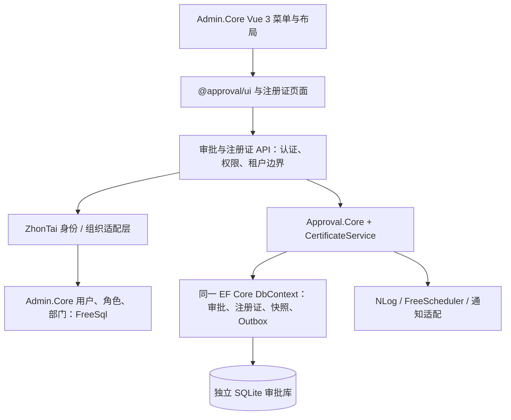

# 集成 Admin.Core：注册证三级审核模块

日期：2026-11-01（Asia/Shanghai）。状态：代码实施、本地验收与发布产物检查已完成；真实员工试点需完成部署配置。当前入口见 [集成说明](../docs/admin-core-integration.md)。

目标：员工通过 Admin.Core 登录，在其菜单内提交注册证，依次由部门负责人、质量/法规、负责人审批；沿用当前 SQLite 试点及现有事务、幂等、历史快照和审批资格保护。

本方案核对并用于实施的上游版本为 [Admin.Core master，47961ee33b2bdcae8104015e82b61f41b8372f78](https://github.com/zhontai/Admin.Core/tree/47961ee33b2bdcae8104015e82b61f41b8372f78)，提交日期 2026-10-28。源码位于同级 `Admin.Core`，分支为 `codex/registration-approval-integration`；已使用真实宿主的进程内集成测试验证。

## 推荐架构与边界

首期采用同一宿主内的业务模块：Admin.Core 提供登录、用户、部门、角色、菜单、日志和任务调度；Approval.Core + Approval.AspNetCore 提供审批服务；注册证与审批数据保留在同一个 EF Core DbContext 和独立 SQLite 文件中。



选择依据：

| 方案 | 影响 | 本轮选择 |
|---|---|---|
| 同宿主模块，Admin 使用 FreeSql、审批业务使用 EF Core | 可以复用已有身份服务，并保留证书写回与审批的本地事务 | 推荐 |
| 独立审批服务，经网关统一访问 | 需要额外处理身份信任、组织查询、网络故障和服务部署 | 有独立部署要求时再选 |
| 将审批引擎整体改为 FreeSql | 当前引擎直接依赖 DbContext，涉及事务、查询、并发、迁移与恢复验证 | 独立重构项目，不作为首期接入前置条件 |

### 必须保留的不变量

- 终审通过、申请状态、正式台账及 Outbox 写入仍在同一个 EF Core 保存边界内。FreeSql 的 UnitOfWork 默认不会加入这个事务，即使使用同一个数据库也不能假定原子性。
- Admin 的用户/组织查询是适配层的读取职责；不得在终审回调中先写 FreeSql 业务表，再假定 EF Core 保存失败可以撤销前者。
- 员工 ID 在接口、组织、任务、历史、通知中使用一致的字符串表示；不得将 long 转成前端 Number 后再还原，以免精度损失。
- API 功能权限与单据参与人/节点资格检查都要通过；拥有菜单或管理权限不能替代正常审核资格。
- 首期只开放一个明确的企业/租户范围，服务端强制限制。当前审批实体没有 TenantId，不能借用 Admin 的多租户开关直接开放共享审批库。
- 维持禁止自审、禁止同一人处理多个不同审核节点、合格人员改派、申请幂等、证号占用、不可变历史快照。
- 沿用 EF Migrations 与显式旧库升级。FreeSql CodeFirst 的实体扫描和表同步范围不包含审批实体。

## 一、后端模块与宿主挂接

在 Admin.Core 中新增独立模块，例如 `ZhonTai.Module.Approval`。这是拟新增名称，目前上游并不存在该模块。

建议内容：

```text
ZhonTai.Module.Approval/
  Integration/
    ZhonTaiApprovalCurrentUser.cs
    ZhonTaiApprovalIdentityProvider.cs
    ZhonTaiApprovalOrganizationProvider.cs
    ZhonTaiApprovalUserDirectory.cs
    ZhonTaiApprovalEndpointFilter.cs
    ApprovalModuleRegistration.cs
  Certificates/        # 从当前样例提取的注册证业务服务和模型
  Infrastructure/      # EF DbContext、迁移、备份、诊断
  Flows/               # 注册证流程版本模板
```

初期通过项目引用复用本仓库的 `Approval.Core` 和 `Approval.AspNetCore`；后续可发布到团队私有 NuGet 源。项目中的 PackageId 不代表公共源已经发布了可用版本。

宿主的实际接入点：

- `HostAppOptions.ConfigurePostServices`：注册审批 DbContext、身份/组织适配、审批服务、注册证服务和授权策略。需要合并进宿主现有回调，保留已有 CAP、任务调度等注册。
- `HostAppOptions.ConfigurePostMiddleware`：映射审批与注册证端点，增加权限、租户及操作日志桥接。保留已有 ApiUI 等中间件设置。
- 启动初始化显式调用数据库检查和流程补缺；不能把异步初始化写成 Action 回调中的 async void。实现时放在宿主支持的启动阶段，或阻止业务就绪的初始化服务中。
- 复用宿主 JWT 认证，不再注册演示身份，不启动第二个 Certificate.Api WebApplication。
- 当前 `CertificateApplication` 是完整示例宿主，包含演示 Webhook、静态文件与前端 fallback。实施时提取业务注册与初始化，不将整个示例 HTTP 管线直接嵌套到 Admin 宿主。
- 本仓库已固定 .NET 10；上游核对版本也是 .NET 10。集成构建时需检查 Microsoft.Extensions / EF Core / ASP.NET Core 等依赖解析，固定通过验证的包版本。

## 二、登录与组织字段映射

上游 `ClaimAttributes.UserId` 的实际值为 `uid`。当前审批默认只读 NameIdentifier / sub，因此需要注册 `IApprovalCurrentUser` 适配，或者在认证成功后统一映射 Claims；优先采用显式适配。

适配器示意（须放到引用了双方类型的集成模块中）：

```csharp
using System.Globalization;
using Approval.AspNetCore;
using Microsoft.AspNetCore.Http;
using ZhonTai.Admin.Core.Auth;

public sealed class ZhonTaiApprovalCurrentUser(IUser user) : IApprovalCurrentUser
{
    public string? GetUserId(HttpContext http)
    {
        if (http.User.Identity?.IsAuthenticated != true || user.Id <= 0)
            return null;

        return user.Id.ToString(CultureInfo.InvariantCulture);
    }
}
```

按 Scoped 生命周期注册。此适配器只负责读取已经认证的身份，不能替代签名验证、账号状态检查、会话撤销或租户限制。

| 当前审批需要 | Admin.Core 实际字段/接口 | 处理要求 |
|---|---|---|
| 当前用户 ID | `IUser.Id` / `uid` | 使用稳定用户 ID，不用姓名或登录名 |
| 主部门 | `UserEntity.OrgId` | 三级审核以主部门为准，不随意选多部门关系中的第一条 |
| 部门负责人 | `UserOrgEntity.OrgId` + `IsManager` | 查询该部门的主管，验证用户及部门有效、同租户 |
| 上级部门 | `OrgEntity.ParentId` | 根节点转换成 null |
| 直属上级 | `UserEntity.ManagerUserId` | 用于 Manager / ManagerChain 扩展规则 |
| 岗位角色 | `UserRoleEntity` + `RoleEntity.Code` | 以稳定编码映射 QualityManager / Leader；同一范围重复编码需预检或显式绑定角色 ID |
| 用户目录 | `UserEntity.Id / Name` 与角色关系 | 批量查询、关键字搜索、有效用户筛选 |
| 邮箱 | `UserEntity.Email` | 通过 IApprovalContactProvider 接入；企业微信用户标识需另外建立可靠映射 |

必须过滤停用、软删除、未激活等不具备业务资格的账号；`UserStatus` 不是通用的 Active/Inactive 枚举，需要按上游实际枚举与账号流程处理。角色组、角色软删除、部门停用也需要明确排除规则。

身份与组织 Provider 应按明确的系统/租户范围查询权威数据，不能因为当前审批人的个人数据权限较小而查不到其他部门的候选人。外部可调用的用户目录接口仍执行宿主允许的目录可见范围，不能为内部审批解析放开所有人员数据。

后台扫描没有 HttpContext；其组织/角色查询必须显式带固定试点范围或受控的租户上下文，不能依靠当前请求的 IUser 获取租户。已有待办遇到调岗/离职时继续执行资格复核，并由管理员按已有规则改派。

注册证登记角色配置：

1. 部门初审：申请人的 `OrgId` → 同部门 `IsManager=true` 的有效用户。
2. 质量/法规复审：配置为 `QualityManager` 的业务角色。
3. 负责人终审：配置为 `Leader` 的业务角色。

现有登记模板每层为 Any，表示该层一位合格人员通过即可，三层仍必须依次完成。至少需要与申请人不同、能够覆盖三层的审核人员。

## 三、Minimal API 权限、数据范围与日志

上游 `ValidatePermissionAttribute` 是 MVC 授权过滤器，调用 `IPermissionHandler.ValidateAsync`；`ControllerLogFilter` 与 `FormatResultFilter` 同样属于 MVC。当前审批使用 Minimal API，不能假定这些过滤器自动覆盖审批端点。

实施要求：

- 所有审批、注册证、附件、流程定义、消息、投递和管理诊断端点建立认证边界。
- 新增端点权限桥接：使用端点路由模板与 HTTP 方法，或明确的权限点映射，调用 Admin 的权限服务。不能用含具体 ID 的 URL 代替权限库中的路由模板。
- 未映射的业务端点默认拒绝；内部自助端点（如 me）也必须有明确的“已登录且属于试点范围”策略，不能用临时全放行兜底。
- 在 Admin 中登记对应 API、菜单、权限点及角色授权，核验端点发现/同步是否覆盖 Minimal API；必要时从 EndpointDataSource 生成模块的显式清单。
- 使用 `ApprovalAspNetCoreOptions.AdminPolicy` 映射专门的审批管理权限。平台管理员是否允许跨业务范围操作，应显式规定；租户边界先于管理员便利权限。
- 保留当前 CertificateAccessPolicy 与节点资格复核；新增 Admin 的数据范围要求时，在现有规则上明确组合，并覆盖列表、详情、历史、附件、统计和导出等入口。
- 接通操作日志桥接并保留审批自身的历史事件；一般操作日志不能替代审批审计记录。
- 验证账号禁用、强制下线、权限回收及缓存失效也作用于 Minimal API。只验证 JWT 签名成功不代表账号仍获准操作。

建议权限点（拟新增，不是上游现成编码）：

| 权限点 | 功能 |
|---|---|
| `approval:read` | 查看自己的工作台与有权访问的实例 |
| `approval:handle` | 处理待办，仍须通过节点资格检查 |
| `certificate:submit` | 注册证提交、按现有所有者规则申请变更/注销 |
| `approval:design` | 查看和发布流程，首期可与现有管理能力合并 |
| `approval:manage` | 投递诊断、受控重试、改派和终止 |

当前审批管理能力的授权粒度较集中；如果要求“设计员可以发布、但不能改派/终止”，需要另行拆分相关授权检查，不应只建两个菜单就宣称已隔离。

### 租户与 FreeSql 数据权限

上游 DbHelper 为 FreeSql 注册 ITenant / IData 过滤器。这些规则不会作用于当前 EF Core 查询；审批实体也没有自动继承 TenantId。

首期建议固定一个授权的试点企业/租户，并用独立审批库。服务端拒绝其他租户访问，后台任务固定在同一范围。不能仅通过菜单隐藏或给用户 ID 加前缀来实现租户隔离。

未来若做多个租户共享审批库，需要为定义、实例、任务、历史、草稿、附件、消息、Outbox、注册证及证号占用设计完整租户范围与复合唯一约束，并覆盖后台扫描、管理操作和备份。该能力不属于当前已验证成果。

## 四、前端嵌入

已核对上游 Vue 3.5.44、Element Plus 2.14.7、Vue Router ^5.4.0，与当前 @approval/ui 的主要 peerDependencies 对齐；仍需实际安装、类型检查和构建验证。

实施步骤：

1. 将 `@approval/ui` 接入 Admin 前端 workspace，或使用明确版本的私有包 / tgz；不能假设公共 npm 上已有此包。
2. 在已有 Vue app 中安装 ApprovalUI，复用宿主 Element Plus 与 router，加载组件库样式与 Vue Flow 依赖。
3. 从 `useUserInfo().getToken()` 读取当前 accessToken，传 `Authorization: Bearer ...`；接通退出登录、401 清理和用户/租户切换时的敏感数据清理。
4. 将 `createApprovalRoutes()` 挂入 Admin 的布局和后端动态路由生命周期，保留 `approval-*` 路由名；目录菜单、详情隐藏路由、标签页和刷新均需能恢复。
5. 上游 `backEnd.ts` 只通过 import.meta.glob 加载宿主 views。需要增加模块组件映射或宿主 wrapper 页面，不能把包内路径直接填到菜单 viewPath 后假定自动可用。
6. 注册注册证列表、申请表、历史及业务详情面板，沿用现有服务端字段错误、幂等提交标识和固定快照展示。

两个接口约定差异必须处理：

- Admin 的控制器通常返回 `success / code / msg / data`，审批接口返回原始 DTO、真实 HTTP 状态和 ProblemDetails。首期保留审批协议，在模块边界适配，不改变整个 Admin 的返回格式。
- 当前 @approval/ui 使用 fetch，上游 `api/admin/http-client.ts` 的 Axios 客户端负责令牌刷新队列。传入 headers 不会自动继承刷新逻辑。需提供一个共享的认证请求桥接（如给组件库增加可选 fetcher 扩展），复用刷新生命周期并保留审批响应格式、AbortSignal、文件上传和下载。不得直接套用强制要求 data.success 的响应拦截器。

写请求重试必须保留原 Idempotency-Key。批准等暂未提供业务幂等键的动作，不能被通用网络重试逻辑盲目重放；应按其已有并发控制和查询结果处理。

## 五、数据库、通知与运维复用

| 能力 | 集成方式 |
|---|---|
| SQLite | 延用当前试点，绝对路径放到发布目录外。Admin 主库与审批库各自管理迁移；审批与注册证共用一个 EF DbContext |
| 日志 | 宿主已经 UseNLog；增加审批类别、TraceId / SubmissionId 与实例关联字段的输出及留存规则 |
| 备份 | 将现有 CertificateDatabase.BackupAsync 或维护命令包装为 FreeScheduler 任务，唯一目标文件、失败抛错、记录结果 |
| 备份告警 | 上游任务调度已有失败重试和告警邮件钩子；配置真实收件人与 SMTP 并验证到达 |
| 运行诊断 | 复用现有 Monitor 与管理员诊断；向 NLog/运维通道转发。服务停机另由进程外健康探测告警 |
| 业务通知 | 可通过 IApprovalChannel 适配 Admin 消息服务，或继续邮件/企业微信；接收端按 Outbox 消息标识幂等 |
| 附件 | 初期保留独立持久化目录并备份；需要统一 OSS 时实现 IApprovalFileStore 并维持授权下载 |

不要让 FreeScheduler 与审批原有 HostedService 重复承担相同扫描工作。备份调度可以独立复用，审批超时与投递扫描首期保留现有职责。

上游宿主示例 CAP 当前使用内存存储和内存队列。若未来把审批结果同步到 FreeSql 的其他业务表，必须采用持久化消息、幂等消费、明确的“审批完成/业务同步待完成”状态与对账补偿；不能把这个默认 CAP 配置当作可靠业务同步。

注册证模板当前只启用 InApp。对接新通知渠道后仍需配置模板通知规则并发布新版本；应用启动不会覆盖已有流程版本。

### 存量数据与回滚

- 切换前分别备份现有审批库、Admin 配置及相关附件，保留源文件。不要覆盖正在运行的 SQLite。
- 若旧库仍使用 alice / dave 等演示 ID，不能直接认为它们对应真实员工。首期优先创建真实试点新库；如需迁移实际业务记录，必须审查完整身份映射和历史责任归属，不伪造审批人。
- 新库创建与旧库升级复用当前 EF 迁移/预检；不通过 FreeSql 自动建表“修补”审批库。
- 出现问题时关闭模块的新提交入口，保留数据库和在途实例，再回滚兼容的应用版本。不得直接执行破坏性 Down 或用旧备份覆盖已经产生真实审批的数据。
- 回滚必须同时考虑前端包、权限/API登记、流程版本和后端程序集，保留已完成业务与审计数据。

## 六、实施清单与验收

代码实施与部署环境验收分别记录：

- [x] 固定 Admin.Core 基线，建立模块与同级源码引用，实现单一企业范围与审批库绑定。
- [x] 链接复用注册证业务与 EF 初始化，接入 HostApp 生命周期，分离两套 ORM 的职责。
- [x] 实现当前用户、角色、公开目录、内部资格与组织 Provider。
- [x] 完成 Minimal API 认证、权限、数据范围和操作日志桥接，登记菜单/API/权限点。
- [x] 接入 Vue 页面、动态菜单、稳定路由名、Token 刷新和返回格式适配。
- [x] 接入迁移、发布配置、附件目录、日志和备份任务主题，编写部署与恢复手册。
- [x] 完成最终隔离数据库回归与发布产物检查，记录逐项证据：Admin 后端 51 项、Workflow 后端 359 项、前端 153 项测试通过。
- [ ] 配置实际企业、真实审核人员、备份计划和告警收件人，完成人工试点后切换业务入口。

验证矩阵：

| 场景 | 必须观察到的结果 |
|---|---|
| 匿名、伪造 X-User-Id、无效 JWT | 无法读取或操作业务 |
| 正常 Admin 登录 | uid 正确映射，me、待办与本人身份一致 |
| 账号停用/待激活/强制下线 | 现有令牌不能继续受限业务操作；权限缓存更新可验证 |
| 无菜单/API权限的已登录用户 | 直接调用 Minimal API 仍被拒绝 |
| 三层真实人员审批 | 按主部门主管 → QualityManager → Leader 顺序产生待办，终审前不生效 |
| 人员调岗、角色回收 | 旧候选资格失效；受控改派保留原因与时限 |
| 终审业务回调失败 | 审批任务、申请、台账与 Outbox 都不部分提交 |
| 重复/并发提交及竞争批准 | 保持现有幂等、证号占用和并发约束 |
| 非试点租户与相同角色编码 | 无法访问试点数据或成为错误租户的候选人 |
| 无 HttpContext 的后台扫描 | 能在显式试点范围内解析人员，不因匿名上下文错判或跨租户读取 |
| Token 刷新并发、401、退出 | 请求恢复或有序退出，页面不残留前一身份的业务数据 |
| DTO、ProblemDetails、204、文件下载 | 不被 Admin 包装/拦截器错误解析；字段级错误和真实状态保留 |
| 菜单刷新、隐藏详情路由、标签页 | 审批内部跳转使用正确命名路由，不因动态菜单加载失效 |
| 备份失败与恢复演练 | 故障被记录并通知，恢复副本的台账、任务、占用与附件可以核对 |

验证应使用真实 Admin 认证/权限配置和隔离的 SQLite 文件；本仓库现有试点测试通过不能代替上述集成测试。源码分析未证明上游真实部署的会话、权限或任务调度配置已启用。

## 源码依据

- [Admin.Core 主宿主与 NLog、CAP、FreeScheduler 注册](https://github.com/zhontai/Admin.Core/blob/47961ee33b2bdcae8104015e82b61f41b8372f78/src/modules/admin/ZhonTai.Admin.Host/Program.cs)
- [HostApp 生命周期扩展](https://github.com/zhontai/Admin.Core/blob/47961ee33b2bdcae8104015e82b61f41b8372f78/src/modules/admin/ZhonTai.Admin.Core/Startup/HostAppOptions.cs)
- [uid 与租户 Claims](https://github.com/zhontai/Admin.Core/blob/47961ee33b2bdcae8104015e82b61f41b8372f78/src/modules/admin/ZhonTai.Admin.Core/Auth/ClaimAttributes.cs)
- [用户主部门、直属主管及有效性字段](https://github.com/zhontai/Admin.Core/blob/47961ee33b2bdcae8104015e82b61f41b8372f78/src/modules/admin/ZhonTai.Admin.Contracts/Domain/User/UserEntity.cs)
- [部门主管关系 IsManager](https://github.com/zhontai/Admin.Core/blob/47961ee33b2bdcae8104015e82b61f41b8372f78/src/modules/admin/ZhonTai.Admin.Contracts/Domain/UserOrg/UserOrgEntity.cs)
- [MVC 权限过滤器](https://github.com/zhontai/Admin.Core/blob/47961ee33b2bdcae8104015e82b61f41b8372f78/src/modules/admin/ZhonTai.Admin.Core/Attributes/ValidatePermissionAttribute.cs)
- [FreeSql 的租户/数据过滤器](https://github.com/zhontai/Admin.Core/blob/47961ee33b2bdcae8104015e82b61f41b8372f78/src/modules/admin/ZhonTai.Admin.Core/Db/DbHelper.cs)
- [Admin 前端 Token 刷新与响应处理](https://github.com/zhontai/Admin.Core/blob/47961ee33b2bdcae8104015e82b61f41b8372f78/ui/zhontai.ui.admin.vue3/src/api/admin/http-client.ts)
- [Admin 动态路由组件加载](https://github.com/zhontai/Admin.Core/blob/47961ee33b2bdcae8104015e82b61f41b8372f78/ui/zhontai.ui.admin.vue3/src/router/backEnd.ts)
- 当前项目：[核心注册接口](../src/Approval.Core/ApprovalServiceCollectionExtensions.cs)、[身份/组织契约](../src/Approval.Core/Abstractions/Abstractions.cs)、[Minimal API 注册](../src/Approval.AspNetCore/ApprovalAspNetCoreExtensions.cs)、[Vue 插件配置](../web/packages/approval-ui/src/config.ts)、[试点运维手册](../docs/registration-certificate-pilot.md)。
