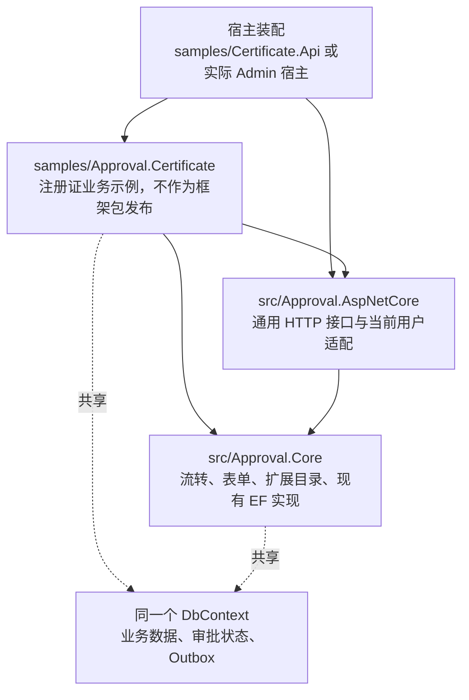

# Workflow 工程化与可扩展性改进方案

日期：2026-11-01。状态：阶段 0–5 的本次实施范围已完成，统一验证与独立包浏览器验收通过。

业务归属校正：注册证仅是审批接入示例，类库归入 `samples/Approval.Certificate`，不参与框架包发布。框架契约与示例契约分别维护，下面的目录和命令已按此边界更新。

方案已开始实施，结果和命令记录在[工程化验收记录](../docs/engineering-validation.md)。以下问题表保留改造前的分析基线；实施已核对并更新同级 Admin.Core 的模块引用，保留其现有改动及正在运行的服务，未改动部署数据库。

## 1. 目标与判断

建议采用**模块化单体、稳定的扩展契约、自动化质量门禁**。当前优先优化复用边界和变化的归属，保持现有 .NET 10、EF Core、Minimal API、Vue 3 技术路线。

工程化的验收目标：开发者可用同一条命令完成本地与 CI 验证；使用发布包的宿主能独立构建；新增业务、动作、审批人规则时，修改集中在所属模块。

当前已有值得保留的基础：

- `src/Approval.Core` 与 `src/Approval.AspNetCore` 已分离；核心不依赖 ASP.NET Core。
- `IApprovalBusinessHandler`、`IApproverResolver`、`IApprovalActionHandler`、`IApprovalChannel`、身份/组织/文件接口已经提供扩展点；动作和审批人具有设计器元数据。
- 审批和业务共用 DbContext；具有并发令牌、Outbox 租约/重试、流程版本绑定及业务幂等设计。
- CI 已执行后端构建/测试、迁移漂移检查、前端类型检查/测试/构建；注册证已有健康端点、诊断、备份和恢复路径。
- 公式的 C# 与 TypeScript 实现共用 `tests/shared/formula-cases.json`，可以推广这种契约一致性验证。

## 2. 基于代码的主要问题

| 优先级 | 现状与依据 | 对工程化或扩展的影响 | 建议 |
|---|---|---|---|
| P0 | 根目录没有 `Directory.Build.props`、`Directory.Packages.props`、`.editorconfig`；各项目重复声明编译属性和包版本，验证步骤集中在 CI YAML | 本地、CI 和新项目容易产生配置差异 | 统一公共配置和 `eng/verify.ps1`，保留项目专属配置 |
| P1 | [CertificateApplication.cs](../samples/Certificate.Api/CertificateApplication.cs) 同时处理业务注册、SQLite、认证、演示身份、Webhook 和宿主管线；[CertificateModels.cs](../samples/Approval.Certificate/Certificates/CertificateModels.cs) 包含实体和具体 AppDbContext | 实际宿主复用业务时，需要理解示例项目的装配和环境假设；[已有集成计划](2026-11-01-admin-core-integration.md) 已采用链接源码复用 | 将注册证业务整理为 `samples/Approval.Certificate` 示例类库，让示例宿主承担装配，不纳入框架发布 |
| P1 | [ApprovalEngine.cs](../src/Approval.Core/Engine/ApprovalEngine.cs) 及 5 个 partial 合计 1,546 个物理行，构造函数注入 13 项依赖；同时保存执行缓存、处理流转、解析人员、生成消息和提交 | 逻辑放在多个文件中，但共享同一个类的状态和内部方法；修改一类规则仍需理解整个操作周期 | 先提取扩展目录和人员解析，再逐步提取有清晰输入输出的运行时职责 |
| P1 | 引擎和 [ApprovalDefinitionService.cs](../src/Approval.Core/Engine/ApprovalDefinitionService.cs) 各自处理同名解析器/动作覆盖与元数据 | 扩展在校验、设计器和执行时的解释规则可能随维护而分叉 | 共享一个 scoped 扩展目录，维持现有大小写与覆盖规则 |
| P1 | [api/types.ts](../web/packages/approval-ui/src/api/types.ts) 从 `features/forms/formModel.ts` 导入协议类型；[flowModel.ts](../web/packages/approval-ui/src/features/flow/flowModel.ts) 同时定义流程协议、Vue Flow 模型、布局、连线编辑和运行态展示 | API 协议与编辑器实现混在一起，复用协议或替换画布时修改面扩大 | 先在现有前端包内建立无 UI 依赖的 `contracts/`，再按职责拆模型算法 |
| P1 | [config.ts](../web/packages/approval-ui/src/config.ts) 的 `current` 是模块级变量；插件每次安装都重写它，API 单例也读取它 | 同一页面安装多个实例时配置会相互覆盖；测试和宿主适配依赖隐式全局状态 | 新增实例化客户端与 Vue 注入，保留现有单实例入口作为兼容层 |
| P2 | 后端 DTO/枚举和前端类型手工维护；流程/表单定义以 JSON 字符串传递，流程 JSON 没有独立的协议版本 | 服务端演进后，前端类型仍可能编译通过；流程发布版本不能替代协议版本 | 先固定 DTO 与序列化契约，再生成 HTTP 类型，并为嵌入的流程/表单 JSON 单独维护契约 |
| P2 | [CI](../.github/workflows/ci.yml) 构建前端库和源码 workspace demo，但没有独立的 NuGet/npm 发布包消费验证；smoke 脚本只做语法检查 | 源码开发可用，不能证明包导出、类型、CSS、流程资源和宿主配置齐全 | 增加本地包消费验收及少量真实浏览器关键链路 |

上述代码行数用于定位职责集中处，不作为“超过多少行就必须拆”的规则。`Approval.Core` 当前对 EF Core 的依赖也有明确目的：与宿主业务维持同一个本地事务。

## 3. 首轮目标边界

示例层通过独立类库复用注册证业务；框架保持业务无关，核心内部先用目录和 internal 类型建立边界。



建议目录，新增部分均为计划：

```text
eng/verify.ps1                       本地与 CI 共用的验证入口
Directory.Build.props               公共编译设置
Directory.Packages.props            公共 NuGet 版本
src/
  Approval.Core/                    保留现有公共 API 与 EF 实现
    Engine/Extensions/              扩展查找、覆盖规则和描述信息
    Engine/Runtime/                 逐步抽取的人员解析、事件收集等内部职责
  Approval.AspNetCore/              保留现有 HTTP 适配边界
samples/Approval.Certificate/       注册证业务示例类库，不参与框架包发布
samples/Certificate.Api/            Program、配置、演示身份、宿主管线
web/packages/approval-ui/src/
  contracts/                       流程、表单、HTTP DTO；无 Vue Flow 依赖
  api/                             实例化 HTTP/approval 客户端
  features/flow/                   画布适配、图编辑、布局、运行态展示
  features/forms/                  表单渲染、编辑、校验反馈和公式计算
web/apps/demo/                     示例布局、路由、演示用户与业务页面
```

协议目录先留在 `@approval/ui` 中。出现第二个独立消费者后，再决定是否发布 `@approval/contracts`。

后端同样按真实需求决定后续物理拆包：例如希望完全不携带 Jint 的宿主可以推动脚本插件拆包；需要更换持久化模型时才评估 `Approval.EntityFrameworkCore`。首轮不引入通用仓储或跨进程架构。

## 4. 必须保持的不变量

1. 业务回调、审批状态和本次 Outbox 写入使用同一个 DbContext，在既定提交边界内保持一致；子服务不另开 DbContext 或自行提交。
2. 并行、退回、加签、超时操作的执行顺序、自动步数限制、任务状态和并发冲突语义保持不变。
3. 进行中的实例继续读取其绑定的定义版本；保持 `DefinitionId`、JSON 字段名/枚举值、旧定义读取行为和数据库迁移历史。
4. 动作的同步/异步、ContinueOnError、检查点恢复、重试及幂等键规则保持不变。外部 HTTP/邮件副作用不属于 EF 事务保证范围。
5. 同名扩展保持大小写不敏感、后注册覆盖先注册；扩展元数据、发布校验与执行选择一致。scoped handler 不被 singleton 缓存捕获。
6. 保持 HTTP 路径、错误码、ProblemDetails、字段权限过滤、404 隐藏不可见资源的语义及 `approval-*` 路由名称。
7. 保留已有 `fetcher` 认证桥接和 `IApprovalHttpUserDirectory` 的职责；公开人员搜索和内部审批资格判断继续使用各自的权限范围。
8. 前后端表单校验各司其职：前端即时反馈，服务端可信校验；通过共享用例保证共同规则一致。

## 5. 分阶段实施清单

每个阶段独立提交、独立验收。发生数据结构或对外行为变化时，从结构重构中分离为单独工作项。

### 阶段 0：统一构建与维护入口

- [x] 从当前 CI 核对基线，记录构建、测试、迁移和前端验证结果。
- [x] 在 `Directory.Build.props` 提取真正公共的编译选项；在 `Directory.Packages.props` 集中相同包的版本。首次迁移保持全部已解析版本不变。
- [x] 添加 `.editorconfig`，先约束后续改动；避免混入全仓格式化。
- [x] 增加 `eng/verify.ps1`，集中 restore、build、test、迁移检查、pnpm 类型检查/测试/构建；每个外部命令失败立即返回非零退出码。
- [x] CI 调用该脚本；从 `global.json` / `packageManager` 读取版本，降低多处硬编码。
- [x] README 保留快速开始与文档入口。核对旧升级说明与现有试点迁移/恢复手册的一致性，以运维手册为唯一操作依据。

验收：相同工作区，本地和 CI 执行相同验证步骤；依赖版本不变；迁移模型没有变化。

### 阶段 1：整理注册证示例模块

- [x] 在 `samples/Approval.Certificate` 示例类库中维护注册证服务、校验器、策略、回调、动作、业务端点及必要持久化/流程资源；不作为框架包发布。
- [x] 第一轮保留现有具体 DbContext 的事务模型；将其与配套迁移作为整体处理。拆出实体配置，但不重建 baseline 或修改迁移 ID。
- [x] 明确迁移程序集、设计时 DbContext 创建、流程 JSON 的 build/publish 资源路径。通过现有迁移测试确认发现的迁移列表与之前一致。
- [x] 增加模块服务注册入口；宿主负责连接字符串、认证、环境、HTTP 客户端配置和初始化时机。模块注册不隐式启动另一个 WebApplication。
- [x] 演示身份、模拟 Webhook、回环代理、静态站点和演示路由留在 sample。先做行为等价的装配迁移，默认行为调整单独处理。
- [x] 更新 `Workflow.slnx`、示例和现有测试引用；保持公共命名空间/配置键可兼容。若有二进制消费者，补类型转发或兼容入口。
- [x] 将实际 Admin 宿主接入列为联动验收：改用示例类库项目引用，撤掉链接业务源码的做法。该仓库不在本轮分析范围，实施时需读取其当前状态。

验收：示例通过现有业务/并发/授权/迁移/恢复测试；实际宿主无需引用 sample Web 项目或链接其业务源文件即可接入。宿主联动未完成时，不宣布本阶段整体完成。

### 阶段 2：收敛引擎职责

- [x] 第一小步抽出 internal scoped `ApprovalExtensionCatalog`，供引擎与 DefinitionService 共享同名覆盖、查找及元数据；核对 Outbox 的选择规则后再接入。
- [x] 用现有 `ActionOverrideTests`、`OrganizationApproverTests` 和发布校验场景约束兼容行为。
- [x] 第二小步提取人员解析/资格过滤服务，接收明确的实例、节点和表单上下文；保留人员顺序、去重、角色展开和自审规则。
- [ ] 根据下一次真实变更需要，分别提取通知事件收集或图流转职责。`ApprovalEngine` 保留现有公共门面；每次只迁一个职责。（后续条件项：本轮提取扩展选择与人员服务，没有新增通知或控制流语义，保留原流转/事件实现。）
- [x] 初期保留 `CommitAsync` 的唯一提交所有权。若随后提取执行上下文，明确并行递归共享的步数、运行态、消息缓冲及操作结束清理规则。
- [x] 保留 `ChangeTrackerCheckpoint` 的既有作用范围和限制；不把它扩张成可回滚所有对象图的通用事务封装。

验收：新增一个动作或审批人解析器，只需要实现现有接口并注册；发布校验、设计器元数据、同步/异步执行选择同一个实现。引擎回归场景保持现有状态、日志顺序和副作用次数。

### 阶段 3：整理前端契约与模型

- [x] 将 `FlowDefinition`、`FormSchema`、HTTP DTO 和相关枚举集中到无 UI 依赖的 `contracts/`；在原导出位置保留类型转导出，迁移内部调用。
- [x] 按职责从 `flowModel.ts` 提取协议/画布转换、布局、图编辑和运行态展示，保持原有函数签名与结果；纯函数继续采用普通 TS 模块。
- [x] 对 `formModel.ts` 做同样的职责梳理，保留公式、序列化和字段清洗行为；继续使用现有模型测试和共享公式用例。
- [x] 保留现有 `useFlowDesigner` 与组件结构；从 `DesignerView.vue` 优先抽取加载/发布会话或快捷键等独立职责，避免按行数机械拆组件。
- [x] 在现有类型检查之外，增加可执行依赖约束：`contracts/` 不依赖 Vue、Vue Flow 或 `features/`；包内不反向依赖 demo。

验收：读取/编辑/再发布旧流程 JSON 结果保持兼容；协议类型可由普通 TypeScript 消费，不需要加载画布实现。

### 阶段 4：实例化前端客户端与稳定扩展入口

- [x] 新增客户端工厂，例如 `createApprovalClient(options)`，为非组件代码显式传递客户端；Vue 插件通过 `InjectionKey` 提供当前实例。
- [x] 保留现有 `ApprovalUI`、`http`、`approvalApi` 单实例导出作为兼容入口。新 API 和旧 API 的状态关系必须有文档和测试。
- [x] 将 `apiBase`、动态 headers、fetcher、当前用户、401 回调和业务面板绑定到实例，验证两个实例在同页互不覆盖。
- [x] 路由名称默认保持不变；如果确有同一 router 下多套审批页面的需求，再增加可选命名空间，并把名称传入所有组件。（本轮未触发路由命名空间扩展条件，已验证独立 router 的状态隔离。）
- [x] 沿用现有动作/审批人元数据扩展设计器。首次需要自定义表单字段时，再定义前端 renderer/editor 和后端 validator 的配套注册契约。（本轮未新增字段类型，配套注册仍为首次字段扩展时的条件项。）

验收：两个客户端使用不同接口前缀和认证桥接，互不串用；原 demo 和既有宿主接入方式保持可用，401、取消、上传和下载行为不变。

### 阶段 5：契约与发布门禁

- [x] 盘点公共导出、HTTP DTO、序列化名称与枚举值；建立兼容基线。现有 `InstanceDetail` 已有过滤 DTO，但 Tasks/Logs 仍复用实体类型，应按实际 JSON 逐步建立显式子 DTO。
- [x] 补齐端点响应元数据/DTO 后生成 OpenAPI 与 TS HTTP 类型；在 CI 中检查生成结果是否有未提交差异。
- [x] 单独描述流程和表单 JSON 的结构，并增加跨语言共享用例。OpenAPI 无法从 `DefinitionJson` 字符串自动推导内部结构。
- [x] 将 `schemaVersion` 作为后续独立协议演进项：旧数据默认版本、读取升级与再发布策略先明确，再实施；流程发布版本和数据库迁移版本继续独立管理。
- [x] 打包 NuGet 和 npm tarball，在隔离消费者中安装，检查公共入口、类型声明、CSS、流程 JSON 和迁移资源；该消费者不使用 workspace 源码别名或项目引用替代包。
- [x] 给 CI 增加“设计/发布 → 发起 → 审批 → 业务生效”的少量浏览器验收；保留已有快速测试。启用真实 smoke 时使用隔离数据和临时端口。
- [x] 将版本号、变更记录、兼容性说明和构建产物关联起来。先验证本地包，实际发布独立执行。

验收：全新消费者仅根据包和文档可以接入；协议变化能在 CI 中被识别；源码 workspace 成功与发布包成功分别有证据。

## 6. 扩展方式与可衡量的完成标准

| 扩展需求 | 预期修改范围 | 验收 |
|---|---|---|
| 新业务，例如合同审批 | 自己的业务模块、`IApprovalBusinessHandler`、流程定义、`businessPanels` 注册 | 无需修改审批引擎内部实现 |
| 新审批人规则 | `IApproverResolver` + Descriptor + 注册 | 发布校验和设计器自动识别，执行结果符合规则 |
| 新自动动作 | `IApprovalActionHandler` + Descriptor + 注册 | 同步/异步能力、参数校验和幂等重试一致 |
| 新通知渠道 | `IApprovalChannel` + 注册 | 保留 Outbox 的失败重试与投递诊断 |
| 接入新宿主 | 身份/目录/组织适配、模块注册、HTTP 客户端桥接 | 无需复制 sample 的业务源码 |
| 新字段类型 | 按需增加配套的前端控件与服务端校验契约 | 旧定义仍可读取，渲染、清洗和服务端校验一致 |
| 发布一个版本 | 统一验证脚本、兼容检查、独立包消费 | CI 和本地同一入口，包离开仓库可用 |

新增控制流节点需要同时定义运行时、图结构校验、退回/并行语义、序列化和设计器行为，应单独设计；当前自定义业务能力优先使用已有 Action 节点扩展。

## 7. 验证方式

方案初稿核对了 .NET SDK `10.0.401`、pnpm `10.20.0`。实施阶段的实际构建、测试和迁移结果以[工程化验收记录](../docs/engineering-validation.md)为准；独立包消费与浏览器门禁仍属于后续阶段。

后续实施前的基线命令与现有 CI 对齐。以下从仓库根目录逐条执行，每条成功后再执行下一条：

```powershell
Set-Location -LiteralPath 'D:\Study\CSharp\Workflow'
dotnet tool restore
dotnet restore 'Workflow.slnx'
dotnet build 'Workflow.slnx' --no-restore --configuration 'Release'
dotnet test 'Workflow.slnx' --no-build --no-restore --configuration 'Release' --verbosity 'minimal'
dotnet ef migrations has-pending-model-changes --project 'samples/Approval.Certificate' --startup-project 'samples/Certificate.Api' --configuration 'Release' --no-build
pnpm --dir 'web' install --frozen-lockfile
pnpm --dir 'web' typecheck
pnpm --dir 'web' test
pnpm --dir 'web' build:lib
pnpm --dir 'web' build
```

模块迁移后按新的 DbContext/迁移程序集位置更新 EF 命令；该位置变化本身属于阶段 1 的验收内容。前端 demo 构建会更新示例的 `wwwroot` 生成产物。

按改动选择回归证据：

- 核心职责：`ParallelReturnAddSignTests`、`ActionRollbackTests`、`ActionOverrideTests`、`DefinitionBindingTests`、`OrganizationApproverTests`、`NotificationTests`。
- 模块提取：现有 `CertificateBusinessTests`、`CertificateConcurrencyTests`、`CertificateAuthorizationTests`、`CertificateMigrationTests`、`CertificateRecoveryTests`。
- 协议和 UI：现有 `flowModel.test.ts`、`formModel.test.ts`、公式共享用例、`http.test.ts`；新实例 API 配套增加双实例隔离场景。
- 发布：隔离宿主的包安装/运行证据、CSS 和声明文件加载、关键端到端流程。现有模型测试不替代这些验收。

## 8. 回退与范围控制

- 每阶段独立 PR；结构调整、行为增强、依赖升级分别提交，禁止同时重写核心与迁移数据。
- 核心内部提取保持公共签名不变；跨程序集移动先查实际消费者、反射/序列化边界和迁移发现，必要时保留转发层。
- 阶段 0–4 以不改变数据库结构为验收条件；若 EF 模型出现差异，先定位原因，不能用追加迁移掩盖意外变化。
- 单个阶段出现回归时回退该阶段的提交或包版本，保留原工作区改动；不清空数据库、不重置迁移历史。
- 协议版本升级另设兼容迁移和恢复验证；正式业务回调继续留在本地事务内，外部投递继续使用既有可靠投递机制。
- 现有 `IApprovalNotifier` 与 Outbox 渠道分别承担兼容通知和可靠投递，先明确文档归属并保留语义；后续废弃策略独立处理。

阶段 0–5 本次范围已完成：源码测试、生成契约、独立包字节校验、浏览器链路和发布产物关联均有独立证据，见工程化验收记录。尚标注的条件项用于将来新增控制流/通知语义、自定义字段或同 router 多套页面时，不在本次未触发条件下扩大实现。原集成适配与本次工程化改造分别归入本地提交；包发布和运行中宿主的更新独立执行。
