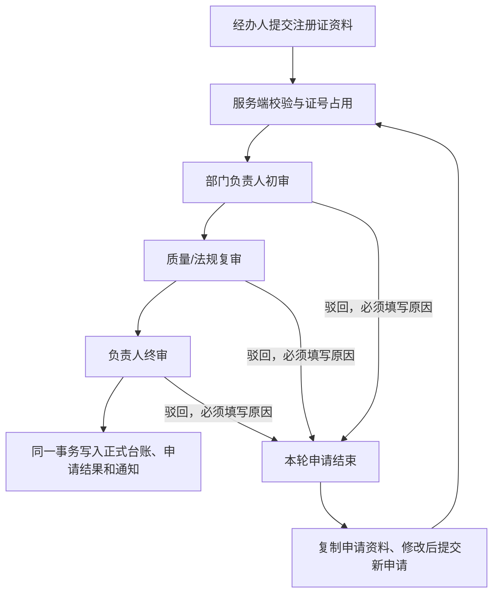

# 注册证三级审核：生产化加固与 SQLite 本地试点

日期：2026-11-01（Asia/Shanghai）

检查结束时的代码基线：57f958a（三项审批修复已提交）；本计划与流程附件为新增的待审阅文件。

## 1. 已确认的目标与实施状态

用户已确认：

- 首条试点主线为注册证登记：经办人提交 → 部门负责人初审 → 质量/法规复审 → 负责人终审 → 正式台账生效。
- 数据库暂用 SQLite 做本地试点。
- 复用现有 Approval.Core、Approval.AspNetCore、@approval/ui 和 Certificate.Api，不重建审批引擎。

用户随后明确授权在当前会话直接实施。本计划的本地试点加固现已落地，保留 57f958a 的三项修复；操作方法见 [试点说明](../docs/registration-certificate-pilot.md)，逐项证据见 [验证记录](../docs/registration-certificate-pilot-validation.md)。

检查阶段的后台启动曾被自动审批策略拒绝。实施阶段采用进程内 TestServer 运行真实服务注册和 HTTP 管线，使用隔离 SQLite 与可控时钟验证业务，不重试该后台启动操作。独立浏览器操作和远端 GitHub CI 不属于本次已执行结果。

业务口径：本试点处理注册证资料在内部系统中的登记与审批。先沿用现有证号、名称、持有人、类型、发证日期、到期日期；行业专属字段和外部登记机构核验需在明确业务品类后另行定义。

## 2. 试点流程与角色



| 身份 | 试点映射 | 规则 |
|---|---|---|
| 经办人 | alice；bob 用作无关用户/并发申请人 | 可提交，不能审批自己的申请 |
| 部门负责人 | DeptLeader，参数 1；alice 所属 rd 的负责人为 dave | 按申请人的部门解析，不使用全公司的 DeptReviewer 候选组 |
| 质量/法规复审 | QualityManager，示例 quinn | 部门初审通过后才产生待办 |
| 负责人终审 | Leader，示例 leo / lily | 本试点为该岗位任一合格人员终审；如需两人会签，应单独调整制度与验收 |
| 业务恢复管理员 | admin | 可监控和处理异常，不能通过管理员身份直接跳过正常审批 |

流程附件：[注册证登记模板](registration-certificate-pilot/certificate.create.json)。

首轮采用“驳回结束、修改后重新申请”，每次提交的数据保持不可变，每次重新申请都从第一层开始。当前证书业务没有原地补正接口，故模板显式关闭 `allowReturn` 和 `allowAddSign`。这比开启一个不能修改单据的重新提交任务更容易审计；同申请多轮补正可在后续增加版本模型后再开放。

模板已同步 AllowTransfer=false 与 RequireQualifiedAssignee=true；引擎在处理/改派时执行岗位校验。启动只补缺失定义，已有库更新模板需显式发布新版本。

## 3. 检查结果

以下为实施前的检查结果。对应修复和运行验证已完成，见验证记录；保留此表作为变更依据。

| 优先级 | 位置 | 当前行为与影响 | 处理方向 |
|---|---|---|---|
| P1 | samples/Certificate.Api/Endpoints/CertificateEndpoints.cs:19、22、26 | 证书列表、单条证书、申请历史读取没有当前用户检查 | 全部业务 API 建立认证边界和数据访问规则 |
| P1 | 同文件:52–69 | 申请详情过滤了 approval，却始终返回 request 和 changes；无关登录用户可能取得申请快照 | 在读取/返回快照前鉴权，不能只把 approval 置空；无权限返回 404 |
| P1 | samples/Certificate.Api/Certificates/CertificateService.cs:12–35 | 未对空白字段、长度、类型、日期范围和空白注销原因做完整服务端校验；前端验证可绕过 | 统一规范化与字段级校验，非法提交不产生申请、任务、证号占用或消息 |
| P1 | CertificateService.cs:14–17；CertificateModels.cs:78–90 | 新增证号防重采用先查后写；正式证书唯一索引不能阻止两个同号的审核中申请；引擎 BusinessKey 是每次新建的申请 ID | 建立跨审核中/已登记状态的数据库级证号占用，另加提交幂等键 |
| P1 | CertificateEndpoints.cs:57–67；CertificateModels.cs:42 | 对比使用当前正式证书和本次 Snapshot。变更生效后差异可能消失，后续变更还会改变历史对比 | 提交时保存不可变 BeforeSnapshot；历史页比较该快照与提交 Snapshot |
| P1 | src/Approval.Core/Engine/ApprovalEngine.cs:196；ApprovalEngine.Admin.cs 的 ReassignError | 转交/改派只检查部分基础条件，未证明目标用户满足原节点岗位资格；普通转交可将岗位任务改为任意用户任务 | 试点禁止普通转交/加签；管理员改派必须验证用户存在及该节点资格 |
| P2 | samples/Certificate.Api/Program.cs:28、85–102 | 演示身份和模拟 Webhook 管理端点没有环境隔离 | 显式本地试点模式；非演示环境使用宿主认证，未配置时拒绝启动/访问 |
| P2 | Program.cs:124、131 | EnsureCreated 不负责升级；修改磁盘 JSON 不会更新已发布流程 | 试点新库用 EF Migrations；流程模板通过受控发布生成新版本 |
| P2 | CertificateExpiryCheckAction.cs:33；web/apps/demo/src/features/certificates/CertificateTable.vue | 临期检查只产生提示，过期不是登记/终审阻断条件；前端按 UTC 日期判断过期，状态仍显示“有效” | 统一业务时区和日期口径；明确登记与最终生效时的有效期规则 |
| P2 | tests/Approval.Core.Tests/CertificateFlowTests.cs；TestInfrastructure.cs | 证书场景测试采用通用 TestDbContext 和 RecordingBusinessHandler，并未证明真实 CertificateService/CertificateApprovalHandler 的写回行为 | 新增真实宿主集成测试项目，覆盖实际证书表和回调 |

### 冒烟脚本的验收问题

检查范围：`samples/Certificate.Api/smoke-test.ps1` 的三个业务场景及 Call / Approve / Items / With 辅助函数。

- Critical：三个场景主要打印“应为”，没有对正式证书、申请状态或审核顺序作失败断言。错误的持有人或状态可能仅被打印出来。
- High：Call 把 HTTP 异常转成普通字符串，未区分预期拒绝和意外错误；不适合作为自动验收的成功信号。
- High：Approve 使用当前用户待办的 `[0]`，可能处理其他申请；固定证号 C-1001 和空库假设使脚本难以安全重复执行。
- 可以保留的部分：明确展示了业务场景、采用 UTF-8 请求体、使用 NoProxy；问题应通过断言、实例定位和隔离测试数据解决。

不扩大为全仓库测试质量审计。新验收必须直接检查真实业务结果。

## 4. 必须保持的不变量

1. 正式台账仅在终审通过后新增/更新；初审、复审、驳回、撤回和终止均不能提前生效。
2. 三个岗位按顺序执行，申请人不得自审，同一人不能完成多个不同审批节点。缺少合格审批人时报错/告警，不能自动通过。
3. 未经授权者不能读取申请快照、变更差异及附件，不能通过历史列表绕过详情权限。
4. 同一规范化证号的审核中新增申请最多一份；登记成功后证号持续占用，防止审核中与已生效之间的竞态窗口。
5. 同一提交幂等键只对应一份申请；同键不同数据返回冲突；重试不重复生成任务和通知。
6. 申请保存的提交前、提交后数据不可随正式证书后续变化而改变。
7. 业务写回、申请结果、审批任务/日志和 Outbox 在同一事务中提交；回调失败不得留下半完成状态。
8. 外部通知为至少一次投递，接收端依据稳定幂等键去重；消息失败不改变已完成的审批结果。
9. 所有时间戳保存 UTC；登记日期/有效期的业务判断使用配置的 Asia/Shanghai 时区。
10. 上一轮三项修复、既有流程版本绑定和已有申请数据必须保留。

## 5. 关键设计与实施文件

### 5.1 试点配置与岗位约束

- 新增显式试点配置，绑定到独立 SQLite 文件，采用上述三级模板；模板的通知先仅用 InApp。
- 试点宿主设置 AllowInitiatorApprove=false、AllowSameUserMultipleNodes=false、RequireBusinessHandler=true；保持通用库默认值的兼容性。
- 提交前检查部门解析和关键岗位配置，发现无合格处理人时给出可处理的错误；运行期间岗位变化造成无人处理时告警管理员。
- 在 FlowNode 增加向后兼容的 AllowTransfer（默认 true），由引擎操作端强制执行；试点模板在该能力完成后设置 false。前端按钮与设计器同步识别，不能仅隐藏按钮。
- 管理员改派除现有校验外，还需检查目标用户存在、不是申请人、未违反岗位分离、满足当前节点审批人规则；批量交接复用同一判定，并要求理由。

涉及：`Program.cs`、`ApprovalOptions` 的宿主配置、`FlowDefinition.cs`、`ApprovalEngine.cs`、`ApprovalEngine.Admin.cs`、设计器 NodeInspector、ApprovalActions 和 flowModel 类型。

### 5.2 服务端证书规则与数据权限

- 在 CertificateService 前增加可复用的证书规范化/校验逻辑；API 返回 ApprovalValidationException 的字段错误。
- 证号、名称、持有人去除首尾空白并检查非空/长度；类型限定为当前支持值；日期必须完整且到期日晚于发证日；注销原因不能为空。
- 本地试点的正常登记拒绝已过期证书，并在最终写回前复核有效期。历史资料导入应走单独受控流程。
- 证号展示值保留，另存统一规范化键。试点默认 Trim + ToUpperInvariant 作为防重键；行业规则确认后再调整，不静默改写旧证号。
- 统一 CertificateAccessPolicy/查询服务，覆盖证书列表、单条、历史、申请详情及写操作。默认按申请人、审批参与者和管理员授权；按申请权限过滤快照，不能因为能看正式证书就自动看到其他申请。
- 名单/历史分页并稳定排序，避免读取全部记录后在内存逐条鉴权。

涉及：`Certificates/CertificateService.cs`、新增 `CertificateDataValidator.cs`、`CertificateAccessPolicy.cs`、`CertificateQueryService.cs`、`Endpoints/CertificateEndpoints.cs`、前端证书 API 与表单。

### 5.3 数据库级证号占用、幂等和迁移

- 新增独立的 CertificateNumberReservations 表，以 NormalizedCertNo 为主键，关联活动申请和已登记证书。新增申请时与申请/审批实例一起占用；成功登记后保留已登记归属；失败结束时仅释放属于当前申请且未登记的占用。
- 不使用进程内锁作为数据库不变量的保证，也不把“审核中唯一索引 + 正式表唯一索引”误当成跨表原子占用。
- 提交幂等键保存到申请记录，建立申请人/操作/幂等键的唯一约束并存储规范化请求摘要；并发相同请求返回同一申请，同键不同摘要返回 409。
- 变更/注销继续使用 PendingRequestId 和并发令牌；生效或解锁前核对锁属于当前申请，不能释放其他申请的锁。
- 只把确定的唯一约束冲突/并发冲突转换为 409；SQLite Busy、磁盘故障、其他约束错误不能一概当作业务重复。
- 新的试点数据库使用 EF Migrations 创建。旧 EnsureCreated 数据库另设升级步骤：备份、模式检查、重复证号/孤立记录检查、可验证的基线接纳、回填、再施加约束。发现冲突则停止，不能自动删除或合并真实记录。

涉及：`CertificateModels.cs`、新增实体及 AppDbContext 配置、`CertificateService.cs`、`CertificateApprovalHandler.cs`、`samples/Certificate.Api/Migrations/`、设计时工厂及必要的本地 EF 工具配置。

### 5.4 审计快照与驳回重提

- CertificateRequest 新增 BeforeSnapshot（新增登记为 null，变更/注销在提交时复制正式证书），现有 Snapshot 保留为提交后的候选数据。
- 已提交申请保持不可变。驳回/撤回后的“修改后重新申请”复制资料到新申请，记录来源申请 ID，重新走完整三审，不继承旧审批结果。
- 历史详情固定比较 BeforeSnapshot 与 Snapshot；前端把“当前值”改为“提交前”，显示申请状态与提交时间。
- 旧数据无法可靠还原 BeforeSnapshot 时标记“历史基线未记录”，不得把当前证书当作历史基线回填。
- 有效/过期展示采用后端统一计算的结果，避免浏览器 UTC 日期与服务端本地日期不一致。

涉及：`CertificateModels.cs`、`CertificateService.cs`、`CertificateApprovalHandler.cs`、`CertificateEndpoints.cs`、`CertificateRequestPanel.vue`、`CertificateTable.vue`、证书 API 类型与标签。

### 5.5 可观测性、恢复和自动化

- 增加最小 liveness/readiness，readiness 覆盖数据库连接和模式就绪；健康接口不返回连接串或密钥。
- 记录 requestId、instanceId、taskId、outboxId 等关联字段；重点观测失败投递、到期积压、无人可处理任务及证书锁异常。
- 为本地试点提供显式配置和启动说明；演示用户切换与模拟 Webhook 管理仅在明确的本地模式开放。非演示环境不接受 X-User-Id 作为真实身份。
- Outbox 故障验证使用本地接收端，设置失败次数验证退避/重试；多实例与崩溃恢复要检查实际业务状态和幂等键。
- 备份使用 SQLite Backup API，或停写并正确处理 WAL 后复制；恢复到新目录，检查完整性和关联数据，再切换路径。
- 新增 CI，执行真实业务测试、现有测试、类型检查、前端构建；固定 .NET/Node/pnpm 的可复现版本，沿用现有包管理方式。

## 6. 分阶段实施清单

### 阶段 A：真实业务测试与本地边界

- [x] 保留当前工作区三项修复，建立可追溯的实施基线。
- [x] 新增并注册 `tests/Certificate.Api.Tests`，直接引用真实示例宿主；不能只换成另一个 RecordingBusinessHandler。
- [x] 建立隔离 SQLite 测试夹具、可控时钟和可控 HTTP 接收替身。
- [x] 先加入匿名/无关用户读取、非法提交、真实三审生效、历史对比变化的回归用例，确认旧代码的失败点。
- [x] 落地显式本地试点模式和服务端数据权限/校验。

### 阶段 B：持久化约束与审计

- [x] 增加证号占用、提交幂等、BeforeSnapshot 及迁移。
- [x] 在两个独立连接/作用域下以同步屏障验证竞态，不能只写顺序提交测试。
- [x] 验证回调抛错时证书、申请、任务、占用和消息一起回滚。
- [x] 验证旧库升级预检失败时不会修改或删除原数据。
- [x] 完成历史快照展示和驳回后新申请的关联。

### 阶段 C：三级流程与岗位控制

- [x] 增加并验证服务端转交限制、管理员改派资格和岗位分离。
- [x] 把附件模板迁入受控试点配置，发布 certificate.create 的新版本。
- [x] 核对 alice → dave → quinn → leo 的实际待办顺序；未到达的层级不能提前审批。
- [x] 验证旧实例仍使用旧版本，新实例采用新版本；重复初始化不能无限增加版本。

### 阶段 D：恢复、CI 与试点交付

- [x] 修复冒烟脚本：强断言、明确预期 HTTP 状态、仅定位本次 instanceId/taskId、唯一测试证号，意外失败非零退出。
- [x] 增加重启、重复投递、租约到期、失联审核人、备份恢复的验收。
- [x] 建立 CI，完成前后端全量验证。
- [x] 输出一次完整试点报告：数据路径、版本、角色、测试结果、已知限制与恢复操作记录。

各阶段分别保持可审阅的差异；不要把迁移、权限、UI 和全部运维改造混在一个无法定位失败的大补丁里。

## 7. 验收矩阵

以下是验收目标；已执行的测试、边界及范围说明见验证记录。

| 场景 | 必须断言的业务结果 |
|---|---|
| 正常登记 | 初审前、复审后正式表均无新证书；终审后恰好一条证书且字段等于提交快照 |
| 审核顺序 | dave → quinn → leo，后续岗位在前一层完成前没有可处理的本次任务 |
| 自审/跨岗位 | 申请人、无关用户和错误岗位不能审批；拒绝后状态、任务和日志无非法推进 |
| 数据读取 | 匿名 401；无关登录用户对单据详情 404；列表和历史也不泄露该申请 |
| 输入校验 | 空白证号/名称、未知类型、错误日期和空白原因返回字段错误，数据库不新增申请或占用 |
| 并发同号 | 两个独立连接并发申请相同规范化证号，最多一份运行中的申请，另一方明确 409 |
| 提交重试 | 相同幂等键与内容返回同一申请；同键不同内容 409；无重复任务/通知 |
| 审批期间锁定 | 新变更/注销申请不能覆盖当前待审申请；正式数据在审批期间不变 |
| 终审并发/重试 | 只生效一次，第二个请求不会重复创建正式记录或业务通知 |
| 业务回调失败 | 原待办仍可处理，正式数据与申请结果未提交，不能留下半完成状态 |
| 驳回重提 | 原申请及日志保留；新申请有来源关联，并重新经历完整三级审核 |
| 历史审计 | 再次修改正式证书后，旧申请的 before/after 仍与首次保存一致 |
| 岗位变动/改派 | 不存在或不合格的目标被拒绝；合法改派有理由、轨迹且时限不被重置 |
| 流程升级 | 旧实例继续旧版本，新申请使用新版本，重复初始化不重复发布 |
| 故障恢复 | 重启后待办不丢失；Outbox 恢复投递且幂等；备份恢复后的关键记录与关联一致 |

## 8. 验证命令

当前仓库基线可在根目录执行：

```powershell
Set-Location 'D:\Study\CSharp\Workflow'
dotnet test 'Workflow.slnx' --verbosity 'minimal'
Set-Location 'D:\Study\CSharp\Workflow\web'
pnpm typecheck
pnpm test
pnpm build:lib
pnpm build
```

新增真实宿主测试项目在阶段 A 注册完成后，再执行：

```powershell
Set-Location 'D:\Study\CSharp\Workflow'
dotnet test 'tests/Certificate.Api.Tests/Certificate.Api.Tests.csproj' --verbosity 'minimal'
```

冒烟脚本只能针对明确的隔离试点地址和数据库执行；不能默认连接正在使用的 5199 服务后选取任意待办。迁移/恢复命令应由实施时实际生成的迁移和数据路径确定，不能在计划阶段假定已有迁移历史。

## 9. 回滚与数据保护

- 迁移前保留可恢复备份和数据校验结果；遇到重复证号、未知旧模式、孤立引用时停止升级并出具清单。
- 代码与数据库分别管理回滚。已有正式申请后，不自动执行破坏性的 Down 或删除新表/快照；优先停止新申请并回到兼容版本，必要时将备份恢复到另一文件路径。
- 流程升级通过发布新版本纠正；不能修改已绑定到运行中实例的历史定义。
- 幂等键、证号占用、审批实例和外部投递记录应一起纳入恢复检查；仅恢复正式证书表不算恢复成功。
- 本地试点数据使用独立文件，不能通过删除现有演示/业务数据库来解决升级错误。

## 10. 检查阶段记录（实施前）

- 源码检查完成；上述文件与风险已定位。
- 上一轮基线：后端 299、前端 131，共 430 项测试通过。本轮没有将该结果当成新增注册证试点的验收结果。
- 后台隔离服务启动：被自动审批检查拒绝，未执行 API/并发/故障注入验收。
- 流程附件已直接调用当前构建的 FlowDefinitionValidator 校验：5 个节点，审批顺序 dept → quality → leader，0 个错误、0 个警告。校验包括结构、已知审批人类型与参数、InApp 渠道和时限配置；这不代替实际业务运行与岗位转交约束的验收。
- 已核对现有演示配置：alice 的部门负责人为 dave，QualityManager 为 quinn，Leader 候选人为 leo / lily；三级模板与这些配置匹配。

## 11. 实施结果

- 已实现权限/校验、持久化证号占用和幂等、不可变快照、完整三级审核、岗位限制、迁移副本/备份、诊断告警与 CI 配置。
- 后端测试：Approval.Core 257、Approval.AspNetCore 43、Certificate.Api 59；前端：组件库 134、示例 6。合计 499 项，零失败、零跳过。
- Release 构建、前端类型检查、组件库/示例构建和 EF 迁移漂移检查通过；新增真实宿主测试已接入 Workflow.slnx。
- 恢复验证采用重新创建宿主与持久化租约场景，不将其描述为进程强杀/断电测试。PowerShell 冒烟脚本已重写并通过语法检查，未连接独立后台服务执行；远端 CI 待推送后运行。
