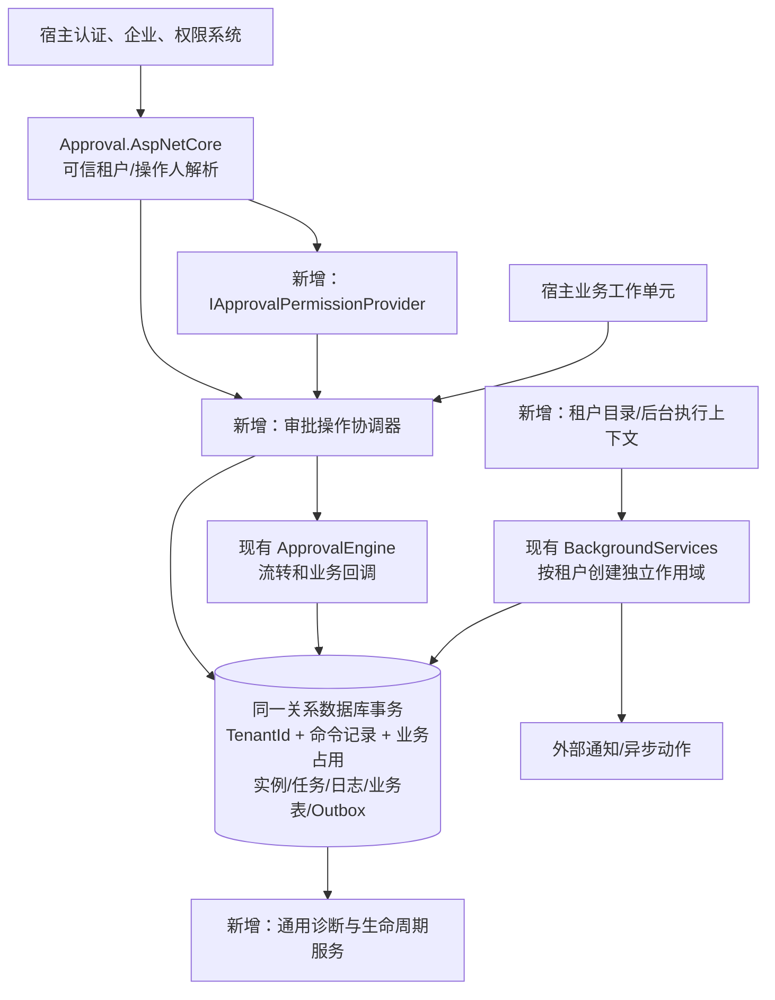
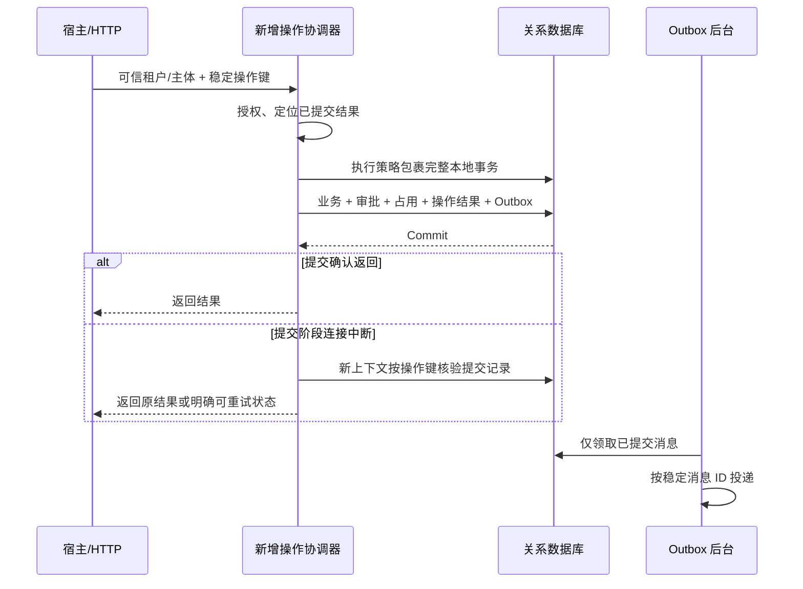

# 通用审批框架：多租户、事务与生产能力实施方案

> **路线状态：已被取代（2026-11-04）。** 当前产品是单宿主、单应用实例的嵌入式通用审批引擎。本文涉及的多租户、服务任务、持久等待及编排目标不再是开发指令；历史实施和验收记录仅代表当时版本。当前实施以 [阶段一产品化计划](2026-11-04-approval-productization.md) 与仓库 AGENTS.md 为准。

日期：2026-11-02（Asia/Shanghai）。
状态：阶段 0–6 已实施并通过本机验收；另已完成[真实认证/备份/TCP 演练](2026-11-02-auth-backup-network-rehearsals.md)。详见 [实施记录](2026-11-02-multitenant-production-hardening-progress.md)及[最终支持/验收矩阵](../docs/production-acceptance.md)。下文“本轮未实施/未运行”指方案编写会话的历史状态；用户现有生产环境、进程断电/HA、远端 CI 与正式部署未验收。
范围：落实本次提出的六项要求，不把注册证业务重新并入框架。
执行约定：按用户提供的 AGENTS.md 第 3 节，大型高风险改造先交付本方案，在新会话实施。

## 1. 目标、基线与默认决策

目标是让多个企业共用审批服务，并让宿主在 MySQL、SQL Server、PostgreSQL 上获得一致的提交、权限和恢复语义。

当前 Git HEAD 为 f79b142。工作区另有已经暂存的注册证示例拆分、契约和打包调整；它们属于实施基线，不能重置、覆盖或并入本任务的无关提交。实施开始时重新记录 HEAD、暂存/未暂存状态及契约摘要，不能只按 HEAD 还原代码。

现状依据：

| 要求 | 当前实现 | 本次交付 |
|---|---|---|
| 通用提交幂等、防并发重复 | [ApprovalEngine](../src/Approval.Core/Engine/ApprovalEngine.cs) 先查后写；[表单服务](../src/Approval.Core/Engine/ApprovalFormService.cs) 每次生成新业务键 | 通用命令记录、稳定请求标识、数据库业务占用约束、提交结果核验 |
| 宿主事务与回滚 | 引擎自行 SaveChanges；[Outbox](../src/Approval.Core/Engine/ApprovalOutboxService.cs) 遇自动重试策略时不主动开事务 | 明确默认事务、宿主工作单元接入、整段重试、提交后副作用 |
| 三种目标数据库 | [依赖配置](../Directory.Packages.props) 当前主要验证 SQLite | 固定驱动组合、独立迁移、真实数据库契约测试和 CI |
| 第三方权限、流程治理 | [HTTP 权限](../src/Approval.AspNetCore/ApprovalHttpContextExtensions.cs) 主要依赖一个 AdminPolicy；核心管理方法依赖调用方授权 | 权限提供者接口、服务端资源授权、能力返回、草稿/发布/停用与审计 |
| 诊断与数据生命周期 | 业务统计已有，部分诊断位于 [注册证示例](../samples/Approval.Certificate/Infrastructure/CertificateDiagnostics.cs) | 通用健康、诊断、指标、受控归档与清理 |
| 多企业共享服务 | 核心实体无租户列；Admin 适配绑定单企业库 | 共享库共享表 TenantId 隔离，覆盖请求、持久化、后台、附件和缓存 |

默认决策：

1. 保持 .NET 10、EF Core 10、Minimal API 和现有 Vue 前端路线。
2. 第一版采用共享库、共享表；一库一租户通过固定租户上下文兼容。租户分库路由不纳入本轮。
3. TenantId 是宿主提供的稳定、不透明标识，不依赖某个第三方框架的企业实体。
4. 框架提供权限接口，不自建用户、角色、组织或登录中心。
5. 本地原子性限定为同一个关系数据库事务。跨 ORM、跨库、远程服务通过宿主适配或 Outbox 实现最终一致，不声称自动获得分布式事务。
6. 生命周期清理默认关闭；保留期、归档位置和删除策略由宿主显式配置。
7. 现有 SQLite 示例与快速测试保留。新三库支持必须经过真实引擎测试，不能由 SQLite 结果推定。
8. 数据库和安全行为升级需同步交付配置迁移指南；尽量保留源码兼容入口，但不能用兼容分支绕过租户或权限校验。

## 2. 必须维持的不变量

- 同一租户、同一幂等作用域、同一请求标识和内容，只产生一份已提交结果；重复请求可得到原结果。
- 同键不同内容返回明确冲突，不修改原申请。
- 开启 SingleRunningInstancePerBusiness 时，同一租户同一业务标识最多有一个进行中实例。
- 业务数据、审批实例/任务/日志、命令结果、业务占用和本次 Outbox 写入处于同一个提交边界。
- 数据库已提交但响应丢失时，依靠提交记录确认结果，不盲目重做业务。
- 租户隔离先于资源权限；任何租户管理员、第三方允许结果或旧 IsAdmin 标志均不能扩大租户边界。
- 缺少可信租户/操作人上下文时，多租户模式拒绝执行，不回落到默认企业。
- 任务资格、自审限制、岗位规则和字段权限继续有效；第三方权限允许只是必要条件之一。
- 历史实例继续绑定原 DefinitionId；停用定义只阻止新发起，不修改已有实例。
- Outbox 保持至少一次投递；外部接收方需要用稳定消息标识去重，不承诺外部副作用恰好一次。
- 活跃实例及其任务、日志、业务占用和必要附件不能被归档清理误删。
- 旧数据的租户归属必须来自明确映射；不猜测所有权、不重写旧实例 ID、不重建现有迁移历史。

## 3. 目标结构与修改范围

下图是原计划结构；标注“新增”的组件现已实施，具体名称和证据以代码及实施记录为准。



主要代码位置：

| 位置 | 预期改动 |
|---|---|
| src/Approval.Core/Abstractions/ | 新增租户、操作人、权限和工作单元契约；保留现有身份/组织/业务扩展 |
| src/Approval.Core/Domain/ | 现有实体租户列；命令记录、业务占用、流程管理及维护记录 |
| src/Approval.Core/Persistence/ | 模型、租户过滤和写入保护、事务协调、提交核验 |
| src/Approval.Core/Engine/ | 将公开写操作接入协调器；查询、定义、Outbox、消息和统计接入租户/权限 |
| src/Approval.Core/Background/、Files/、Notifications/ | 租户后台作用域、投递归属、附件生命周期、租户配置解析 |
| src/Approval.AspNetCore/ | 可信上下文、权限适配、请求标识、能力/治理/诊断接口和 DTO |
| web/packages/approval-ui/src/ | 提交标识生命周期、能力驱动按钮、租户切换与缓存、流程治理/诊断界面 |
| samples/Approval.MultiTenant.Api/（拟新增） | 业务无关的多租户参考宿主，第三方权限适配示例、数据库选择和迁移 |
| tests/Approval.Core.Tests/、Approval.AspNetCore.Tests/ | 保留原回归，增加语义和接口用例 |
| tests/Approval.Database.Tests/（拟新增） | 三库真实迁移、事务、并发、隔离、恢复的契约测试 |
| eng/、.github/workflows/、contracts/、docs/ | 三库验证入口、CI、公共契约、支持矩阵、升级运维指南 |
| samples/Approval.Certificate/、samples/Certificate.Api/ | 固定单租户兼容和事务适配回归；业务专属表继续由示例维护 |

Core 继续只依赖 EF Core Relational；具体数据库 Provider 由宿主与数据库测试项目引用。仅在真实差异需要时增加狭窄的数据库错误分类/模型适配，不建立通用仓储替换现有引擎。

同级 Admin.Core 的已运行服务不在本轮自动更新范围。交付适配说明，并使用隔离测试宿主验证接口契约；实际宿主代码联动与部署另列可审查变更。

## 4. 多租户方案

### 4.1 可信上下文

拟增加：

- IApprovalTenantContext：当前作用域唯一且不可变的 TenantId。
- IApprovalActorContext：当前用户或服务主体，以及授权所需身份信息。
- IApprovalTenantCatalog：后台任务枚举可运行租户的受控接口。
- IApprovalTenantScopeFactory：为指定、已验证的租户创建独立 DI/DbContext 作用域。

HTTP 适配器从已认证 Claims 或宿主服务解析企业。若宿主允许租户选择请求头，必须再次验证操作人属于该企业；请求体中的 TenantId 不能直接决定持久化归属。

后台任务不读取 HttpContext，也不复用上一次请求的 AsyncLocal 状态。每个租户建立独立 scope，执行完释放；服务主体只能执行分配的后台操作。

单租户兼容模式要求宿主显式设置 FixedTenantId。多租户模式禁用此回退。初期不启用 DbContext pooling；今后若支持，必须增加池复用和租户重置验收。

### 4.2 数据模型与防线

以下全部纳入 TenantId：Definition、Instance、Task、Log、CarbonCopy、Draft、File、Message、Outbox，以及新增命令记录、业务占用、定义管理和维护记录。

- 租户查询过滤器从 DbContext 实例属性读取参数，不能把首次租户捕获为模型常量。
- 模型缓存被多个租户复用时，仍必须得到不同参数化租户条件。
- 写入拦截器校验新增、修改、删除实体的租户，禁止修改实体归属。
- 对实例/定义、任务/实例、日志/实例、抄送/实例及附件关联建立必要的同租户复合关联约束。
- 明确检查 ExecuteUpdate/ExecuteDelete、原始 SQL、Find/已跟踪实体和管理查询；不能只依赖 SaveChanges 拦截器。
- 普通代码不能整体 IgnoreQueryFilters。归档等维护若需忽略归档过滤，仍必须保留租户过滤。
- 所有唯一性约束与常用索引增加租户范围，包括定义版本、日志序号、业务占用、幂等命令。
- 新表键长度、字符语义和索引字节数同时满足三个数据库，不依赖数据库默认排序规则。

租户标识、人员标识、业务主键和流程键的空白/大小写规则分别明确。业务主键不能为图方便一律转大写；扩展类型维持当前忽略大小写的匹配约定。迁移发现归一化碰撞时报告冲突，不自动合并。

### 4.3 查询、文件、配置和后台

- 覆盖待办/数量、已办、我发起、抄送、按业务查找、定义/版本、目录、草稿、消息、统计和所有管理接口。
- 非 HTTP 的 GetInstanceAsync/GetByBusinessAsync 也限定当前租户；“后台使用”不再意味着跨租户查询。
- 文件读写先校验元数据归属与访问资格。新存储键带不可碰撞的租户范围；旧附件可保留物理路径，通过已回填归属的元数据访问。
- 用户/角色/组织/联系方式适配器必须按当前租户查询；同名用户或角色不得共用跨租户缓存。
- 前端 userKey 包含 tenantId 和 userId；切换企业时取消旧请求、清空用户/目录/页面缓存和未完成提交状态。
- 单例安全限制仍由宿主控制；租户时区、业务链接、通知目标和模板变量通过受控租户配置解析，不允许租户扩大宿主 HTTP 访问白名单。
- Outbox、超时扫描、清理和诊断按租户限量轮转；一个租户积压或故障不能阻止其他租户运行。
- 停用租户不接收新命令，并有明确的后台暂停/恢复策略，不删除其待办或失败消息。

## 5. 通用幂等与业务并发防重

### 5.1 两种约束分别处理

幂等命令记录解决“相同请求重试”；业务占用解决“不同请求同时发起同一业务”。两者不能互相替代。

拟新增 ApprovalOperation：

- 作用域包含 TenantId、调用主体、命令类型及目标业务/资源范围。
- 稳定 Idempotency-Key、请求摘要、摘要算法版本、已提交结果引用、结果协议版本和提交时间。
- 唯一查找键采用有界索引；较长作用域可使用固定长度摘要，并保留原作用域校验。
- 成功记录与业务变化同事务提交，作为提交结果未知时的核验凭据。
- 不把表单正文、令牌或通知密钥写入普通日志；结果记录只保留重放必要内容。

拟新增 ApprovalBusinessSlot：

- 唯一范围为 TenantId + BusinessType + BusinessKey（或等价的规范化查找键）。
- 指向唯一进行中的 InstanceId。
- 发起和占用在同一事务提交；最终通过、驳回、撤回、终止时在同一事务释放。
- 退回发起人仍属进行中，保留占用。
- 自动立即结束的流程不遗留占用；原 SingleRunningInstancePerBusiness=false 的明确配置保留。
- 采用独立占用表，避免将 SQL Server/PostgreSQL 过滤唯一索引当作 MySQL 也支持的统一方案。
- 缺失/多余占用由诊断报告，不能定时无条件删除“看起来过期”的业务锁。

### 5.2 协议与重放

第一阶段覆盖业务 StartAsync、表单发起、首次创建草稿和重新提交；后续在同一协调器中覆盖审批/驳回/退回/撤回/转交/加签及治理写操作。

- HTTP 接受 Idempotency-Key；C# 请求提供等价的操作标识。服务端临时生成标识不能替代客户端稳定重试键。
- 严格生产模式对需要幂等的提交入口要求标识；旧客户端通过明确的过渡配置兼容，并标记其保障范围。
- 首次操作固定采用的 DefinitionId、业务主键和结果引用，不随后续发布改变。
- 重放先定位原记录，再按原绑定版本规范化内容；不能先用最新表单 Schema 校验，导致原请求无法重放。
- 同键同内容返回原结果；同键不同内容返回 409；竞争中的命令有明确的可重试错误码和有限等待策略。
- 每次重放重新校验当前身份、租户与资源访问。流程停用只禁止新发起，不阻止有权读取的旧结果重放。
- 验证失败不写成功记录；基础设施失败回滚后允许原键重试。
- 对唯一冲突先完整回滚，再用干净上下文读取获胜记录。不能在 PostgreSQL 已中止的事务里继续查询，也不能把任意 DbUpdateException 都解释为重复提交。
- 幂等失效期必须写入契约；结果被归档后保留防重标记或明确拒绝旧键，不把旧键静默当作新请求。

前端每次逻辑提交生成一次标识，网络重试保留；用户明确修改并发起新申请时生成新标识。标识只放在相应表单/命令状态中，不让 HTTP 公共拦截器对每次请求自动换键。

### 5.3 验收示例

两个服务实例同时处理 20 个相同提交：最终一条命令结果、一份申请、正确数量的任务与日志，所有重试最终指向同一实例。

两个不同标识争用同一业务：只有一个进行中实例及占用，失败方没有残留业务数据或 Outbox。

相同业务键位于不同租户：两个企业都能独立发起，彼此看不到结果。

## 6. 事务、宿主工作单元与恢复

### 6.1 提交权

拟增加 IApprovalUnitOfWork 与审批操作协调器，明确两种模式：

| 模式 | 提交权 | 约束 |
|---|---|---|
| 引擎默认模式 | 协调器在完整操作外层开事务并提交 | 包含读取状态、流转、业务回调、命令结果和 Outbox；失败后当前操作作用域作废 |
| 宿主工作单元模式 | 宿主显式通过工作单元适配器提交/回滚 | 引擎参加同一 DbContext/事务，不自行提交；需要提交后回调和失败通知 |
| 裸外部事务或跨库事务 | 不自动宣称支持 | 在产生副作用前拒绝不受支持的组合，要求使用适配器或跨系统事件方式 |

宿主业务准备也应置于同一个逻辑操作委托中。保留旧入口的桥接，但调用方需明确它是否已加入工作单元；不能把 DbContext 当前有事务等同于已完成接入。

禁止通过清空整个 ChangeTracker 来“修复”宿主事务，避免丢弃调用方未提交修改。默认失败后的 DbContext/引擎作用域必须释放；可恢复场景只使用明确的保存点与局部检查点，不承诺恢复任意内存对象图。

批量离职交接保留当前逐实例提交的部分成功语义，输出每项结果；禁止在外部原子工作单元里偷偷清空跟踪器。若不支持这种组合，执行前返回明确配置/使用错误。

### 6.2 重试与提交结果未知



- 使用 Provider 执行策略包裹整个事务，而不是发现 RetriesOnFailure 后取消事务。
- 每次重试重建干净作用域及确定性的操作状态；业务回调可能被重新调用，只有本地事务内变化得到原子保证。
- 存在宿主尚未提交的业务变化时，不能只重试引擎内部片段；要求整个宿主操作委托可重放。
- 提交时断线先检查已提交操作记录。核验也失败时返回“结果待确认”，保留原键供后续确认。
- 不让纯数据库错误、权限拒绝或业务校验错误进入无界重试。
- 取消请求和进程重启不能留下已提交半份申请；已提交后的客户端取消依靠重放取回结果。

### 6.3 回调、同步动作与 Outbox

- 同步业务回调和动作不得自行提交工作单元；同步 SaveChanges 的行为必须有明确保护或拒绝。
- ContinueOnError 同时考虑数据库保存点与局部内存检查点；处理 Provider 对保存点的限制，SQL Server 测试配置关闭 MARS。
- 同步外部写调用不能承诺回滚。新增/新发布流程要求此类副作用通过 Outbox；确实依赖同步返回的宿主扩展必须显式声明其幂等和补偿边界。
- 对已发布的同步 HTTP/自提交动作先做兼容扫描，输出受影响定义及在途实例；不偷偷改变其执行方式，不把旧实例改绑新版本。
- 旧 IApprovalNotifier 只在真实提交完成后执行；外层工作单元回滚时不得发送。其进程崩溃丢失风险仍明确记录，可靠通知继续走 Outbox。
- Outbox 领取租约和动作执行分别具有清晰事务边界；异步动作自行 SaveChanges 后再失败，也必须回滚动作数据。
- 每次领取使用可核验的所有者/并发标识，避免过期 worker 覆盖后来领取者的结果。长任务的续租/取消应有上限。
- 消息 ID 在执行策略、投递失败和重启后保持稳定。租约不能阻止已发出的远程副作用重复，接收方仍需幂等。

## 7. 数据库支持与验证矩阵

### 7.1 首轮固定组合

以下 NuGet 版本及依赖于 2026-11-02 通过官方 v3 索引和 nuspec 核对；仅证明包依赖候选兼容，尚未执行本项目三库集成测试。

| 数据库验收基线（拟） | EF Provider | 已核对的依赖 |
|---|---|---|
| MySQL 8.4 LTS / InnoDB | MySql.EntityFrameworkCore 10.0.12 | net10.0 组依赖 EF Core/Relational >=10.0.12，MySql.Data >=26.10.0 |
| SQL Server 2022，compatibility level 160 | Microsoft.EntityFrameworkCore.SqlServer 10.0.14 | Relational >=10.0.14，SqlClient >=6.1.7 |
| PostgreSQL 17 | Npgsql.EntityFrameworkCore.PostgreSQL 10.0.3 | EF Core/Relational [10.0.4,11.0.0)，Npgsql >=10.0.3 |
| SQLite，保留现有示例 | Microsoft.EntityFrameworkCore.Sqlite 10.0.14 | 沿用现有 .NET 10 依赖组合 |

继续统一 EF Core 10.0.14；实施时锁定传递依赖并以 restore/build 结果复核。Pomelo.EntityFrameworkCore.MySql 9.0.0 的 Relational 约束为 [9.0.0,9.0.999]，本方案不选它，也不为适配它擅自降级全仓 EF Core。

MariaDB、其他数据库大版本及 .NET 8/9 不在首轮已验证支持声明中。后续增加版本必须扩展矩阵并记录真实结果。

### 7.2 数据库差异必须验证

- 标识大小写、尾部空白、Unicode、最长复合索引、唯一冲突和并发令牌。
- GUID、bool、枚举字符串、长 JSON、UTC 时间、可空时间与精度往返。
- 乐观并发、重复键竞争、死锁/瞬时失败、命令取消、连接在提交时中断。
- 实际事务和保存点语义；第三方驱动的重试能力不能仅因存在通用 EF API 就视为已支持。
- 查询过滤器、Include、分页/计数、Contains、ExecuteUpdate、统计查询在真实 Provider 下可翻译且结果一致。
- 新建库、旧库升级、重新执行迁移、模型漂移检查、备份恢复后的在途审批继续执行。
- 迁移脚本使用目标 Provider 生成；每种 Provider 维护独立迁移/快照，不直接执行 SQLite 的迁移 SQL。
- MySQL DDL 的隐式提交单独处理；不声称一次事务能回滚全部 schema 升级。

提供 samples/Approval.MultiTenant.Api 作为三库接入参考。业务宿主仍维护自己的 DbContext 迁移；框架模型扩展不能自动扫描和改造宿主所有业务表。

### 7.3 测试运行方式

保留当前 SQLite 快速回归；新增三库集成测试使用临时实例/专用测试库。CI 采用具备 Docker 的 Linux x64 runner，现有 Windows 验证继续保留。

新增 eng/verify-databases.ps1（拟）负责预检、创建唯一测试库、迁移、执行、记录结果及只清理自己创建的资源。也允许显式提供测试环境连接，但不自动使用业务连接字符串。

指定的数据库不可用、迁移失败或未发现测试时，必须失败，不能通过跳过全部用例显示绿色。

## 8. 第三方权限接入与流程治理

### 8.1 权限契约

拟增加 IApprovalPermissionProvider.AuthorizeAsync，输入至少包括：

- 已认证主体及 TenantId；
- 稳定权限码；
- 资源引用（DefinitionKey、InstanceId、TaskId、BusinessType/Key，按操作填写）；
- 取消令牌。

核心服务调用该接口，HTTP 适配负责把 Claims/第三方身份转换成可信上下文。直接调用 C# 管理方法也不能绕过授权。用户 ID 参数须与可信主体一致；后台服务主体使用独立且受限的权限。

提供默认权限实现和 ASP.NET Core policy 映射，兼容现有 AdminRole、AdminPolicy、DefinitionReaders 配置。宿主可实现本地权限库、远程授权服务或既有框架适配器；不引入指定厂商 SDK 为核心依赖。

拟定权限组：

| 类别 | 示例权限码 |
|---|---|
| 日常查询与发起 | approval.instance.read、approval.instance.start |
| 任务操作 | approval.task.approve、reject、return、transfer、add-sign、resubmit |
| 定义治理 | approval.definition.read、read-sensitive、design、validate、publish、disable |
| 受控管理 | approval.instance.terminate、approval.task.reassign、approval.task.reassign-bulk |
| 运维与生命周期 | approval.outbox.read、retry；approval.diagnostics.read；approval.archive.read、execute、purge |

权限清单必须覆盖撤回、文件/草稿/消息以及全部新增端点，并通过端点元数据检查防止遗漏。

- 鉴权拒绝采用现有 401/403/404 约定；跨租户和不可见资源继续返回 404。
- 远程权限服务超时/失败不转换为允许；以明确的授权基础设施错误返回。
- 权限缓存按租户、主体、权限/资源和版本隔离，有受控失效机制。
- 第三方动作权限与 IApprovalAccessPolicy、任务资格共同生效，不能一个 Allow 就越过所有业务限制。
- 宿主数据范围通过现有访问策略扩展及查询范围适配表达，应用在分页和 count 之前；禁止先分页再逐条过滤。
- /me 和实例/任务响应增补能力信息，前端据此显示按钮；每次提交仍在服务端复核。
- 核心不依赖 ASP.NET HttpContext；需要 Claims/IAuthorizationService 的实现放在 Approval.AspNetCore。

### 8.2 流程治理

增加独立的定义管理记录，区分可编辑草稿、不可变发布版本及是否允许新发起。业务表单草稿与流程设计草稿是两种实体，不混用。

- 草稿保存/编辑使用版本令牌，防止两个设计者互相覆盖。
- 发布生成新不可变版本，记录发布人、时间、来源版本、变更说明及摘要。
- 发布版本号分配有数据库并发保障，不能只用 Max(version)+1。
- 停用后新发起失败；已有任务、历史定义查看和已提交结果重放继续正常。
- 重新启用/选用历史版本需显式管理操作并审计，不重写历史 JSON。
- 治理操作与权限、幂等、事务共用同一边界，失败不留下半次发布。
- 操作审计与宿主日志桥接区分：核心审计同事务落库，外部日志投递走提交后路径。
- 定义密钥、HTTP 凭据和表单敏感数据不随普通差异视图或诊断导出。

## 9. 通用诊断和数据生命周期

### 9.1 诊断

新增 ApprovalDiagnosticsService 及宿主可扩展的诊断贡献接口。

覆盖数据库/迁移就绪、后台心跳、Outbox 最老积压及失败数、过期租约、超时扫描延迟、无有效处理人的待办、实例/任务/业务占用不一致。

- 匿名健康探针只返回整体就绪状态，不公开租户、用户、标题或表单数据。
- 详细诊断按租户和权限读取；大规模查询分页/分批，避免重复全表内存聚合。
- ActivitySource/Meter 记录请求、事务、冲突、重试和后台耗时；默认指标避免 TenantId/InstanceId 等高基数标签。
- 受控结构化日志可携带 TenantId、OperationId、InstanceId、TraceId，不包含凭据或完整业务内容。
- 故障诊断默认只读；修复业务占用、重派任务或重试消息需要相应权限与审计。

### 9.2 归档和清理

先提供预览/dry-run，再执行可恢复、可重入的分批维护任务；默认不开启自动删除。

- 分别配置已结束实例、已读消息、成功 Outbox、失败 Outbox、设计/业务草稿、命令结果和未绑定附件的策略。
- 运行中实例、待投递/失败消息和持有中的业务占用不按统一年龄删除。
- 历史实例仍需要绑定的发布版本与附件，归档保持可查询或有明确检索入口。
- 对幂等记录保留必要防重摘要/标记，公布重放窗口；清理不能让同一旧请求重新产生业务。
- 支持受控保留标记；删除前复查关联与状态，预览结果不视为永久删除许可。
- 维护任务带租户、游标和执行租约；崩溃重启从已提交批次继续，重复运行不会重复产生副作用。
- 文件删除采用提交后任务：先落删除意图，再删除存储内容，失败可重试；不把文件系统删除描述为 EF 事务的一部分。
- 备份、附件备份、还原演练和保留配置纳入运维手册；数据库备份由宿主/目标数据库工具完成。

## 10. 分阶段执行清单

每阶段形成独立、可审查的变更。涉及行为修改时先增加针对外部行为的回归，不以类型存在或镜像实现的断言代替验证。

### 阶段 0：固定基线与驱动验证

- [x] 记录当前 HEAD、暂存差异、契约和现有测试结果，保留示例拆分。
- [x] 验证三种 Provider 的完整 restore/build 兼容性，固定候选版本和服务镜像摘要。
- [x] 在独立测试库完成当前九类实体模型、事务、查询和迁移往返。
- [x] 建立三库测试项目并加入 Workflow.slnx、中央依赖和 CI；本机验证确实发现用例（远端 CI 未运行）。
- [x] 写明默认隔离级别、字符/时间/键规则和当前支持范围；未统一的键排序语义明确列为后续边界。

退出条件：三库运行证据存在；没有将包版本存在等同于集成通过。

### 阶段 1：租户与操作上下文

- [x] 实现上下文、租户目录和 scope factory，先完成单租户兼容。
- [x] 覆盖九类现有实体及框架读写路径；增加同租户关联和写入保护。
- [x] 生成四 Provider 及示例的 Expand/Harden 迁移、回填预检和租户映射报告，验证模型缓存不串租户。
- [x] 改造后台、文件、目录适配注册、租户配置和客户端缓存的作用域。
- [x] 验证两个租户拥有相同用户/业务键/流程键时隔离；三库真实测试、HTTP/Core/前端均有证据。

退出条件：HTTP、核心直接调用、批量写、后台和文件均有跨租户拒绝证据。

### 阶段 2：权限接口

- [x] 实现权限 provider、默认角色/policy 适配、资源范围与系统主体。
- [x] 覆盖 HTTP 和核心管理入口；校验操作人参数与可信主体。
- [x] 能力响应和 UI 按钮接入；保留实际服务端复核。
- [x] 提供一个第三方权限接口替身验收：允许、拒绝、超时、撤权、租户切换。
- [x] 增加端点到权限码的完整性检查。

退出条件：能设计不能发布、能诊断不能重试、普通审批管理员不能跨企业。

### 阶段 3：事务协调与通用幂等（作为完整纵向切片验收）

- [x] 引入工作单元、事务执行器、命令结果和业务占用；先覆盖表单和业务发起。
- [x] 实现同内容重放、不同内容冲突、竞争后恢复和提交结果未知核验。
- [x] 宿主业务代码进入同一操作委托；测试多次引擎调用同一工作单元的提交/回滚。
- [x] 推广至其他写命令，保留批量管理的显式部分成功语义。
- [x] 修正 Outbox 自动重试事务、过期 worker 结果保护、提交后通知。
- [x] 前端稳定标识和重试生命周期接入。

退出条件：三个数据库都通过同键/异键并发、业务回调失败、外层回滚、提交断线和 Outbox 恢复用例。

### 阶段 4：流程治理

- [x] 设计草稿、发布版本、启停状态分离；发布计数并发安全。
- [x] 发布/停用权限及同事务审计，编辑冲突反馈。
- [x] 历史实例和原 Schema 读取保持不变。
- [x] UI 增加草稿保存、变更信息、启停操作及实际能力反馈。
- [x] 扫描旧同步副作用动作并提供明确处置报告。

退出条件：并发发布不重号，停用不破坏在途审批与历史展示。

### 阶段 5：诊断与生命周期

- [x] 通用健康/诊断服务与权限入口，指标和日志关联。
- [x] 按租户后台轮转、限量和独立故障处理。
- [x] 归档预览、受控执行、游标恢复、防重保留和附件删除任务。
- [x] 验证运行中数据不清理、崩溃恢复、重复执行和历史检索。
- [x] 交付三库备份/还原、告警和保留策略文档。

退出条件：诊断不泄露数据，默认无破坏性清理，启用维护后可核验每批结果。

### 阶段 6：兼容与完整验收

- [x] 全部现有回归、三库集成、前端类型/行为、契约和独立包消费者通过。
- [x] 使用参考宿主真实运行双租户完整审批与第三方权限变更。
- [x] 验证证照示例的固定租户适配、迁移及既有三审链路。
- [x] 更新框架 OpenAPI/公共 API/前端类型，保持示例契约单独归属。
- [x] 更新发布说明、支持矩阵、接入指南及升级/回滚记录。

退出条件：六项需求都有证据，未完成/未运行项明确列出；不得仅因构建成功标记完成。

## 11. 最低验收矩阵

| 编号 | 场景 | 必须观察到的结果 |
|---|---|---|
| I01 | 20 个相同请求跨两个宿主并发 | 一个已提交业务结果，重试最终返回同一 ID |
| I02 | 相同键、不同内容 | 409；没有新增实例、业务变化或消息 |
| I03 | 不同键、相同业务并发 | 最多一个 Running 实例及占用 |
| I04 | 响应丢失后重试、期间发布新流程 | 返回首次结果，仍绑定原版本 |
| I05 | 两个租户相同键和业务 | 各自独立，无误冲突或结果泄漏 |
| T01 | 业务回调失败、同步动作失败 | 业务、状态、日志、占用、命令记录、Outbox 全部回滚 |
| T02 | 宿主外层事务最终回滚 | 没有已提交数据和提交后通知 |
| T03 | 自动重试启用，异步动作保存后失败 | 动作变化回滚，只留下正确投递状态 |
| T04 | Commit 返回前断线 | 核验提交记录；不重复生效，不凭猜测返回成功 |
| T05 | 两次操作同一工作单元、批量改派 | 前者整体提交/回滚；后者明确逐实例结果 |
| N01 | 猜测其他租户实例/任务/文件/定义 ID | 404 或明确拒绝，count/统计/目录也不泄漏 |
| N02 | 无租户、伪造租户、切换租户、模型复用 | 无默认回落；不会使用旧缓存、旧跟踪实体或首次模型租户 |
| N03 | 后台处理/清理跨企业与企业停用 | 只处理已授权租户，故障不会阻塞其余租户 |
| A01 | 独立设计/发布/终止/重试权限 | 每种操作单独允许/拒绝，直接核心调用同样生效 |
| A02 | 权限服务超时、撤权、仅前端隐藏 | 不放行；服务端保持限制 |
| G01 | 并发保存草稿与发布 | 无覆盖、无版本重号，有完整审计 |
| G02 | 停用流程但有在途实例 | 新发起受阻，原实例继续按原版本处理 |
| O01 | Outbox 租约过期、重启、迟到 worker | 稳定消息 ID；旧 worker 不覆盖新结果 |
| L01 | 归档/清理中断、重复运行 | 不删活跃数据、无防重失效、可从已提交批次恢复 |
| D01 | 三库新建、旧库升级、迁移重跑 | 数据/约束/模型一致，无静默数据丢失 |
| C01 | 旧单租户接口及包消费者 | 按兼容配置可运行，新增必填配置和行为变化有文档 |

I、T、N、G、O、L、D 中涉及数据库的用例必须在 MySQL、SQL Server、PostgreSQL 真实引擎上运行。故障注入使用屏障、可控连接/事务故障和 FakeTimeProvider；不依赖任意 sleep 制造概率。

测试报告同时记录 Provider/Server 版本、用例数量、失败/跳过、运行标识及制品摘要。未运行不能写成通过。

## 12. 迁移、发布和回滚

第一版选择维护窗口切换，暂停所有旧版写服务与后台 worker；不允许旧版本继续向新模型写入无租户/无占用数据。零停机双写迁移不在本轮承诺中。

1. 备份数据库和附件，使用副本演练；记录恢复位置和数据检查结果。
2. 预检所有现有审批数据、无实例的草稿/附件/消息、重复进行中业务、孤立关联和键归一化冲突。
3. 对既有单企业库要求明确 TenantId；多来源数据提供逐项归属映射。仅凭配置变化不能把旧库改属其他企业。
4. 分阶段增加列与新表、按明确映射回填、构建占用和定义管理记录，最后增加非空/唯一/复合约束。
5. 对已有多个 Running 的业务生成待处理清单；不能自动保留一条并终止其余实例。
6. 旧命令不伪造幂等成功记录，旧审计不虚构发布人。新保障从明确升级边界生效。
7. 新建三库与 SQLite 旧库采用各自迁移链；保留原迁移 ID。
8. 先以关闭破坏性维护的配置启动，完成租户隔离、在途继续、Outbox、权限和健康冒烟，再开放新写入。
9. 上线后监控冲突、授权失败、扫描延迟、积压和实例/占用不一致。
10. 新版本尚未开放写入时可恢复旧二进制和备份；开放写入后不能直接回滚旧程序或删除列，应优先前向修复。必须恢复备份时，明确期间新增数据的补录/对账处理。

未受信任的旧同步副作用动作、归属不明数据、冲突占用和缺失权限适配都是发布预检的可见问题，不应在启动时静默修复。

## 13. 验证命令与交付状态

现有仓库测试为 SDK 风格、xUnit v2、VSTest。已读取 global.json、中央依赖、项目及验证脚本；没有发现 run-tests 仓库 overlay。

以下现有命令可在实施基线及最终验收运行，本轮未运行它们：

```powershell
Set-Location -LiteralPath 'D:\Study\CSharp\Workflow'
pwsh -NoProfile -File './eng/verify.ps1'

dotnet test 'tests/Approval.Core.Tests/Approval.Core.Tests.csproj' --configuration 'Release' --verbosity 'minimal'
dotnet test 'tests/Approval.AspNetCore.Tests/Approval.AspNetCore.Tests.csproj' --configuration 'Release' --verbosity 'minimal'
dotnet test 'tests/Certificate.Api.Tests/Certificate.Api.Tests.csproj' --configuration 'Release' --verbosity 'minimal'
```

以下为原计划中的三库脚本契约，现已实现并通过阶段 6 验收（每库 33 项）；具体 runId 与摘要见实施记录：

```powershell
Set-Location -LiteralPath 'D:\Study\CSharp\Workflow'
pwsh -NoProfile -File './eng/verify-databases.ps1' -Provider 'MySql'
pwsh -NoProfile -File './eng/verify-databases.ps1' -Provider 'SqlServer'
pwsh -NoProfile -File './eng/verify-databases.ps1' -Provider 'PostgreSql'
```

本轮实际完成：代码和依赖基线核对、官方文档读取、NuGet 版本/nuspec 依赖核对、实施方案编写。没有连接或改动任何业务数据库，没有安装数据库驱动到项目，没有执行三库测试，没有修改业务/框架代码。

阶段 0–6 已执行，实施记录独立保存。完整需求的本机验收已完成，真实生产环境的认证、备份/附件恢复、外部投递对账及网络/进程故障演练保留明确边界。没有提交、推送、部署或发布正式包。

## 14. 外部依据

- [EF Core 连接弹性、事务重试及提交结果未知](https://learn.microsoft.com/en-us/ef/core/miscellaneous/connection-resiliency)
- [EF Core 全局查询过滤、多租户参数与导航关联注意事项](https://learn.microsoft.com/en-us/ef/core/querying/filters)
- [MySql.EntityFrameworkCore 10.0.12 nuspec](https://api.nuget.org/v3-flatcontainer/mysql.entityframeworkcore/10.0.12/mysql.entityframeworkcore.nuspec)
- [SQL Server Provider 10.0.14 nuspec](https://api.nuget.org/v3-flatcontainer/microsoft.entityframeworkcore.sqlserver/10.0.14/microsoft.entityframeworkcore.sqlserver.nuspec)
- [Npgsql Provider 10.0.3 nuspec](https://api.nuget.org/v3-flatcontainer/npgsql.entityframeworkcore.postgresql/10.0.3/npgsql.entityframeworkcore.postgresql.nuspec)
- [Pomelo 9.0.0 的 EF Core 9 依赖约束](https://api.nuget.org/v3-flatcontainer/pomelo.entityframeworkcore.mysql/9.0.0/pomelo.entityframeworkcore.mysql.nuspec)

