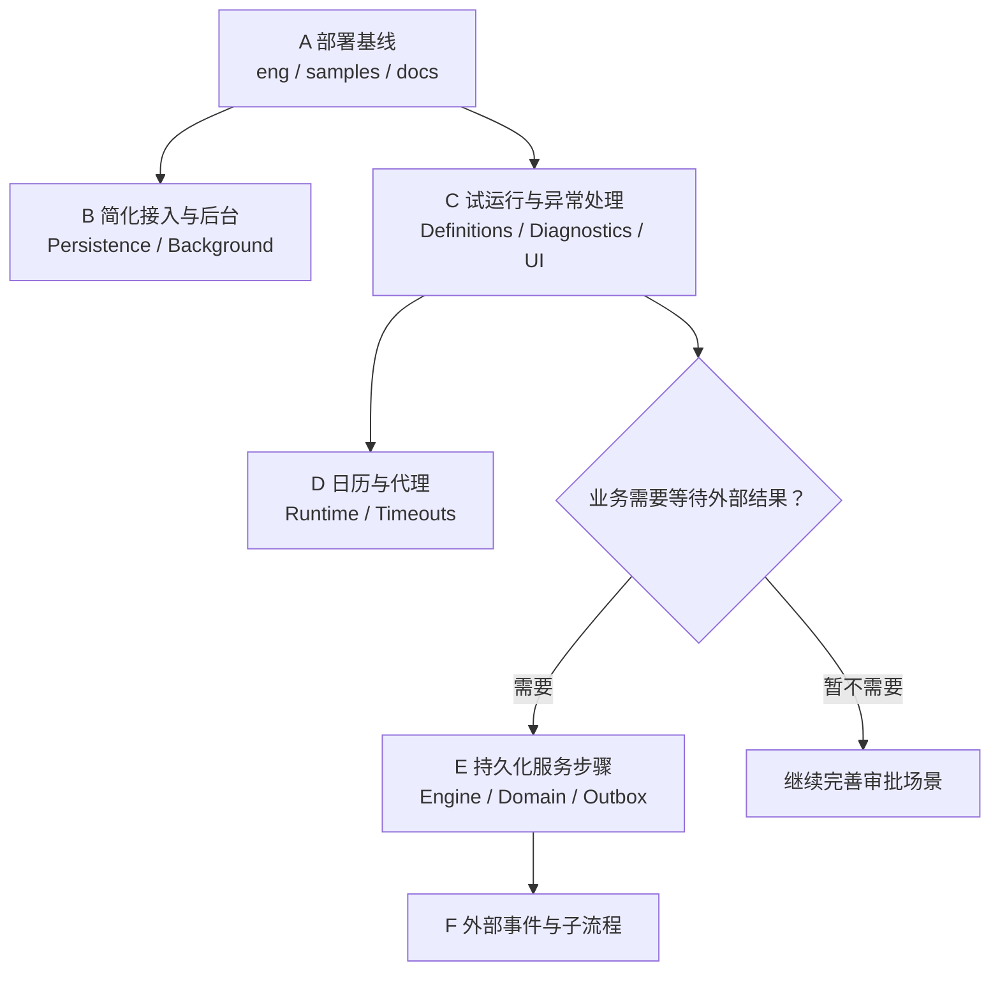
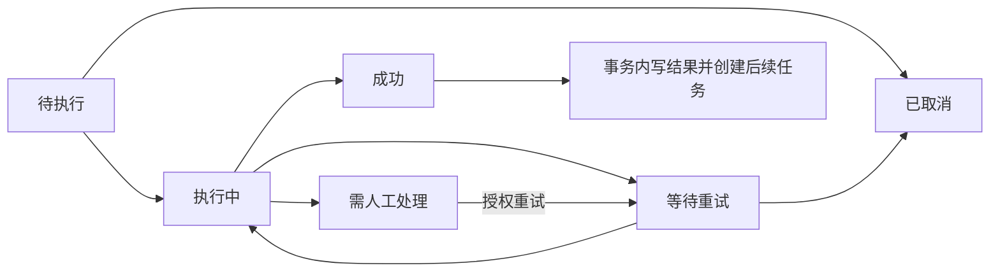

# 单实例工作流系统优化与能力补充路线

> **路线状态：已被取代（2026-11-04）。** 当前产品是单宿主、单应用实例的嵌入式通用审批引擎。本文涉及的多租户、服务任务、持久等待及编排目标不再是开发指令；历史实施和验收记录仅代表当时版本。当前实施以 [阶段一产品化计划](2026-11-04-approval-productization.md) 与仓库 AGENTS.md 为准。

日期：2026-11-02\
状态：待实施。本文件是设计与执行计划，不代表相关能力已实现或已验证。

> 2026-11-03 目标调整：用户已明确选择“单体部署、人工与自动步骤、持久等待、故障恢复”的工作流引擎。后续实施顺序以 [单体工作流引擎实施计划](2026-11-03-monolith-workflow-engine.md) 为准。本文保留作前期分析；“审批平台优先、编排可选”及 A–D 优先的排序不再作为当前路线。

## 1. 目标与适用边界

当前系统已经具备较完整的通用审批能力。下一阶段优先降低接入和运维成本，补齐真实业务中的异常处理与配置验证，再按实际业务需要扩展持久化编排能力。

默认部署假设：一个应用进程，HTTP 与后台任务同进程，共享关系数据库；附件沿用现有存储扩展。单实例不等于单租户，也不等于没有并发。本文不假定实际部署只服务一个企业，也不指定生产数据库。

推荐路线：继续采用模块化单体、EF Core 与宿主共享事务、现有 Vue 组件库。不引入消息中间件、分布式调度平台、微服务拆分或完整 BPMN 执行器。

产品目标分为两层：

- **基础目标：通用审批平台。** 覆盖业务单据审批、组织处理人、配置验证、异常运维、代理和工作日历。
- **可选目标：业务编排。** 只有出现“等待外部系统成功再继续”“等待回调”等需求时，建设持久化步骤与事件等待。

## 2. 现状与证据

已具备流程与表单设计器、条件、结构化并行、会签/或签/依次审批、退回、加签、转交、组织解析、定义版本治理、事务幂等、Outbox、诊断、归档与附件删除恢复。

| 当前实现 | 依据 | 本轮规划含义 |
|---|---|---|
| 异步动作写入 Outbox 后继续推进 | `src/Approval.Core/Engine/ApprovalEngine.Actions.cs`、`ApprovalEngine.cs` | 现有异步动作是后台副作用，不是等待完成的服务任务 |
| Outbox 执行动作，但未将返回结果接入流程续跑 | `src/Approval.Core/Engine/ApprovalOutboxService.cs` | 不能直接支持“外部结果决定后续分支” |
| 实例状态没有暂停、故障状态 | `src/Approval.Core/Domain/Entities.cs` | 暂停、步骤故障与人工恢复需要独立设计 |
| 定义无环，并行分支必须结构化合并 | `src/Approval.Core/Definitions/FlowDefinitionValidator.cs`、`FlowStructure.cs` | 保留审批模型约束，不直接开放任意回边 |
| 后台统一经过租户枚举、轮转和预算控制 | `src/Approval.Core/Background/ApprovalTenantSweeper.cs` | 只有固定单租户场景才适合简化该路径 |
| 宿主必须继承审批 Context，使用查询与事务拦截器 | `src/Approval.Core/Persistence/ApprovalDbContext.cs` | 需要检查审批约束是否影响无关宿主业务 |
| 已有统计、诊断与维护恢复 | `src/Approval.Core/Engine/ApprovalStatisticsService.cs`、`Maintenance/` | 补充运营体验，不重复建设报表或维护引擎 |

本表来自代码静态审查，不构成吞吐、容量、可用性或性能结论。实施时应重新核对当前工作区，不能按旧计划重复开发已经完成的能力。

## 3. 必须保持的不变量

1. 业务单据、审批变更与 Outbox 意图保持本地事务一致。
2. 同一命令重复提交不能重复产生业务效果；结果不确定时保留原提交键。
3. 并发处理同一待办只能产生一个有效状态迁移。
4. 多租户部署不能因单实例优化而失去租户隔离；操作仍受服务端权限与查询范围约束。
5. 发布定义不可修改；已有实例继续绑定原定义，除非未来显式执行经校验的迁移。
6. 现有 Async 动作的“入队后继续”语义保持兼容，不静默改成等待完成。
7. 外部调用按至少一次执行设计；不能承诺远程恰好一次或数据库回滚能撤销远程副作用。
8. 附件删除仍先提交删除意图，成功后确认；进程重启可恢复。
9. 归档、清理、审计与永久防重边界保持兼容，不能为简化代码直接移除。

## 4. 优先级与交付顺序

| 阶段 | 内容 | 优先级 | 进入条件 | 完成标志 |
|---|---|---|---|---|
| A | 部署基线与兼容边界 | P0 | 立即可做 | 单实例运行画像、支持矩阵和基线验收记录 |
| B | 降低接入与后台执行复杂度 | P1 | A 完成 | 适用场景路径简化，原保障保持有效 |
| C | 发布前试运行与异常运营闭环 | P1 | A 完成；可独立于 B | 管理员能解释路径、发现异常并安全处理 |
| D | 工作日历与审批代理 | P1 | 存在对应业务需求 | 时间与代理权限语义明确并可验证 |
| E | 持久化服务步骤与人工恢复 | 编排需求出现时升为 P0 | 明确外部成功是后续步骤前置条件 | 等待、失败、恢复形成闭环 |
| F | 外部事件等待与可复用子流程 | P2 | E 稳定且有真实用例 | 回调关联、超时、重复事件及取消语义完整 |

没有编排需求时，完成 A–D 即可持续交付，不为追求“通用”提前实施 E–F。



## 5. 阶段 A：建立可复验的单实例基线

### 实施清单

- [ ] 记录目标租户模式、主数据库、附件存储、认证来源、是否存在外部动作与后台人工触发入口。
- [ ] 区分“当前部署使用的 Provider”和“框架承诺支持的 Provider”；未经版本治理不缩减已发布支持范围。
- [ ] 整理单实例推荐配置，复用现有 options，不新增一组与现有配置重叠的模式开关。
- [ ] 记录典型发起、审批、查询、Outbox 的耗时、数据库往返和故障恢复时间；指定负载数据与环境。
- [ ] 运行现有验证入口，记录工作区版本或源指纹、命令、结果和未执行边界。
- [ ] 核对文档中的“尚未交付/下一阶段”描述，修正与当前代码不一致的信息。

涉及：`samples/Certificate.Api`、`samples/Approval.MultiTenant.Api`、`eng/verify*.ps1`、`docs/production-acceptance.md` 及部署文档。

验收：新宿主可以按一份指南完成配置、启动、审批与重启后继续处理；性能目标以测量基线确定，不预先编造指标。

## 6. 阶段 B：优先消除没有收益的复杂度

### B1. 固定单租户后台路径

- [ ] 仅在固定单租户配置下，评估直接创建该租户的系统作用域，减少目录轮转成本。
- [ ] 复用相同业务处理器、权限检查、诊断心跳和取消机制；避免复制一套 worker 逻辑。
- [ ] 多租户模式继续走原调度路径，不增加可绕过租户验证的公共入口。
- [ ] 若基线证明成本很小，只补清晰文档，不为减少几层调用引入双实现。

涉及：`Background/ApprovalTenantSweeper.cs`、`Background/BackgroundServices.cs`、`Abstractions/ApprovalTenancy.cs`。

验收：固定租户无需多租户轮转；多租户隔离、停用租户和失败继续调度行为不变。

### B2. 缩小持久化约束的影响范围

- [ ] 检查查询拦截器对宿主无关实体的影响，尤其是 `IgnoreQueryFilters`。
- [ ] 区分纯宿主查询、审批实体查询与混合查询；混合查询和导航访问仍必须保护审批数据。
- [ ] 只在能可靠识别查询边界时收窄拦截；无法证明安全则保留拒绝行为并明确说明。
- [ ] 先保持现有 Context 继承与事务契约，不同时改为任意 Context 注入或抽象整个存储层。

涉及：`Persistence/ApprovalDbContext.cs`、`ApprovalModelBuilderExtensions.cs`、宿主集成文档。

验收：宿主自身软删除查询可按约定工作，审批租户过滤、发布版本与审计保护不能绕过。

### B3. 评估缩短 Outbox 外部投递事务

- [ ] 按是否需要本地数据库原子写入，梳理动作与通知渠道。
- [ ] 对纯外部投递，评估“短事务领取 → 事务外调用 → 短事务确认”；复用消息 ID 作为稳定幂等键。
- [ ] 对需要与投递结果共同提交的本地动作，保留原事务语义；若新增契约，显式声明，不按运行时猜测。
- [ ] 核对取消、租约过期、人工重试、迟到返回和外部成功后确认失败。
- [ ] 比较改动前后事务时长与锁等待，只有收益明确才替换现有路径。

涉及：`Engine/ApprovalOutboxService.cs`、`Actions/ActionAbstractions.cs`、`Notifications/ChannelAbstractions.cs`、`Persistence/ApprovalTransactionLease.cs`。

验收：慢外部调用对数据库事务的占用下降；本地回滚契约不退化，迟到 worker 不能覆盖新结果，远程重复仍可对账。

### B4. 降低日常使用复杂度

- [ ] 运维默认展示健康、积压、失败投递和异常待办；高级保留治理按权限和启用状态展示。
- [ ] 提供最小宿主接入示例，封装常见命令调用方式，保留稳定键、结果待确认和原作用域不可复用等规则。
- [ ] 不删除历史迁移、租约、永久防重记录或文件删除队列。

## 7. 阶段 C：试运行与异常运营

### C1. 发布前试运行

输入：草稿修订、模拟发起人、样例表单；输出：命中路径、条件解释、候选处理人、字段验证错误，以及暂停预演的原因。

- [ ] 复用现有定义校验、条件求值与处理人解析规则，避免建立另一套执行解释器。
- [ ] 不创建正式实例、任务、消息或 Outbox，不运行实际动作、业务回调和远程写操作。
- [ ] 遇到影响后续条件的动作输出时停止推演或要求模拟输出，明确标为“依赖未验证”。
- [ ] 组织目录查询采用只读约定；预演结果受服务端权限控制，不泄露无权读取的人员与字段。
- [ ] UI 显示每步依据，说明组织数据可能变化，预演不能保证未来处理人完全相同。

涉及：`Definitions/`、`Engine/Runtime/ApprovalAssigneeService.cs`、`Conditions/`、`src/Approval.AspNetCore`、`web/packages/approval-ui/src/features/designer`。

验收：高金额/低金额、空处理人、条件默认分支、并行、依赖动作输出等用例可解释；全过程不产生业务副作用。

### C2. 异常处理闭环

- [ ] 在现有诊断与统计上增加可定位实例的入口，优先覆盖无有效处理人、超期、投递失败和业务占用不一致。
- [ ] 优先复用已有改派、终止与 Outbox 重试，操作前复查当前状态和权限。
- [ ] 保留操作原因、操作者和关联记录；不提供任意改库式“修复状态”按钮。
- [ ] UI 区分审批完成与外部投递完成，避免用户把流程通过理解为外部业务已完成。

验收：管理员可从异常定位到实例并采取已有安全操作；无权限用户不可扩大查询范围。

## 8. 阶段 D：按业务需要补充日历与代理

### D1. 工作日历

- [ ] 增加可注入的工作日历计算契约，默认沿用自然时间。
- [ ] 明确时区、工作时间段、节假日、调休与夏令时边界；发布定义选择时间计算方式。
- [ ] 保存任务的最终截止时间及计算依据；日历变更默认不追溯改写已创建任务。
- [ ] 沿用现有超时扫描，明确调度精度由扫描间隔与负载决定，不承诺秒级触发。

### D2. 有效期审批代理

- [ ] 定义委托人、代理人、有效期、流程范围及撤销；首版不支持代理链。
- [ ] 明确代理是代办权限还是任务改派，不与现有转交混用。
- [ ] 核对职责分离、自审限制、处理人资格、字段可见性与租户边界。
- [ ] 轨迹同时保留实际操作者与被代理人；明确待办创建后代理变更的生效规则。

涉及：`Definitions/FlowDefinition.cs`、`Engine/Runtime/`、`Engine/ApprovalEngine.Timeouts.cs`、授权、持久化和相应 UI。

验收：跨周末/节假日截止时间可复现；代理到期或撤销后不能继续代办，并发代理审批只产生一次有效迁移。

## 9. 阶段 E：持久化服务步骤与恢复（可选，高风险）

本阶段属于行为扩展，需要单独设计评审和实施计划。首版仅支持显式服务步骤，保留现有 Async 动作语义。

推荐新增独立步骤执行记录，不把所有执行细节塞入实例 `StateJson`。字段至少包括租户、实例、节点、步骤序号、执行轮次、状态、稳定执行键、重试时间、输出、错误码和并发令牌。具体表名与公共 API 在实施前确定。



- [ ] 定义入队即继续与等待成功两种明确语义，验证后续分支能否消费输出。
- [ ] 明确参数快照和执行时读取数据的规则；首版建议冻结步骤输入。
- [ ] 步骤成功、结果写入、后续任务生成共同提交，重复确认不重复推进。
- [ ] 区分失败重试与重新执行：失败重试保持原执行键，新的执行轮次才产生新键。
- [ ] 自动重试耗尽进入人工处理，支持授权重试和终止；首版不开放任意跳过。
- [ ] 暂停阻止新调度与推进，不能保证撤销已发出的远程调用；恢复需复查当前状态与权限。
- [ ] 定义终止、退回与在途动作的关系，旧执行轮次返回不能影响新轮次；远程副作用按业务补偿或对账。
- [ ] 输出经过结构、大小和字段权限校验，敏感参数与错误不直接返回普通实例视图。
- [ ] 如新增协议枚举或节点类型，同步升级协议版本、旧客户端拒绝行为、契约与设计器。

涉及：`Domain/`、`Engine/`、`Persistence/`、`Actions/`、HTTP、前端契约及运行图。需要追加迁移，不修改已有迁移。

验收场景：外部调用失败时下游不启动；成功后推进一次；调用成功但确认丢失可恢复；重复确认、并发重试、租约替换和进程重启不重复推进；实例取消后迟到结果不创建任务。

## 10. 阶段 F：外部事件与子流程（后续按需）

外部事件等待：先持久化等待记录，再处理回调；使用租户、实例、步骤轮次与事件键关联，校验回调身份及业务权限。明确事件早到、重复、迟到、超时和取消竞争。首版不建设通用消息总线。

子流程：固定被调用定义版本，映射输入输出；明确父子取消、失败、重试及权限。动态多实例另设并发上限与汇总规则，不与首版子流程同时实现。

在途版本迁移、补偿编排、任意循环、事件网关与完整 BPMN 兼容继续暂缓。它们应由真实用例推动，并各自形成独立计划。

## 11. 验证策略与可复制入口

本次只编写计划，未运行以下验收。实施时按影响范围执行已有入口，先做针对性验证，再跑相关完整门禁。

```powershell
Set-Location -LiteralPath 'D:\Study\CSharp\Workflow'

# 后端、前端、契约与独立包等统一验收
pwsh -NoProfile -File './eng/verify.ps1'

# 只涉及前端时的已有入口
pwsh -NoProfile -File './eng/verify.ps1' -Scope 'Frontend'

# 修改持久化、事务或迁移后，按实际支持的 Provider 验收
# 需要 Docker；默认使用隔离测试资源，不传入业务数据库连接。
pwsh -NoProfile -File './eng/verify-databases.ps1' -Provider 'SqlServer'
```

跨 Provider 的发布承诺仍存在时，要对全部承诺 Provider 执行数据库验收，不能因当前部署只用一个数据库而省略发布门禁。

必须补充的行为证据：并发审批、稳定键重放、提交结果待确认、重启恢复、迟到投递、权限撤销、租户隔离与旧实例按原定义继续。阶段 C 验证无副作用；阶段 D 验证时间和代理边界；阶段 E 验证步骤续跑与取消竞争。

性能验证使用相同数据与环境对比，记录事务时长、数据库往返、锁等待、Outbox 最老积压和恢复时间。无基线与复测数据，不宣称性能提升。

## 12. 迁移与回退

- A、C 的文档与只读能力优先交付；新增只读入口也必须通过权限和数据范围检查。
- B 每次只改变一个执行边界，分别验证租户调度、查询保护和投递事务，避免同时改写整个持久化体系。
- 结构变更追加迁移，先在备份副本与隔离环境验证，沿用现有停写、备份和恢复流程。
- D、E 新能力按定义显式使用；旧定义与在途实例保留旧语义。
- 新语义写入前可以回退兼容程序；写入后优先前向修复。旧程序无法识别新协议时，禁止直接降级连接新库。
- 回退不自动撤销远程副作用，必须按稳定执行键对账；停止 worker 或关闭能力不等于取消已发出的远程请求。
- 保留当前未提交工作区改动，不通过重置仓库或删除历史迁移完成简化。

## 13. 推荐的首批任务

第一批只交付 A、B2 和 C：建立真实部署画像与基线，检查宿主查询受影响范围，增加无副作用预演与异常操作入口。B1、B3 先测量并验证契约，再决定是否改动。

每个任务的完成记录应包含：改动文件、行为前后对比、实际执行命令、结果、未覆盖边界与回退条件。第一批验收后，再依据业务决定 D 的顺序和是否启动 E；不要把全部路线一次性纳入实现。
