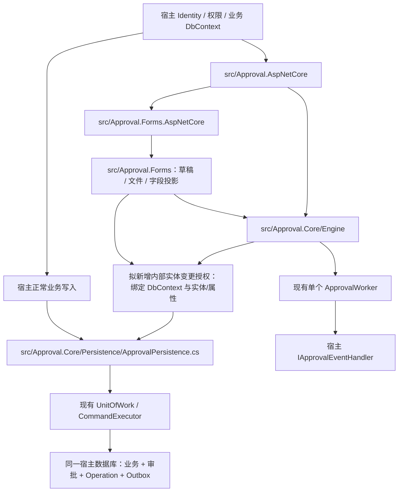

# 第三轮审批边界收尾：审计与实施计划

日期：2026-11-03（Asia/Shanghai）。状态：**已按用户后续授权完成 P0/P1 与兼容收尾，本地全验证通过；最终 CI 结果见交付回复，实际证据见 docs/round3-report.md**。

本文件最初遵循 Global AGENTS.md 第 3 节形成高风险实施计划；规划阶段只新增计划。用户随后明确授权“按计划帮我改动吧”，实施阶段已执行相应生产修改与测试，保留历史模型/迁移与公共兼容契约。

原始需求：用户附件“第三轮架构优化：审批核心数据保护与宿主集成可靠性收尾”。下一会话按本计划和原始需求继续，不能将本次审计当成安全验证报告。

## 1. 基线、范围与不变量

已核验：

- 仓库 `ttcc666/WorkflowDemo`，工作目录 `D:\Study\CSharp\Workflow`。
- 当前分支 `codex/engineering-extensibility`；HEAD 为 `cdb25539da587cea33f2fd50324e9c5f3f2e77a1`，与需求基线一致；开始审计时工作区干净。
- 当前版本 `0.3.0`，目标框架 `net10.0`；`global.json` 固定 SDK `10.0.401`；本机实际版本一致。
- EF Core / SQLite / SQL Server 为 `10.0.14`；MySQL Provider `10.0.12`，Npgsql Provider `10.0.3`，以 `Directory.Packages.props` 为准，不借本轮升级依赖。
- pnpm 实际版本 `10.20.0`，与 `web/package.json` 一致。
- `docker info --format '{{.ServerVersion}}'` 失败：无法连接 `dockerDesktopLinuxEngine` 管道。本次没有数据库实测、构建、测试或 CI 成功结果。

本轮 P0/P1 是安全性与可靠性行为修正，应走 bug-fix/feature 验证流程；不能声称是完全保持行为的结构重构。P2 仅做可证明兼容的职责说明与清理，存在契约风险的迁移另立版本方案。

必须保持的 Invariant（不变量）：

1. 宿主仍使用自己的普通 DbContext、IdentityDbContext 或自定义基类；不拆数据库，不要求继承审批基类。
2. 单宿主、单实例、一个运行中的 ApprovalWorker；允许并发 HTTP 请求。不引入租户、租约、Redis、分布式锁、维护、归档、保留或自动清理服务。
3. Core 不依赖 Forms、ASP.NET Core 或宿主通知/存储实现；Forms 单向依赖 Core。
4. 宿主业务实体的 SaveChanges、SaveChangesAsync、合法 bulk/raw SQL 和已有 override 继续工作。
5. 事务仍归 `ApprovalUnitOfWork` 和 `ApprovalCommandExecutor` 管理；嵌套委托不提交外层事务。保留裸外部事务拒绝规则、失败 scope 作废、新 scope 重试和 COMMIT 核验。
6. 幂等记录、LookupHash、RequestHash、HashVersion、ResultVersion、IsTombstone、确定性资源 ID、BusinessSlot 和 Outbox 不删除、不改已发布数据语义。
7. 历史 Migration、旧表、`ArchiveId`、`DeletionPending` 和旧附件存储键保持兼容。优先做到零数据库模型变更。
8. 保护默认开启且不可通过宿主公开布尔属性或通用 DI 服务关闭；公开 UnitOfWork/CommandExecutor 不能成为审批写权限。
9. 所有生产修改配套行为测试；拒绝场景必须用新上下文核验数据库未变，不能只断言抛出了异常。
10. 不改 `RequireOperationId=false` 的旧客户端默认值；新生产接入显式采用严格模式。不能以兼容为由放过严格模式绕过入口。

## 2. 当前架构与目标保护层



审批能力授权回答“谁能执行命令”，持久化授权回答“这份实体变化是否由拥有它的内部服务产生”；两者都必须满足。对业务实体不套用审批实体所有权规则。

## 3. 第一阶段审计结果

以下“缺口”来自现有实现检查，尚未运行新增攻击/回归测试。

### 3.1 实体所有权与实际写入位置

| 实体 | 允许写入的所有者与范围 | 现有写入位置 | 当前保护 / 缺口 |
| --- | --- | --- | --- |
| ApprovalDefinition | 定义服务创建发布版本；发布后不可改写/删除 | `src/Approval.Core/Engine/ApprovalDefinitionService.cs`、`.Governance.cs` 的 PublishManagedAsync | SaveChanges 禁止修改原已发布行；删除、宿主新增/未发布行写入没有完整所有权保护；bulk 已拒绝 |
| ApprovalInstance | 引擎管理状态、运行图、数据快照、并发令牌、轨迹序号 | `ApprovalEngine.cs`、`.Collaboration.cs`、`.Admin.cs`、`.Timeouts.cs` | 宿主直接改写/删除和 bulk 未被拒绝 |
| ApprovalTask | 引擎任务状态转换、处理人、时限、改派、加签 | 同上，任务创建位于 ApprovalEngine.cs 的 AddTask | 宿主直接改写/删除和 bulk 未被拒绝 |
| ApprovalLog | 引擎追加；任何所有者均不可修改/删除 | ApprovalEngine.cs 的 AddLog；表单变更轨迹仍由引擎追加 | SaveChanges/bulk 拒绝改写与删除，但宿主仍可伪造新增日志 |
| ApprovalCarbonCopy | 引擎追加抄送记录 | ApprovalEngine.cs 的抄送创建路径 | 宿主所有写路径缺少所有权保护 |
| ApprovalCarbonCopyRead | 抄送服务创建本人阅读记录 | `ApprovalCarbonCopyService.cs` 的 MarkReadAsync | 宿主所有写路径缺少所有权保护；确定性 ID/唯一约束应保留 |
| ApprovalMessage | 引擎创建消息；消息服务只改本人可见消息的 IsRead/ReadAt | `ApprovalEngine.Notifications.cs`、`ApprovalMessageService.cs` | MarkAllReadAsyncCore 使用 ExecuteUpdateAsync，不能一禁了之而破坏内部服务 |
| ApprovalOutboxMessage | 引擎创建；Outbox 服务确认、失败重试、人工恢复 | `ApprovalEngine.Notifications.cs`、`ApprovalOutboxService.cs` | 普通宿主可改载荷、投递状态、次数、并发令牌，或删除 |
| ApprovalOperation | 命令执行器预约、绑定资源、保存结果；记录由执行器维护 | `src/Approval.Core/Persistence/ApprovalCommandExecutor.cs` | 宿主可伪造/改写/删除幂等与结果记录；预约阶段和最终提交都需授权 |
| ApprovalBusinessSlot | 引擎创建/释放同一业务的运行占用 | ApprovalEngine.cs 的 StartAsyncCore/FinishAsync | 宿主可破坏唯一占用；不能只保护 Instance |
| ApprovalDefinitionManagement | 定义治理服务编辑设计稿、版本选择、启停、Revision | ApprovalDefinitionService.Governance.cs | 宿主可绕过治理、并发和审计直接修改 |
| ApprovalDefinitionAudit | 定义治理服务追加审计 | ApprovalDefinitionService.Governance.cs 的 Audit | 禁止改写/删除，但宿主可伪造新增 |
| ApprovalDraft | Forms 草稿服务新增、更新、删除；提交成功同事务删除 | `src/Approval.Forms/Runtime/ApprovalFormService.Drafts.cs`、`ApprovalFormService.cs` | 不属于 Core 写权限；目前未受所有权保护 |
| ApprovalFile | Forms 文件服务上传元数据、绑定/解除草稿和实例引用 | `src/Approval.Forms/Attachments/ApprovalFileService.cs` | 通过 IApprovalTrackedRevision 递增版本，但无所有权保护；上传直接 SaveChanges，绑定随其他操作保存 |

不要用名称 `Approval*` 作为分类规则。`IApprovalEntity` 是已有 marker，`ApprovalFile` 通过 `IApprovalTrackedRevision : IApprovalEntity` 实现它；marker 不能代替不同服务的所有权与属性权限。

### 3.2 保存、回调与事务缺口

- `ApprovalPersistence.ValidateWrites` 仅处理 Failed、ExtensionDepth、扩展版本令牌、已发布定义、治理审计和日志。未核验审批变化的内部来源。
- `ApprovalQueryGuard.GuardVisitor` 仅对 Definition / DefinitionAudit / Log 拒绝 bulk；RootType 只沿第一个参数向下找，需验证 Select、Join、SelectMany、投影目标与编译查询。
- `ApprovalCommandGuard` 仅在 CommandSource.ExecuteSqlRaw 的 NonQuery 路径按表名字符串包含判断；不能证明其他 reader/scalar 执行路径受保护。业务 SQL 中仅提到审批表名也可能被误拦。
- `ApprovalUnitOfWork.ExecuteAsync` 是宿主可调用接口；`State.Active` 代表事务状态，并不证明内部审批写授权。
- 宿主可在引擎调用之前、两次嵌套调用之间或返回之后改动已跟踪审批实体。若只在引擎 SaveChanges 周围开放所有审批写入，会把这些变化一起保存。
- 生命周期与业务回调接收可变 ApprovalInstance。`Extension()` 目前阻止自行保存/提交，没有完整禁止偷偷修改任务/日志/状态。开始回调修改 Title 是现有测试覆盖的合法行为，不能粗暴禁止所有快照准备。
- `ApproveWithDataAsync` 的公开 edit 委托接收跟踪 Instance/Task；目前没有 Extension 隔离。Forms 借此修改 Title、绑定附件并返回 ApprovalDataEdit；需保留合法能力并防止委托改任务状态等非授权属性。
- Outbox `DeliverPendingAsync` 使用 `Extension(allowSave: true)`；宿主处理器合法业务 SaveChanges 必须保留，但处理器不能顺便篡改审批实体。失败业务写入仍随投递事务回滚，失败确认使用新事务。
- `ApprovalQueryService.GetPublicDefinitionAsync` 改写的是 AsNoTracking 的返回对象，不是数据库写入，不应误报成引擎修改发布版本。

### 3.3 宿主、幂等、身份、契约缺口

- `ApprovalServiceCollectionExtensions.cs` 使用 `GetService<IApprovalEventHandler>()`；`ApprovalOutboxService` 在实际 DeliverAsync 中才报缺失。Worker 与 BackgroundRunner 捕获运行错误后继续，故不能靠运行循环暴露启动配置错误。
- `EnableBackgroundServices=false` 只不注册 Worker，仍可手动解析 Dispatcher/Scanner；当前没有独立的显式 Dispatcher 关闭配置。
- `ApprovalUnitOfWork.ExecuteCommandAsync` 严格模式仅在 `!IsActive` 且非 system 时拒绝。公开 UnitOfWork 可以先设 Active，使直接调用未证明有 OperationId 的引擎命令获得通行。
- `ApprovalCommandExecutor` 已有正确的 actor/kind/scope/key 摘要、请求冲突、事务预约、新 scope 重试、权限重验和提交核验，优先复用。
- `ApprovalHttpCommands.Managed` 排除定义校验、文件上传和批量改派。`ApprovalEngine.Admin.cs` 的 ReassignUserAsync 逐实例调用 `AllowUnkeyed=true`；必须单独补齐严格策略和部分完成恢复，不能只检查 HTTP Header。
- `DefaultApprovalAuthorization.Subject` 已拒绝空 ActorId 与 userId 冒充；默认权限 Provider 拒绝人工操作，系统操作还受 AllowedPermissions 限制；Provider / QueryScope 超时或异常转换为 AuthorizationUnavailable，应保留。
- 默认 QueryScope 不收窄查询，实际参与人规则由 access policy 继续处理。这是当前单宿主默认约定，不应误判为租户缺失；宿主自定义数据范围仍须在分页/count 前应用。
- Core 的 FlowNode.FieldPermissions、FieldAccess、FieldsWith、InstanceDetail.HiddenFields 和 ApprovalDataView.HiddenFields 是已发布类型/JSON 的兼容残留。实际字段校验/投影在 Forms；Validator 仍检查存在模块，缺失时明确拒绝。
- JSON 的 `channels`、DefinitionMeta/FlowValidationContext 的 Channels、ChannelInfo、前端 meta.channels 已被客户端使用；路由语义已经在事件文档说明，不能本轮强制改名。
- `ApprovalFile`、文件服务、Forms model builder 的“过期后后台清理”等注释与当前运行时不一致；授权服务注释还含“租户”，Scanner 的 scope 参数仍叫 tenants。
- `LocalApprovalFileStore` 接受旧 `tenants/<hash>/...` 存储键是历史兼容；ArchiveId / DeletionPending 的读取限制与旧数据保留仍有效。
- `eng/verify-packages.ps1` 对 Forms/ReferenceHost 消费者校验 package 类型和 sha512；Core-only 的 embedded consumer 当前只检查 package 类型与无 Forms 依赖，**应补同样的包字节摘要校验**，避免缓存旧包造成假阳性。

## 4. 第二阶段：P0 实施设计与清单

### 4.1 内部持久化授权，复用现有事务

推荐使用内部、按 DbContext 实例保存的实体变更授权，复用现有 ConditionalWeakTable 状态；不用 AsyncLocal，不把授权注册成公共 DI 服务，不把权限挂在 ApprovalOptions 上。

拟在 Persistence 增加一个聚焦的内部实现文件（例如 `ApprovalWriteAuthorization.cs`），负责实体所有权、允许操作/属性以及本次已授权变更的记录。Forms 通过现有 `InternalsVisibleTo("Approval.Forms")` 接入，不新增 Core 对 Forms 的引用。

- [ ] Core 内部显式列出其实体所有权；Forms 在内部接入位置声明自身实体类型及操作规则。分类依据 CLR/EF 映射元数据，支持宿主覆盖 ToTable、schema、tablePrefix。不要加入会导致 Migration 漂移的持久模型字段。
- [ ] 宿主不能获取“允许所有审批写入”的服务/令牌；公开 CommandExecutor 与 UnitOfWork 只负责组织事务。
- [ ] 内部变更入口开始前 DetectChanges，核验所有待保存审批变化均为此前内部授权的变化；不能将宿主预先写入的变化作为授权起点。
- [ ] 授权绑定 DbContext、实体对象/主键、Added/Modified/Deleted、允许属性和预期值；授权结束记录实际允许的变化，不允许返回后宿主继续改同一对象而被最终保存。
- [ ] 嵌套内部调用保留并合并各自已授权变化；跨所有者不自动继承权限。不能在外层 Core 操作结束时把 Forms 或宿主回调的所有修改统一“盖章”。
- [ ] SaveChanges 前先核验权限，再执行受控的版本递增；保持现有 Instance/Outbox 与 ApprovalFile 并发行为。保护 OriginalValues、ConcurrencyStamp、key/foreign key，防止通过重设 EF 状态逃逸。
- [ ] 已发布 Definition、Log、DefinitionAudit 的不可变/只追加规则独立于内部授权，内部权限也不能改写历史。
- [ ] 保存成功、SaveChanges(false)、AcceptAllChanges、失败/取消、事务回滚与重试时处理授权记录的消费/作废；失败 scope 不可复用。不要保留可在下一次保存时重复使用的通用授权。
- [ ] 对宿主 override/事件在 SavingChanges 之后引入变化的情况验证最终命令保护；不能只在一次早期快照检查后无条件放行所有 EF SQL。
- [ ] 验证两个 scope、两个 DbContext、异常后新 scope、异步嵌套与 cancellation 不泄漏授权。若池化 Context 被支持，必须核验重用同一对象时授权状态已清空；未经验证不得扩大支持声明。

该机制先用最小关系数据库 Repro（复现）证明授权不会被夹带，再接入完整引擎；不重写 Engine 或 UnitOfWork。

### 4.2 现有写入路径接入

- [ ] CommandExecutor 单独授权 ApprovalOperation 的预约 SaveChanges 与结果最终保存；宿主委托期间暂停/隔离该权限。
- [ ] Engine 的 Start/Approve/Reject/Return/Transfer/AddSign/Withdraw/Terminate/Reassign/Resubmit/Timeout 和任务、轨迹、抄送、消息、Outbox/BusinessSlot helper 接入相应内部授权，保留原状态机。
- [ ] DefinitionService 的发布、草稿、复制、启停、版本选择分别授权，并保留 Revision 冲突与审计。
- [ ] MessageService 只授权 IsRead/ReadAt；CarbonCopyService 只授权本人阅读记录新增，不能取得任务状态或消息正文权限。
- [ ] OutboxService 分别授权创建/投递确认/失败确认/人工 Retry；宿主事件处理器只允许业务写入，不能获得 Outbox 载荷与状态写权限。
- [ ] Forms Draft 服务只授权草稿和实际绑定的附件；FileService 上传使用单次元数据新增授权，保留文件存储失败补偿，不添加新的清理任务。
- [ ] Forms 对实例 Title 的修改迁移到由 Core 接受并验证的数据编辑结果/窄属性适配路径。若需要扩展 ApprovalDataEdit，采用保留已有构造器的兼容新增属性，先检查 public API 和 JSON 影响；不要允许 Forms 任意修改 ApprovalInstance。
- [ ] Lifecycle.OnStartingAsync 的合法 Title/申请快照准备需明确窄范围并由 Core 接受；开始之后的状态、日志、任务图、处理人、幂等/Outbox 字段不得由回调改动。
- [ ] 宿主 permission/identity/approver/definition extension/data-edit/lifecycle/business/event 回调周围核验审批实体变化；恢复后不要把回调非法变化视作引擎变化。
- [ ] 回调允许改变宿主业务实体；Outbox 回调允许业务 SaveChanges，仍不允许直接 Commit 或重入审批写操作。

### 4.3 EF bulk 与原生 SQL

官方依据已读取：

- [EF Core interceptors](https://learn.microsoft.com/en-us/ef/core/logging-events-diagnostics/interceptors)：QueryExpressionInterceptor 在查询编译前工作，并属 singleton；CommandInterceptor 可拦截命令执行；需覆盖实际同步/异步执行路径。
- [ExecuteUpdate / ExecuteDelete](https://learn.microsoft.com/en-us/ef/core/saving/execute-insert-update-delete)：绕过 ChangeTracker/SaveChanges，即刻执行，不自动提供跟踪式并发检查，不会自动把多次操作合并进同一事务。

下一会话须用当前 EF 10.0.14 的真实执行路径验证，官方说明不能替代跨 Provider 的测试。

- [ ] QueryGuard 按真实 EF bulk MethodInfo/表达式目标识别审批实体，覆盖直接查询、Where、Select、Join、SelectMany、cast、投影后 target 等可执行形式；不能仅使用方法名或假设第一个 root 就是写入目标。
- [ ] **默认无条件禁止所有受保护审批实体的普通 ExecuteUpdate/Delete**。查询编译阶段不读取短期写授权，避免内部执行编译成功后宿主复用缓存。
- [ ] 当前仅 MessageService.MarkAllReadAsyncCore 使用受保护实体 bulk。优先将该内部操作改为受控、按原可见范围处理的跟踪更新，继续使用同一事务、保持返回 count/ReadAt 与权限语义。采用有界批次并核验大消息量成本，避免一次加载全部历史数据。
- [ ] 若实测证明保留内部消息 bulk 必要，则必须另加不可公开获得的**执行时**授权及目标/属性验证，用同一缓存表达式“内部执行 → 宿主执行”和相反顺序测试；未证明安全前不保留此例外。
- [ ] 宿主业务实体 bulk 继续允许，包括使用审批表作只读筛选的业务更新；按写目标分类，不能只因源查询出现审批表而拒绝。
- [ ] DbCommandInterceptor 覆盖 NonQuery/Reader/Scalar 的同步与异步路径，核验 EF SaveChanges、ExecuteUpdate/Delete、ExecuteSqlRaw/Interpolated、FromSql/SqlQuery 返回行 DML 等来源；不得声称 NonQuery 覆盖所有写命令。
- [ ] 原生 SQL 防护从明确可识别的 DML 写目标入手：INSERT、UPDATE、DELETE、MERGE/UPSERT 的 Provider 支持形式，正确处理 schema、引号、别名、注释、参数和多语句。不要以 SQL 中 Contains(tableName) 作为完整语义分析。
- [ ] 对审批表普通 raw DML 拒绝，即使当前处于公开 UnitOfWork 或业务回调；合法业务 raw DML、读取审批表的合法语句和字符串/注释中出现审批表名的业务 SQL 不误拦。
- [ ] 不支持/无法可靠分析的 SQL 语法、存储过程、触发器、视图/同义词间接写入逐项记录真实边界，不通过全局禁用宿主 SQL 来“实现安全”。迁移/设计工具和创建数据库的 SQL 单独验证，不能误拦。
- [ ] 文档明确：移除拦截器、手动创建未 UseApproval 的上下文、GetDbConnection 自建命令、独立连接、数据库管理权限属于可信宿主/数据库边界。应用保护不能约束拥有数据库写权限且主动绕过配置的宿主，不能替代数据库权限隔离。

### 4.4 P0 阶段验收

必须首先在 SQLite 真实 DbContext 通过以下全部用例，再做后续 P1；服务数据库也必须覆盖关键拒绝和成功路径。

| 场景 | 验收 |
| --- | --- |
| 宿主改 Task.Status、Instance.Status、Operation 内容/结果；删除 Log、发布 Definition | 明确拒绝；新 DbContext 核验原记录与状态不变 |
| 宿主新增伪造 Log/Audit/Operation/Message；删除 Slot/Outbox；修改 DefinitionManagement | 拒绝，不能只保护状态两个属性 |
| 宿主修改/删除 Draft/File；Core 权限操作 Forms；Forms 权限改 Task/Operation | 拒绝所有者越界 |
| Attach/Update、Entry.Property/State、AutoDetectChanges=false、级联删除 | 不因 EF 写入形式改变而绕过 |
| 宿主先改审批数据再调用合法引擎；嵌套命令之间修改；合法调用返回后修改 | 拒绝夹带，事务整体按现有规则回滚 |
| 宿主公开 UnitOfWork / CommandExecutor 委托直接写审批实体 | 拒绝；同一委托写业务实体并正常调用引擎成功 |
| edit/lifecycle/business/event/权限解析回调篡改审批状态或日志 | 拒绝；合法快照准备与业务写入成功 |
| 普通 bulk Task/Instance/Log/Operation/Draft/File | 同步/异步拒绝；投影/Join/缓存重用覆盖 |
| 业务实体 bulk/raw/save/override | 正常成功，含审批只读筛选和混合事务业务写入 |
| 正常创建、审批、并行/会签/退回/加签/重提、治理 | 成功；任务/轨迹/Operation/Outbox 数量和状态正确 |
| Forms 草稿、新文件上传、草稿绑定、提交删除、审批编辑、重提标题 | 成功；附件 Revision 正确；失败后补偿/回滚保持 |
| 本人单条/全部站内信与抄送已读 | 成功；其他人的阅读状态/消息内容不变 |
| Outbox 处理器业务 SaveChanges 后抛错 | 业务与成功确认回滚；新事务只记录失败，可重试 |
| SaveChanges/SaveChangesAsync 所有 overload、宿主继承结构、后置宿主回调 | 成功/拒绝规则一致，宿主 override 实际执行 |

拟新增 `tests/Approval.Core.Tests/ApprovalWriteProtectionTests.cs` 与数据库对应场景文件；扩展现有 HostDbContextIntegrationTests、ActionRollbackTests、FieldPermissionTests、DraftTests、FileTests、OperationTests 和 NotificationTests，避免复制整个引擎夹具。

历史 Migration 用例需要旧数据时通过其已有独立 DbCommand/离线 seed 方式构造，不为测试新增生产绕过 API。安全用例只使用生产宿主接口；包消费者没有测试 friend 权限。

## 5. 第三阶段：事件处理器启动与 Dispatcher 配置

主要文件：`ApprovalServiceCollectionExtensions.cs`、`ApprovalOptions.cs`、`Background/ApprovalWorker.cs`、`Background/BackgroundServices.cs`、`Engine/ApprovalOutboxService.cs`，必要时新增短生命周期的内部 startup validation service。

- [ ] 增加单独的显式 Dispatcher 开关（例如 `Outbox.EnableDispatcher`，名字实施时与现有 options 风格一致，默认 true）。现有 EnableBackgroundServices 继续只控制后台调度。
- [ ] 使用启动阶段创建的短 scope 验证启用 Dispatcher 时存在并可构造有效 IApprovalEventHandler；在接收请求/进入循环前失败。不可构造的新 handler 配置同样启动失败，不调用 HandleAsync 来探测。
- [ ] 验证必须基于最终 DI 注册，支持 AddEventHandler 与宿主自行注册，以及 Scoped handler 的依赖；不把 Scoped handler 持有在单例 validator/Worker 中。
- [ ] validator 可是只执行 StartAsync 的 IHostedService，不是新后台 Worker；测试改为统计实际 ApprovalWorker/循环，保留单 Worker 不变量。
- [ ] 缺 Handler 的异常不由 BackgroundRunner 吞掉后延后重试。运行时手动 Dispatcher 也做同样有效性检查；普通 ServiceCollection.BuildServiceProvider 无宿主生命周期时要说明显式初始化/第一次调度检查边界。
- [ ] Dispatcher 显式关闭时 Worker 继续按原规则扫描超时，但不投递 Outbox；手动 ProcessDue/DispatchOnce 也不能忽略开关。消息照常持久化，不标为 Succeeded，不默认添加空 handler。
- [ ] 文档说明 Dispatcher 关闭会积压未投递事件；与 EnableBackgroundServices=false 下允许手动调度区别清楚。
- [ ] 真正启动 Generic Host/WebApplication 验证：正确 Handler 成功；缺失/构造失败拒绝；显式关闭成功且 Outbox 原样保留。只断言 services 注册不是启动测试。
- [ ] 保留事件成功、重试、最终 Failed、人工 Retry、重复投递 stable Event.Id、忽略取消时不重叠，以及旧 Notification 行适配测试。

## 6. 第四阶段：严格 OperationId 与直接应用服务入口

主要文件：`Persistence/ApprovalUnitOfWork.cs`、`ApprovalCommandExecutor.cs`、`Engine/ApprovalEngine.Commands.cs`、`.Admin.cs`、各服务命令入口、`Approval.AspNetCore/ApprovalHttpCommands.cs`、宿主 business endpoints 与现有幂等文档。

- [ ] 内部记录当前**已预约带键命令的来源**；State.Active、OperationSeed、公开 UnitOfWork 活跃不能证明该来源。System 例外仍需明确 AllowedPermissions，不自动允许所有系统操作。
- [ ] 严格模式要求所有引擎状态命令、治理命令、Forms 草稿/提交和阅读状态命令由带键 executor 协调；StartApprovalRequest.OperationId 仍使用现有入口。业务 UnitOfWork 本身不要求审批键，只有调用受保护审批命令时检查。
- [ ] 默认兼容无键模式继续可用并明确没有请求级重放保证；安全写保护在兼容模式仍始终开启。
- [ ] 同一逻辑命令保持 Kind/Scope/Payload/key 映射稳定；键作用域为 actor + kind + scope，不宣称同一 key 在所有路由全局唯一。相同范围/键、不同内容冲突，相同内容恢复原结果且重新核验权限。
- [ ] HTTP 不生成重试时变化的新 key，保留一个 Header、长度、空白/控制字符验证；direct service 与 HTTP 的严格策略一致。
- [ ] 严格模式不能通过公开 UnitOfWork 包住无键 Approve/Publish 等绕过；不能通过 DI 获取内部的 AllowUnkeyed 豁免。
- [ ] 批量 ReassignUserAsync 保持逐实例提交/部分成功语义。增加稳定 root operation 与持久候选/结果快照，再派生逐实例键；重试读取原批次清单和已提交项，不能重新查询已经改派后的候选来返回空结果。
- [ ] 批量的 keyed 新 API 使用兼容重载/新增入口，不改原已发布方法签名；旧无键入口在兼容模式保留，在严格模式明确拒绝。HTTP 使用现有 Idempotency-Key 映射到批量协调，不能直接套单一原子 HTTP executor 破坏逐实例事务。
- [ ] Root manifest 优先复用现有 ApprovalOperation 的版本化 ResultJson/内部命令类型，不新增事务系统；逐项故障、部分完成、未知提交恢复和最终原结果重放必须先设计测试。
- [ ] 文件上传仍是外部 Stream/FileStore 操作，当前明确不受 HTTP command filter 管理。文档单列其非请求幂等与失败补偿边界；若本轮补稳定上传键，必须保留旧入口并证明存储对象与元数据的重试/未知结果安全，不能只写 Header 检查或宣称 exactly-once。
- [ ] 只读查询/定义校验无需 OperationId；后台扫描/Outbox 确认使用显式系统权限、现有任务状态/并发与 stable Event.Id，不要求用户 Header。

验收矩阵：

| 命令组 | 严格策略与验收 |
| --- | --- |
| Start / Approve / Reject / Return / Transfer / AddSign / Withdraw / Terminate / Resubmit / Reassign | 必须带键命令来源；逐组验证同请求重放、不同行为冲突、网络重试仅一份轨迹/任务/Outbox |
| Publish / PublishDraft / DesignDraft / Copy / Enable / SelectVersion | 必须带键；原版本/Revision/审计结果重放；请求变化 409 |
| Forms Start / Draft Save/Delete / Approve/Edit / Resubmit | 必须带键；已删除草稿重放使用可信已提交资源快照，附件不重复绑定/丢失 |
| 单条/全部站内信、抄送阅读、人工 Outbox Retry | 按现有命令入口带键；重放不改变其他资源，权限撤销后拒绝 |
| 批量离职改派 | 稳定批次及逐项键；保持部分成功、重复调用原结果、部分完成恢复与直接入口保护 |
| 上传 | 明确现有例外与补偿边界；不能把不具备请求幂等的上传写成严格保证 |
| 后台系统命令 | 仅允许能力集合；用户不可通过 system 身份/裸 UnitOfWork 绕过 |

保留并增强 OperationTests、RequestBodyRetryTests、OperationEndpointTests、DefinitionGovernanceEndpointTests、CertificateRecoveryTests、并发/原子数据库测试。

## 7. 第五阶段：身份与权限宿主检查

- [ ] 保留 DefaultApprovalPermissionProvider 的人工拒绝行为、系统 AllowedPermissions 上限、userId 与可信 ActorId 等值检查；角色字符串不授予管理权限。
- [ ] startup validator 检查必需 IdentityProvider 注册与构造能力。HTTP claims/current user 在真实请求时检查，不能启动时伪造当前用户来让检查通过。
- [ ] 区分有效的默认人工拒绝与生产宿主实际集成要求；如新增严格宿主注册校验策略，采用显式兼容配置，不偷偷改变所有 Core-only/headless 宿主的默认权限约定。
- [ ] 生产示例显式注册身份/权限/Handler，示例 DemoMode 不替代通用默认实现；ASP.NET 注册顺序不得把宿主 Provider 意外替换成 policy/default Provider。
- [ ] HTTP 默认当前用户只从可信已认证 Claims/宿主 IApprovalCurrentUser 读取；空身份、未认证伪造 claim、参数 actor 不一致全部拒绝。
- [ ] Provider 异常、超时、忽略取消，以及 QueryScope 异常/扩宽尝试、分页/count/统计均测试拒绝或按原范围限制。
- [ ] 撤销权限后的操作结果重放仍重新授权；普通角色名 Admin 不自动获得 InstanceReadAll/Publish/Reassign 等权限。
- [ ] 不将 ASP.NET HttpContext 或宿主身份实体引入 Core。

拟扩展 `tests/Approval.Core.Tests/PermissionTests.cs`、`HostDbContextIntegrationTests.cs`、`tests/Approval.AspNetCore.Tests/HostIdentityEndpointTests.cs`、`PermissionEndpointTests.cs` 与 ReferenceHost 场景。

## 8. 第六阶段：Forms 残余耦合的兼容决定

本轮建议保留已发布兼容结构：FlowNode.FieldPermissions、FieldAccess、FieldsWith、HiddenFields 返回字段以及旧 `form` JSON。实际规则仍归 Forms，Core 仅保留 DTO 兼容与“缺少模块时拒绝”的安全检查。

- [ ] 证明 Core 没有 ProjectReference/运行依赖指向 Forms，Core-only 消费者不加载 Forms；不因保护注册机制引入反向依赖。
- [ ] Forms Validator/Projection 保持字段可见性、可编辑权限、公式/明细/附件访问；旧定义 Parse → ToJson round-trip 不丢 FieldPermissions。
- [ ] 历史实例始终用绑定的已发布版本执行，不能用最新 schema 替换旧规则；未注册 Forms 的带表单定义继续明确拒绝，不静默忽略隐藏字段。
- [ ] 调整误导性 Core 注释：字段规则由可选投影提供，不宣称 Core 实现表单领域规则。
- [ ] 后续单独契约版本可把每节点字段规则放入可选模块 snapshot，再以双读/单写和旧 schema adapter 迁移；旧流程 JSON、public types、前端协议与历史实例测试全部设计好后实施。本轮不执行公共类型删除/移动或前端 @approval/forms 拆包。

## 9. 第七阶段：通知路由与历史概念清理

- [ ] 对宿主可见说明统一为“宿主通知路由”，保留 NotificationTargets 与 ApprovalEvent.DeliveryTarget 的现有语义；站内信 InApp 仍是系统能力。
- [ ] 保留 JSON `channels`、Meta.Channels、FlowValidationContext.Channels、ChannelInfo 与 InAppChannel 的外部名称；本轮优先改注释/校验错误说明，不盲目新增多套 alias。
- [ ] 若改前端设计器展示文案，仅触及 `web/packages/approval-ui/src/features/designer/NotificationRulesEditor.vue` 等实际展示点，保留 props/data/JSON；实施前加载 Vue 技能，配套相关展示测试与契约检查。
- [ ] 清理 ApprovalAuthorizationService 中租户/单租户旧注释，BackgroundServices 中 tenants 参数的内部用语，以及 Forms 文件实体/服务/model builder 的自动清理承诺。
- [ ] 保留 `IApprovalFileStore.cs` 旧 `tenants/<hash>/...` 键校验，保留 ArchiveId / DeletionPending 兼容读取及所有历史 Migration/旧表/测试证据。
- [ ] 搜索结果分为运行代码、兼容字段、误导性注释、历史文档/迁移；历史报告和历史计划是事实记录，不批量删除改写。
- [ ] 不增加 SMTP、邮件、短信、企微、钉钉、Webhook 发送器。

## 10. 第八阶段：完整验证与真实证据

实施之前记录 baseline；每一阶段先做针对性验证，最终完整运行。当前测试为 .NET SDK-style + xUnit v2 + Microsoft.NET.Test.Sdk/VSTest，global.json 没有 native MTP runner；使用仓库现有 positional dotnet test 命令。仓库未发现 run-tests skill overlay 或其他 Directory.Build.targets 覆盖。

所有命令在 `D:\Study\CSharp\Workflow` 的 PowerShell 执行，退出码非零就定位对应阶段，不能继续写“通过”。下列是下一会话命令，**本次未执行**：

```powershell
Set-Location -LiteralPath 'D:\Study\CSharp\Workflow'
pwsh -NoProfile -File './eng/verify.ps1' -Scope 'Backend'
pwsh -NoProfile -File './eng/verify.ps1' -Scope 'Frontend'
pwsh -NoProfile -File './eng/verify.ps1' -Scope 'Contracts'
pwsh -NoProfile -File './eng/verify.ps1' -Scope 'Packages'
```

最终 `All` 验证完整组合，避免把上面每项无变化地重复跑；可选择一次运行：

```powershell
Set-Location -LiteralPath 'D:\Study\CSharp\Workflow'
pwsh -NoProfile -File './eng/verify.ps1'
```

`verify.ps1` 已包含 Release 构建、全部 solution 测试、九套 pending-model 检查、ReferenceHost 实测、前端 frozen install/boundary/typecheck/test/build、contracts 与包消费者。OpenAPI 由 `web/scripts/contracts.mjs` 对照生成；契约变化不能仅更新 golden 来隐藏破坏。

服务数据库在专用测试容器执行；先确保 Docker daemon 可用，不连接生产数据库：

```powershell
Set-Location -LiteralPath 'D:\Study\CSharp\Workflow'
pwsh -NoProfile -File './eng/verify-databases.ps1' -Provider 'SqlServer'
pwsh -NoProfile -File './eng/verify-databases.ps1' -Provider 'MySql'
pwsh -NoProfile -File './eng/verify-databases.ps1' -Provider 'PostgreSql'
```

脚本已检查 TRX 的 total/executed/passed/failed/notExecuted、完整测试定义与结果、必需 Migration 和原子回滚病例，并保存 manifest/摘要。不降低任何计数/必需病例约束。数据库状态切换使用现有环境变量，不输出连接串或密码。

- [ ] 将 P0 跨 Provider 安全场景加入数据库套件，并加入必需执行病例检查；默认 SQLite 与三个真实服务 Provider 都验证。
- [ ] 保留九套 Migration pending-model 检查与 `EmbeddedBoundaryMigration_PreservesLegacyArchiveAndAttachmentData`；保护新增运行元数据不得逼出无意义的新迁移。
- [ ] 全套后端包含 UnitOfWork、并发、幂等、未知提交、Outbox 恢复、Forms 与三种宿主基类。
- [ ] 前端不重构契约，仍执行 frozen install、typecheck、unit、boundary、lib/demo build、contracts/OpenAPI。
- [ ] 当前 NuGet 包消费者：Core-only EmbeddedHost、ReferenceHost、Forms/Certificate；npm 真实 tarball 消费者。所有框架依赖应为 package，包字节 sha512 与本次 feed 匹配；Core-only 同样补摘要检查。
- [ ] `eng/consumers/EmbeddedHost/Program.cs` 增加宿主直接状态写/bulk 被拒绝和正常业务 SaveChanges 的生产包证据；Forms 消费者也实际覆盖 Draft/File 保护。
- [ ] 证据保存在 output 下并生成第三轮报告；记录命令、UTC/本地时间、HEAD、包摘要、TRX Passed/Failed/Skipped、前端测试数、消费者 checks、Migration 结果、真实 CI run URL。
- [ ] `.github/workflows/ci.yml` 已有 Windows verify 与 Ubuntu 三数据库 matrix。实施提交后核验匹配最终 HEAD 的全部 job 和 artifact；本地成功不能写成 CI 成功，不使用上一轮绿色状态冒充本轮。
- [ ] Docker 不可用时先完成独立的本地代码工作与 SQLite 验证，继续尝试真实可用 CI；外部验证仍缺失时报告未完成，不能跳过用例或宣布具备合并条件。

## 11. 预计修改文件与提交分组

实施根据 POC 结果收敛文件，以下是有证据的修改范围，不是要求每个文件都必须改：

1. **P0 persistence**：ApprovalPersistence.cs、ApprovalUnitOfWork.cs、ApprovalCommandExecutor.cs、必要的内部授权文件；Core/Forms 实际写入服务和回调边界；HostDbContext/安全/数据库/Forms 回归测试。
2. **P1 host integration**：Core 注册、Options、Worker/Dispatcher/Outbox、启动 validator、权限/HTTP 命令、批量改派与生产示例；真实宿主启动与幂等/身份测试。
3. **P2 compatibility**：Core/Forms/通知/授权旧注释；必要的设计器展示文案和对应测试；不删除公共类型、历史字段和迁移。
4. **Validation/evidence**：eng/verify-packages.ps1、eng/consumers/EmbeddedHost/Program.cs、eng/verify-databases.ps1 的必需病例、相关消费者证据与 CI artifact 配置（仅在有需要时）。
5. **Documentation**：README.md、docs/architecture.md、embedded-host-integration.md、permissions.md、events.md、transactions-and-idempotency.md、forms.md、upgrade-0.3.md、contracts-and-release.md、database-validation.md、CHANGELOG.md；新增 `docs/round3-report.md`，或分为安全/宿主/CI 报告并互相链接。

建议审核单元：`fix: protect approval entity writes in shared contexts`、`fix: validate host event dispatch configuration at startup`、`fix: enforce keyed approval commands in strict mode`、`docs: clarify approval module and notification boundaries`。每组只能在配套测试通过后形成，最后保持 `codex/engineering-extensibility`，不合并 main，不重写历史。

用户请求最终提交，不等于本计划会话需要先提交一个“第三轮已完成”的提交。执行结束才提供最新 SHA、diff 文件/行统计、测试统计、CI 链接、未解决问题与合并结论。

## 12. Rollback（回滚）与停止条件

- 默认不改 schema/历史 migration，回滚以逐组 Git revert 和宿主配置回退实现，保留 Operation、Outbox 和历史数据；不执行 reset --hard、清库或迁移回退来消除失败。
- 增强写保护回滚会重新开放已识别漏洞，必须明确记录；不能为恢复测试而提供生产 DisableWriteProtection 开关。
- 新 Dispatcher 配置只改变投递行为，不删除/成功标记积压 Outbox；恢复 handler/启用后仍按原 stable Event.Id 投递。
- 严格幂等升级保留默认兼容模式与历史键；不删除旧 Operation 或用新键掩盖 CommitOutcomeUnknown。批量部分完成使用原 manifest/逐项结果恢复。
- 任一 P0 测试发现授权夹带、跨 owner/context/cache 泄漏、业务 override 或 Outbox 事务破坏，停止推进 P1，修复 P0；不能以未来文档说明替代必须的 EF 保护。
- P2 需要公共类型删除/移动、JSON 字段消失、旧实例配置迁移或数据库字段删除时，保留当前兼容结构，记录到下一契约版本方案；本轮不强行完成。
- 基线测试红、缺数据库或 CI 未取得最终 HEAD 证据必须如实单列，不跳过、不削弱断言、不复用旧结果。

## 13. 下一会话执行入口与最终验收

下一会话先确认分支/HEAD/工作区，阅读本计划和完整原始需求，按第二阶段从 SQLite 攻击用例和内部授权 POC 开始。若基线已前进，审阅相关差异后局部更新计划，不重新设计引擎。

最终报告必须逐问题给出原问题、根因、方案、文件、结果、兼容性，并包括：

- 安全：真实数据库证明直接 Task/Instance/Log/Operation 与 bulk 被拒绝，内部引擎/Forms/消息/业务正常。
- 宿主：真实启动 handler 缺失/正确/关闭行为；事件重试/恢复；直接服务与 HTTP 的 OperationId 规则；缺身份、冒充、默认权限拒绝。
- CI：Windows、SQLite、SQL Server、MySQL、PostgreSQL、前端、消费者、Migration 的真实命令和计数/链接。
- 架构：共享 Context、单 Worker、Core 单向依赖、历史兼容、raw SQL 的实际保护边界与 P2 后续方案。
- Git：最终 SHA、文件统计、测试统计、匹配 HEAD 的 CI 链接、尚未解决的问题、是否具备合并条件。

**规划阶段的审计不能当作验证；实施后的实际测试、数据库、消费者与 CI 结果以第三轮报告和最终交付回复为准。**

## 14. 实施记录

- P0：内部实体/属性授权、回调和序列化隔离、EF bulk/普通 DML 保护、后置保存检查、显式 Accept/池化租期兼容已实施。
- P1：必需身份/Handler 启动检查、显式 Dispatcher 配置、严格键来源与批量原键清单/逐项恢复已实施。
- P2：文档/旧注释收尾；字段权限、channels、历史字段和 Migration 保留，后续迁移方案见第三轮报告。
- 后端 Release 548 个测试通过、无跳过；九套模型无漂移；ReferenceHost smoke 27 checks；前端 186、boundary 7、浏览器 5；三库各 31 个用例通过；Core-only 18 checks。实际报告和最终 CI 链接见第三轮交付。
- 无新的维护/归档/租约/分布式锁/第三方发送器，无 Core 对 Forms 的实现引用。
