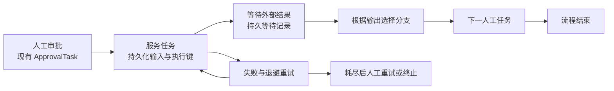
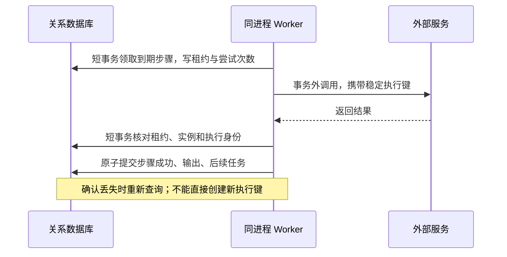

# 单体工作流引擎实施计划

> **路线状态：已被取代（2026-11-04）。** 当前产品是单宿主、单应用实例的嵌入式通用审批引擎。本文涉及的多租户、服务任务、持久等待及编排目标不再是开发指令；历史实施和验收记录仅代表当时版本。当前实施以 [阶段一产品化计划](2026-11-04-approval-productization.md) 与仓库 AGENTS.md 为准。

日期：2026-11-03。状态：待实施，尚未修改执行引擎或数据库。

## 1. 已确认的产品目标

建设一个单体部署、支持人工与自动步骤、能够持久等待和故障恢复的工作流引擎。

采用现有 .NET、EF Core、ASP.NET Core 和 Vue 技术路线。HTTP API、工作流调度和后台执行位于同一个应用进程，关系数据库是执行状态的事实来源。内存信号只负责加速唤醒，不能承担持久化保证。

“故障恢复”首先指进程重启、步骤失败、结果确认丢失后可以继续处理。单体部署不承诺高可用；数据库和附件灾难恢复继续使用现有备份体系。单实例仍有并发请求和后台竞争，单实例也不表示单租户。

本计划替代前一份路线的实施优先级。审批作为人工任务的现有实现保留，通用执行语义成为新增能力的中心。

## 2. 首个可交付闭环

示例业务：人工审核申请 → 调用外部系统创建工单 → 等待工单完成事件 → 根据结果分支 → 人工复核 → 结束。使用隔离的示例外部服务验证，不依赖生产系统。

第一批先交付“人工 → 服务任务 → 人工”的垂直切片；第二批补定时等待和事件等待，形成上图完整闭环。

成功标准：在任意持久边界停止并重新启动应用，原实例仍能继续；重复请求、重复回调和迟到结果不能重复创建下游任务。

## 3. 首版范围与复杂度预算

| 首版包含 | 暂缓 |
|---|---|
| 现有人工审批、条件分支、服务任务、定时等待、事件等待 | 完整 BPMN、任意循环、动态多实例 |
| 持久化步骤执行、固定输入、输出映射、失败重试 | 自动补偿平台、在途版本迁移、子流程 |
| 步骤异常列表、授权重试、实例终止 | 任意跳过、任意跳转、修改历史执行结果 |
| 同进程 worker、数据库调度与恢复 | 消息中间件、分布式调度、微服务拆分 |

首版新执行协议只开放串行与条件分支；旧协议的结构化并行、退回、加签按原语义继续支持。发布校验明确拒绝首版不支持的新旧组合，不能允许设计后在运行时失败。

在首版闭环稳定后，再将新执行记录接入结构化并行和退回。不能为了立刻支持所有组合，一次建立完整通用 token、事件总线和插件调度框架。

新增持久实体优先控制在两个：步骤执行记录、事件收件箱。定时器与等待订阅直接建模在步骤记录中，不额外创建调度平台。现有 Outbox 继续承担通知和原有异步副作用。

## 4. 必须保持的不变量

1. 发布定义不可变；实例固定定义版本和执行协议，重启不能读取最新定义替换原版本。
2. 同一次步骤激活具有独立 ExecutionId。NodeId 是定义位置，不能替代执行身份；现有实例 Round 也不能替代未来分支的执行轮次。
3. 同一次步骤的自动和人工失败重试沿用稳定执行键。重新激活节点才创建新的 ExecutionId。
4. 步骤成功、输出映射、日志和后续激活必须在同一短事务提交。
5. 租约过期、实例终止或执行失效后，旧 worker 的结果不能推进流程。
6. 外部副作用按至少一次设计；远端需要接受稳定幂等键或提供查询对账能力。数据库事务不能撤销外部效果。
7. 租户、主体权限、查询范围、文件保护和原命令幂等继续生效。
8. 旧 Async 动作仍然入队后继续，不静默变成等待完成；旧同步本地动作仍保持原事务契约。
9. 技术故障不是业务驳回；等待不是失败。不能复用 Rejected 表示远程超时。
10. 业务结束回调只在实例实际结束时执行，不在服务任务入队或等待开始时执行。

## 5. 最小执行模型

下列名称为设计建议，最终名称在阶段 0 固化；不在本轮直接加入公共 API。

### 5.1 步骤执行记录

建议 `WorkflowStepExecution` 保存：TenantId、InstanceId、DefinitionId、NodeId、ExecutionId、执行类型、状态、输入快照、输出、错误码、尝试次数、NextAttemptAt、DeadlineAt、租约标识与到期时间、并发令牌、时间戳。

等待事件时增加订阅类型、可信来源、关联键；等待定时器时使用持久到期时间。输入与输出应有大小限制、敏感信息访问控制，密钥使用宿主凭据引用，不在快照中固化明文。

状态建议：Ready、Running、Waiting、RetryScheduled、Succeeded、Faulted、Canceled。步骤类型区分人工、服务、定时与事件等待；条件等即时节点首版仍在短事务内推进，不强制每个节点都写独立记录。

人工任务继续使用 ApprovalTask 作为待办实体，新协议中将任务关联到步骤执行；整个会签节点成功后才完成该步骤。暂不重写既有 Any、All、Sequential 的人员处理逻辑。

实例保持业务生命周期状态；新增运行状态查询视图，根据活动步骤呈现等待、故障和可操作信息。首版避免同时新增一套容易漂移的持久实例状态。一个活动步骤故障时，实例仍未结束；管理员终止才能进入终态。

### 5.2 执行事务

新服务任务处理器不获得可自行提交宿主共享事务的契约。其职责是执行外部或可重试计算、返回结果；本地业务变更通过受控结果应用阶段与步骤完成共同提交。现有本地事务动作保持原路径，避免破坏兼容语义。

租约用于重启接管与迟到结果失效；不做集群选主或全局 leader。复用现有 scope、TimeProvider、重试策略与授权设施，但不要把新步骤执行和旧 Outbox 双重排队。

### 5.3 定时与事件等待

定时等待保存 UTC 截止时间；worker 查询到期记录并条件更新，重启后扫描恢复。精度取决于扫描间隔和负载，不使用长期 Task.Delay 保证持久等待。

事件收件箱建议 `WorkflowInboxEvent`，保存租户、来源、事件 ID、关联键、接收时间、载荷和消费标记。来源加事件 ID 在租户内唯一，消费标记与步骤完成在同一事务提交。

为解决回调早到，示例在调用外部服务前就持久化并传递关联键；服务返回后等待步骤按该键消费已到达事件。仅接受能关联到已存在实例和执行意图、且经过来源认证的事件，拒绝无界缓存任意外部事件。

首版每个订阅只消费一个结果事件，无广播语义。重复事件返回稳定结果；同 ID 不同正文冲突。超时与事件消费竞争时，通过相同状态和并发条件只允许一方生效。过期、终止或旧轮次事件不能重新激活流程。

事件收件箱首版提供明确容量、载荷与保留边界，未消费且仍有效的事件不可按年龄随意删除。不要以建设完整归档治理作为交付前置条件。

## 6. 分阶段实施清单

### 阶段 0：冻结契约与基线

- [ ] 重查当前工作区与已有实现，记录基线；保留未提交的用户改动。
- [ ] 固定首版节点、状态、错误码、输入输出、事件关联与终止语义。
- [ ] 明确新协议与旧协议的读取、发布、设计器兼容策略；旧客户端不能错误解释新节点。
- [ ] 定义服务处理器及受控结果应用契约，明确禁止副作用的位置。
- [ ] 审查人工审批后的既有动作和完成回调，确定可复用边界。

验收：完整示例有明确状态表，每个失败点都有恢复路径；无待定的重复执行语义。

### 阶段 1：人工 → 服务 → 人工

- [ ] 添加步骤实体、索引、同租户外键、租约与并发保护，以及追加式迁移。
- [ ] 新协议人工任务关联执行记录，复用现有待办规则。
- [ ] 服务节点只持久化执行意图，不在 HTTP 事务中等待远程调用。
- [ ] 实现领取、事务外执行、成功确认、退避、故障及授权重试。
- [ ] 实现输出映射与后续任务原子创建，适配现有命令协调器。
- [ ] 增加最小查询与异常操作 API、最小设计器配置及步骤状态展示。
- [ ] 示例外部服务支持幂等执行、失败、慢响应和结果查询。

验收：重启、重复提交、确认丢失和人工重试后，下游任务仍只创建一次。先完成这一阶段，再扩展节点类型。

### 阶段 2：持久等待

- [ ] 添加定时等待与事件收件箱，明确并校验回调身份、租户与关联范围。
- [ ] 处理回调早到、重复、迟到、正文冲突和超时竞争。
- [ ] 从等待结果映射变量并进入条件分支，完成示例闭环。
- [ ] 补齐等待状态展示、故障原因、重试记录及终止后的查询行为。

验收：应用停止期间等待状态不丢失；重新启动后到期定时器与已到事件可以继续处理。

### 阶段 3：并行与退回兼容

- [ ] 根据现有 FlowStructure 保持结构化并行，建立分支激活身份与去重到达记录。
- [ ] 合并不能仅依赖 NodeId 或无身份到达计数，否则重复完成可能提前放行。
- [ ] 明确退回取消哪些活动执行，重新进入节点时生成新身份。
- [ ] 定义并行输出冲突策略；默认拒绝未经声明的同变量并发覆盖。
- [ ] 逐项开放通过验证的节点组合，解除首版发布限制。

验收：分支部分完成后重启能继续；重复到达不提前合并；退回后旧服务结果不能推进新轮次。

### 阶段 4：依据实际使用简化外围

- [ ] 记录新执行核心与现有 ApprovalEngine 的职责，逐步共享推进逻辑，避免长期维护两套重复规则。
- [ ] 对宿主查询保护范围和单租户调度进行针对性简化，保持安全边界。
- [ ] 保持现有包名和业务适配，暂不进行 Workflow 命名大迁移或抽象整个数据库访问层。
- [ ] 仅依据测量结果优化索引、扫描和事务时长；不新增治理平台。

## 7. 文件与模块范围

| 范围 | 预期变更 |
|---|---|
| `src/Approval.Core/Definitions/` | 新节点协议、发布校验、旧版本兼容 |
| `src/Approval.Core/Domain/`、`Persistence/` | 步骤与收件箱、模型约束、命令和事务集成 |
| `src/Approval.Core/Engine/` | 激活、完成、结果应用与活动步骤查询；逐步复用原审批推进 |
| `src/Approval.Core/Background/` | 同进程到期步骤调度，复用租户作用域 |
| `src/Approval.Core/Abstractions/`、`Actions/` | 最小服务处理器契约，旧动作保持兼容 |
| `src/Approval.AspNetCore/` | 步骤查询、重试与可信事件接收 |
| `web/packages/approval-ui/src/` | 协议类型、设计器、执行图与异常操作 |
| `samples/`、`tests/`、`eng/`、`docs/` | 可复验闭环、并发与恢复证据、迁移及运维说明 |

迁移生成到各实际宿主所属项目，不假设 Core 类库拥有唯一通用迁移。已承诺的 Provider 支持继续维护，停止扩展兼容范围不等于取消既有发布保障。

## 8. 验证矩阵

| 场景 | 必须观察的持久结果 |
|---|---|
| 正常执行与条件分支 | 输入固定，输出正确，下游人工任务唯一 |
| 外部超时、异常与重试耗尽 | 尝试和下次时间持久化，耗尽后可人工处理，下游未启动 |
| 外部成功但本地确认失败 | 使用原执行键恢复；远端效果可对账，流程只推进一次 |
| 领取后、调用后、确认后停止进程 | 分别可接管、恢复确认或读取已完成结果 |
| HTTP 与 worker 并发、人工与自动重试竞争 | 租约和并发条件只允许有效结果写入 |
| 事件早到、重复、迟到、超时竞争 | 事件最多消费一次，结果与后续任务共同提交 |
| 实例终止后迟到结果 | 无新增任务或恢复执行；远端副作用单独对账 |
| 租户与权限边界 | 跨租户事件和操作被拒，当前权限撤销立即生效 |
| 旧定义、旧在途实例、现有 Async 动作 | 保持原行为，不要求回填无法推断的步骤历史 |

复用现有 `eng/verify.ps1` 作为统一验收入口；持久化变更执行 `eng/verify-databases.ps1` 的对应 Provider 验收，前后端协议同步执行既有契约和独立包门禁。具体针对性命令在实施时依据实际新增测试选择，不能预报未运行的结果。

恢复验收至少包含停止并重新启动隔离宿主进程，不能只用异常模拟替代。使用独立测试数据和实例，不停止用户正在使用的业务服务。

## 9. 升级、回退与交付规则

1. 保持旧迁移，追加实体和协议，不推断回填旧实例执行历史。
2. 旧实例固定使用旧执行协议；新实例只在显式选择的新定义下启用新节点。
3. 升级前暂停写入与 worker、备份数据库和附件，在副本验证迁移及旧待办继续。
4. 新协议尚未产生实例时，可在验证 schema 兼容后回退程序；已有新协议实例后优先前向修复，旧程序不得接管未知协议。
5. 恢复备份前记录已发生的外部效果并对账，不通过换执行键盲目重跑。
6. 每阶段交付代码、针对性验证、完整相关门禁、实际运行证据和未覆盖边界；未完成阶段不标记完成。

首个实施会话只执行阶段 0–1。阶段 2 之后独立验收推进；不将整个路线压入一次大改造。
