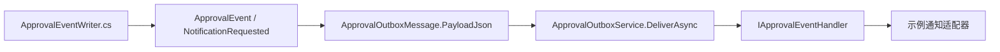

# 开发期旧版本兼容清理计划

状态：全部实施及两次补查完成。最新深度复查后端 667/0/0、三种服务数据库各 56/0/0、前端定向 21、类型检查/库构建、契约及包消费者通过。初轮的前端 181+6、边界 7、浏览器 5，以及三种数据库的真实认证/原生恢复/TCP 故障演练结果保留为前轮证据。原完整脚本在浏览器 fixture 失败，修正后单独重跑浏览器成功，未将原退出码伪报为零。详见 `docs/unreleased-compatibility-cleanup.md`。

执行依据：用户明确说明项目处于开发阶段，`samples/` 仅为示例，没有其他宿主；允许直接修改当前 API、JSON 和初始化模型，无需旧宿主、旧库或旧消息的兼容桥。用户提供的 AGENTS.md 第 3 节要求大规模或高风险任务先写 `plans/<日期>-<主题>.md`，提醒用户在新会话实施；本文件是该执行入口。

基线 HEAD：`b83c3c24a088ecdb7de9798b3f80ab974a43ca57`。当前工作区含上一轮异步校验、严格幂等和统计预算的已暂存及未暂存修改；实际执行必须保留这些变更，不能用 HEAD 覆盖工作区。

执行补充：审查还发现前端 `contracts/api.ts` 为旧调用方保留不完整 ApprovalTask 投影及可缺省 DirectoryUser.isActive。同步改为完整生成响应类型，补齐测试数据；目录未解析用户使用明确 isActive=false 的占位并验证后续可重新解析，不伪装成可用用户。

## 目标和边界

- 删除真正用于解释旧数据或保留旧调用路径的代码，直接使用当前唯一实现。
- `samples/Certificate.Api`、`samples/Approval.Certificate`、`samples/Approval.ReferenceHost` 是仓库示例；`eng/consumers/EmbeddedHost` 是包验证夹具。它们都随当前源码更新，不作为已发布宿主的兼容边界。
- 不新增旧格式转换器、双读适配、Obsolete 转发、旧程序集转发或旧库升级工具。
- 保留审批流程的业务版本绑定：新发布版本不改写在途审批。这里的“旧流程发布版本”是现有业务能力，与旧软件兼容不同。
- 保留严格命令预约、请求摘要、同键重放、未知提交恢复、当前权限检查、实例并发令牌、日志唯一序号及 Outbox 至少一次投递。
- 不删除表单权限、隐藏字段、通知路由、动态表单模块或宿主扩展能力；它们仍被当前功能使用。
- 不升级 SDK/NuGet/npm，不推送、不发布、不删除用户现有数据库或附件目录。

## 已确认的清理项

| 类别 | 当前代码依据 | 实施决定 |
| --- | --- | --- |
| 旧幂等结果擦除兼容 | `Domain/OperationEntities.cs:20` 明确声明 IsTombstone 仅兼容旧版本；`Persistence/ApprovalCommandExecutor.cs:50` 返回 ReplayExpired | 删除 IsTombstone、EF 映射、ReplayExpired 错误及 HTTP 410/前端专用分支；当前幂等结果永久保存与防重保持 |
| 旧通知 Outbox 转换 | `Engine/ApprovalOutboxService.cs:197` 将 Notification 旧载荷补装为 ApprovalEvent；当前 `Runtime/ApprovalEventWriter.cs` 已直接产生 NotificationRequested 事件 | 删除转换分支。Outbox 只投递 ApprovalEvent；同步删除仅用于两种旧载荷区分的 OutboxKind/Kind 字段、DTO 字段和前端展示 |
| 旧公开构造器 | `ApprovalEngine.cs:48`、`ApprovalDefinitionService.cs:36`、`ApprovalOutboxService.cs:60`；仓库 DI 直接调用另一组 internal 构造器 | 删除三组公开适配构造器；只保留当前 DI 路径，删除无用参数及仅用于旧构造的默认依赖 |
| 无协议版本 JSON 默认按 v1 读取 | `Definitions/FlowDefinition.cs:44`、前端 `features/flow/flowVersion.ts:7`；共享用例 default-version 当前接受缺省版本 | 外部 JSON 必须显式 schemaVersion=1，前后端均拒绝缺省；源码直接 new FlowDefinition 可继续初始化为当前版本，序列化始终写版本 |
| 当前文档仍宣称旧契约不可变 | `docs/forms.md:15`、`docs/contracts-and-release.md:15`、`docs/transactions-and-idempotency.md:103` | 当前文档以未发布项目为准；移除对已发布宿主、旧字段和旧消息的兼容承诺，历史报告标注其结论已被本轮替代 |

“旧公开构造器”还会漏掉当前 DI 注入的生命周期/Forms 扩展或可靠事件处理器。删除后以 AddApprovalWorkflow 注册路径为唯一来源，不新增另一套公共组合入口。

## 保留项与误判排除

| 搜索命中 | 保留理由和处理 |
| --- | --- |
| FlowNode.FieldPermissions、FieldAccess、FieldsWith、HiddenFields | 当前 Forms 校验、可编辑字段、数据/审计投影、附件授权和设计器直接使用。保留真实功能；改正“仅为已发布契约兼容而保留”的文档，不借本轮重构模块快照布局 |
| ChannelInfo、NotificationRule.Channels、元数据 Channels | 当前表示通知路由及设计器选择，仍被实际写入和消费。去掉 FlowValidationContext 中“名称保留以兼容”的注释；不为删除一个注释引入全仓路由改名 |
| HashVersion=1、ResultVersion=2 及不匹配时拒绝重放 | 当前只接受一种摘要/结果格式，并没有读取旧格式的适配器。保留版本保护和完整结果资源；不为重置数字而改动未知提交恢复协议 |
| FlowDefinition.CurrentSchemaVersion、未来版本拒绝 | 当前协议边界，保留。删除的只是“外部输入缺省版本时猜测为 v1” |
| 通知 fallback、浏览器存储不可用 fallback | 分别是当前产品默认通知和稳定键恢复能力，均与旧版本无关 |
| 无 Timeout 策略但存在 NextRemindAt 的防御清理 | 防止异常记录被后台反复扫描，且参与实例并发检查。保留逻辑；把测试名中的 Legacy 改为 Inconsistent/Unconfigured，避免与软件版本迁移混淆 |
| ApprovalHostServices、Extension/写权限边界 | 负责限制宿主扩展写权限并复制返回集合，是安全机制，不是兼容壳，保留 |
| EF 多 Provider、IdentityDbContext、SaveChanges override、Save(false)/池化 | 当前集成能力和生命周期正确性，不属于旧软件兼容，继续验证 |

清理后的投递路径：



## 实施顺序与文件

### 1. 固定工作区与失败用例

- [x] 对比执行时 HEAD、暂存区和工作区，记录上一轮现有修改；不执行 reset/restore/clean。
- [x] 按任务加载 karpathy-guidelines、aspnet-core；测试修改使用 code-testing、运行使用 run-tests，Vue/TS 前端改动按 vue-best-practices；检查仓库 overlays。
- [x] 基于当前源码验证基线，不用上一轮 641/56 等数字冒充本轮结果。
- [x] 先调整共享 JSON 协议用例：缺省版本应拒绝，显式 v1 正常；保留未来版本、null、字符串、负数、非整数等拒绝规则。
- [x] 为当前 NotificationRequested 投递、回滚/重试和非法旧载荷拒绝准备明确回归；不能通过只删旧测试得到“通过”。

### 2. 收敛 DI 构造

- [x] 删除 Engine、DefinitionService、OutboxService 的三组公开适配构造器，迁移任何新出现的仓库内直接调用。
- [x] 删除 DefinitionService 未使用的 ApprovalOptions 参数，更新服务注册。
- [x] 删除 OutboxService 未使用的 ApprovalExtensionCatalog 参数；IApprovalScopeFactory 与共享 ApprovalOutboxSignal 改为必需依赖，删除 new ApprovalOutboxSignal 的备用路径。
- [x] Dispatcher 明确关闭时 EventHandler 仍允许缺省；目录、状态提供者、Forms/lifecycle 等真正可选扩展继续保持原语义。
- [x] 验证 Core-only 和 Forms 示例 DI 均可完整构造，模块校验、生命周期和事件处理器均实际被调用；不删除 ExtensionCatalog/HostServices 的懒加载和安全边界。
- [x] 遗漏复查补齐：删除 Dispatcher/TimeoutScanner 两个忽略参数的旧构造重载，accessor 三项依赖改为必填，并删除不再可达的 MissingApprovalAuthorization/空命令执行器分支；重新运行后端、契约与独立消费者验证。

### 3. 删除旧幂等擦除协议

- [x] 删除 ApprovalOperation.IsTombstone 与 ApprovalModelBuilderExtensions 对应并发映射。
- [x] 删除 CommandExecutor 的墓碑分支、ApprovalErrorCode.ReplayExpired 及 ApprovalExceptionHandler 的 410 映射，不影响有效操作记录的当前权限复核。
- [x] 删除 useCommandIntent 的 ReplayExpired 专门保留逻辑和专用测试；保留网络错误/CommitOutcomeUnknown 后复用原键及原内容的用例。
- [x] 修改 Approval.RehearsalTool：不再制造已擦除结果；用真实保留的已完成操作验证备份恢复后的重放不产生第二次业务副作用。
- [x] 保留 RequestHash、LookupHash、HashVersion/ResultVersion、唯一预约及未知提交核验；不改为业务键代替请求幂等。

### 4. Outbox 仅保留当前事件格式

- [x] 删除 OutboxKind 枚举及 ApprovalOutboxMessage.Kind，删除 EF 列配置、响应 DTO/From 映射、前端类型与 OutboxView 的类别展示、日志中的 Kind 参数。
- [x] DeliverAsync 直接反序列化并投递当前 ApprovalEvent；删除从旧通知载荷补装空业务/定义标识的分支。
- [x] 对缺少当前事件必要字段、无效 JSON/旧裸通知载荷明确报错，进入既有失败/退避机制；不得将无 EventType 的旧 JSON 静默确认成功，也不得重新引入格式转换器。
- [x] NotificationRequested、DeliveryTarget 和 ApprovalNotificationRequest 仍是当前事件的有效内容，不删除通知业务能力。
- [x] 更新引擎生产者、测试夹具、shared/http-resources-v1.json 及 HTTP 契约测试；只更新受本轮影响的当前断言，不把整个 HTTP 测试当旧兼容测试删除。
- [x] TestHost.NotificationOutboxAsync 只识别当前事件，不保留 Notification 或条件。
- [x] RehearsalTool 的恢复样例写入真实当前事件；保留稳定事件 ID、处理器事务回滚、失败重试、人工重试和权限检查。

### 5. 外部流程 JSON 显式声明版本

- [x] FlowDefinition.Parse/反序列化边界要求 schemaVersion，缺失返回 InvalidDefinition；直接创建 C# FlowDefinition 的默认当前版本不受影响。
- [x] 前端 FlowDefinition.schemaVersion 改为必填，flowVersion 删除 undefined -> 1 的猜测；缺省导入/设计器加载明确报错。
- [x] 通过当前构造器/序列化器及逐文件修改更新样例流程、tests 中常量/共享 JSON、浏览器 fixture、rehearsal 和独立包消费者，全部显式写 schemaVersion=1。
- [x] 不在 API/测试全局包装器中自动补版本，这会把兼容层换个位置；缺省版本负例必须直接经过真实解析器。
- [x] ContractTool 的 flow JSON Schema 将 schemaVersion 列入 required，保留当前 const=1；前后端共享 definition-cases.json 的同一组结果。
- [x] 验证发布、草稿、实例公开图、Forms、流程克隆与序列化往返均正常；未来版本拒绝不能被默认值覆盖。

### 6. 重建开发期模型基线、契约与文档

- [x] 九套上下文重生成当前 InitialApproval/snapshot：Certificate 的 AppDbContext；ReferenceHost 和 Database.Tests 各 Sqlite/MySql/SqlServer/PostgreSql 四套。当前每套为迁移、Designer、Snapshot 共 27 个生成文件。
- [x] 使用 EF 生成器重建，不能只手删 Snapshot；不新增兼容迁移、旧库搬运/回填或 Notification 转换 SQL。操作前确认目标限于对应源码 Migrations 目录；不删除本地样例数据库。
- [x] 先重建以当前模型编译的程序集，再用 dotnet ef migrations add InitialApproval；Certificate 使用 samples/Approval.Certificate 与 samples/Certificate.Api startup、Infrastructure/Migrations；其余使用各自项目的设计时工厂与 Migrations/<Provider>。执行时复核实际上下文/路径后生成。
- [x] 通过 pnpm contracts:update 生成并审查 C# API、OpenAPI、Flow Schema、TypeScript；不手工改生成基线。
- [x] 更新 README、CHANGELOG、forms、transactions-and-idempotency、contracts-and-release、upgrade-0.3 等当前文档，明确没有其他已部署宿主；历史审计报告增加本轮计划/结果链接与替代说明，不伪造历史验证。
- [x] 测试中的 v1 命名若仍表示当前协议可以保留；把“保持旧版本”改为“当前契约稳定、DTO 隔离”的实际目的。
- [x] 新增最终执行报告，列出删除清单、保留理由、精确命令、退出码、测试计数与产物路径。

## 验收矩阵

以下是实施验收要求，全部完成证据、原始失败与最终成功产物路径见执行报告。

| Requirement | Evidence |
| --- | --- |
| 没有墓碑兼容协议 | 生产源码/API/新迁移无 IsTombstone/ReplayExpired；带键重放、不同内容冲突、权限撤销和未知提交恢复仍有行为断言 |
| Outbox 仅当前事件 | 当前通知完整投递、稳定 ID；旧裸通知/非法载荷进入失败并不调用处理器；处理器失败后业务回滚、重试成功且不重复已提交副作用 |
| 唯一 DI 路径 | 无三组旧公开构造器；Forms/lifecycle/事件处理器在真实 DI 作用域被调用；Core-only 消费者不引入 Forms |
| 显式协议版本 | 共享 C#/TS 用例缺省拒绝，当前 v1 往返成功，未知/非法版本拒绝；HTTP 发布及设计器正反例一致 |
| 字段/附件安全保持 | FieldPermissionTests、投影/审计隐藏、附件可见性与服务端元数据校验继续通过 |
| 当前审批语义保持 | 发布版本绑定、加签/退回/并行汇聚、命令严格幂等、陈旧审批日志冲突、超时防御清理、失败 scope 保护继续通过 |
| 四 Provider 的新初始化模型 | 九项 model drift 无变化；SQLite 与三种真实数据库实际建表、迁移回滚/重放和完整数据库测试无失败/跳过 |
| 可交付包 | NuGet/npm 独立消费者、类型检查、契约检查和浏览器 5 场景全部成功；恢复演练适配当前协议并实际运行受影响阶段 |

标准入口（仓库根目录；具体定向测试按 run-tests 与实际框架选择）：

```powershell
Set-Location 'D:\Study\CSharp\Workflow'
$env:DOTNET_PROCESSOR_COUNT = '4'
dotnet build 'Workflow.slnx' --configuration 'Release'
pnpm --dir './web' 'contracts:update'
pwsh -NoProfile -File './eng/verify.ps1' -SkipRestore
pwsh -NoProfile -File './eng/verify-databases.ps1' -Provider 'MySql' -SkipRestore -SkipBuild
pwsh -NoProfile -File './eng/verify-databases.ps1' -Provider 'SqlServer' -SkipRestore -SkipBuild
pwsh -NoProfile -File './eng/verify-databases.ps1' -Provider 'PostgreSql' -SkipRestore -SkipBuild
```

RehearsalTool 的 seed/auth/restore/network 阶段依赖 eng 现有演练脚本及隔离数据库、附件目录。执行时先读取相关脚本参数，运行受本轮 seed/restore 改动影响的演练；不可拿用户数据库作为夹具，不把只编译工具当作恢复验证完成。

## 风险与回滚

- 删除列、枚举和构造器以及将 JSON 版本设为必填会破坏旧源码/旧数据读取，这是本轮明确接受的开发期变化；不增加兼容路径抵消它。
- 不能重置业务流程发布版本或删除历史实例绑定功能。不能用删功能来清理 FieldPermissions/HiddenFields、通知路由、宿主安全包装。
- 重新生成初始迁移只影响源码基线；测试仅使用新建、带所有权标记的可丢弃容器/数据库。已有开发库、附件内容和用户其他 Docker 容器均不自动清理。
- 回滚以本轮独立补丁/提交为单位；保留开始时的暂存区和工作区证据。若需要数据库回滚，只重建本轮自己的测试数据库；不自动 reset/clean 或还原上一轮用户变更。
- 如果出现“缺模块时静默接受定义”“旧消息被确认成功但未投递”“当前权限撤销后仍可重放”“并发失败泄漏副作用”，停止后续门禁并修复根因，不通过修改期望值、放宽校验或启用兼容分支规避。

## 执行会话入口

深度复查补充（用户再次授权检查后实施）：合并治理列表旧签名，删除 Core/Forms 旧校验转发，删除并行状态中无消费者的 ActivationId 与重复 Arrived，移除前端缺失 round 补零；另已复现并修复非对象 JSON 根节点导致发布接口 500 的问题。新增直接解析与 HTTP 零残留回归，最终验证见清理报告的深度复查节。

按本计划直接实施，用户已授权删除旧版本兼容并接受更新所有仓库示例。执行前复核当前工作区与本计划仍一致；无需为上述已确认 API/模型变化再次征求相同许可。若发现当前生产者仍产生被判为旧格式的记录，先更正清单并迁移该生产者，不能只删除消费者。
