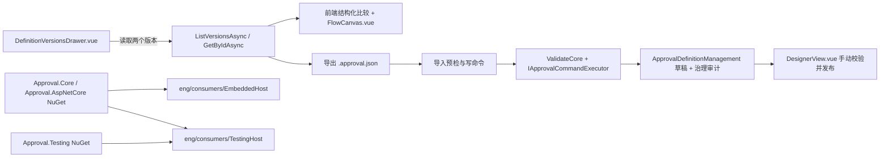

# WorkflowDemo 阶段二产品化实施计划

日期 2026-11-05。勘察基线 `main` / `df1739f2e0eb171bfd91208b9ab2e82f01d76fd3`，开始时工作区干净。P1、P2、P3 已随 `480143de63ee91139ffbc6d5880e0221ac488a97` 实施。下文保留原始实施清单，实际交付与验收以本节记录为准。

## 最终验收记录

| 工作包 | 已实现 | 已验证 |
|---|---|---|
| P1 版本对比 | 已发布快照的结构化差异、筛选、交换及只读画布定位 | `definitionDiff.test.ts` 验证格式、字段、规则和路由差异。`ReadVersionSnapshots_ForComparison_LeavesGovernanceAndRuntimeUnchanged` 验证读取无写入。包浏览器验证交换、筛选和定位 |
| P2 导入导出 | 单个 JSON 包、只读预检、目标新 Key 草稿、原键恢复 | `DefinitionTransferEndpointTests` 验证权限、格式与大小、Forms、回滚和提交结果未知。`ConcurrentImportsWithDifferentKeys_CommitExactlyOneUnpublishedDraft` 验证并发。包浏览器验证导出、缺少 Resolver、丢失响应恢复 |
| P3 宿主测试工具包 | 独立 `Approval.Testing` NuGet、`TestingHost`、测试替身与公开契约 | `TestingHost` 22 项、`EmbeddedHost` 18 项通过。`verify-packages.ps1` 核对依赖图、实际还原的包哈希与场景结果，Certificate、ReferenceHost 和 npm 独立消费者通过 |

| `480143d` 的 CI 检查 | 通过 | 失败 | 跳过 |
|---|---:|---:|---:|
| Windows .NET Core / HTTP / SQLite / Certificate | 613 / 135 / 82 / 59 | 0 | 0 |
| MySQL / PostgreSQL / SQL Server | 各 82 | 0 | 0 |
| UI / Demo Vitest | 252 / 6 | 0 | 0 |
| Playwright 包浏览器 | 9 | 0 | 0 |

Windows `./eng/verify.ps1` 完成 Release 构建、模型漂移检查、ReferenceHost、契约和独立包验收。服务数据库执行各自的 `./eng/verify-databases.ps1 -Provider <Provider>`。以上数量来自对应作业日志。 [基准提交的 GitHub Actions](https://github.com/ttcc666/WorkflowDemo/actions/runs/42065839666)

生产加固审查另行跟踪布局统计、导入预检乱序，以及单实例部署的运行边界。上述基线结果只对应 `480143d`。 [生产准备审查](2026-11-production-readiness.md)

## 范围与不变量

- P1 在现有版本抽屉里做纯结构化比较，复用已授权的定义快照和只读画布。比较期间发布版本、活动版本、草稿、实例、治理审计、Operation 和 Outbox 均保持原状态。
- P2 使用单个 UTF-8 `.approval.json` 文件。首版仅接受尚未占用的目标 Key，成功后产生未发布设计草稿、治理审计和 Operation。草稿后续校验与发布走现有设计器入口。
- P3 交付独立 `Approval.Testing` NuGet。测试替身基于 Core 的宿主接口，宿主持有 DbContext、数据库 Provider 和测试框架。`EmbeddedHost` 继续验证现有宿主的独立包消费，另设 `TestingHost` 验证测试包消费。
- 全程维持审批运行语义、历史版本不可变、实例版本绑定、宿主授权默认拒绝、Forms 可选、写入保护以及既有事务与 Outbox 边界。方案以现有数据库模型为前提，若发现必须改动模型，先记录证据和受影响的四类 Provider，再单独评审。



## P1 流程版本差异对比

`DefinitionAndMessageEndpoints.cs` 的版本列表已经返回 `ApprovalDefinitionResponse.DefinitionJson`、Key、名称、版本号、`CreatedAt` 和 `IsPublished`。`ListVersionsAsync` 先按 Key 检查 `DefinitionReadSensitive`，再逐条按版本 ID 过滤。前端可直接使用这批已授权的快照，版本详情保留 `definitionById` 的原有授权。此工作包按当前基线无需新增 HTTP 路由或公共 C# 类型。

- [ ] 在 `web/packages/approval-ui/src/features/definitions/` 增加内部 TypeScript 纯函数，输入两个已发布快照，校验 Key 一致且 ID 不同，输出稳定排序的流程、节点、规则、路由和 Forms 差异。只解析选中的两个版本，复用现有 schemaVersion 检查。
- [ ] 节点按 `nodes` 字典 Key 对齐。比较名称、起点、`settings.category`、发起设置、流程与节点通知，以及节点的类型、审批方式、审批人规则、空审批人策略、退回/转交/加签、时限、字段权限和 `next`。画布坐标可归为布局变化，统计时与业务规则分开。以实际 schema 为范围。
- [ ] JSON 对象的属性顺序和格式空白无差异。通用比较保留数组顺序，尤其是审批人、通知、条件与并行分支。条件分支没有稳定 ID，先对齐完全相同的项，再对唯一可匹配项显示表达式、优先级、目标或默认分支变化，歧义项显示增删。分支顺序变化单独呈现，结果固定排序只用于展示。覆盖分支指向 Join 及 Join 后继的变化。
- [ ] Forms 使用前端已有 `FormSchema` 类型。表单字段按字段 Key 对齐，比较类型、必填、默认值、公式等配置，节点字段权限与节点对齐。字段顺序及嵌套配置的变化独立呈现，Core 继续将表单视为可选快照。
- [ ] `DefinitionVersionsDrawer.vue` 持有已授权版本和入口。比较子组件接收已发布版本，负责基准/目标选择、交换、选择最新可读版本、统计、类型与节点筛选、前后值和空状态。复用 `toFlowElements` 和 `FlowCanvas.vue` 的只读模式，新增/修改节点定位到目标图，删除节点定位到基准图。画布使用独立派生数据，点击和高亮只影响比较视图。切换 Key、身份或关闭抽屉时清理敏感快照与选项。
- [ ] Vitest 覆盖相同快照、对象键重排、节点增删改、规则参数和顺序、条件表达式/优先级/默认分支、连线、并行、Join、表单字段/权限以及多种变化并存和结果稳定。交互覆盖交换、最新版本、筛选、定位、相同或跨 Key 的选择、身份切换。补充 HTTP 回归，证明 Key 权限不足或只有单个版本权限时，原 API 不泄露另一份快照。检查只读请求前后持久化记录一致。
- [ ] 交付 `docs/definition-version-diff.md`，通过 Frontend、Backend、Contracts 门禁。回滚时移除比较入口及对应内部代码，继续使用现有版本列表。

## P2 流程定义导入导出

`SaveDesignDraftAsync` 有权限、Revision、来源 FK 和写入保护，设计上允许未完成的草稿。`ValidateCore` 已基于已注册 Resolver、渠道描述符和 `IApprovalDefinitionExtension` 执行完整校验。`CopyAsync` 已检查新 Key 冲突，复用其检查和草稿写入的共同部分。`DraftSourceDefinitionId` 关联目标库里的本地发布版本，跨环境来源记录在治理审计 `ChangeNote` 中。

### 文件和 HTTP 契约

- [ ] 包格式固定 `packageVersion: 1`、`kind: "approval-definition"`、`source`（原 Key、名称、发布版本、发布时间）及对象型 `definition`。嵌套 `definition.schemaVersion` 维持 `1`，流程格式沿用 `flow.schema.json`。由 `Approval.ContractTool` 生成独立包 Schema，并加入 `web/scripts/contracts.mjs` 校验清单。只导出配置和必要的来源元数据。保留 Resolver 参数、通知路由提示和 Forms 快照，文档提示在目标宿主复核这些依赖。导入时视来源为文件声明，限定长度和类型并以纯文本呈现。
- [ ] 导出使用 `GET /definitions/by-id/{id:guid}/export`。复用 `GetByIdAsync` 的版本资源授权，要求 `IsPublished`，输出完整配置及对应版本元数据。使用 JSON 响应和清理过的浏览器下载文件名（如 `purchase-v3.approval.json`），响应设为 `no-store`，避免在日志记录文件正文。
- [ ] 预检与提交使用 `POST /definitions/{key}/import/validate` 和 `POST /definitions/{key}/import`。目标 Key 来自路由，两个入口使用目标 `DefinitionDesign` 资源权限，提交进入现有受管理命令。把预检作为明确的只读例外接入 HTTP 命令分类，单测证明两个路由的分类。预检和提交共用解析、完整定义校验与目标检查，提交在写入时重新检查；预检结果不作为提交凭证。成功提交返回目标 Key 和草稿 Revision 等最小回执，设计器仍按现有权限读取草稿。
- [ ] HTTP 请求 DTO 携带文件原始字节的 Base64（仅 HTTP 传输使用）。计划文件上限 1 MiB，请求体上限 1.5 MiB。客户端在读文件前按字节拒绝超限，服务器在绑定/缓冲前限制请求体且覆盖无 `Content-Length` 路径，解码前检查编码长度，解码后限制文件大小，并保留现有草稿 JSON 字符数约束。使用严格 UTF-8 和现有 JSON 深度限制，拒绝非法编码、重复关键属性与无效包版本，避免解析过程中丢失不认识的配置。明确报错与 ProblemDetails 映射。大于导入上限的历史版本仍可导出，界面提示超限文件需要通过现有设计器重新整理。

### 写入与界面

- [ ] 在 `ApprovalDefinitionService` 增加明确的导入入口，复用 `FlowDefinition.Parse` 与 `ValidateCore`，避免复制发布校验。验证 Resolver 类型和参数、通知接收人与渠道描述符、Forms 快照及字段权限依赖。渠道检查依据宿主已声明的描述符，连接外部渠道、识别目标用户或转换组织映射属于宿主。给缺失扩展返回可操作的名称或字段路径。
- [ ] 在 `ApprovalWriteOwner.Definitions` 和现有 `IApprovalCommandExecutor` 边界内校验目标 Key，检查管理记录及已发布定义，再复用受保护的草稿持久化。现有唯一键和精确 `GovernanceConflict` 转换兜底并发同 Key。按 `DraftSaved` 追加治理审计，`ChangeNote` 记录来源 Key 和版本，沿用草稿摘要及可信操作人，外部来源 ID 不写本地 FK。提交后应为 `LastVersion == 0`、`ActiveDefinitionId == null`，启用标记使用现有新流程默认值。导入路径不调用发布或审批事件逻辑。
- [ ] SDK 在 `api/approval.ts` 增加预检、提交和导出入口。提交使用现有 `Idempotency-Key`，命令摘要包含目标 Key 和携带原始文件字节的请求参数，回放优先于目标冲突判断。相同操作人、键和内容返回第一次结果，原键携带任意不同文件字节时拒绝。导入弹窗接入 `useCommandIntent`，提交结果未知或网络异常时保留原键及原文件的重试入口，浏览器存储仅保留现有键和摘要。身份切换后清空敏感 UI 数据，回调不得跨身份复用。
- [ ] 版本抽屉提供导出选中版本入口，`DefinitionsView.vue` 提供导入入口，使无流程的目标环境也可导入。弹窗负责文件选择、来源预览、目标 Key、预检及依赖错误。成功后导航到目标 Key 的现有设计器，显示未发布草稿及目标 Key。失败提示区分格式、超限、权限、冲突、缺少依赖及结果未知。

### P2 验收

- [ ] Core/HTTP 测试覆盖导出指定发布版本、导入/导出往返、包版本与 schemaVersion 分离、无效 UTF-8/JSON、重复关键属性、请求体与文件边界、非法流程图、未知 Resolver、未声明渠道、有/无 Forms。解析失败或扩展校验失败后，用新 DbContext 核对管理、定义、审计、Operation、实例及 Outbox。
- [ ] 验证预检不写入，未授权导出/预检/提交不返回敏感配置；已存在草稿、发布版本及预检后竞争占用目标 Key 时拒绝。两个不同命令同 Key 并发仅一个成功。注入保存或提交故障，证明无部分写入，验证同键回放、同键不同字节冲突、未知提交结果后原键恢复。成功后核对只多出一个草稿、一条治理审计和一条 Operation；手动发布才创建 v1。首版以已有 Key 拒绝测试代替覆盖草稿的 Revision 测试，现有编辑/发布 Revision 测试照常执行。
- [ ] 前端测试覆盖从空列表导入、文件预览、超限、缺依赖、原键恢复及成功进入草稿。更新 `docs/definition-import-export.md`，生成并审阅 API、OpenAPI、包 Schema 和 TS 契约，执行 Backend、Frontend、Contracts 门禁。回滚时成组撤下导入导出 API 与 UI，已保存的草稿和审计仍由现有治理能力读取与处理。

## P3 宿主集成测试工具包

`eng/consumers/EmbeddedHost` 已用真实 NuGet 包验证宿主已有 `IdentityDbContext`、业务表、`SaveChanges` override、Migration 和真实审批行为。它继续只引用 Core/AspNetCore。新 `TestingHost` 则从包验证测试工具 API，数据库和断言由该消费者自行选择。

- [ ] 新增 `src/Approval.Testing/Approval.Testing.csproj`，沿用 `Directory.Build.props` 的版本与打包设置，添加到 `Workflow.slnx`。依赖 `Approval.Core` 和实现需要的 DI 库。可控时间复用仓库已使用的 `Microsoft.Extensions.TimeProvider.Testing`，通过显式选项替换 `TimeProvider`。保持独立于 ASP.NET Core、Forms、具体测试框架和数据库 Provider。
- [ ] 按职责提供测试替身。用 `IApprovalContextResolver` 控制测试操作人，用 `IApprovalIdentityProvider`、`IApprovalUserStatusProvider`、`IApprovalUserDirectory` 共享可配置用户和角色。授权实现 `IApprovalPermissionProvider`，默认拒绝，显式指定主体、权限及资源匹配，支持撤销和故障注入。QueryScope 场景在独立消费者注册其自身的 `IApprovalQueryScope`，测试真实数据库过滤后再计数和分页。
- [ ] `IApprovalEventHandler` 保存投递尝试快照，可按 `Event.Id`、类型和实例查找，支持指定事件故障和重试次数。记录尝试与宿主副作用去重分开。测试通过真实 Outbox Dispatcher 或既有 Worker 到达处理器，结合可控时间验证重试间隔，保留真实事件 ID 与投递状态。
- [ ] `AddApprovalTesting` 显式声明替换的宿主接口和注册顺序。将可变测试数据限制在各自 ServiceProvider，事件/用户/授权状态用同步保护与快照隔离。操作人使用按调用链恢复的作用域，支持不同逻辑调用并发、嵌套和释放，并覆盖命令执行器创建的新作用域。保持 HTTP Claims、宿主业务回调、QueryScope、DbContext 及迁移仍由宿主提供，测试时按需注册替换项。覆盖默认拒绝、未知/停用用户、权限撤销、跨资源拒绝、并行身份隔离和时间控制。
- [ ] 新增 `eng/consumers/TestingHost`。消费者显式注册其 DbContext、SQLite 持续打开连接、`AddApprovalWorkflow` 和测试工具，从构建产出的隔离 NuGet feed 还原，通过真实入口执行。保留 `EmbeddedHost`、Certificate、ReferenceHost 及 npm 消费者的原有验证。
- [ ] 独立消费者覆盖创建/发布/启动，业务与审批一起提交，审批失败和业务委托异常分别回滚，同键重放，提交结果未知后原键恢复。复用仓库现有故障注入模式，在消费者内显式注入并从新 scope 断言真实持久化状态。覆盖权限拒绝/授权成功、身份切换、停用与 QueryScope，覆盖同意、驳回、退回、重新提交、转交、加签、撤回、并行 Join。验证真实 Outbox、投递失败与重试、同一 Event.Id 和宿主按 ID 去重。
- [ ] 更新 `eng/verify-packages.ps1`。区分现有生产包清单与全部打包产物清单，给测试包补充 manifest/hash 和独立消费者执行证据。核对 `.nuspec`、消费者依赖图和实际还原包哈希，证明生产包及 `EmbeddedHost` 的依赖图无 `Approval.Testing`，测试包无测试框架或数据库 Provider，`TestingHost` 解析的是本次构建的 NuGet 而非 ProjectReference 或缓存旧包。原有消费者仍须通过。
- [ ] 更新 `eng/Approval.ContractTool`、`web/scripts/contracts.mjs` 和 `contracts/Approval.Testing.api.txt`，审查实际公共 API，交付 `docs/testing-toolkit.md`、README 和嵌入宿主文档的使用入口。通过 Packages、Backend、Contracts 门禁。回滚时成组移除测试包、独立消费者、契约基线和打包清单项，已有宿主验收继续独立运行。

## 整体回归与交付

在仓库根目录执行。Backend、Frontend 和 Contracts 用于 P1/P2，Backend、Contracts 和 Packages 用于 P3，最后执行完整门禁。

```powershell
pwsh -NoProfile -File './eng/verify.ps1' -Scope 'Backend'
pwsh -NoProfile -File './eng/verify.ps1' -Scope 'Frontend'
pwsh -NoProfile -File './eng/verify.ps1' -Scope 'Contracts'
pwsh -NoProfile -File './eng/verify.ps1' -Scope 'Packages'
pwsh -NoProfile -File './eng/verify.ps1'
```

- [ ] 审阅全量 diff 和生成契约，核对各阶段的授权、事务、运行状态机、Forms 与包依赖。对有意的契约变更在 `web/` 执行 `pnpm contracts:update`，逐项审阅生成文件后再执行 Contracts 门禁。文档按最终实现记录，阶段一验收保留为历史。
- [ ] 按仓库约定记录本地 SQLite、Windows verify 和 GitHub Actions 的 MySQL、PostgreSQL、SQL Server 结果。服务数据库专项只在 CI 执行，报告对应确切实现 SHA。区分实际测试、仅编译、失败、跳过与未执行。提交、推送及发布由用户明确授权后执行。
- [ ] 最终报告按 P1/P2/P3 列出入口和真实行为、契约及包变化、数据库模型影响、回归测试统计、独立消费者与 CI 证据，以及余下限制。
