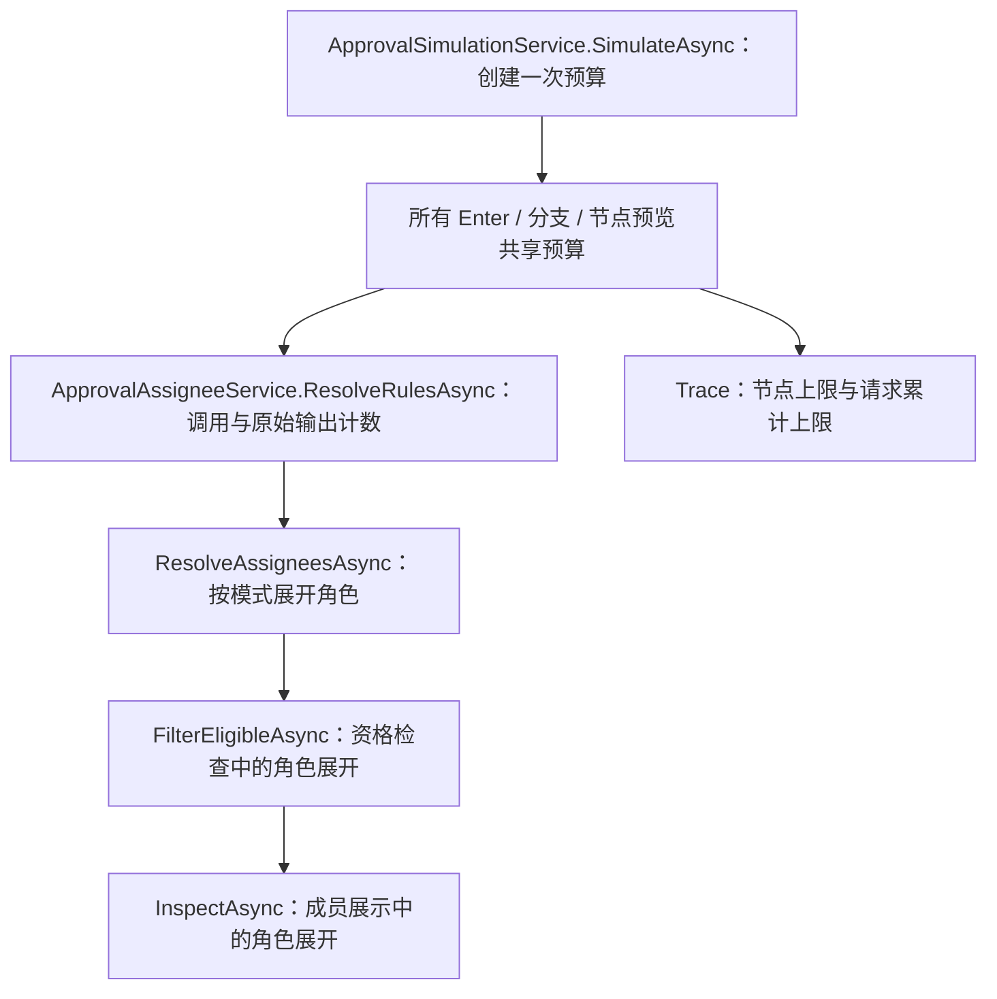

# 上轮审查稳定性修复实施计划

日期：2026-11-05（Asia/Shanghai）。状态：用户授权“按计划修复”后已完成两批代码修复与本地验收；三个服务数据库待未来修复提交的 CI 验证。实际实现、测试名、命令和结果见 [修复报告](../docs/review-stability-fixes-report-2026-11-05.md)。下文保留原规划依据及建议测试名，不作为实际通过证据。

## 1. 基线、范围与执行约定

- 仓库：`ttcc666/WorkflowDemo`，工作目录：`D:\Study\CSharp\Workflow`。
- 当前分支：`main`；HEAD、审查基准与 merge-base 均为 `4d9dab101e6500d8f8b1e6a87de93824e85e6aba`。开始时工作区干净，无基准之后的提交。
- 已读取相关实现、现有 Core / HTTP / 数据库测试、验证脚本，以及架构、权限、事务幂等、诊断、模拟、数据库验证文档。
- 本次跨人员资格、并发失败汇总和资源保护，规划轮按用户全局工作约定第 3 节先写计划；后续用户已明确授权执行。本次实现范围与验收记录见修复报告。
- 实施分两批：第一批正确性与验收描述，第一批本地门禁通过后再实施第二批模拟预算。未获明确提交授权时仅保留两个可审阅的逻辑改动集；不自动 commit、push 或 merge。

不变量（必须持续成立）：

- 保持公共 C# API、HTTP / JSON / TypeScript 契约、错误枚举、流程 schemaVersion 和数据库模型；预期没有 Migration、Snapshot 或依赖变更。
- 保留宿主用户 / 角色 / 目录 / 状态接口与权限门禁；不从角色名推断授权，不向 Core 引入宿主实现。
- 保留当前审批状态机、正式运行的角色任务语义、自审限制和同一人跨节点审批限制。
- 保留 `UseApproval()` 写保护、同一 DbContext 事务边界、幂等预约、逐实例批量提交与部分成功语义。
- 模拟只读，预算对象只属于一次 `SimulateAsync` 调用，不能污染正式运行或同 scope 后续请求。

## 2. 审查结论核查

以下均为源码及现有测试的静态证据；尚未新增或运行复现测试。

| 问题 | 结论与证据 | 已有覆盖及缺口 |
|---|---|---|
| 角色任务异常漏报 | 存在。`ApprovalDiagnosticsService.cs:63-64` 使用节点级用户集合；Role 分支仅在整个集合为空时报错。`ApprovalAssigneeService.GetEligibleApproversAsync` 在第 137 行展开所有角色并去重，丢失具体角色来源。 | `OperationsQueryTests.DiagnosticFindingsCarryScopedResourceLinks_AndExposeSampleTruncation` 只覆盖 User 停用、范围和截断，没有双角色反例。 |
| 超期边界不一致 | 存在，而且原审查对统计实现的描述不完全准确。`ApprovalQueryService.cs:119` 为 `<`；`ApprovalStatisticsService.cs:126` 为 `now > due`，第 186-187 行积压也为 `<`。实例筛选第 267 行及诊断第 86 行已为 `<=`。前端 `labels.ts:87` 的 `diff < 0` 同样漏掉相等时刻。 | `OperationsOverdueFilter_TranslatesScopeAndPaginationOnEachProvider` 已覆盖实例筛选的相等边界；待办筛选、统计总数、积压分组和 UI 缺少对应一致性测试。 |
| 离职交接冲突汇总过宽 | 存在。`ApprovalEngine.Admin.cs:110` 仅按 InstanceId / AssigneeValue 回查；第 124-126 行候选查询还限制 User、三种开放任务状态和两种活动实例状态，并应用 QueryScope。 | `AdminTests` 覆盖普通交接，`StrictCommandBoundaryTests` 覆盖原键重放及部分完成恢复，未覆盖 Conflict 回查混入历史 / 角色 / 结束实例任务。 |
| 模拟累计资源预算缺失 | 存在。`ApprovalSimulationService.Enter` 每节点重建 trace，并在解析完成后检查结果数；`InspectAsync` 在成员去重与数组分配之后检查 200。角色在解析、资格过滤、成员展示处都可能展开；没有请求级共享计数。`FlowDefinitionValidator` 只做结构和规则校验，没有执行期累计预算。 | `SimulationUsesRuntimeAutomaticStepBudget` 只有 200 步限制；角色运行一致性、取消、只读已有测试，没有跨节点 / 跨角色累计边界。 |
| 报告误述 Reload | 存在。报告第 37 行写“页面刷新后”；`package.spec.ts:250` 开始的恢复用例仅 goto、提交、丢响应、同页重试，没有 reload。文件第 48 行另有 reload，属于别的用例。 | 目标用例已断言原 Header / 正文相等、最终 Approved 和单条 Approve 日志。`useCommandIntent.test.ts` 的“重建页面”用例实为重建 manager 并重新提供原正文。 |

## 3. 第一批：正确性与验收描述

### 3.1 按具体任务对象判断角色资格

涉及：`src/Approval.Core/Engine/Runtime/ApprovalAssigneeService.cs`、`Engine/ApprovalEngine.cs`、`Diagnostics/ApprovalDiagnosticsService.cs`，以及 Core 诊断回归测试。

- [ ] 先新增双角色回归：通过正常引擎在 A、B 均有效时创建或签 Role 任务，再撤销 A 成员或使其失效；不能一开始就令 A 无成员，因为正常建任务会过滤它，无法复现已有任务失效。
- [ ] 复用 `ResolveAssigneesAsync(... expandRoles: false)` 获取带 Kind 的真实解析对象，支持内置及自定义 Resolver 返回的 Role；不拆解规则字符串或比较角色名与用户 ID。
- [ ] 增加最小 internal 的任务对象资格入口。Role 路径保留其来源，只展开该任务对应的角色，使用现有 Identity、FilterEligible 与跨节点历史约束；不能以整个节点用户集合非空推断角色有效。若须验证其仍属当前节点规则，在保留来源的 `Assignee` 结果上完成。
- [ ] User 路径继续使用当前具体用户资格判断。公共 `GetEligibleApproversAsync` 的签名、宿主语义和调用者保持不变。
- [ ] Engine 的内部桥接保留当前 TaskRead / DiagnosticsRead 权限检查，以及按绑定定义重载真实实例、节点和完整任务历史的规则；诊断不得开放新的越权读取路径。
- [ ] 验证同一成员同时通过目录与状态检查；自审、目录缺失 / 停用、宿主状态、岗位资格与跨节点历史约束均复用现有规则。

建议测试文件：在 `OperationsQueryTests.cs` 扩充或新增 `DiagnosticsAssigneeTests.cs`。按可读性选一种，不拆空壳服务。

### 3.2 统一当前待办的超期边界

涉及：`ApprovalQueryService.cs`、`ApprovalStatisticsService.cs`、`web/packages/approval-ui/src/utils/labels.ts`，以及 Core、数据库和 UI 测试。

- [ ] 待办 overdueOnly SQL 条件改为 `DueAt != null && DueAt <= now`。
- [ ] 统计中当前 Pending 的 `now > due` 改为 `now >= due`；积压新建分组与已有分组两处均改为 `<=`。
- [ ] 保持已正确的实例筛选、诊断和超时扫描边界；不为这些路径制造无用修改。
- [ ] 前端 `dueText(dueAt, now)` 在 `diff == 0` 返回 overdue；利用其现有 now 参数测试，不新增时钟机制。
- [ ] 使用注入的 FakeTimeProvider 固定 UTC 时刻，覆盖早于、等于、晚于及 null；比较相同可见、活动、Pending 数据集上的待办、实例筛选、统计、积压和诊断结果。
- [ ] 分别覆盖积压字典的第一次插入和后续累计分支，不能仅验证单任务分组。
- [ ] 保留 null、权限范围、分页、任务状态与流程状态语义。统计总数含历史逾期完成任务，积压仅当前 Running，不能把不同统计口径误写为任何数据集都应相等。

范围解释：历史“超过时限才完成”的 `CompletedAt > DueAt` 及节点处理逾期率保持现有语义。它与“当前待办 DueAt <= now”不是同一指标，不做机械全局替换；增加恰好截止时完成的保护用例。

建议测试：新增 `tests/Approval.Core.Tests/OverdueBoundaryTests.cs`，扩充 `tests/Approval.Database.Tests/OperationsCenterDatabaseTests.cs`，新增 `web/packages/approval-ui/tests/utils/labels.test.ts`。

### 3.3 冲突后的交接汇总与候选条件一致

涉及：`ApprovalEngine.Admin.cs`、Core 管理测试和数据库交接测试。

- [ ] 在 Conflict 回查中使用与 `ReassignCandidatesAsync` 一致的可翻译查询：应用当前授权 QueryScope、连接实例，筛选目标用户的 User 任务、Pending / Waiting / Suspended，以及 Running / Returned。
- [ ] 选择最小表达方式；如能用一个本类内 private IQueryable helper 同时服务候选与回查，可共用，避免新增跨层抽象。不得将不可翻译的 `IsOpen` 方法直接放进数据库表达式。
- [ ] 通过受控 EF 冲突注入 / 已有并发测试同步手法进入真正的 Conflict 捕获分支。只针对选定实例触发，不能拦截计划预约或最终汇总保存。
- [ ] 回查数据同时包含目标用户的三种开放状态、历史状态、同值 Role 和他人 User。流程结束及范围撤销要在候选清单建立后、回查之前发生，才能覆盖对应过滤。
- [ ] 断言 Skipped 的精确 TaskId 集合、排除项、Count，以及其他实例已成功交接的最终状态、单条对应审计和原键重放结果。
- [ ] 不复用失败 item scope；保留当前外层协调查询与 executor 每实例新 scope、原 OperationId / Kind / Scope、最终汇总持久化。

建议在 `AdminTests.cs` 或独立 `BulkReassignmentConflictTests.cs` 加测试；在 `FinalAcceptanceDatabaseTests.cs` 或新增同 partial class 测试文件验证真实 Provider 的回查翻译。历史 / 异常数据仅用已有离线 storage fixture 构造，服务调用仍安装写保护。

### 3.4 修正验收报告，准确标识恢复边界

涉及：`docs/approval-productization-report-2026-11-04.md`；必要时仅澄清相关测试名称 / 注释。

- [ ] 将第 37 行改为：同页业务状态重新获取后原同意按钮消失，内存快照仍可按原键、原正文重试；目标用例没有整页 reload。
- [ ] 修正第 70 / 72 行证据描述：重建意图 manager 并重新提供原正文，与同页自动重试分别说明；不得写作浏览器 reload 后自动恢复正文。
- [ ] 保留正文仅在内存、sessionStorage 仅存键与摘要、身份隔离和禁止静默换键的设计说明。
- [ ] 如调整单元测试的“重建页面”名称，使其明确为重建 manager 并重新提供原正文，同步报告中的精确测试名；不改其业务断言。
- [ ] 不在此修复中新增敏感正文持久化或跨 reload 自动恢复功能。若以后补真实 Reload 用例，必须独立验证原键保留、正文缺失时拒绝误重放、重新提供原内容才能恢复，以及相同审计不重复。
- [ ] 重新执行现有命令恢复、模拟和包浏览器回归后，仅追加本次真实结果，不把历史报告的通过数量当成本次证据。

## 4. 第二批：模拟请求累计预算

仅在第一批代码及回归通过后实施。涉及 `ApprovalSimulationService.cs`、`ApprovalAssigneeService.cs`、一个可选内部预算文件、Core / HTTP 模拟测试及 `docs/definition-simulation-and-operations.md`。

### 4.1 最小设计与初始默认值

创建一个请求局部的 internal `ApprovalSimulationBudget`（可独立文件），由 `SimulateAsync` 创建，通过 internal 方法参数传入 ResolveRules / ResolveAssignees、FilterEligible 和 Inspect。正式运行不传预算。保留已有节点 / 单角色 / 自动步数限制，不新增公开 options、DI 服务或公共 Resolver 接口。



以下为待回归验证的初始内部常量，不代表已完成生产容量评估：

| 维度 | 请求级初始上限 | 计费点及含义 |
|---|---:|---|
| 解析对象累计 | 2,000 | 每次 Resolver 返回的原始 Assignee 项数；展开后额外生成的 User 项数也计入。去重 / 过滤不能退还预算。Role 作为分配对象计一项，其成员另行计费。 |
| 角色成员展开累计 | 5,000 | 每次引擎调用角色成员接口得到的原始成员项数，包含重复角色、重复成员以及过滤 / 展示中的重复查询。不得依赖最终用户去重规避消耗。 |
| Resolver 调用累计 | 500 | 每次引擎准备调用一个规则 Resolver 时先扣一项，跨节点共享。并非宿主 Resolver 内部任意网络调用数。 |
| 解析说明累计 | 2,000 | 引擎规则输入 / 输出说明及 Resolver 自报 Trace 均计入；先检查再追加，同时保留每节点 200 条上限。 |

这些值分别允许多个正常节点 / 角色，不把四个维度统一再设成 200。测试应验证每一维可独立触发，避免一个更早耗尽的维度掩盖未实现的限制。实施时若调整默认值，记录量级依据及边界测试结果。

### 4.2 检查顺序与失败行为

- [ ] 整个全流程 / 单节点 / 单规则模拟使用同一个请求局部预算；并行与嵌套分支不得重建预算。
- [ ] Resolver 调用前扣调用预算，再创建快照和执行回调；尚未消耗的后续节点不能继续调用 Resolver。
- [ ] Resolver 返回后立即检查 `IReadOnlyList.Count` 并扣原始输出预算；必须在 string.Join 生成输出 Trace、AddRange、去重和角色展开之前检查。
- [ ] 三处角色展开统一走本服务内的一个 private 辅助方法：预检查剩余额度，调用现有 Identity，返回后立即按 Count 检查 / 扣费，再允许 ToArray、Distinct、AddRange、目录查询或逐用户状态查询。保留当前单角色 200 个成员的语义，避免只保护 Inspect 而漏掉 FilterEligible / 会签解析。
- [ ] 按实际工作计费，不增加角色全局缓存。Any 保留 Role，All / Sequential 展开 User，顺序、去重及现有资格结果不变。
- [ ] Trace 在加入集合之前检查节点及累计配额；输出 Trace 的大字符串格式化前先检查已知对象数量。不可在追踪被关闭或自定义 Resolver 不报说明时绕过调用 / 人数预算。
- [ ] 预算超限状态在本请求内保持失败；若自定义 Resolver 捕获 Trace 回调抛出的异常，在其返回后仍须检查该状态并拒绝模拟，不能输出成功。此检查不能强制中止尚未返回的宿主代码。
- [ ] 超出时统一通过现有 `ApprovalAutomaticTraversal.Invalid(...)` / InvalidDefinition 业务路径返回：`isValid=false`、`isComplete=false`、当前步骤 Failed、稳定的中文维度和限额错误，例如“模拟请求的角色成员累计超过 5000 项预算，请减少节点或角色范围”。不新增 HTTP 状态、公共 code 或 DTO 字段。
- [ ] 恰好达到额度且无后续消耗允许成功；再消费一项必须拒绝。耗尽后不得执行后续 Resolver、角色展开、目录或状态调用；用计数 fake 验证顺序。
- [ ] 保留 200 自动步数与现有协作取消、只读回调边界；发生预算错误后审批 / 业务 / Operation / Outbox / 通知均无写入。

`FlowDefinitionValidator` 保持结构校验职责：不将模拟专属累计执行限制加成发布契约。对已选规则数等已知成本可在模拟服务预检；不要为了保护一个单节点预览而拒绝整个草稿中未执行的其他节点。若实施发现必须修改公共校验语义或扩展 API，先记录具体缺口和替代方案，停止第二批实现。

### 4.3 保护能力的明确边界

`IApproverResolver.ResolveAsync` 与 `GetUserIdsInRoleAsync` 返回完整 IReadOnlyList，没有分页或“最多 N 项”参数。引擎可以在结果返回后、自己的后续分配与 I/O 前拒绝超量，但无法阻止宿主在返回前分配超大列表、输出单条巨大 Trace 字符串或忽略取消令牌。预算限制的是引擎可观察并控制的累计工作，不是对任意宿主代码的强制 CPU / 内存沙箱。

此限制不要求本次重构 Resolver 架构；继续用现有可信宿主扩展及协作取消契约。若验收目标改为宿主回调内也必须硬限额，应先另行设计可限量 / 流式扩展契约，不在本轮强行引入。

## 5. 回归矩阵（均待实现 / 待执行）

以下名称是建议新增的测试名，不是已经存在或通过的证据。

| Requirement | Evidence |
|---|---|
| A 失效 / B 有效仅报 A；A、B 都有效无异常；A、B 都失效均报；角色来源不能由全局用户集推断 | 计划 `RoleDiagnosticReportsOnlyUnavailableRole`，在任务正常创建后变更各角色成员；断言具体 TaskId 和错误码；补自定义 Resolver 返回 Role 的变体。 |
| 自审、目录 / 状态及历史约束；同一成员满足全部条件；User 行为保持 | 计划 `RoleDiagnosticUsesExistingEligibilityConstraints`、`UserDiagnosticStillChecksTheAssignedUser`；保留并运行现有目录 / 状态交叉测试和资源范围 / 截断测试。 |
| DueAt 前 / 相等 / 后 / null，列表 / 统计 / 积压 / 诊断一致，积压两个分组分支均覆盖 | 计划 `PendingOverdueBoundaryIsConsistentAcrossQueriesStatisticsAndDiagnostics`；固定 UTC 时刻并断言精确任务集合、总数、分组；补 `CompletedAtDeadlineKeepsHistoricalStatisticsMeaning`。 |
| 真实数据库 SQL 翻译、权限范围及分页 | 计划 `TodoOverdueBoundary_TranslatesOnEachProvider`；保留 `OperationsOverdueFilter_TranslatesScopeAndPaginationOnEachProvider`，由数据库矩阵逐 Provider 执行。 |
| UI 到点即超期 | 计划 `dueText treats the deadline as overdue`，覆盖截止前 / 相等 / 截止后，断言 overdue 和文本。 |
| 冲突汇总仅含三种开放 User 任务、活动实例，排除角色 / 历史 / 他人 / 结束及不可见实例 | 计划 `BulkReassignmentConflictReportsOnlyOpenUserTasksInActiveInstances`、`BulkReassignmentConflictQueryHonorsCurrentScope`；断言精确 TaskId，不只断言条数。 |
| 批量部分成功不回滚、原键重放不重复写 | 计划 `BulkReassignmentConflictKeepsCommittedInstancesAndReplaysSummary`；同时运行已有 `KeyedBulkReassign_ReplaysOriginalResult_AndResumesPartialCompletion`。 |
| 恢复报告与实际行为一致 | 审阅报告与 browser 目标用例无 reload 的控制流；重新运行既有丢响应恢复、重建 manager 并给原正文、同页快照、4xx 结果未知、身份隔离和防改正文测试。 |
| 累计解析人数边界、重复项及多个节点无法绕过 | 计划 `SimulationResolvedAssigneeBudgetCountsRawOutputsAcrossNodes`；通过低于各节点 200 上限的多节点数据跨过请求限额，独立验证 limit-1 / limit / limit+1。 |
| 角色成员预算覆盖 Any、All、Sequential 及过滤 / 展示、重复成员和多节点累计 | 计划 `SimulationRoleMemberBudgetCoversEveryExpansionPath`；计数 Identity / Directory / Status，确认超限后不触发后续查询。 |
| Resolver 调用预算在下一次回调前生效，无 trace / 空结果也受限 | 计划 `SimulationResolverBudgetStopsBeforeTheNextCallback`，使用输出空列表及计数 Resolver。 |
| 累计 Trace 预算独立于节点上限，回调异常被宿主捕获也不能恢复成功 | 计划 `SimulationTraceBudgetAccumulatesAcrossNodes`、`SimulationTraceBudgetFailureCannotBeSwallowedByResolver`；另保留单节点 200 边界，包含宿主自报与引擎生成说明。 |
| 请求隔离、各种预览模式、正常输出一致与零副作用 | 计划 `SimulationBudgetIsLocalToEachRequest`、`SimulationBudgetFailureHasNoEffects`；保留角色语义、单规则、并行 / 嵌套 Join、Forms 规范化、只读和取消测试。 |
| HTTP 使用现有明确业务结果且无键只读、权限在解析前生效 | 计划 `SimulationBudgetExceededReturnsExplicitErrorsWithoutWrites`，扩充 `SimulationEndpointTests`；不改变既有授权 / 无键 / 可信申请人断言。 |

所有冲突同步采用显式 gate / interceptor / TaskCompletionSource，不用 Task.Delay 猜时序。不删除测试、放宽断言、吞异常或改竞争场景换绿色结果。

## 6. 验证命令与分批门禁

SDK-style、xUnit 2.9.3、Microsoft.NET.Test.Sdk / VSTest；global.json 没有切换 MTP。命令使用仓库验证脚本和现有运行器。实施者应先核对工作区及本轮真实 SHA。

第一批：先让新回归在原实现失败，修复后通过，再运行以下本地门禁；同一通过状态不无故重复全量运行。

```powershell
Set-Location -LiteralPath 'D:\Study\CSharp\Workflow'
dotnet test 'tests/Approval.Core.Tests/Approval.Core.Tests.csproj' --configuration 'Release'
dotnet test 'tests/Approval.AspNetCore.Tests/Approval.AspNetCore.Tests.csproj' --configuration 'Release'
dotnet test 'tests/Approval.Database.Tests/Approval.Database.Tests.csproj' --configuration 'Release'
dotnet build 'Workflow.slnx' --configuration 'Release'
pwsh -NoProfile -File './eng/verify.ps1' -Scope 'Frontend'
pwsh -NoProfile -File './eng/verify.ps1' -Scope 'Contracts'
pwsh -NoProfile -File './eng/verify.ps1' -Scope 'Packages'
```

本地 Database.Tests 只能记为 SQLite；确认 `APPROVAL_TEST_PROVIDER` / 连接变量没有指向服务数据库，不擅自执行服务数据库脚本。Frontend 包含 UI / Demo 单测、边界检查、TypeScript、库与 Demo 构建；Packages 包含独立消费者与真实浏览器回归，需如实记录各阶段结果。

第二批：新增预算回归先失败再修复，完成后运行 `pwsh -NoProfile -File './eng/verify.ps1'`。该完整门禁包含解决方案 Release 构建、Core / HTTP / SQLite 等测试、各 Provider 模型漂移、ReferenceHost、前端、契约与独立包 / 浏览器验证。必要的单项失败修复后才定向重跑；契约默认只 check，不执行 update。

服务数据库最终验收：

- [ ] 按现有 `.github/workflows/ci.yml` 对本次实际修复提交运行 MySql、SqlServer、PostgreSql 矩阵，并确认 Windows verify job。
- [ ] 检查每个 Run 的 headSha 与实际修复提交一致，读取对应 TRX / manifest，记录各 Provider 测试与本次新增病例。
- [ ] 本地不启动 Docker、不执行 `eng/verify-databases.ps1`，也不重置用户数据库。
- [ ] 本地验收结束后，用户已另行授权提交 / 推送；对应 CI 尚未完成时，这三项仍必须标记“待 CI 验证”。若先验证第一批后再本地实施第二批，必须记录第一批尚缺服务数据库验收，最终两批合并结果仍须精确 SHA 的完整 CI，不能宣布数据库兼容性已通过。

## 7. 风险、回滚与最终交付

- 角色检查最容易漏掉跨节点历史、同一成员同时符合目录 / 状态和 Resolver 来源；按任务来源测试，保留现有公开用户集合 API。
- EF 条件必须留在 IQueryable，保持 QueryScope 在 count / 分页和回查前生效。不要把内存过滤当成数据库兼容性验证。
- 累计预算按实际工作计数可能使大量重复规则 / 角色的模拟更早失败，这是预期资源保护；正常小流程的结果、顺序、角色语义必须完全一致。
- 本次不回填数据库，不改变已发布定义、已有任务或幂等记录。回滚仅撤回对应逻辑批次的本次代码 / 测试 / 文档改动；不执行 reset / clean，不清库，不把已提交批量项目整体回滚。
- 下一会话开始时重新检查 HEAD / status，确认本文证据行号是否因其他改动变化；不要覆盖用户后续工作。
- 最终新增修复报告，逐问题记录根因、实际变更和代码位置、精确测试名、命令 / 退出码 / 通过失败跳过数、运行环境和对应 SHA、未验证项、Migration 是否为零及 Git diff 摘要。

## 8. 规划轮已执行与未执行（历史记录）

已执行：Git 状态、分支、HEAD、merge-base、基准之后日志与 remote 只读检查；相关源码 / 测试 / 文档 / 脚本静态核查；版本探测得到 .NET SDK `10.0.401`、pnpm `10.20.0`。

已用 `git diff --no-index --check` 单独检查新增计划文件，输出没有空白错误；退出码为 1（no-index 比较新文件与空文件存在差异），另有 Git 行尾转换提示。常规 `git diff --check` 退出 0，但不会检查 untracked 文件，不能单凭它声称新增文档已验证。

未执行：新回归编写、生产修复、报告正文修正、任何 build / test / contracts / 包 / 浏览器验证、GitHub Actions、commit / push / merge。本文中的验证命令及建议测试全部属于后续执行计划。

当前实际改动只有本文；没有数据库迁移、依赖或 API / HTTP / JSON / TypeScript 契约变更。
