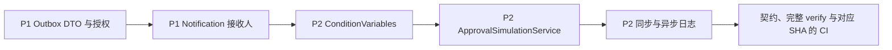

# Action Engine 安全加固与可靠性修复计划

基线为 `265a341150822064858026fc5f3a6a52ee9a781c`。制定计划时 `main` 与 `origin/main` 一致，工作区干净。该提交的 [approval-pilot CI](https://github.com/ttcc666/WorkflowDemo/actions/runs/42161098143) 已完成，Windows verify 和 MySQL、PostgreSQL、SQL Server 矩阵均通过。修复提交另行验收。

实施记录与实际验证结果见 [Action Engine 安全加固验收报告](../docs/action-engine-hardening-report-2026-11-06.md)。

## 范围与不变量

- 先收紧 P1 数据读取和通知接收人边界，再实现 P2 条件变量、预演和诊断。沿用现有 Action Handler、审批导航、Outbox、Resolver、权限 provider 与 Forms 扩展。
- 保持 Schema v1、既有发布版本绑定、审批与宿主写入的事务边界、并行输出作用域、退回重提、Outbox ID、并发令牌和退避机制。
- EF 模型与迁移沿用当前基线。普通 HTTP 列表保持路由、分页、时间及状态语义，旧的正文槽位仅为可选兼容字段。对正文的访问走独立授权读取。
- 保留直接读取表单字段的条件表达式。已有 Action 表达式的兼容规则必须明确，遇到无法判定的命名冲突时停止发布或执行。
- 原始工作流数据保留在有权限的存储和读取边界。故障响应、Outbox 摘要和诊断日志使用不同的安全信息集。

## P1.1 Outbox 读取隔离

`ApprovalOutboxService.ListAsync` 当前返回带 `PayloadJson` 的 EF 实体，`ApprovalOutboxMessageResponse.From` 将正文复制到 HTTP 列表。查询已有 `IApprovalQueryScope`，但列表只有 OutboxRead。旧通知可能把已渲染标题写到 `Description`，通用事件投递失败也可能把异常 Message 写到 `LastError`。

- [ ] 在 `ApprovalOutboxService.cs` 保留按 scope、状态、实例过滤及现有稳定排序。在数据库端投影列表元数据，避免获取正文。保留现有公开列表返回类型，Core 列表的正文槽位用空 JSON 对象占位。HTTP 普通列表通过安全 DTO 投影，`payloadJson` 只作为可空可省略的兼容字段，正常响应省略。前端普通 Outbox 页面仍使用同一路由。
- [ ] 以可验证的固定事件名、动作类型和步骤标识构造列表摘要。针对 `WorkflowAction` 保留安全动作标识及已知错误代码、HTTP 状态。针对 `Host` 保留固定审批事件标签，旧的渲染标题和任意错误文本返回固定摘要。未知 Target 仅展示其标识和通用状态摘要。历史记录在读取时同样投影，避免依靠重写数据。
- [ ] 在现有 Outbox 端点组增加 `GET /outbox/{id:guid}/payload`，返回独立的正文 DTO，并使用 `Cache-Control: no-store`。在 `ApprovalEndpointPermissions.cs` 登记 OutboxRead 和 `outbox` 资源种类。Core 正文读取要求 OutboxRead 与 InstanceReadSensitive，复用资源解析器、查询范围和现有实例访问策略确认正文归属和可见性。资源解析先按 ID 只读取归属列，所有检查通过后再读取正文。使用服务端解析出的实例归属，忽略客户端提供的归属信息。
- [ ] 正文读取仅支持能够验证归属的实例关联 `WorkflowAction` 与 `Host` 消息。格式错误、正文实例与记录不一致、实例越权及不存在的记录沿用安全错误语义。无实例系统消息可按现有 OutboxRead 查看元数据，正文读取默认拒绝。沿用现有能力代码，`ApprovalPermissions.All` 和宿主角色映射无需扩展。
- [ ] 在 `ApprovalEventWriter.cs` 为新通知记录写固定的投递摘要。保留内部执行快照、原收件人、原模板内容、`ConcurrencyStamp`、重试和回放逻辑。
- [ ] 增加 `Approval.AspNetCore.Tests` 权限矩阵。覆盖无 OutboxRead、仅 OutboxRead、双权限且实例可见、双权限但查询范围或实例策略拒绝、无归属系统消息、缺失记录。用三类 Target 的正文、历史标题和异常字段中的不同标记断言响应脱敏。同步 `tests/shared/http-resources-v1.json`、生成契约和 TypeScript。浏览器验证既有列表显示、分页及重试入口。

## P1.2 Notification 的可信人员字段

`NotificationActionHandler.ValidateConfig` 有 Resolver 描述符，却在调用 `ValidateRuleValue` 时传入空的人员字段集合。Forms 的 `FormSchemaValidator` 对审批人和普通通知使用人员字段白名单，Action 的接收人列表未纳入校验。运行时 `FormFieldApproverResolver` 只按 JSON 形状读取字符串或字符串数组。

- [ ] 在 `NotificationActionHandler.cs` 集中校验接收人配置，复用 `FlowDefinitionValidator.ValidateRuleValue`、Resolver 描述符及 `IApprovalDefinitionExtension.UserFields`。在 `FlowDefinitionValidator.cs` 和 `ApprovalActionValidation.cs` 传递已有的人员字段集合。每条 `FormField` 规则都必须引用可信 schema 中真实存在的 `User` 或 `Users` 字段，按既有不区分大小写规则比较。无可信 schema、字段为空或混合列表中存在非法条目时拒绝动作配置。Core 通过现有接口访问字段信息。
- [ ] 在实际运行 Notification Action 前使用实例绑定的已发布定义再做同一检查，覆盖修复前已发布的非法步骤。通过现有运行时上下文传递所需的定义信息，保留普通通知和审批人 Resolver 的兼容路径。无效历史配置应回滚当前操作并给出安全错误，测试确认未产生站内信或 Outbox。
- [ ] 核对 `ApprovalFormService.NormalizeAsync` 的人员目录校验及发起、重提、审批修改入口。沿用已有的规范化数据和字段权限。可信 Core 宿主直接提供表单快照时继续承担输入校验职责，记录此宿主约定。
- [ ] 扩展 `NotificationWorkflowActionTests.cs`、Forms 和 HTTP 集成测试。覆盖 `User`、`Users`、`Text`、`Number`、`Select`、空字段、未知字段、未安装 schema 扩展、混合接收人列表、无效人员提交和已发布旧定义。用现有通知规则及审批人 `FormField` 测试作对照。

## P2.1 Condition 命名空间兼容性

`ApprovalActionExecutor.ConditionVariables` 在 Action 流程中先删除 `form` 和 `outputs`，再注入系统别名。Forms 的字段标识规则允许这两个名称。保留裸字段语义，并为系统路径提供单一、可文档化的主入口。

- [ ] 在正式运行与模拟共用的 `ConditionVariables` 增加 `workflow.form` 与 `workflow.outputs`，继续基于 `ExecutionState.OutputsFor` 取当前节点可见输出。仅当对应表单字段不存在时添加旧 `form.*` 与 `outputs.*` 别名。保留裸 `form`、`outputs` 及其原始值。无 Action 的流程直接走原路径。
- [ ] 在 `FormSchemaValidator.cs` 复用已有顶层字段集合，检查 Action 流程的 `workflow` 冲突，含大小写变体及生成字段。对已声明字段与旧限定别名的歧义，识别条件表达式中真实根路径后给出明确迁移错误，引导改为 `workflow.form` 或 `workflow.outputs`。识别逻辑应区分直接变量、成员或索引访问与字符串字面量，覆盖条件节点各分支。
- [ ] 对无表单 schema 的可信宿主输入及已发布历史定义，在运行时使用同一冲突规则，防止新注入变量覆盖真实字段或让历史旧别名静默指向别的数据。保留 `DynamicExpressoConditionEvaluator` 的反射保护。
- [ ] 扩展 `WorkflowActionTests.cs` 和定义校验测试。覆盖裸字段、旧别名、主命名空间、大小写冲突、含字面量的条件、无 Action 的历史定义、多个上游动作、并行分支隔离和汇聚输出。更新 `NodeInspector.vue`、`BranchInspector.vue` 中相关变量提示及动作使用文档。JS 和 Mapping 的既有 `context`、`form`、`outputs` 变量协议继续使用。

## P2.2 单节点 Action 预演

`ApprovalSimulationService.SimulateAsync` 为带 `NodeId` 的请求直接调用 `Enter`，所以单点 Action 预演总从空输出状态开始。现有完整模拟已能安全运行预演 Handler、分支、Join 和步数预算。

- [ ] 对 Action 单点预演，从 Start 进入既有 `ApprovalAutomaticTraversal`，使用同一 `ExecutionState` 逐步累积可见的预演输出，到达目标 Action 执行预演后停止。使用现有条件求值和分支栈。保留审批节点与抄送节点的单点分配预览及 `RuleIndex` 行为。
- [ ] 在未到达目标时明确区分人工决策、上游失败、所需输出无法预演、条件选中其他路径和 Join 等待。保留已产生的路径记录和阻断原因。单点请求的完成语义与完整模拟到达 End 的语义分别测试。
- [ ] 遇到无显式预演能力的 Handler，仅记录跳过。异步步骤展示计划。继续使用只读 scope、超时、步数与输出预算。保留现有 `ExecuteAsync` 与 Outbox 写入边界。
- [ ] 在 `DesignerSimulation.vue` 显示上游路径、目标与阻断原因，沿用当前模拟请求和权限。视情况在 `ActionStepsEditor.vue` 更新帮助文案。组件通过现有 props 和事件传递数据。
- [ ] 增加只读模拟回归。覆盖 A → B、A → Condition → B、未选中路径、嵌套并行与 Join、上游失败、缺少预演 Handler、上游人工审批、空审批人自动通过和异步计划。通过 DB 和副作用探针断言实例、任务、审计、业务记录、Outbox 及正式 Handler 调用次数保持预演前状态。保留完整模拟和浏览器节点分配预览用例。

## P2.3 Action 结构化故障诊断

同步动作 catch 丢弃异常，异步动作把原始异常压成安全代码。直接记录原始异常对象会由日志格式化器展开 Message 和 InnerException，可能写出 SQL、连接字符串、凭证或响应正文。

- [ ] 在 `ApprovalActionExecutor.cs` 与 `ApprovalOutboxService.cs` 复用一个内部诊断入口。记录 InstanceId、NodeId、ActionId、ExecutionId、异步 OutboxId、Handler Type、Mode、固定错误类别、异常类型与堆栈。对内部异常链做有界处理，保留类型和栈帧信息，排除 Message、Data、源码路径、配置和正文。日志层级及字段统一，失败同一次仅记录一次详细诊断。
- [ ] 同步 `Fail` 在回滚前写安全诊断，`Continue` 留下安全审计并按现有配置继续。异步记录原始异常的安全结构后仅传固定错误类别给失败记录事务。覆盖 Handler 失败、非法快照及数据库保存阶段的失败。同步和异步对调用方公开的错误保持安全，`LastError` 仅持久化已知分类和经允许的状态码。
- [ ] 保持请求或 Worker token 已取消时的取消语义，取消不进入普通失败记录和计数。Handler 自己的超时按既有失败策略处理。保留现有 Outbox 的退避、并发冲突处理和宿主数据回滚。
- [ ] 用内存 Logger 捕获结构化记录。测试同步、异步异常含敏感标记时能获得标识、异常类型和堆栈，响应、数据库错误摘要和日志均无敏感标记。测试取消、`Continue`、`Fail`、无副作用声明的校验，以及异步 Handler 已暂存宿主写入再失败时的回滚。

## 实施顺序与验收门禁

1. 按 P1 两个边界先写负向回归，再实现并运行定向 Core、HTTP 与 Forms 测试。确认未经授权的请求读取不到正文，非法通知步骤没有部分写入。
2. 按 P2 实施兼容命名空间、路径预演、内部诊断。每块在进入下一块前验证新用例。检查已有幂等、重启、退回、并发、SSRF、脚本和 SQL 安全回归。没有新证据时保留既有实现。
3. 在 `web/` 执行 `pnpm contracts:update`，审阅 Core 公共 API、HTTP/OpenAPI、Flow Schema、生成 TypeScript、样例契约和测试 fixture。再运行 `pnpm contracts:check`。
4. 从仓库根目录执行 `pwsh -NoProfile -File ./eng/verify.ps1`。分别记录 Core、AspNetCore、SQLite Database、Certificate、前端单测、Playwright、契约、Flow Schema、ReferenceHost、独立包消费者和完整 verify 的实际结果。
5. 按仓库约定在授权提交并推送后检查该 SHA 的 Windows verify、MySQL、PostgreSQL 和 SQL Server。未执行项保持待验。交付报告按模块列文件和用例，写明 P1/P2 完成情况、已知限制和试运行判断。

## 回滚与发布

- 数据库与已入队快照沿用现有格式。暂停或恢复 Dispatcher 按宿主现有部署流程操作，保留原 Outbox ID 和投递状态。
- 生产遇到兼容性问题时优先修正定义表达式或人员字段并发布新版本。对仍绑定旧版本的实例，按现有定义治理及恢复流程处理。回滚版本前核对当前定义是否已开始使用 `workflow.*`。
- Outbox 正文权限与接收人校验作为试运行门禁。如果回滚会重新开放敏感正文或接受非法字段，先在宿主撤销相关读权限并限制受影响定义，再执行部署回退。
