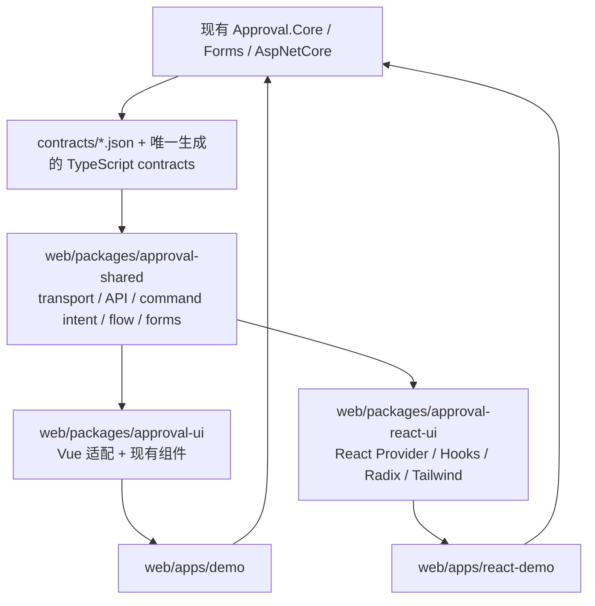
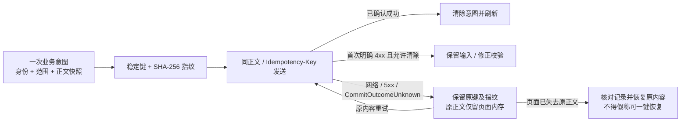

# React 第二套正式前端：实施与验收计划

日期：2026-11-06。参考分支：`main`。参考 HEAD：`27588b1b00d36e9c91e8735094698625f30fcacc`。

状态：**G0–G5 实现完成，本地完整门禁和源码 / 打包浏览器验收通过**。Vue 基线保留；最终命令、证据与限制见 [验收报告](../docs/react-frontend-report-2026-11-06.md)。未提交 / 推送，服务数据库 CI 未执行。

## 1. 目标、优先级和不变量

Vue 继续作为稳定版本和交互行为基准；React 是第二套正式组件库与 Demo。两套前端共享后端、HTTP / JSON 协议和前端纯业务算法。后端仍负责审批推进、最终授权、校验、事务、幂等及 Outbox。

优先级：协议与业务正确性 → 设计器 / Action / 表单完整性 → 审批工作台与详情可靠性 → 治理与宿主集成 → 视觉细化。**在设计器及 Action 迁移可行性门禁通过前，不展开大规模页面美化。**

不变量（迁移前后必须保持）：

- 不删除 Vue，不改变现有 Vue 公开导出、宿主选项、路由语义和业务行为；纯模块迁移通过原入口重导出或适配。
- 不改变后端业务逻辑、数据库模型、HTTP 路由 / DTO、ProblemDetails、流程 `schemaVersion=1`、Form Schema 或 Action 配置协议。
- 流程发布版本、协议版本、Action `configVersion`、治理 `expectedRevision` 是不同概念，不能混用。发布版本及实例绑定快照不可变。
- 保持或签 / 会签 / 依次审批、条件 / 并行 / Join、前 / 后 / 并加签、转交、退回、重新提交、撤回、终止、抄送、超时和字段权限语义。
- React 不能依赖 Vue、Vue Router、Vue Flow、Element Plus、`.vue`、Vue composables，包含发布类型声明的间接依赖。shared 不依赖任何前端框架。
- 受管理写操作保持稳定键、请求快照及未知提交恢复；附件上传沿用既有非请求幂等例外及补偿边界，不统一包装成自动重试命令。
- 能力来源是 `/me`、实例 / 任务 / 定义治理响应；角色名和菜单可见性不能推断权限。敏感数据、表单数据、Token、原请求正文不写入 localStorage。
- Vue 的 `dev`、`build`、`build:lib` 入口保持原用途；`typecheck` / `test` 当前是递归命令，新增包后自然覆盖新包，原 Vue 用例继续执行。
- 不引入额外后台服务、数据库、审批业务实现或另一份长期维护的契约。证书和模拟 Webhook 保留在 Demo。

## 2. 已核实的代码事实与需求差异

| 事实 | 代码依据 | 实施含义 |
| --- | --- | --- |
| 当前仅有 `@approval/ui`、`approval-demo` | `web/package.json`、两个现有包的 `package.json` | 新增 `@approval/shared`、`@approval/react-ui`、`approval-react-demo` |
| workspace 已覆盖 `packages/*`、`apps/*` | `web/pnpm-workspace.yaml` | 不需要为了发现新包改目录规则 |
| HTTP / API 算法基本独立，但引用 Vue 配置类型 | `src/config.ts`、`src/api/http.ts`、`src/api/approval.ts`（以下未限定 src 均指 Vue UI 包） | 先分离 transport 选项与组件注册类型，再移动实现 |
| 客户端、用户、目录状态使用 Vue reactivity | `src/client.ts`、`src/composables/useApprovalUser.ts`、`useDirectory.ts` | 保留框架适配；身份与缓存规则复用 / 同场景验收 |
| 命令意图包含 `shallowRef`，但绝大部分是存储 / 指纹 / 重试逻辑 | `src/composables/useCommandIntent.ts` | 提取一个无框架核心；Vue `pending.value` 与现有函数签名保留 |
| 图算法间接使用 Vue Flow 类型，边还含展示属性 | `flowElements.ts`、`flowGraph.ts`、`flowLayout.ts`、`flowSerialization.ts` | shared 使用最小图模型；两个画布适配 marker、尺寸、选择等属性 |
| 实际 8 类节点 | `src/contracts/flow.ts` | Start、Approval、Cc、Condition、Parallel、Join、End、Action 均须覆盖 |
| 实际 16 类字段；明细列支持 6 类 | `src/contracts/forms.ts`、`features/forms/formFields.ts` | 明细列是 Text、Number、Money、Date、Select、Formula，不能把全部顶层类型塞入明细 |
| Form Schema 没有可配置正则或通用联动协议 | `src/contracts/forms.ts`、`src/Approval.Forms/Schema/FormSchema.cs`、`features/forms/formValidation.ts` | 当前迁移范围保留既有公式 / 汇总联动；正则和通用联动列为产品差异，不添加 React 私有属性 |
| HTTP 配置使用宿主目标名 | `src/Approval.Core/Actions/HttpActionHandler.cs`、`ActionConfigEditor.vue` | 编辑 `endpoint/method/timeoutSeconds/query/headers/body/form`；地址和凭证归宿主；不开放任意 URL |
| HTTP 预演 `ProvidesOutput=false`，实际同步 GET 可返回输出 | 同上 | 保留 Sync GET 的输出变量和 statusCode/body 提示；预演仅显示请求计划，不能新增响应映射配置字段 |
| Sql 使用已登记只读查询 | `SqlActionHandler.cs`、`ActionConfigEditor.vue` | 编辑 `dataSource/queryId/parameters`，展示查询参数类型、行数和时限；结果转换复用后续 Mapping |
| Mapping 是声明式转换协议 | `MappingActionHandler.cs`、`actionMappingModel.ts` | source、target、transform、default、omitNull、precision、items、filterPath、filterEquals；不增加任意表达式配置 |
| 内置 Action 是 JavaScript、Http、Sql、Mapping、Notification；其他由宿主登记 | `src/Approval.Core/Actions/`、`ActionStepsEditor.vue`、`docs/action-handler-development.md` | 以 `/meta.actions` 描述符为准，不能硬编码“只有六种”或虚构 `CSharp` 类型 ID |
| 自定义 Handler 的现有可运行示例在独立消费者 | `eng/consumers/EmbeddedHost/Program.cs` | E2E 用测试宿主暴露登记的 Handler，不能声称 Certificate Demo 已有同样注册 |
| Outbox 当前 Vue 页面刷新 3 秒，消息数量刷新 10 秒 | `src/views/OutboxView.vue`、`src/components/MessageBell.vue` | React 沿用并测试卸载 / 身份切换清理 |
| Outbox Payload API 已存在，Vue 当前页没有独立查看入口 | `src/api/approval.ts`、`src/views/OutboxView.vue` | 属于任务要求的新增 UI；用既有独立 Payload API，列表不能携带或拼出敏感正文 |
| Vue Demo 构建会清空后端 `wwwroot` | `web/apps/demo/vite.config.ts` | React 固定独立 `web/apps/react-demo/dist`，不使用同一 outDir |
| 工程工具目前只识别 Vue UI 包 | `eng/check-boundaries.mjs`、`eng/verify-packages.ps1`、`web/scripts/contracts.mjs` | 必须同步边界检查、契约路径、tgz 消费者和 CI，不能只让 Vite 编译通过 |

差异处理规则：已有协议支持的 UI 完整实现；只涉及视觉 / 编辑辅助的增强可以做；需要新协议或后端能力的正则、通用联动、HTTP 输出映射等必须先单独决定、双前端同步实施。本计划不会把差异标记为“已完成”或无说明地删掉。

## 3. 目标依赖与共享边界



shared 不是第二个审批引擎：这里只共享两套前端本来就需要的解析、模型和交互规则。模拟与执行仍调用后端，JavaScript 不在浏览器执行真实流程脚本。

| 模块 | 处理方案 |
| --- | --- |
| `contracts/api.ts/flow.ts/forms.ts/http.generated.ts/index.ts` | 移至 shared 为唯一源；Vue 原公开类型入口重导出。生成器只生成一份 HTTP 类型。审阅搬迁内容，HTTP / JSON 基线内容必须不变 |
| `api/http.ts`、`api/approval.ts` | 实现移至 shared；配置缩小为 transport 选项，保留 `ApiError` 类身份、方法签名、401、204、Blob、请求头桥接及取消行为 |
| `config.ts`、`client.ts` | transport 选项 / 配置解析中纯部分共享；Vue Component、inject、install、effectScope 留在 Vue。React 单独提供 React 组件注册类型和客户端生命周期 |
| `useCommandIntent.ts` | 指纹、稳定键、sessionStorage 及失败写入 fallback、并发保护、原请求内存重试提取一次；Vue / React 仅订阅 pending 状态及绑定客户端身份 |
| `features/forms/` 的纯 `.ts` | fields、serialization、formula、formFormulas、validateValue、checkSchema 共享。`fieldRules` 的 Element Plus 回调形态保留 Vue 适配；React 直接消费验证结果 |
| `features/flow/` 的纯 `.ts` | version、defaults、graph、serialization、layout、runtime、simulationState 共享；剥离 Vue Flow 类型和展示 marker。合并后的 `flowModel` 原入口保留 |
| `features/designer/history.ts`、`actionMappingModel.ts` | 直接共享；不建立第二份撤销栈或 Mapping 类型 |
| `features/definitions/definitionDiff.ts/definitionTransfer.ts`、`utils/labels.ts` | 共享纯比较 / 文件转换 / 文案与时间规则；Element Plus TagType 到 React Badge variant 的映射属于适配层 |
| `useAsyncData/usePagedList/useDirectory/useApprovalUser` | Vue hooks 保留；纯过滤转换、目录 / 身份 / 过期请求规则在有必要时提取，React Hooks 负责 React 生命周期。不要把 Vue 响应式对象传入 shared |
| 各 `.vue`、Vue route、Demo 组件 | 不移动到 shared；React 实现独立视图。证书 API / submissionIdentity 的纯部分按 Demo 职责复用，不引入通用库 |

中性图模型保留 node ID、type、position、data、edge ID/source/target/branch data 与算法所需尺寸。框架适配转换 Vue `dimensions` 和 React `measured`；不把 selection、dragging、viewport、marker 等画布临时状态写入流程 JSON。保留分支数组顺序、默认分支 `null`、优先级、节点坐标、Action config 的 JSON 类型和未知宿主 config 子属性。

## 4. React 组件与状态职责

技术栈：React 19、strict TypeScript、同一 monorepo Vite / Vitest / pnpm 版本体系；Tailwind v4 CSS-first、Radix Primitives、React Router、`@xyflow/react`、`@dagrejs/dagre`、lucide-react、CodeMirror 6。实际依赖版本在 G1 用官方文档 / registry 验证兼容后写入锁文件；不能随意升级 Vue 依赖。

- `ApprovalProvider`：单个客户端配置、用户 / 目录资源和销毁；React Context 只持有服务与必要共享快照。
- `useApprovalClient/useApprovalUser/useDirectory/useCommandIntent/useAsyncData/usePagedList`：分别负责客户端、身份、目录、命令、查询、URL 分页。React 订阅无框架 store 可使用 `useSyncExternalStore`，不增加第三方全局状态库。
- Provider 保持 `apiBase/headers/fetcher/onUnauthorized/userKey/businessPanels/outboxPanel` 语义；配置 getter 每次读取最新值。React 的 `userKey` getter 必须在宿主重新渲染时重新采样，不能假定具有 Vue 自动依赖追踪。文档给出身份变化触发渲染的例子。
- 身份切换在显示新身份数据前清空旧快照，取消旧请求并以 generation 阻止迟到结果；覆盖 A→B→A、两个 Provider、路由变化、卸载与 StrictMode setup/cleanup。
- 每个页面作为路由组合层；列表 / 筛选 / 对话框 / 数据 hooks 放在 feature 内，禁止把所有业务逻辑放入 Provider 或单个页面。
- `ApprovalDetailPage` 组合 Summary、Actions、DynamicForm、FlowViewer、Timeline、CcHistory、ActionExecutionList、业务面板；动作 Hooks 接收后端资源能力并绑定命令快照。
- `DesignerPage` 组合 Toolbar、NodePalette、FlowCanvas、NodeInspector / BranchInspector、FormDesigner、FlowSettingsPanel、ValidationResult、Preview、Simulation。
- `useFlowDesigner` 的所有改变通过统一命令入口记录 shared history；快照包含流程、表单、发起设置、通知、坐标和 Action 步骤。拖拽 / 连线插入按可观察操作验收撤销步数；输入合并规则沿用原 history。CodeMirror 文本编辑撤销与流程撤销快捷键需要避免重复触发。
- `ActionStepsEditor` 管步骤增删、复制、排序、名称、模式、版本、输出、失败策略；`ActionConfigEditor` 调度 Script、Json、Mapping / MappingRule、Notification 及描述符生成的 Http、Sql、自定义配置。
- `FormDesigner` 分成 FieldPalette、FieldCanvas、FieldInspector、OptionsEditor、FormulaInput、TableColumns、Preview；`DynamicForm` 分成 FieldInput、TableField、ValueText、FileUpload / FileList，并复用 UserPicker。
- UserPicker 保留搜索 / resolve / 多选 / 排除当前人及发起人等上下文约束、角色配置和不可用目录提示；自定义选择器扩展通过 React 组件属性 / 类型化适配实现，不改 API 协议。

基础 UI 按实际业务推进统一封装：Button、Input、Textarea、Select、Checkbox、RadioGroup、Switch、Dialog、AlertDialog、Drawer、Popover、DropdownMenu、Tabs、Tooltip、Toast、Badge、Card、Table、Pagination、DatePicker、DateRangePicker、Calendar、Command、FormField、EmptyState、Loading、Skeleton、ErrorState、ConfirmDialog、FileUpload。焦点管理、键盘、disabled/loading、校验和 aria 统一。

Tailwind 用 scoped 主题容器和 CSS 变量 / `@theme`，显式控制 Preflight 影响及消费者源码扫描；声明 CSS sideEffects、导出独立 style.css。发布 CSS 不能要求宿主扫描库源码才能显示正确，也不能改变宿主或 Vue 页面的全局样式。

## 5. 实施顺序与退出门禁

每个阶段完成后运行相应检查、审阅完整 diff、更新 FEATURE_PARITY 中的证据。G1 / G2 是最先执行的风险验证，不是展示页面开发。遇到失败先解决该门禁，不能将核心编辑器留作“后续补齐”。

### G0：冻结行为基线

- [x] 重新检查分支 / HEAD / 工作区；如果 HEAD 已变化，增量核对本计划的代码依据。
- [x] 复核 [`FEATURE_PARITY.md`](../web/packages/approval-react-ui/FEATURE_PARITY.md) 的逐项来源、需求差异和测试映射，记录新发现的能力。
- [x] 保存 Vue Frontend、Contracts 和现有独立包消费者验证结果；已运行与未运行分开报告。
- [x] 固定共享 fixtures：现有 `tests/shared/definition-cases.json`、`formula-cases.json`、HTTP 资源样例和 sample 流程；补充全字段 / 全节点 / 全 Action / 嵌套并行 / 字段权限 / 历史版本案例。

退出条件：当前版本基线已记录；不能把历史 CI 绿色当作本次运行结果。

### G1：最小 React 工程与共享核心

- [x] 新增三个包的 package.json、tsconfig、Vite / Vitest 配置、exports / d.ts / CSS 与锁文件；Demo dev 为 `5174`，proxy 为 `http://localhost:5199`，outDir 为自身 `dist`。
- [x] 建立最小 Radix / Tailwind shell，Provider 与真实 API `/me` 接入；仅完成后续编辑器需要的基础组件。
- [x] 按第 3 节分批移动纯模块，保留 Vue 原入口，不复制实现。
- [x] 扩展 `eng/check-boundaries.mjs` 支持 `.tsx`、React / shared、包 exports、类型查询和动态导入；禁止跨包源码路径、shared→UI、React→Vue、库→Demo。
- [x] 调整契约生成目标为 shared 唯一源，Vue contracts 为允许的公开重导出；更新边界规则而不放宽到任意外部依赖。
- [x] 扩展独立 tgz 消费：shared 和 React 库均安装打包产物，消费者不配置 `@ui` / React 内部 alias，不存在 workspace 源码；检查 JS、d.ts、CSS 与依赖图。
- [x] 新增独立脚本 `dev:react/build:react/build:react-lib/typecheck:react/test:react`；shared 构建作为明确依赖步骤，不改 Vue dev/build 的用途。

退出条件：React Demo 能从现有后端读取身份；共享算法和原 Vue 用例通过；React / shared 的运行时与声明依赖无 Vue / Element Plus；独立消费者能 typecheck / build。

### G2：先证明设计器、Action 与表单可以完整迁移

- [x] 实现 React FlowCanvas 适配：8 类节点、拖拽、缩放 / 平移、选择 / 删除、连线替换 / 分支、插入连线、布局、Fit View 与网格。
- [x] 实现 unified history；验证默认分支切换、条件边插入保留条件与顺序、表单 / 设置 / Action 修改的撤销重做。
- [x] 实现 NodeInspector、BranchInspector、ApproverRulesEditor、NotificationRulesEditor、TimeoutEditor、FieldPermissionsEditor。
- [x] 在完整节点属性前提下实现 ActionStepsEditor 与全部配置编辑器；通过 `/meta` 枚举内置 / 自定义 Handler，不遗漏 JSON fallback。
- [x] CodeMirror 6 提供高亮、行号、折叠、缩进、上下文插入 / 提示、语法错误和主题；格式化只改变格式，不能执行脚本；卸载销毁 EditorView，保存 / 切换节点前提交当前文本。
- [x] 用当前合法 Schema 实现 16 字段动态渲染和 FormDesigner，覆盖明细列、公式依赖 / 循环 / 精度 / 汇总、人员和附件引用；共享算法输入先复制，不能就地改 React props。
- [x] 连接既有 validate / simulate：完整流程、分支 / 单节点 / 节点内步骤定位预演及上游合成输出；未经过人工节点、未选分支、失败、无预演处理器和 Async 计划均展示服务端结果。
- [x] 双向 round-trip：Vue 原入口载入→React 编辑 / 保存→Vue 再编辑；反向重复，包含全部节点 / 字段 / Action configVersion、通知、权限、布局和 settings。
- [x] 后端校验正反案例：缺 schemaVersion、未知版本、非法分支 / Join、重复 outputKey、不可见上游输出、非法 Handler mode / config、非法公式 / 表列 / 人员字段均拒绝。

退出条件：可发布并互相编辑含 Parallel / Join、复杂表单和 Action 的真实定义；浏览器真的操作拖拽 / 插入 / 撤销 / 编辑器，不仅调用 serializer；后端真实执行至少一个完整组合 Action 流程。HTTP / Sql 使用隔离测试目标与登记查询；自定义 Handler 用测试宿主。视觉细化要等此门禁通过。

### G3：工作台、发起中心与审批详情

- [x] 四个工作台标签、表格字段、查询 / 时间 / 状态 / 流程 / 未读筛选、分页和 URL 同步；后退 / 前进恢复、用户切换、旧请求取消 / 忽略。
- [x] 发起中心真实可发起流程、分类 / 搜索、业务草稿继续 / 删除；发起表单保存草稿、恢复、附件、提交和字段错误。
- [x] 详情加载实例绑定公开定义、my-task、字段权限、业务面板、流程状态、轨迹、字段变更、抄送逐人已读和 Action 记录。
- [x] 实现同意、驳回、退回节点、转交、Before / After / Parallel 加签、撤回、Resubmit、终止、改派及各确认窗口。
- [x] 同意仅发送可编辑字段；校验错误保留输入、按路径显示；其他成功 / 错误按 Vue 刷新最新状态；隐藏字段 / 附件 / 审计只用服务端投影。
- [x] 所有受管理写入使用 shared intent；未知结果禁止新请求内容覆盖旧意图，恢复原内容与原键；更换意图必须先核对原结果并显式确认。
- [x] 真实 E2E 验证普通审批、退回修改重新提交、三种加签、转交、撤回 / 终止、并发冲突、字段变更和权限撤销。

退出条件：审批过程、最终状态、审计、字段权限和异常恢复与 Vue 等价；UI 权限无默认放行。

### G4：完整治理、监控与 Demo

- [x] Definitions 分类、草稿、复制、导入预检 / 导出、版本列表 / 详情 / diff、历史版本编辑 `?from=...`、选用版本、启停、审计和 changeNote。
- [x] 保存 / 发布 / 启停 / 选用使用 expectedRevision 与原命令键；409 后刷新治理状态，不覆盖远程草稿或自动换键再发布。
- [x] Monitor 实例 / 统计 / 离职交接按能力可见；交接保留候选、逐实例结果、部分完成恢复，不能伪装整批原子事务。
- [x] Outbox 列表、筛选 / 分页、3 秒刷新、失败 / 尝试 / 重试、Payload 独立读取和 outboxPanel；访问正文要求既有敏感权限与实例访问策略。
- [x] Diagnostics 与 MessageBell 使用真实 API；消息单条 / 全部已读使用键、跳转审批、10 秒数量刷新；用户切换清空消息。
- [x] React Demo 保留 `X-User-Id`、`approval-demo-user`，演示用户列表来自既有 API；布局菜单、子页面高亮、懒加载和移动导航。
- [x] 证书列表 / 申请 / 详情 / 历史 / 撤销 / 业务面板 / 诊断；模拟 Webhook 记录、Idempotency-Key、配置失败次数、503→自动重试→成功。

退出条件：所有治理和演示功能都有可执行路径及测试；React Demo 不覆盖 Vue 构建目录；普通宿主不能借 Demo 配置得到管理员权限。

### G5：发布质量与功能完成判定

- [x] 统一设计系统的键盘、焦点、加载 / 错误 / 空状态、响应式与长时间设计器操作；性能工作以测量为依据。
- [x] 导出 Provider、client / user hooks、routes、MessageBell、UserPicker、DynamicForm、FormDesigner、FlowViewer、API / Flow / Forms / Panel 类型与常用模型函数。
- [x] 增加 React 集成文档和设计系统文档：安装、CSS、认证、身份切换、capabilities、路由、业务 / Outbox 面板、自定义选择器、主题与独立构建消费。
- [x] 独立 tgz React 宿主验证认证 fetcher、401、双 Provider、无 Forms 模式、懒加载、d.ts 和打包 CSS。
- [x] 完整执行 Frontend / Contracts / Packages / 仓库门禁及 React E2E；在 `.github/workflows/ci.yml` Windows verify 中纳入 React、shared 和独立消费者。
- [x] 功能表每个必需编号有实现文件、测试 / 操作证据及对应 SHA；不能通过删测试、skip、假 API、缩减竞争场景达到完成。
- [x] 如用户之后授权推送，核对本次确切 SHA 的 Windows verify 与 MySql / SqlServer / PostgreSql 矩阵；本地不启动 Docker 或数据库专项脚本。

退出条件：FEATURE_PARITY 所有必需项完成；协议需求差异已明确决定并验收；Vue 原有测试 / 构建、React / shared 检查、真实浏览器与双向兼容均有证据，才宣布 React 开发完成。

## 6. 命令恢复验收模型



严格沿用原实现细节：指纹对象 key 排序而数组有序；相同意图不同正文阻止提交；`uncertain` 已置位后后续 4xx 仍不能自动清除；`retainOnError` 供批量交接等使用；Storage 不可用 / 删除失败保持内存 fallback；owner 切换后不能把旧命令结果呈现给新用户。sessionStorage 只保存 opaque key、摘要和状态，retry callback 与敏感正文留在页面内存。

## 7. 验证命令与证据

当前可执行命令（仓库根目录）：

```powershell
Set-Location -LiteralPath 'D:\Study\CSharp\Workflow'
pwsh -NoProfile -File './eng/verify.ps1' -Scope 'Frontend' -SkipRestore
pwsh -NoProfile -File './eng/verify.ps1' -Scope 'Contracts'
pwsh -NoProfile -File './eng/verify.ps1' -Scope 'Packages'
pwsh -NoProfile -File './eng/verify.ps1'
```

仅在 node_modules 已匹配锁文件时使用 `-SkipRestore`。Contracts 是验证，不运行 `contracts:update` 来掩盖 drift。

实施后已提供的命令（在 `web/` 执行，实际结果见验收报告）：

```powershell
pnpm 'dev:react'
pnpm 'typecheck:react'
pnpm 'test:react'
pnpm 'build:react-lib'
pnpm 'build:react'
pnpm --filter '@approval/shared' 'test'
pnpm 'test:e2e:react'
pnpm 'test:e2e:parity'
```

E2E 脚本负责隔离测试宿主与临时数据库 / 文件目录、独立端口、两个 Demo、测试数据初始化和回收；不得连接 / 清空用户开发数据库。复用现有 package-smoke / reference-host 工具职责，不另造通用平台。并发和迟到请求测试使用显式屏障 / 可控 Promise / 请求拦截，不能使用随机 Task.Delay / sleep 竞争。

证据分三层：shared 纯算法 fixture 测试；React Testing Library 组件 / hooks 可观察行为；真实后端 Playwright E2E 与独立包消费者。两套 serializer 仅比较同一个实现是不充分的，浏览器必须分别编辑和保存，再查询后端存储定义及运行实例 / 审计验证。

本次在上述参考 HEAD 的本地工作区实际执行 `pwsh -NoProfile -File './eng/verify.ps1' -Scope 'Frontend' -SkipRestore`，退出码 0：

| 检查 | 实际结果 |
| --- | --- |
| 依赖边界 | 111 个源文件检查通过 |
| 边界 / 发布声明工具测试 | 12 个测试通过，0 skipped |
| Vue UI / Demo 源码与测试类型检查 | 通过 |
| Vue UI 单元测试 | 25 个文件、256 个测试通过 |
| Vue Demo 单元测试 | 2 个文件、6 个测试通过 |
| Vue UI 库 JS / d.ts 构建 | 通过 |
| Vue Demo production 构建 | 通过 |

以上表格保留最初 Vue 基线证据。实施后的 Backend / Frontend / Contracts / 包与浏览器结果见验收报告；生产后端、协议和数据库模型保持不变。未提交 / 推送，服务数据库 CI 尚未执行。

## 8. 影响文件与回滚

新增：`web/packages/approval-shared/**`、`web/packages/approval-react-ui/**`、`web/apps/react-demo/**`、React / parity 浏览器用例及测试宿主资料、React 集成 / 设计系统 / 验收报告。

必要修改：Vue 包的纯模块 / config / 命令适配 / 类型重导出、两个 Vue 包的依赖与构建配置、`web/package.json`、锁文件、`web/scripts/contracts.mjs`、`eng/check-boundaries.mjs` 及其测试、`eng/verify.ps1`、`eng/verify-packages.ps1`、浏览器 smoke 工具及 CI。`contracts/` 的 HTTP / JSON 基线内容、生产 `src/` 和 Migration 不在迁移修改范围。

回滚按阶段保持可分离 diff：先共享模块并确保 Vue 绿色，再 React 核心，最后页面 / 工程验收。共享抽取失败时只撤回该批移动与适配，恢复 Vue 原实现；不要保留两份业务算法。React 可停止挂载 / 构建而不删除 Vue，不需要改库或重置数据库。回滚不得使用破坏性 reset / clean 覆盖用户后续工作；提交、推送和发布仍须用户明确授权。

## 9. 后续复核入口

用户已授权并实施 G0–G5；后续从验收报告及功能对照进入复核。发布 / 推送仍需用户明确指令；本地记录不能代替确切提交 SHA 的 CI。

阅读顺序：本计划 → FEATURE_PARITY → 仓库 AGENTS.md → `docs/client-instances.md`、`transactions-and-idempotency.md`、`permissions.md`、`forms.md`、`action-engine.md`、`action-handler-development.md`、相关代码和测试。开始前再次检查 HEAD / 用户改动。
