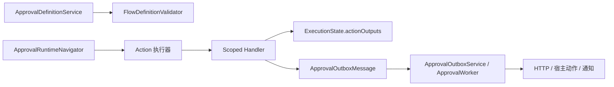

# Workflow Action Engine 实施与验收

基线 `4c1536beea032427323a15b22e02038e80079444`。实施状态以本文件末尾的实测记录为准。

## 范围与不变量

- 单个 Action 节点承载有序步骤，由同一执行器选择 Scoped Handler。JavaScript 负责受限计算，Mapping 负责声明式转换，复杂业务由宿主注册 C# Handler。
- 保留流程 Schema v1 的原有形状，Action 作为可选扩展，每种动作配置拥有独立版本。定义、发布、导入、比较和预演走现有入口。普通实例视图剥离动作配置。
- 同步步骤在审批命令的工作单元内执行。成功输出才进入 `StateJson`，可用于下游 Action 和 Condition。并行分支只能看到自己的上游输出，汇聚后可读已完成分支的输出。输出键在整份定义内唯一。
- 同步错误默认回滚。仅无写入副作用的 Handler 可选择 Continue。`OperationId` 重放使用既有命令记录。退回清除重新开放路径的输出，重新发起本轮从 Start 计算。持久化异步投递使用显式触发语义和稳定 ID。
- 外部写入提交后由现有单 Dispatcher 处理。Outbox ID 贯穿自动与人工重试，远端须以该键去重。独立发布或重试的外部结果不参与当前流程分支。
- SQL 只执行宿主注册的数据源和参数化查询，使用数据库只读身份。HTTP 凭证由宿主注入，连接时验证目标地址。通知复用站内消息和现有 `NotificationRequested`。
- 预演隔离实际 Handler 的副作用。权限沿用设计、发布、预演和 Outbox 管理的能力边界。

## 实施与门禁

1. Core。扩展 `FlowDefinition`、`FlowDefinitionValidator` 和 `ApprovalExtensionCatalog`，将执行接到 `ApprovalAutomaticTraversal` 的运行时回调。补齐旧实例、无效配置、回滚、并行、退回、幂等重放和预演测试。用 C# Handler → Condition 证明最小完整链路。
2. JavaScript 与 Mapping。Jint 以中央包管理锁定经核验版本，每次执行使用新的受限引擎和纯 JSON 上下文。脚本解析、执行、结果序列化共享取消和预算。Mapping 使用封闭转换规则，复用变量解析。测试沙箱、预算、数据转换和模拟。
3. HTTP、Outbox 与恢复。复用当前事件 ID、投递循环、退避及 Retry 权限。按模式/方法校验，持久化已绑定请求快照和凭证引用。禁止自动重定向或逐跳重复校验，连接绑定已校验地址。测试事务回滚、重启后投递、重试、幂等、SSRF、超时与体积限制。
4. SQL。宿主注册 `dataSource` / `queryId`、参数及边界。通过 `DbCommand` 参数绑定，限制读取行数、体积、超时和并发。将 Provider 测试接入现有 CI 矩阵。
5. Notification。将显式通知接到 `ApprovalEventWriter` 的接收人解析和消息/事件写入路径，测试多接收人、渠道、模板与去重。
6. 设计器、管理与宿主集成。同步 `contracts/`、`web/packages/approval-ui`、示例和 NuGet 消费者。动态配置从 `/meta` 读取，预览与诊断复用现有权限和页面。浏览器验收覆盖设计、发布、发起、自动执行和查看记录。
7. 全量验收。运行 `pwsh -NoProfile -File ./eng/verify.ps1`，核验契约生成差异。服务数据库在 GitHub Actions 按确切提交 SHA 验收。记录测试通过、失败、跳过数量及未执行检查，补齐动作模型、安全、Handler 开发、故障处理文档与可运行示例。

## 回滚与恢复

- 初始设计复用 `ApprovalInstance.StateJson`、`ApprovalLog` 和 `ApprovalOutboxMessage`。如出现新增表或索引需求，在实现前单独核对所有 Provider、Context 和 Migration 快照。
- 在部署旧二进制前停止发布和启动含 Action 的定义，完成仍绑定新定义的实例与待投递项。已发布定义和实例绑定按现有版本机制保留。人工重试复用原 Outbox ID。

## 实施记录

| 动作类型 | 后端 | 前端 | 代表性验证 | 状态 |
| --- | --- | --- | --- | --- |
| JavaScript | Jint 独立解释器、执行与结果预算 | CodeMirror、上下文插入、只读预演 | `Script_escape_or_exhaustion_rolls_back_and_a_new_engine_remains_usable` | 已实现 |
| HTTP | 精确 HTTPS 目标、DNS 连接校验、凭证解析、Outbox | 注册目标、方法、模式、请求配置 | `External_write_runs_after_commit_and_retries_with_same_id_and_payload`、`Exhaustion_and_manual_retry_preserve_original_id`、`Pending_http_action_survives_host_restart_with_original_input` | 已实现 |
| SQL | 宿主数据源、固定查询和参数类型、结果预算 | 数据源与查询 ID 联动、参数描述 | `Registered_query_binds_parameters_and_produces_bounded_rows`、`Sqlite_reads_multiple_computed_columns_without_using_blob_metadata` | 已实现，服务数据库矩阵待运行 |
| Mapping | 声明式转换、默认值、嵌套映射、数组过滤 | 源字段拖放、嵌套规则、自动预演 | `Script_and_mapping_run_in_order_and_simulation_matches_runtime_output` | 已实现 |
| Notification | 站内信和原有 `NotificationRequested` 事件 | 复用接收人编辑器、渠道和模板 | `Explicit_notification_uses_transactional_inbox_and_existing_event_route`、`Explicit_notification_rolls_back_both_routes_if_approval_completion_fails` | 已实现 |
| Custom C# | Scoped Handler、配置版本、变量绑定、同事务写入或异步投递 | 从 `/meta` 生成字段 | `Runs_in_order_and_routes_using_persisted_outputs`、`Step_failure_rolls_back_host_data_instance_audit_and_outbox`、`ScopedCustomActionFromNuGetPackage` | 已实现 |

### 架构与契约

- 新增 `ActionStep`、`IApprovalActionHandler`、`IApprovalActionPreviewHandler` 和宿主注册入口。现有业务、生命周期和事件 Handler 的职责保留。
- `ApprovalAutomaticTraversal` 仍统一驱动运行时和预演。输出存入 `StateJson`，审计用 `ApprovalLog`，异步投递用现有 Outbox。
- 流程协议继续使用 v1。生成的公共 API、OpenAPI、JSON Schema 和 TypeScript 契约包含动作和预演描述。数据库模型无需迁移。
- `Parallel_outputs_are_isolated_until_join_then_visible_together`、`Return_to_start_discards_previous_output_and_resubmit_recalculates` 和 `Replay_of_the_same_start_command_returns_original_instance_without_running_steps_twice` 覆盖输出可见性、退回和命令重放。

### 安全与恢复

- JavaScript 输入只包含 JSON，禁止 CLR 和动态字符串编译。脚本执行和输出受限。宿主显式启用计算动作。
- SQL 的流程配置不包含正文与连接凭证。安全性由注册式查询、参数绑定和数据库只读身份共同提供。SQLite 使用标量文本读取并校验字段长度。
- HTTP 目标由宿主批准，传输禁用重定向、代理和 Cookie。网络写请求仅提交后投递。凭证在发请求时读取，审批审计和 Outbox 摘要不记录凭证、载荷和响应正文。
- 设计元数据、定义发布、实例敏感审计和 Outbox 重试沿用独立授权能力。`Design_metadata_and_action_audit_are_visible_only_with_their_capabilities` 覆盖权限隔离。
- `Condition_cannot_inspect_clr_type_through_a_dynamic_action_output` 验证发布时拒绝动态值的 CLR 类型读取。合法的 `outputs.inventory.rows[0].quantity` 访问已通过实际求值。
- `Later_sync_failure_rolls_back_the_queued_http_action` 与 `Return_and_resubmit_keep_first_http_delivery_snapshot` 分别验证本地回滚和已入队请求的恢复语义。

### 部署限制

- 保持单应用实例和单 Dispatcher。远端接收方必须支持按 Outbox ID 去重。
- 真实 ERP 联调由宿主配置测试目标。浏览器验收覆盖实际审批和持久化入队，传输测试覆盖请求、HTTP 状态、自动和人工重试。
- 托管 Jint 用于受信任的流程设计者。服务数据库 CI 及真实环境试运行需要关联提交后验收。
- 通知预演展示配置的接收人规则及渲染后的内容。按角色展开实际接收人在正式执行时进行。异步管理页使用 Outbox 的创建、完成、重试次数和失败摘要字段，同步审计记录单步耗时。
- 脚本编辑器使用按需加载的 CodeMirror。打包消费者构建中的脚本编辑器 chunk 约 503 kB，gzip 后约 169 kB。

### 最终本地验证

在 `4c1536beea032427323a15b22e02038e80079444` 基线上验证工作区改动。

| 检查 | 通过 | 失败 | 跳过 |
| --- | ---: | ---: | ---: |
| Approval.Core.Tests | 661 | 0 | 0 |
| Approval.AspNetCore.Tests | 145 | 0 | 0 |
| Approval.Database.Tests（SQLite） | 87 | 0 | 0 |
| Certificate.Api.Tests | 59 | 0 | 0 |
| UI 与 Demo Vitest | 262 | 0 | 0 |
| 前端依赖边界测试 | 12 | 0 | 0 |
| 打包 Playwright | 12 | 0 | 0 |
| ReferenceHost 烟测 | 27 | 0 | 0 |

- `pwsh -NoProfile -File ./eng/verify.ps1` 通过。加入条件反射保护后，用 `pwsh -NoProfile -File ./eng/verify.ps1 -Scope Backend -SkipRestore`、`pwsh -NoProfile -File ./eng/verify-packages.ps1 -SkipBuild -RunBrowser` 和 `pnpm contracts:check --no-build`（在 `web/` 下）复验受影响范围，均通过。
- Release 构建为零警告、零错误。SQLite、MySQL、PostgreSQL 和 SQL Server 模型漂移检查通过。数据库矩阵项目的锁定还原通过。
- 独立 EmbeddedHost 的 19 项检查和 TestingHost 的 22 项检查通过。最终包与浏览器记录位于 `output/engineering/consumer-1af1f6e31ec644b2ad7875313571750f/`。
- 并行运行打包和后端的一次复验中，现有 `BulkSummaryConcurrentReplay_RevokedResourceAccessRejectsWithoutLeaks` 的一个用例触发 30 秒取消边界。隔离复跑 3 个用例及单独重跑完整后端门禁均通过。

### 最终验收

本地已验证旧流程、Action 流程发布、六类动作、采购示例、独立包及浏览器使用路径。采购示例验证了批准后才入队 ERP 请求，定向测试验证投递、自动重试、人工重试、回滚与重启恢复。MySQL、PostgreSQL 和 SQL Server 的服务数据库执行，以及真实 ERP 联调与试运行，待宿主和对应 CI 验收。
