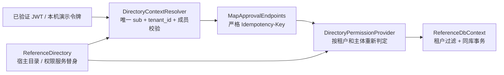

# 多租户参考宿主

业务无关的共享库表单审批 API，使用真实 `Approval.AspNetCore` 路由。`alpha` / `beta` 拥有相同的用户 ID、角色、流程键和提交键，初审为 `Reviewer`，终审为 `FinalReviewer`。没有业务台账依赖。



## 本机验收

在仓库根目录执行以下命令。脚本生成随机临时令牌、独立 SQLite 文件和端口，先执行迁移，再启动真实 Kestrel 进程，完成两个企业的初审/终审、原键重放及撤权/恢复授权。只停止自己启动的进程，保留报告和数据库。

```powershell
pwsh -NoProfile -File './eng/verify-reference-host.ps1'
```

结果位于 `output/reference-host/<runId>/smoke.json`。全部后端入口还运行两个独立宿主的 20 请求并发，以及四个 Provider 的模型漂移检查。

## 认证与第三方接入

默认生产认证为 JWT：通过安全配置提供 `Authentication:Authority`（HTTPS）和 `Authentication:Audience`。验证签名、发行者、受众、有效期后，要求唯一的 `sub` 和 `tenant_id`，并再次核对企业成员资格。`X-Tenant-Id` 和请求体不能覆盖归属。未配置认证中心时启动失败。

`ReferenceDirectory` 是配置驱动的权限服务替身。`DirectoryIdentityProvider`、`DirectoryTenantCatalog`、`DirectoryContextResolver` 和 `DirectoryPermissionProvider` 展示接入位置；实际宿主替换为自身 SDK/服务，并维持按作用域注册、当前权限判定及按企业的目录查询。框架不提供账户或登录中心。若外部服务还限制实例查询范围，另行实现 `IApprovalQueryScope` 及对应 `IApprovalArchiveQueryScope`。

`appsettings.Development.json` 只选择演示认证，不携带令牌。Development 中需从 user-secrets/环境提供 `Authentication:DemoIdentities:<index>:{Token,TenantId,UserId}`，每个令牌至少 32 字符且唯一，人员须已属于相应企业。演示认证在其他环境被拒绝。

演示控制台 `PUT /demo/grants/{userId}/{permission}` 接受 `{ "allowed": false/true }`；调用者须属于当前企业的 `AccessAdmin`，只能变更本企业成员的已知非系统权限。该路由只在演示认证中映射，不属于框架 OpenAPI。权限替身的修改存在单个进程内，重启会恢复配置；多实例生产宿主须连接统一权限服务，不能以此内存实现承诺跨进程撤权传播。

撤销 `approval.instance.start` 阻止新申请；已提交结果仍按 `approval.instance.read` 和资源范围取回。撤销读取权限后重放也拒绝。普通第三方允许不绕过审批资格、自审、企业过滤和字段限制。后台主体只获得投递、超时扫描、文件清理和维护运行四个系统权限。

## 数据库与迁移

`Database:Provider` 只接受 `Sqlite`、`MySql`、`SqlServer`、`PostgreSql`。连接由 `ConnectionStrings:Approval` 提供；三库使用与支持矩阵一致的 Provider，开启完整操作重试。MySQL 连接须显式使用 TLS、`CharSet=utf8mb4`；SQL Server 不开启 MARS。口令不要写进仓库或命令日志。

每个 Context 独立维护 `Migrations/<Provider>/`。`InitialReferenceApproval` 仅用于此参考宿主的**空库**，不能代替证照或既有宿主的迁移历史。升级既有宿主须保留原迁移链，停写、明确回填企业及业务占用，按[升级指南](../../docs/multitenancy.md)预检后追加自身迁移。

普通启动不建表、不迁移。明确选择数据库并配置认证/目录后执行：

```powershell
dotnet run --project 'samples/Approval.MultiTenant.Api' --configuration 'Release' --no-launch-profile -- --migrate
dotnet run --project 'samples/Approval.MultiTenant.Api' --configuration 'Release' --no-launch-profile
```

`Approval:EnableBackgroundServices` 默认 true，可在多实例中只开启指定 worker；维护和删除保持关闭。`Approval:FileRoot` 指向私有、持久化附件目录。`/health/approval` 匿名返回 `{ "ready": true/false }`，详细诊断仍需权限。反向代理须由真实宿主明确配置受信代理及 HTTPS 转发。

## 复验

```powershell
pwsh -NoProfile -File './eng/verify.ps1'
foreach ($provider in @('MySql', 'SqlServer', 'PostgreSql')) {
    pwsh -NoProfile -File './eng/verify-databases.ps1' -Provider $provider -SkipRestore -SkipBuild
    if ($LASTEXITCODE -ne 0) { throw ('数据库验收失败：' + $provider) }
}
```

三库契约使用参考宿主自己的新建/重跑/回退迁移，运行双租户完整审批及权限变化；既有数据库测试另行验证旧迁移升级和旧待办继续。完整证据、已验证范围及未演练项见[最终验收矩阵](../../docs/production-acceptance.md)。参考宿主为不可打包示例，不增加框架发布包。
