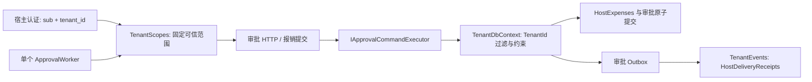

# 共享数据库多租户审批宿主

此示例演示一个应用实例、一个 SQLite 数据库、`alpha` / `bravo` 两个宿主租户。两个租户可以使用相同用户 ID、流程 Key、业务键和 Idempotency-Key。只引用 Core 与 ASP.NET Core 集成，未启用可选 Forms。



| 文件 | 宿主职责 |
| --- | --- |
| `TenantScopes.cs` | 租户目录、可信 claim 校验、不可变范围快照、AsyncLocal 安装与恢复、后台范围枚举 |
| `TenantIdentity.cs` | 当前操作人、租户内用户目录与显式权限、仅开发环境的 Demo 认证 |
| `TenantDatabase.cs` | 固定 DbContext 分区、非临时稳定 TenantId 值生成、匿名查询过滤、跨范围命令与写入拒绝、分区索引和外键 |
| `TenantApplication.cs` | HTTP 管道、带稳定键的报销提交、宿主数据与审批同一事务 |
| `ExpenseIntegration.cs` | 审批结束时更新宿主报销状态、按 Event.Id 保存事件接收记录 |
| `Migrations/` | 此宿主自己的 SQLite 初始迁移与 Snapshot |

## 运行

在仓库根目录执行。迁移是明确的宿主操作；API 启动不自动迁移、重置或清理数据库。

```powershell
dotnet run --project 'samples/Approval.MultiTenantHost/Approval.MultiTenantHost.csproj' --configuration 'Release' --no-launch-profile -- --environment 'Development' --migrate
dotnet run --project 'samples/Approval.MultiTenantHost/Approval.MultiTenantHost.csproj' --configuration 'Release' --no-launch-profile -- --environment 'Development' --urls 'http://localhost:5186'
```

默认数据库为执行目录下的 `approval-multitenant.db`，可通过 `ConnectionStrings__Approval` 环境变量或 `--ConnectionStrings:Approval` 配置覆盖。

另开终端执行完整 HTTP 演练：

```powershell
pwsh -NoProfile -File './samples/Approval.MultiTenantHost/smoke-test.ps1' -BaseUrl 'http://localhost:5186'
```

脚本为两个租户发布同一份 `expense-flow.json`，以相同业务键和操作键分别提交报销、重放请求、拒绝跨租户访问，再分别审批并检查宿主状态与事件接收记录。每次演练使用新业务意图，不删除已有数据。

## 示例凭据与 HTTP

Development 下的 Demo token 只用于演练，均来自 `appsettings.Development.json`：

- 甲公司管理员：`multitenant-demo-alpha-admin-0000000000000000`
- 甲公司申请人：`multitenant-demo-alpha-alice-0000000000000000`
- 甲公司审批人：`multitenant-demo-alpha-bob-0000000000000000`
- 乙公司用同样格式，将 `alpha` 换成 `bravo`。

认证将凭据映射为可信 `sub` 与 `tenant_id` claim；`X-Tenant-Id` 或请求正文不会选择租户。`alice` 能发起并查询自己的报销，`bob` 有审批权限，`admin` 有定义治理及当前租户的广泛查询权限。权限来自配置中的显式列表，不由角色名推断。

租户 ID 必须为 1–64 个非空白、非控制字符，目录中不能同时出现 `alpha` / `ALPHA` 这类仅大小写不同的条目。合法现有 ID（含大写或 Unicode）保持原样，可信 claim 必须精确匹配目录值；不自动 Trim、转小写或修改已有数据库中的 ID。非法配置在宿主构造时拒绝。共享 SQLite 使用默认 BINARY 比较；迁移到其他 Provider 时须核对宿主目录与数据库 collation 的比较语义。

基础审批使用 `/api/approval` 下已有的定义、任务、实例、Outbox 等 Endpoint。宿主补充：

- `POST /demo/expenses`：`Idempotency-Key` + `{ "businessKey": "EXP-001", "amount": 12 }`，业务与审批原子提交。
- `GET /demo/expenses`：当前租户内，申请人只看自己的报销。
- `GET /demo/deliveries`：需要当前租户的 `approval.outbox.read` 权限。
- `GET /health/approval`：匿名探针；在宿主提供的所有可用租户范围内检查数据库，仅返回整体 `ready`，任一失败或无可用范围返回 503。

相同租户/用户/业务键/操作键与相同正文返回同一结果；相同键与不同正文返回 Conflict。不同租户彼此独立。

## 宿主接入边界

生产配置默认使用 Jwt。必须配置 HTTPS Authority、Audience，由自己的身份提供者签发 `sub` 和 `tenant_id`，并替换示例租户目录。非 Development 环境拒绝 Demo 认证。

`ConfigureApprovalPartition()` 扩宽索引、非主键候选键与复合外键，GUID 主键保留。自然候选键及其引用一起分区，原全局候选键移除；存在未纳入分区的引用方（含主键关联和 Owned 关联）时拒绝配置。宿主提供 TenantId 属性、可信值生成与过滤；Core 统一配置分区不可变性、并发条件并校验分区写入。所有审批实体及 `Expense` / `DeliveryReceipt` 采用同一边界；已创建的 DbContext 不能切换租户，也不能移除分区查询过滤或修改实体 TenantId。

报销完成回调优先读取当前 DbContext 已跟踪的业务对象，因此“开始 → 结束”等提交时立即完成的流程也能原子保存业务与审批状态。回调不自行 SaveChanges 或提交事务；回调失败时业务行、审批、日志、Outbox 和本次操作键预约一起回滚。

TenantId 同时作为并发条件参与 UPDATE/DELETE；即使 Attach 的 ID 属于另一个租户，数据库也不会改到那条记录，整个 SaveChanges 事务会回滚。整个分区 DbContext 禁止任意 `IgnoreQueryFilters` 重载，包括从非分区实体发起的导航、Include、AutoInclude、组合查询与编译查询；非分区管理查询使用独立的非分区 Context。

分区 Context 的 EF 原生 SQL 入口与内置 `Sql` 工作流动作默认拒绝；普通宿主业务字段的批量操作保留查询过滤，批量修改分区字段拒绝。不能使用 DbContext Pooling。过滤器使用 `分区字段 == context.PartitionKey`，软删除等条件以 `&&` 组合；不允许 `OR` 放宽范围或只配置软删除过滤。租户作用域释放按嵌套顺序执行，重复释放无副作用。

此示例**不提供数据库 RLS**。直接 `GetDbConnection().CreateCommand()` 或独立数据库连接绕过 EF 拦截器；共享 SQLite 文件不能隔离同进程中持有连接的不可信代码。数据库级部署选项、权限要求及未覆盖边界见 [宿主数据分区](../../docs/host-data-partitioning.md#数据库级边界与部署前提)。生产验收不能仅以 EF 回归测试通过为依据。

事件接收记录与 Outbox 确认同事务提交。日志是演示输出；真实邮件/消息等外部副作用仍须按稳定 Event.Id 去重，不承诺跨系统 exactly-once。仅有一个 ApprovalWorker，逐租户处理 Outbox 和超时扫描。一个运行期分区失败不会阻断其他分区，整轮心跳记为失败。

示例只提供 SQLite 驱动与迁移。共享 MySQL、SQL Server、PostgreSQL 的宿主可复用接入方式，但必须创建自己的 Provider Migration 并在相应环境验收。本示例不提供独立租户数据库模式。

## 验证

```powershell
dotnet test 'tests/Approval.AspNetCore.Tests/Approval.AspNetCore.Tests.csproj' --configuration 'Release' --filter 'FullyQualifiedName~MultiTenantHostTests' --verbosity 'minimal'
dotnet ef migrations has-pending-model-changes --project 'samples/Approval.MultiTenantHost/Approval.MultiTenantHost.csproj' --configuration 'Release'
pwsh -NoProfile -File './eng/verify.ps1' -Scope 'Backend'
```

测试覆盖 A/B 共享数据库隔离、同键重放与内容冲突、审批业务回调、越权/非法 claim 拒绝、跨租户 FK 拒绝、失败事务无部分写入、编译查询下的 Context 切换拒绝、实际 Outbox 分区失败恢复及显式同步的并发请求。

回归测试还覆盖 detached 实体的跨租户更新/删除与事务回滚、同租户 detached 写入，以及组合/命名/编译查询的过滤器移除拒绝。SQLite 初始迁移的 Snapshot/Designer 同步记录 TenantId 并发元数据，数据库列与 DDL 无变化。
